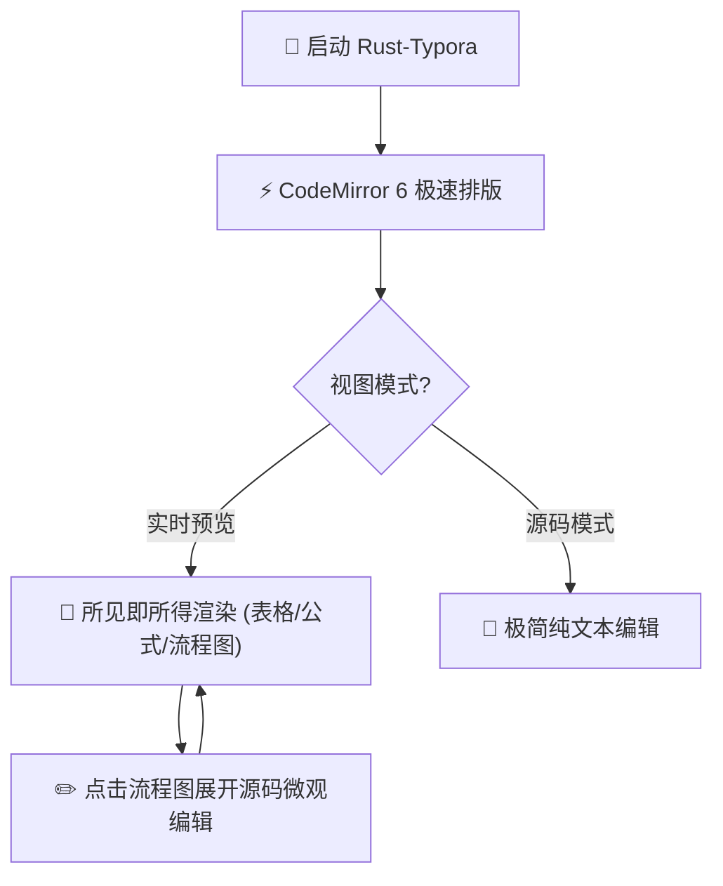

# 🚀 欢迎使用 Rust-Typora (极速进化版)

这是一个基于 **Rust + Tauri v2 + CodeMirror 6** 深度打造的现代化 Markdown 所见即所得编辑器。

## 🌟 核心突破与 Typora 人性化体验

- **Token 级微观局部展开 (Micro-expansion)**：光标仅在进入特定单词标记（如 **加粗**、*优雅斜体*、***加粗斜体***、`行内代码`、公式 $E = mc^2$）内部时才展开源码，同行其他元素各自保持优雅渲染！
- **可视化表格内联编辑 (In-Place Table Editor)**：告别 ASCII 乱码！表格自始至终是标准表格，点击单元格直接打字，按 `Tab` 跳格，悬浮小工具条一键增减行列与对齐！
- **Mermaid 流程图矢量渲染**：支持 ```mermaid 语法自动生成优雅流程图，点击图表即可展开源码编辑（视口锚点锁定，杜绝跳屏）！
- **多语言代码块卡片**：支持主流语言语法高亮、右上角语言标签与【一键复制代码】。
- **全链路图片资产与拖放管道**：支持截图 `Ctrl+V` 自动在本地 `assets/` 落盘并插入，外部图片/文件直接拖入编辑器即可导入！

---

## 📐 体验 1：可视化交互表格 (点击即可直接输入)

点击任意单元格直接打字；按 `Tab` 键自动跳往下一格，在最后一格按 `Tab` 自动新增一行：

| 模块名称 | 核心语言 | 职责说明 | 性能指标 |
| :--- | :---: | :--- | ---: |
| Rope Core | Rust | 文档缓冲原子持久化 | < 1ms |
| Micro Live View | TypeScript | Token 级微观局部展开 | 60 FPS |
| Visual Table | CSS/DOM | 可视化表格内联双向同步 | 即时响应 |
| Mermaid Engine | Mermaid.js | 响应式矢量流程图渲染 | 即时响应 |

---

## 📊 体验 2：Mermaid 流程图渲染 (点击即刻微观编辑)



---

## 📐 体验 3：多语言代码块卡片 (右上角一键复制)

```rust
fn main() {
    println!("Hello, Rust-Typora!");
    let rope = ropey::Rope::from_str("极速 Markdown 所见即所得引擎");
    println!("文档字数: {}", rope.len_chars());
}
```

---

## 📐 体验 4：数学公式与行内排版

- 质能方程：$E = mc^2$
- 行内斜体测试：*星号斜体 (Italic)* 与 _下划线斜体 (Underline Italic)_ 与 ***加粗斜体 (Bold Italic)***
- 高斯正态分布积分公式：
$$
\int_{-\infty}^{\infty} e^{-x^2} dx = \sqrt{\pi}
$$

---

## 📌 体验 5：优雅引用块与快捷操作

> 游戏核心定位:
> 一款以“商业视讯勘察、口供搜证填表、双轨逻辑质询、击破老板执念”为核心体验的黑色幽默直播打假/救市 Rogue-lite 策略游戏。

> 快捷操作指南:
> - 快捷键速查指南：按 `F1` 随时呼出全量快捷键指南卡片
> - 标题快速切换：按 `Ctrl+1~6` 或 `Ctrl+Alt+1~6` 快速切换标题，按 `Ctrl+0` 恢复正文
> - 撤销与重做：按 `Ctrl+Z` 撤销，按 `Ctrl+Y` 或 `Ctrl+Shift+Z` 重做
> - 视图即时切换：点击底部状态栏 `</>` 或按 `Ctrl+/` 即时切换，无需二次点击
> - 独立汉堡菜单：点击左上角 ☰ 仅呼出主菜单（不再重复触发侧边栏）
> - 侧边栏拖拽：鼠标拖拽侧边栏右侧边缘可随意调节宽度 (180px - 550px) 并自动保存
> - 窗口原生控制：支持置顶锁定、最小化、最大化与退出
