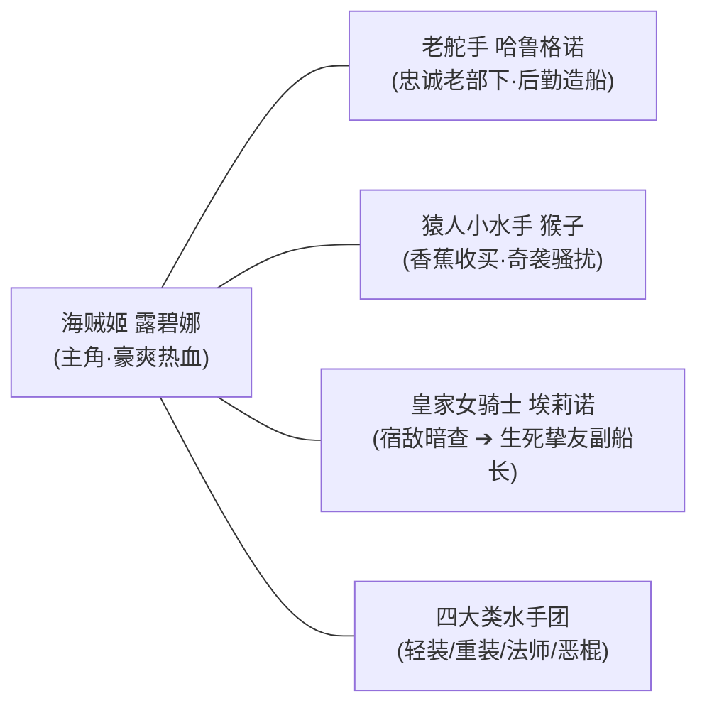
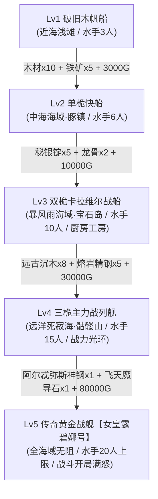
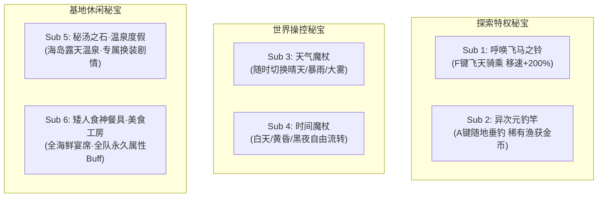

# 🏴‍☠️《Artemis Pearl ~海盗姬露碧娜与梦幻秘宝~》全剧情脉络·全结局·全支线秘宝·全要素100%终极攻略

> **作品原名**：Artemis Pearl ~Pirate Princess Rubina and the Mystical Treasure~（阿尔忒弥斯之珠 ~海盗姬露碧娜与梦幻秘宝~ / アルテミスパール）  
> **制作社团**：柴犬制作组（シバイヌ開発 / WOLF RPG Editor 2.20 Pro）  
> **作品类型**：大航海探索冒险 / 策略经营RPG / 战败社保恶堕 / 奇幻喜剧 / 姬骑士羁绊  
> **主角身份**：露碧娜（Rubina / Luvina）——传奇大海贼老船长之女、打工十年终买下破帆船扬帆起航的新生代海盗姬  
> **全要素状态**：✅ **包含全5章主线剧情通关详解、十年前老船长冤案完全昭雪真结局【金色黎明】、全6大核心支线功能秘宝获取法、海贼船Lv1~Lv5改造工坊、四大水手类型谈判与暴动控制、全赏金首通缉犯猎杀、全21幕CG回想100%全收集与回想部屋全开指引**

---

## 📑 目录导航
1. [作品总览与世界观背景揭秘](#一作品总览与世界观背景揭秘)
   - [十年前的大海难与骑士团的黑暗阴谋](#1-十年前的大海难与骑士团的黑暗阴谋)
   - [四大核心登场角色与海贼团成员图鉴](#2-四大核心登场角色与海贼团成员图鉴)
   - [梦幻秘宝：阿尔忒弥斯珍珠（Artemis Pearl）之谜](#3-梦幻秘宝阿尔忒弥斯珍珠artemis-pearl之谜)
2. [核心按键操作与特殊秘宝系统](#二核心按键操作与特殊秘宝系统)
   - [大地图快捷键与特权秘宝列表（Z/X/C/F/A/D）](#1-大地图快捷键与特权秘宝列表zxcfad)
   - [黄金之眼（Golden Eye）寻宝与足迹追踪机制](#2-黄金之眼golden-eye寻宝与足迹追踪机制)
   - [狮鹫之翼（Griffin Wing）与港口即时传送机制](#3-狮鹫之翼griffin-wing与港口即时传送机制)
3. [海贼船改造工坊与水手管理系统](#三海贼船改造工坊与水手管理系统)
   - [海贼船 Lv1 ~ Lv5 五阶段改装升级清单与海域解锁](#1-海贼船-lv1--lv5-五阶段改装升级清单与海域解锁)
   - [四大水手职业特性与酒馆谈判招募技巧](#2-四大水手职业特性与酒馆谈判招募技巧)
   - [暴动度（Mutiny Gauge）产生根源与宴会平息策略](#3-暴动度mutiny-gauge产生根源与宴会平息策略)
4. [全五章主线剧情与BOSS战全流程攻略](#四全五章主线剧情与boss战全流程攻略)
   - [序章 / 第1章：【初航与出海的试炼】（收集木材与猴子水手）](#1-序章--第1章初航与出海的试炼)
   - [第2章：【豚镇与受诅咒的秘宝】（兽人化异变与万能钥匙解咒）](#2-第2章豚镇与受诅咒的秘宝)
   - [第3章：【海贼船的危机与宝石洞穴】（水手叛乱与女骑士坠崖交心）](#3-第3章海贼船的危机与宝石洞穴)
   - [第4章：【骷髅山的真相与决死羁绊】（骸骨蠕虫之战与骑士团秘辛）](#4-第4章骷髅山的真相与决死羁绊)
   - [第5章：【终焉海怪与十年前的大决战】（阿尔忒弥斯之珠共鸣弑神）](#5-第5章终焉海怪与十年前的大决战)
   - [真结局：【金色黎明】（沉冤昭雪与双人并肩副船长）](#6-真结局金色黎明the-golden-dawn)
5. [全6大核心支线秘宝（Sub 1 ~ Sub 6）全获取指引](#五全6大核心支线秘宝sub-1--sub-6全获取指引)
   - [Sub 1：呼唤飞马之铃（大地图200%极速坐骑）](#sub-1呼唤飞马之铃pegasus-bell)
   - [Sub 2：异次元钓竿（全水域垂钓与深海遗宝）](#sub-2异次元钓竿dimensional-rod)
   - [Sub 3：天气魔杖（自由操控暴风雨与专属魔物）](#sub-3天气魔杖weather-wand)
   - [Sub 4：时间魔杖（黑夜黑市与暗夜死灵触发器）](#sub-4时间魔杖time-wand)
   - [Sub 5：秘汤之石与温泉度假（露碧娜女骑士温泉换装）](#sub-5秘汤之石与温泉度假hot-spring)
   - [Sub 6：矮人食神餐具与海鲜美食工坊（全队永久全属性强化）](#sub-6矮人食神餐具与海鲜美食工坊)
6. [全赏金首通缉令（Bounties）分布与击杀弱点](#六全赏金首通缉令bounties分布与击杀弱点)
7. [全21幕CG回想事件（CG_AP_001 ~ 021）100%全收集指南](#七全21幕cg回想事件cg_ap_001--021-100全收集指南)
   - [回想事件清单与触发场景/战败条件详析](#1-回想事件清单与触发场景战败条件详析)
   - [通关后【回想之房】（Memory Room）与一键全开方法](#2-通关后回想之房memory-room与一键全开方法)
8. [实用推图技巧与高效率刷钱/素材心得](#八实用推图技巧与高效率刷钱素材心得)

---

## 一、作品总览与世界观背景揭秘

### 1. 十年前的大海难与骑士团的黑暗阴谋
在亚托拉尼亚大洋（Atlania Ocean）的浩瀚群岛中，曾流传着“传奇义贼老船长”的威名。十年前，老船长率领舰队驰骋七海，仗义疏财，深得平民与渔民爱戴。然而，一场突如其来的灭世浩劫降临——远古深海海怪**克拉肯（Kraken）**从大洋海沟的地幔裂隙中复苏，掀起滔天海啸，沿海城邦与王国舰队死伤殆尽。
* **被掩盖的历史真相**：面对灾难，骄傲的王国皇家骑士团主力舰队吓破了胆，抛弃平民落荒而逃。老船长为了阻击巨兽、保卫群岛万千生灵，毅然率领自己的海贼团在风暴中独战巨兽数天数夜。最终老船长以肉身引爆旗舰动力核心，与克拉肯同归于尽，将巨兽重创封印于亚托拉尼亚大漩涡深处。
* **骑士团的卑劣诬陷**：战后，逃跑的王国骑士团高层为掩饰懦弱贪生之过并侵吞战功，向枢密院与全大陆谎报军情，将老船长污蔑为“勾结深海魔物、引发大海难的极恶大海贼”，并声称巨兽是被骑士团英勇讨伐。自此，老船长的名号背负上了十年的莫须有骂名。
* **少女的十年誓约**：露碧娜当时尚幼，亲睹父亲被扣上恶贼之名。为了洗清父亲的奇冤，重拾海盗家族的荣光，露碧娜孤身一人在码头酒馆、船坞洗甲板、搬运重物，苦苦打工整整十年，受尽嘲笑与白眼。终于在十年后的今天，她攒齐了积蓄，在老家码头买下了一艘二手破木船，握着父亲留下的唯一遗物——【黄金之眼】，正式扬帆起航！

### 2. 四大核心登场角色与海贼团成员图鉴

* **露碧娜（Rubina / Luvina）**：
  本作女主角。金发红瞳的海贼姬，头戴插着鲜艳羽毛的大海盗帽，腰悬短铳与快刀。性格乐观坚韧、恩怨分明、行事大大咧咧但对待同伴极重情义。自小被父亲灌输海贼的自由信念，对所谓“正规军骑士团”的虚伪作风深恶痛绝。持有老船长的秘宝【黄金之眼】，能窥破一切隐蔽痕迹。
* **哈鲁格诺（Harugno）**：
  海盗团的灵魂支柱，曾经侍奉老船长的忠勇老海兵兼大管家。在露碧娜打工的十年间一直在暗中默默看护她。当露碧娜买下小船出航时，哈鲁格诺立刻以大副与舵手身份加入。他不仅负责海贼船的五阶改装、委托告示板管理，还把珍藏的【狮鹫之翼】交托给露碧娜。
* **猿人水手·小猴子（O-Saru）**：
  露碧娜在孤岛海滩遭遇的奇特原始人猴子。身手敏捷、灵性十足但极度贪吃且有点好色。在露碧娜用香蕉“贿赂”后，死心塌地成为船上的一号水手。在战斗中擅长扔投投掷物、偷取敌方弱点道具、翻越悬崖机关。
* **埃莉诺（Eleanor / 王国骑士团女调查官）**：
  王国皇家骑士团的高级女调查官、年轻有为的姬骑士。身着银白骑士轻甲，佩戴西洋剑。奉上峰密令“缉捕并严密监视大海贼余孽露碧娜”。前期一直伪装潜伏在露碧娜周围，认为海盗皆为亡命歹徒，暗中挑拨水手甚至设置绊子。然而在与露碧娜双双跌落深邃的【宝石结晶洞窟】后，被露碧娜舍命相救打动；得知老船长牺牲的惊天真相后，内心信仰崩溃，转而坚决站到露碧娜身边，最终辞去骑士团职位成为【女皇露碧娜号】唯一的副船长。

### 3. 梦幻秘宝：阿尔忒弥斯珍珠（Artemis Pearl）之谜
传说中由海洋女神阿尔忒弥斯所赐福的至高神器。它拥有唤醒万物生机、汇聚纯粹羁绊力量的奇迹权能。在十年前的战斗中，老船长曾试图用它净化海怪，但因魔力不足只能同归于尽。如今，珍珠沉睡在被封印的古代沉船【方舟之王座】中，只有心怀至纯守护之愿与拥有真正同伴羁绊之誓的人，才能激发阿尔忒弥斯珍珠的弑神神光。

---

## 二、核心按键操作与特殊秘宝系统

本作在传统RPG基础上融合了极高自由度的开放海域探索与地图交互系统，大量快捷键与功能秘宝极大地提升了跑图与搜刮体验：

### 1. 大地图快捷键与特权秘宝列表
| 按键 | 功能说明 | 对应系统 / 秘宝要求 | 核心用途与实战技巧 |
| :--- | :--- | :--- | :--- |
| **`Z` / `Space`** | 调查 / 互动 / 寻宝 | 基础按键 + 【黄金之眼】 | 调查NPC、开启宝箱、在闪光处挖掘宝藏、显现脚印踪迹 |
| **`X` / `Esc`** | 主菜单 / 取消 | 基础按键 | 查看角色属性、装备、道具、水手编制、当前通缉令 |
| **`C` / `Shift`** | 冲刺奔跑 | 移动系统 | 大地图与迷宫常驻2倍速跑步，逃离明雷怪物追击 |
| **`F` 键** | 呼唤飞马极速骑乘 | 核心秘宝【呼唤飞马之铃】 | **大地图移动速度飙升200%**，越过浅滩、沼泽等泥泞地形障碍 |
| **`A` 键** | 异次元即时垂钓 | 核心秘宝【异次元钓竿】 | 在任何水边直接抛竿，钓取稀有海产、强化珍珠、深海古金币 |
| **`D` 键** | 向导妖精提示 | 任务引导系统 | 迷茫时按下，自动弹出下一步主线目标、未探索洞窟与赏金首线索 |
| **背包常驻** | 瞬间回船 / 城镇传送 | 核心道具【狮鹫之翼】 | 迷宫内部或大地图一键脱离，直接瞬间返回海贼船基地或港口 |

### 2. 黄金之眼（Golden Eye）寻宝与足迹追踪机制
* **高亮隐藏足迹**：在第2章豚镇追踪半兽人、第4章追踪骷髅山幽灵踪迹时，靠近特定区域画面会有金色瞳孔闪烁提示，调查发光点可锁定敌人巢穴与密门。
* **伪装与隐藏宝箱**：大地图各岛屿隐蔽角落存在透明/埋入地底的古代宝箱，装备黄金之眼后地表会出现金黄微光，直接调查即可挖掘出高阶饰品与技能书。

### 3. 狮鹫之翼（Griffin Wing）与港口即时传送机制
* 由老管家哈鲁格诺在第1章末期赠予，无论身处多么危险的迷宫底层，只要未处于战斗中，均可打开背包使用【狮鹫之翼】瞬间脱出，绝不会陷入死档或卡关危机。

---

## 三、海贼船改造工坊与水手管理系统

海贼船不仅是露碧娜的航行载具，更是移动的海上基地。随着海贼船升级，船内功能空间不断拓展，还能解锁远洋深海区域的通航权。

### 1. 海贼船 Lv1 ~ Lv5 五阶段改装升级清单

* **Lv1 破旧木舟（初始）**：
  - 解锁条件：序章收集【木材×7】修补船身。
  - 属性容量：容纳水手3人，仅限初始小岛与近海浅滩。
* **Lv2 单桅武装快船**：
  - 所需材料：金币 3,000G + 优质木材×10 + 铁矿石×5。
  - 开放海域：迷雾外海、商业海岛【豚镇】。水手容量扩充至6人。
* **Lv3 双桅卡拉维尔巡航舰**：
  - 所需材料：金币 10,000G + 秘银锭×5 + 强化龙骨×2。
  - 开放海域：暴风雨频发带、璀璨群岛【宝石结晶洞窟】。水手容量提升至10人。
  - **船内新设施**：船内开放【料理厨房】（可入驻矮人主厨）与【装备工坊】。
* **Lv4 三桅主力重装战列舰**：
  - 所需材料：金币 30,000G + 远古沉木×8 + 熔岩精钢×5。
  - 开放海域：黑风死寂海、遗迹禁区【骷髅山】。水手容量提升至15人。
  - **舰队被动**：全员出战基础攻击力+15%，暴击率+10%。
* **Lv5 传奇黄金战舰【女皇露碧娜号】（终极形态）**：
  - 所需材料：金币 80,000G + 阿尔忒弥斯神钢×1 + 飞天魔导石×1。
  - 开放海域：大洋深处终焉大漩涡【亚托拉尼亚圣船方舟】。水手容量上限达到20人。
  - **舰首撞角与神力加持**：免疫一切漩涡与暗礁伤害，在海上航行速度翻倍；进入战斗时露碧娜全员怒气槽初始全满！

### 2. 四大水手职业特性与酒馆谈判招募技巧
在各个港口酒馆中，露碧娜可以招募形形色色的水手壮大队伍。招募时需选择谈判策略：
1. **轻装水手（Scout Sailor）**：
   - 特点：敏捷极高、回避率优异、多段轻击。在派遣任务中耗时最短，适合日常搜集木材与食材。
   - 谈判策略：选择“提供探险分成”，以冒险梦想打动，成功率最高。
2. **重甲力士（Heavy Bruiser）**：
   - 特点：血厚防高、自带群体嘲讽与眩晕重击。在探索中能为露碧娜砸开挡路的巨石暗礁。
   - 谈判策略：选择“展现豪爽腕力”或“奉上美味大块猪排”，容易以低价雇佣。
3. **法师水手（Arcane Navigator）**：
   - 特点：高群体魔法爆发，掌握火、冰、雷多系元素法术，能针对特定属性弱点的BOSS。
   - 谈判策略：选择“资助魔法研究经费”（消耗一定金币）即可招募。
4. **恶棍海盗（Rogue Marauder）**：
   - 特点：高暴击撕裂与盗窃技能，击杀怪物额外掉落金币与战利品。
   - 谈判策略：选择“以金币直接砸脸”，只要赏金到位即可效忠。

### 3. 暴动度（Mutiny Gauge）产生根源与宴会平息策略
* **暴动度累积原因**：
  1. 长期在海上航行未靠港补给（每航行100海里累积5点）；
  2. 露碧娜推行严格纪律，禁止在战斗执勤期酗酒；
  3. 积欠水手薪水或战斗遭遇连续挫败。
* **暴动爆发的后果**：
  - 暴动度达到100%时，停泊时会触发【水手暴乱叛变】事件，露碧娜将被水手逼入死角（若处理失败会触发战败CG回想）。
* **平息与重置方法**：
  - 在港口酒馆或船内举办【果汁与无酒精朗姆酒狂欢派对】（消耗食材与酒水，每次花费500G），暴动度直接清零，并使全体水手攻击力在未来数场战斗中提升20%！

---

## 四、全五章主线剧情与BOSS战全流程攻略

### 1. 序章 / 第1章：【初航与出海的试炼】
* **剧情提要**：
  经过十年打工攒钱，露碧娜在码头老船坞接手了一艘破木船。忠诚的老舵手哈鲁格诺已等候多时。为了能扬帆出海，首先要收集修船木材。
* **流程攻略**：
  1. 在码头与哈鲁格诺对话，领取任务【修葺破旧海贼船】。
  2. 离开码头进入初始小岛的【绿风森林】。在林地各闪光树桩处搜集【优质木材×7】。
  3. 途中在海滩触发遇险事件：遭遇正在偷窥的原始人【小猴子】。猴子龇牙咧嘴阻拦道路，露碧娜掏出随身携带的【香甜香蕉】喂给猴子。猴子大喜过望，当即翻滚抱大腿，正式成为海贼团一号先锋水手！
  4. 顺着山道探索至深处，发现【哥布林洞窟】。洞窟内有哥布林哨兵巡逻，利用猴子引开注意或正面迎战。
  5. **BOSS战：哥布林酋长（Goblin Chieftain）**：
     - 特性：擅长呼唤2只投石哥布林，蓄力发动旋风棒击。
     - 打法：先用猴子的【猴子投掷】打断后排杂兵，露碧娜集中使用【居合斩】迅速清理杂兵，随后在BOSS蓄力红圈提示时使用防御，破招后爆发输出将其击倒。
  6. 战后在宝箱中获得【古老航海图残片（其一）】。
  7. 返回码头将木材交给哈鲁格诺，海贼船完成翻新（达到Lv1）。哈鲁格诺赠予露碧娜至宝【狮鹫之翼】。
  8. 此时阴影处，皇家骑士团女调查官埃莉诺正冷眼打量着扬帆起航的露碧娜：“大海贼的女儿吗……就让我看看你打着什么幌子。”

### 2. 第2章：【豚镇与受诅咒的秘宝】
* **剧情提要**：
  舰队顺着洋流抵达第二座以猪肉养殖和美味火腿闻名的富饶岛屿【豚镇】（Pork Town）。然而平日里熙熙攘攘的城镇此刻死气沉沉，街道上游荡的竟然全都是面容狰狞、体型硕大的凶残半兽人（Orc）！
* **流程攻略**：
  1. 进入镇公所废墟，从幸存的老镇长口中得知：镇上原本供奉的一件祖传秘宝突然散发妖异紫光，导致全体居民与猪群被诅咒污染，心智狂化变异成了半兽人狂战士。
  2. 按下 `Z` 键激活【黄金之眼】，地面显现出狂乱的半兽人蹄印与残留魔力尾迹。
  3. 顺着足迹一路向东，穿过【炽热岩浆溶洞】。沿途半兽人怪物体力极高，注意利用冰属性魔法卷轴克制。
  4. 深入溶洞核心祭坛，遭遇罪魁祸首——狂化的半兽人大酋长。
  5. **BOSS战：狂暴兽人战帅（Orc Warchief）**：
     - 特性：血量低于50%时狂暴化，攻击力提升100%，附加击晕重踏。
     - 打法：猴子使用【沙尘致盲】降低其命中率；露碧娜保持【海盗轻灵步】提升自身闪避，在BOSS狂暴回合交出减伤技能，利用重甲水手的盾击打出硬直后合力绝杀。
  6. 击倒战帅后，夺回被暗黑魔力侵蚀的核心秘宝【欲望魔猪金币】。
  7. 露碧娜掏出父亲遗留的【万能解咒钥匙】刺入金币孔穴，神圣金光绽放，诅咒被彻底净化！
  8. 金光席卷全岛，全镇变成半兽人的居民和家猪齐刷刷恢复原貌。小镇居民狂欢庆祝，送上丰厚谢礼、大批朗姆酒与【古老航海图残片（其二）】。露碧娜“义贼海盗姬”的仁义声名开始在群岛不胫而走。

### 3. 第3章：【海贼船的危机与宝石洞穴】
* **剧情提要**：
  出海数周后，由于长时间海上巡弋以及露碧娜严格禁止战时饮酒，船上水手内部滋生了怨气。潜伏已久的埃莉诺抓住机会，暗中挑拨水手宣称露碧娜不过是把他们当炮灰的贪婪海盗，导致水手突发叛乱。
* **流程攻略**：
  1. 露碧娜在甲板上面对暴动水手，正欲陈述利害，海上突发万丈狂澜——罕见的大海龙卷风与海蚀暗流席卷整艘船。
  2. 混乱中，露碧娜与潜伏的埃莉诺双双被巨大的漩涡吞噬，落入人迹罕至的死地——【宝石结晶洞窟】（Jewel Cavern）。
  3. 两人从潮湿冰冷的溶洞浅滩苏醒。埃莉诺佩剑已失，右脚踝在坠落中严重骨折扭伤。
  4. 四周窸窣作响，洞窟深处涌出成群泛着晶莹磷光的剧毒异种【宝石史莱姆】（Jewel Slimes）与触手怪。
  5. 埃莉诺本以为露碧娜会弃自己于不顾甚至借机报复，未料露碧娜毫不犹豫地撕破心爱的海盗披肩长裙，细心地为埃莉诺正骨包扎，并拔刀护在埃莉诺身前。
  6. 两人背靠背深入洞窟寻找出路，埃莉诺以战术眼光指引魔物弱点，露碧娜冲锋陷阵。
  7. 抵达晶石祭坛，迎战盘踞于出口的洞穴主宰。
  8. **BOSS战：深渊宝石晶核主宰（Crystalline Core Beast）**：
     - 特性：体表覆有高硬度宝石甲壳，物理防御极高，定期释放晶石穿刺与黏液束缚。
     - 打法：利用震击技能击碎其晶壳弱点部位；当晶核暴露时，埃莉诺用残余剑气破防，露碧娜全力施展火铳爆破射击将其彻底粉碎。
  9. **羁绊升华与脱险**：
     - 战后两人坐在晶石光芒下休整。埃莉诺终于忍不住质问露碧娜为何要冒死当海盗。露碧娜眼含热泪吐露了十年来父亲被冤杀、自己打工受辱只为查明真相的心声。
     - 埃莉诺内心剧烈震动，坦言骑士团官方记录漏洞百出，并为自己煽动水手叛乱的狭隘行径感到羞愧万分。
     - 洞口被巨石封死无法攀爬，露碧娜微笑着取下帽子上的【狮鹫之羽】（与船上的狮鹫之翼存在共鸣传送），二人紧紧相拥，在白色羽光中双双瞬间传送回海贼船甲板！
  10. 回到船上后，埃莉诺亲自站出来当众痛斥叛乱挑唆者，洗清误会。露碧娜开怀大笑，宣布当晚破例举办【全船不限量果汁朗姆酒盛宴】。众人同欢，水手们心悦诚服，海贼团空前团结！

### 4. 第4章：【骷髅山的真相与决死羁绊】
* **剧情提要**：
  航海图指引露碧娜前往群岛极北的诅咒禁地——堆满无数古战场遗骸的【骷髅山】（Skull Mountain）。这里不仅栖息着极度危险的不死魔物，更是当年老船长在决战前最后留存机密航海日志的地方。
* **流程攻略**：
  1. 驾驶升级至 Lv3 以上的双桅战船破浪航行，穿过弥漫毒瘴的死寂海，登上白骨皑皑的骷髅山岛。
  2. 在山脚营地，埃莉诺向露碧娜全盘托出了骑士团最高机密文档：十年前，正是皇家骑士团副团长为了贪图功名，不仅逃离战场，战后更伪造军情，将老船长的救世功绩全部抹杀并污蔑为恶魔。埃莉诺握紧露碧娜的手：“如果揭发真相，我们面对的将不仅是魔物，而是整个王国的暗杀部队……即便如此，你也要去吗？”露碧娜拔剑指天：“我绝不会让父亲的灵魂在大海深处哭泣！”
  3. 开启【黄金之眼】侦测古代海盗密道，避开致命的落石与白骨陷阱。
  4. 登上骷髅山山巅祭坛，老船长留下的青铜宝箱赫然在目。然而在大地轰鸣声中，沉睡了数百年的远古尸骸巨兽破土而出！
  5. **BOSS战：远古巨大骸骨蠕虫（Ancient Death Worm）**：
     - 特性：体积极其庞大，具备【剧毒腐蚀吐息】与【地刺崩塌】全屏大招。
     - 战况：战斗进行至第二阶段，蠕虫释放濒死毒刺偷袭露碧娜，埃莉诺奋不顾身飞身格挡，替露碧娜挡下剧毒尖刺重伤倒地！
     - 露碧娜进入【极意怒火】状态，全属性大幅提升。使用连续【海盗极意斩】强攻巨虫头部核心晶核，将其庞大的骨骼彻底震碎轰塌！
  6. 露碧娜抱住奄奄一息的埃莉诺，立刻灌入秘宝圣药为她逼出剧毒。埃莉诺苏醒后，二人十指相扣，埃莉诺正式誓言效忠：“露碧娜……从今往后，我的剑就是你的盾，直到世界尽头。”
  7. 打开青铜宝箱，取得【老船长的最后密信】与开启亚托拉尼亚大漩涡封印的最后信物——【海皇太阳印章】。

### 5. 第5章：【终焉海怪与十年前的大决战】
* **剧情提要**：
  将海贼船升级改装至最高阶，舰队迎着万道雷霆，驶入终焉风暴的中心——亚托拉尼亚大漩涡。大漩涡中心悬浮着十年前被封印的古代神话方舟遗迹。
* **流程攻略**：
  1. 驾驶黄金战舰冲破狂暴的海上龙卷与漩涡暗流，成功靠泊在方舟王座外殿。
  2. 使用【黄金之眼】扫描方舟壁画，老船长十年前引爆自身战舰、力抗滔天巨浪的英烈幻影浮现眼前。
  3. 穿过殿堂，抵达中央封印之池。中央神龛上，散发着七彩圣洁光晕的梦幻秘宝——【阿尔忒弥斯珍珠】静静悬浮！
  4. 就在露碧娜触碰珍珠的刹那，漆黑的大海瞬间沸腾，深渊裂隙撕裂开来，沉睡了十年的远古灭世海神——**克拉肯（The Ancient Kraken）**咆哮而出！遮天蔽日的万千触手将整个方舟包围！
* **终极BOSS决战：灾厄终焉巨兽·克拉肯（Resurrected Kraken）**：
  战斗分为三大激战阶段：
  - **Phase 1：狂暴深海巨触手（Kraken Tentacles）**
    - 机制：Boss伸出4根属性各异的巨大触手（酸蚀、重碾、雷光、冰霜）。
    - 对策：由猴子利用投掷物破除触手护盾，法师水手释放火系高阶禁咒群攻，露碧娜逐一精准斩断4根触手本体。
  - **Phase 2：深渊核晶与惊涛骇浪（Abyssal Core Surge）**
    - 机制：本体浮出水面，核心闪耀暗黑紫光，蓄力准备释放秒杀技【大洋终结巨啸】（倒计时3回合）。
    - 对策：埃莉诺开启【女武神守护结界】提供全员50%高额减伤与免死Buff；露碧娜与哈鲁格诺使用船炮全力轰击核心，打断巨兽蓄力。
  - **Phase 3：终焉神灭态·阿尔忒弥斯珍珠共鸣（Final Awakening）**
    - 机制：克拉肯身躯化为通天彻地的黑雾恶神姿态，全场陷入无尽黑暗。
    - 剧情爆发：露碧娜高举【阿尔忒弥斯珍珠】。珍珠感应到露碧娜心中的赤诚、十年不灭的执念，以及与埃莉诺、哈鲁格诺、猴子与全体水手的无间羁绊，绽放出超越太阳的七彩神圣极光！
    - 全员属性数值暴增999%，羁绊光辉汇聚为一体。露碧娜跃至万丈高空，挥出斩断大洋的终极神技——【破晓之海圣裁斩】！
    - 万道金光贯穿克拉肯身躯，深渊巨兽在惨嚎中彻底化作漫天星屑飞散湮灭！

### 6. 真结局：【金色黎明】（The Golden Dawn）
* **结局剧情演播**：
  - 遮蔽亚托拉尼亚大洋十年的狂风暴雨彻底平息，温暖和煦的金黄色朝阳普照在波光粼粼的海面上。【阿尔忒弥斯珍珠】静静落入露碧娜掌心，化作一颗温润明亮的美丽宝珠。
  - 埃莉诺以皇家调查官的权威身份，联合老船长密信与沿途各岛屿居民联名请愿书，将骑士团当年的丑恶阴谋与老船长拯救世界的真实功绩上呈枢密院与全大陆。
  - 王国被迫撤回对老船长的一切恶名通缉，正式追授其为“大海守护神·帝国大提督”，沉冤昭雪，举国颂扬。
  - 露碧娜站在码头，父亲的冤屈终于昭雪，但她的眼中依然闪烁着对广袤未知汪洋的渴望。
  - 此时，辞去骑士团长官身份、脱下刻板制服的埃莉诺，佩戴着海盗羽毛帽微笑走上海贼船甲板：“副船长埃莉诺，向露碧娜船长报到。接下来，让我们去寻找下一个传说中的秘宝吧！”
  - 鸣笛声起，【女皇露碧娜号】在金色晨曦中破浪起航，海贼姬的新传奇在无垠的大海中永不落幕！

---

## 五、全6大核心支线秘宝（Sub 1 ~ Sub 6）全获取指引

除了主线任务外，散落在世界各地的6大功能性秘宝极大丰富了游戏体验与跑图便捷度：

### Sub 1：呼唤飞马之铃（Pegasus Bell）
* **功能作用**：获得后在任何大地图或开阔野外按下 `F` 键，即可召唤飞马坐骑。移动速度暴增200%，且无视泥沼、减速与低矮灌木障碍。
* **获取地点**：云之浮岛（近海悬崖上方）。
* **获取方法**：
  1. 在海贼船升至 Lv2 后，航行至东北方的【高耸白崖岛】。
  2. 使用黄金之眼找到崖壁脚下的藤蔓攀爬至顶峰。
  3. 解开风铃石柱谜题（按照：高音 ➔ 低音 ➔ 中音 ➔ 高音 顺序敲击石柱）。
  4. 守护石门开启，在中央祭坛即可拾取【呼唤飞马之铃】。

### Sub 2：异次元钓竿（Dimensional Rod）
* **功能作用**：在任何水边、码头、甚至地下熔岩池边按下 `A` 键，即可直接抛竿垂钓。不仅能钓到恢复体力的鲜鱼，更能钓出深海古金币、古代锻造卷轴与稀有饰品。
* **获取地点**：隐士渔夫之礁（迷雾浅滩西南礁石）。
* **获取方法**：
  1. 乘船前往西南角单独矗立的【钓翁礁】。
  2. 与独钓的老翁对话，接受委托【寻找丢失的黄金鱼钩】。
  3. 在豚镇海鲜市场的鱼肚子里搜寻到【黄金鱼钩】带回交给老翁。
  4. 老翁哈哈大笑，赠予露碧娜祖传的【异次元钓竿】。

### Sub 3：天气魔杖（Weather Wand）
* **功能作用**：在背包使用，可随意在大海与陆地上切换【晴天】、【狂风暴雨】与【浓雾弥漫】。特定水系魔物与隐藏幽灵船只会在雷雨天气刷新！
* **获取地点**：雷鸣灯塔遗迹。
* **获取方法**：
  1. 航行至狂暴雷区中的孤立灯塔。
  2. 登上灯塔顶层击败守护机关【雷电机械傀儡】。
  3. 净化避雷针顶端的雷电宝珠，获得【天气魔杖】。

### Sub 4：时间魔杖（Time Wand）
* **功能作用**：在背包使用，可在【清晨】、【正午】、【黄昏】与【深夜】之间随意拨动时间指针。深夜时分各港口酒馆会刷新黑市走私商人，贩卖禁忌强力装备；洞窟在夜晚会刷新高经验死灵系怪物。
* **获取地点**：钟楼之岛（时计岛）。
* **获取方法**：
  1. 拜访时计岛的老钟表工匠。
  2. 替他找回被魔鸟叼走的【机械齿轮零件】（位于后山鸟巢）。
  3. 帮助修好古老大钟楼，工匠作为谢礼赠予【时间魔杖】。

### Sub 5：秘汤之石与温泉度假（Hot Spring Retreat）
* **功能作用**：解锁海贼船后勤度假地图【微醺温泉岛】，触发露碧娜、埃莉诺与水手们的温泉修养专属换装与剧情事件，浸泡后全员HP/MP永久+50。
* **获取地点**：地热火山岛（斯帕斯帕岛 / スパスパ島）。
* **获取方法**：
  1. 在第3章结束后，收到哈鲁格诺关于地热岛的传闻。
  2. 登岛解决堵塞泉眼的【熔岩火炎龟】。
  3. 疏通泉眼取得【秘汤之石】，并在岛上修建天然温泉浴池。

### Sub 6：矮人食神餐具与海鲜美食工坊
* **功能作用**：在海贼船内解锁顶级料理厨房。可利用钓鱼收获与打猎肉类烹饪大餐，永久提升全队攻击、防御、魔力与暴击率。
* **获取地点**：矮人之岛（小人之岛 / コビトノ島）。
* **获取方法**：
  1. 登岛拜访被巨型螃蟹困在厨房里的矮人名厨。
  2. 协助击退巨蟹，并从海中钓取特级【深海霸王金枪鱼】作为入伙食材。
  3. 矮人名厨心悦诚服，携带一套【食神餐具】登船入驻海贼船工坊。

---

## 六、全赏金首通缉令（Bounties）分布与击杀弱点

在各大港口告示板上挂有6名恶贯满盈的赏金首（通缉犯），击败他们不仅能名扬四海，更能获得海量金币与专属神器：

| 赏金首名称 | 出没区域 / 刷新条件 | 弱点属性 | 推荐克制策略 | 悬赏金额与战利品 |
| :--- | :--- | :--- | :--- | :--- |
| **【独眼暴徒】狂暴野猪王** | 初始之岛野猪林地（常驻） | 火属性 / 斩击 | 避开直线冲撞，利用猴子致盲后破甲斩击 | 2,000G + 巨兽獠牙皮甲 |
| **【骸骨水手长】幽灵船长** | 迷雾海域（需使用天气魔杖调为**大雾**） | 光圣属性 / 雷电 | 携带净化药剂解除恐惧，露碧娜雷光弹轰炸 | 8,000G + 亡灵海盗统帅弯刀 |
| **【深海恶霸】巨鳌铁甲蟹** | 矮人之岛浅滩暗礁（退潮期） | 钝击 / 雷属性 | 重甲水手锤击破甲，法师雷霆连锁打击 | 12,000G + 不破巨蟹圆盾 |
| **【白骨尊者】骷髅大法师** | 骷髅山半山腰陵寝（需时间魔杖调为**黑夜**） | 圣属性 / 物理突刺 | 贴身打断其大范围暗黑流星吟唱，速战速决 | 20,000G + 贤者幽冥法杖 |
| **【苍穹霸王】雷霆巨鸟** | 高耸白崖顶峰（需天气调为**暴风雨**） | 冰属性 / 远程射击 | 飞马骑乘规避落雷，使用异次元钓竿投网缠绕 | 25,000G + 疾风羽翼战靴 |
| **【深渊狂龙】熔岩巨龙** | 地热火山岛核心熔岩湖深处 | 水冰属性 / 绝对零度 | 冰系禁咒集中爆发，埃莉诺圣光结界抵挡龙息 | 50,000G + 龙皇不灭逆鳞铠 |

---

## 七、全21幕CG回想事件（CG_AP_001 ~ 021）100%全收集指南

本作包含丰富多样的剧情与战败恶堕差分事件，总计21幕主要回想：

### 1. 回想事件清单与触发场景/战败条件详析
| CG 编号 | 事件名称 / 场景描述 | 触发阶段 / 涉及角色 | 具体解锁条件与失败分支 |
| :---: | :--- | :--- | :--- |
| **`CG_AP_001`** | 【初航的恶作剧】猴子与露碧娜在海滩上的意外遭遇 | 第1章 / 露碧娜 & 猴子 | 初入森林海滩初遇猴子，初次交互失败或未交香蕉时触发 |
| **`CG_AP_002`** | 【洞窟受辱】哥布林洞窟战败受缚 | 第1章 / 露碧娜 & 哥布林首领 | 在第1章哥布林洞窟BOSS战中露碧娜HP归零战败 |
| **`CG_AP_003`** | 【兽人围剿】豚镇熔岩溶洞战败 | 第2章 / 露碧娜 & 半兽人杂兵 | 在第2章探索溶洞过程中被普通兽人群体击败 |
| **`CG_AP_004`** | 【战帅的烙印】半兽人大酋长战败凌辱 | 第2章 / 露碧娜 & 兽人战帅 | 在第2章对决兽人大酋长时战斗失败 |
| **`CG_AP_005`** | 【解咒的欢愉】豚镇居民恢复正常庆典 | 第2章 / 露碧娜 & 豚镇居民 | 成功使用钥匙解开诅咒后参加小镇感谢宴 |
| **`CG_AP_006`** | 【禁断的触手】宝石洞窟史莱姆黏液侵蚀 | 第3章 / 露碧娜 & 晶石史莱姆 | 坠入宝石洞窟后在普通史莱姆战中战败 |
| **`CG_AP_007`** | 【晶核同化】宝石洞穴主宰战败结晶化 | 第3章 / 露碧娜 & 晶核巨兽 | 宝石洞窟BOSS战全灭战败 |
| **`CG_AP_008`** | 【洞窟更衣】露碧娜撕衣为埃莉诺包扎脚踝 | 第3章 / 露碧娜 & 埃莉诺 | 主线必经剧情，二人洞窟中放下戒备袒露心扉 |
| **`CG_AP_009`** | 【水手反叛的下场】海贼船暴动镇压失败 | 第3章 / 露碧娜 & 水手团 | 船上暴动度达到100%且未能在暴动交涉战中获胜 |
| **`CG_AP_010`** | 【朗姆酒微醺之夜】平息叛乱后的甲板庆典 | 第3章 / 露碧娜 & 全体船员 | 成功解决宝石危机并举办朗姆酒宴会时触发 |
| **`CG_AP_011`** | 【白骨腐蚀】骷髅山死灵亡骸战败 | 第4章 / 露碧娜 & 骷髅战士 | 在骷髅山迷宫探索中被亡灵魔物击败 |
| **`CG_AP_012`** | 【巨蠕虫捕获】骷髅山巨大蠕虫吞噬战败 | 第4章 / 露碧娜 & 骸骨蠕虫 | 骷髅山BOSS战第一阶段或第二阶段团灭战败 |
| **`CG_AP_013`** | 【誓言之吻】星空下为埃莉诺解毒羁绊誓言 | 第4章 / 露碧娜 & 埃莉诺 | 战胜骸骨巨虫后喂药疗伤，好感度达标触发 |
| **`CG_AP_014`** | 【微醺温泉·红晕】露碧娜与埃莉诺的双人秘汤 | 支线 Sub 5 / 露碧娜 & 埃莉诺 | 完成温泉岛建设并在黄昏时段前往温泉 |
| **`CG_AP_015`** | 【猴子的偷窥】温泉恶作剧与追逐打闹 | 支线 Sub 5 / 露碧娜 & 猴子 | 温泉休假期间调查后方树林抓现行小猴子 |
| **`CG_AP_016`** | 【方舟幻影】黄金之眼映照的老船长往昔 | 第5章 / 露碧娜 & 老船长 | 进入亚托拉尼亚圣船方舟调查神殿浮雕必经 |
| **`CG_AP_017`** | 【深海巨触缠绕】克拉肯触手狂暴战败 | 第5章 / 露碧娜 & 克拉肯触手 | 最终决战Phase 1战败 |
| **`CG_AP_018`** | 【深渊同化坠落】克拉肯黑潮淹没战败 | 第5章 / 露碧娜 & 终焉克拉肯 | 最终决战Phase 2或Phase 3战败 |
| **`CG_AP_019`** | 【阿尔忒弥斯的神光】珍珠共鸣弑神觉醒 | 第5章 / 露碧娜 & 全员羁绊 | 最终战Phase 3释放【破晓之海圣裁斩】主线必得 |
| **`CG_AP_020`** | 【金色黎明的誓约】埃莉诺佩戴海盗帽就任副船长 | 通关结局 / 露碧娜 & 埃莉诺 | 通关真结局【金色黎明】CG，二人相视欢笑 |
| **`CG_AP_021`** | 【海贼姬的胜利大巡游】全体舰队扬帆向新大陆 | 通关结局 / 露碧娜海贼团全员 | 通关制作人员名单后全员庆贺CG |

### 2. 通关后【回想之房】（Memory Room）与一键全开方法
* **回想部屋入口位置**：
  - 通关一周目真结局保存通关存档后，在游戏标题画面选择【读取存档】，或在海贼船船长室内调查挂在墙上的【怀表与航海日志】，即可随时传送进入【回想之房】。
* **一键全开隐藏秘籍（全CG解锁NPC）**：
  - 在回想之房的左下角站着一只戴着海盗眼罩的特殊金色小猴子NPC。
  - 与其对话选择：“我想要看遍七海的所有风景！”
  - 即可一键直接解锁全部 `CG_AP_001` ~ `CG_AP_021` 的全差分CG与场景回想，无需反复挑战战败分支。

---

## 八、实用推图技巧与高效率刷钱/素材心得

1. **开局资源滚雪球**：
   - 序章拿到【异次元钓竿】后，在第1章码头垂钓10分钟，钓出古代金币与稀有金枪鱼，换得启动资金3000G，可直接跳过前期的资金短缺，直升Lv2海贼船。
2. **黄金之眼养成习惯**：
   - 每到一个新岛屿或迷宫拐角，务必按下 `Z` 键环顾四周。隐藏宝箱中的高阶附魔首饰能大幅降低Boss战难度。
3. **飞马与天气魔杖的无敌跑图流**：
   - 在广阔大地图上骑乘飞马（F键）配合冲刺跑步，遇怪直接绕行；若遇到难缠的水系强敌，使用【天气魔杖】调为艳阳晴天，魔物属性直接衰减20%。
4. **水手暴动度永动机策略**：
   - 在矮人美食工坊解锁后，常备5份【海鲜什锦披萨】。一旦航行中暴动度超过60%，立刻在船舱食用并开启宴会，既免除了叛变风险，又常驻高额伤害增益。
