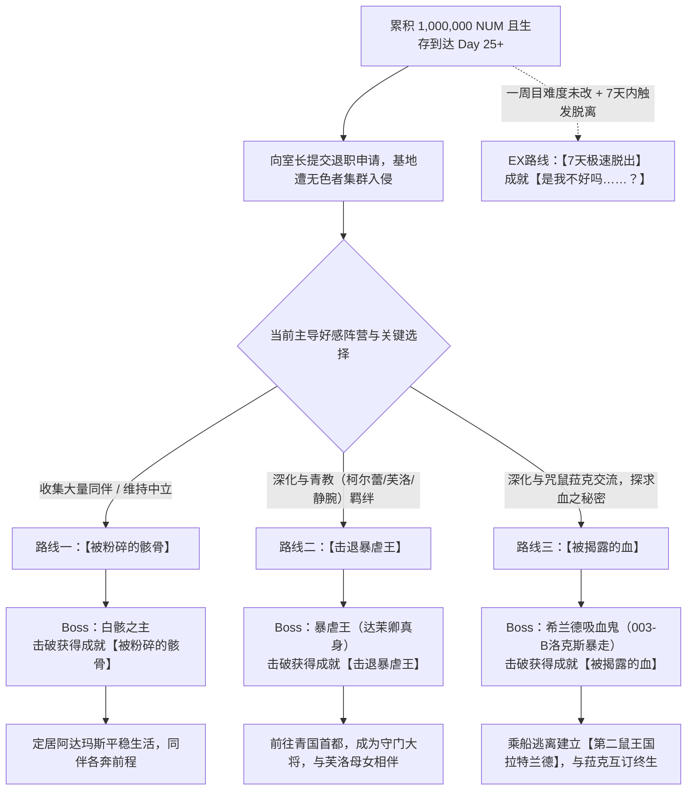
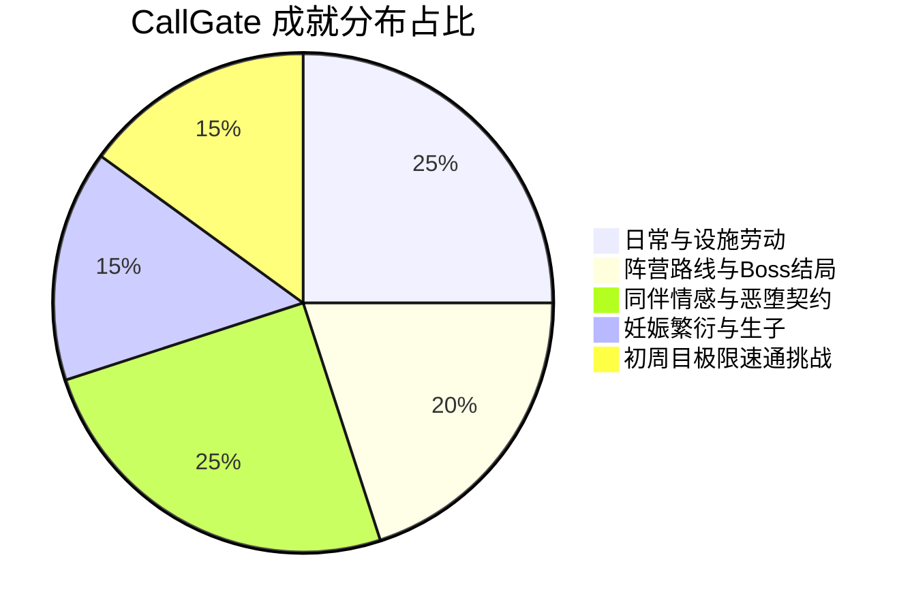

# 🚪《CallGate》（移转之门）全剧情背景·多分支结局·全角色招募·全要素100%终极全攻略

> **制作社团**：ンジャna!!（主创：@niganaramen / Ci-en: 18735）  
> **作品编号**：RJ01259041 / Steam AppID: 3950500  
> **作品类型**：近未来废土 / 暗黑克苏鲁异界 / 恶堕妊娠 / 债务打工模拟 RPG  
> **游戏引擎**：RPG Maker MV（816×624 分辨率，内嵌协同多语言汉化补丁）  
> **主角身份**：普莱耶斯（Players）不灭血族偷渡者 / 移转之门重罪劳工  
> **全要素状态**：✅ **包含全剧情暗线揭秘、三大主线结局+7天速脱结局、20+全角色好感与招募条件、基地全设施解密、最强BD与全成就达成指南**

---

## 📑 目录导航
1. [世界观设定与核心剧情背景](#一世界观设定与核心剧情背景)
   - [移转之门（CallGate）与四大世界阵营](#1-移转之门callgate与四大世界阵营)
   - [核心物质与概念：希尔菲姆、NUM与褪色者](#2-核心物质与概念希尔菲姆num与褪色者)
   - [主角身世之谜与被掩盖的开局真相](#3-主角身世之谜与被掩盖的开局真相)
2. [全三大路线结局与终局条件](#二全三大路线结局与终局条件)
   - [Ending 1：【被粉碎的骸骨】打倒白骸之主（正统伙伴集结结局）](#ending-1被粉碎的骸骨打倒白骸之主正统伙伴集结结局)
   - [Ending 2：【击退暴虐王】打倒暴虐王（青教帝国守护结局）](#ending-2击退暴虐王打倒暴虐王青教帝国守护结局)
   - [Ending 3：【被揭露的血】打倒希兰德吸血鬼（第二鼠王国地下乐园结局）](#ending-3被揭露的血打倒希兰德吸血鬼第二鼠王国地下乐园结局)
   - [EX Ending：【7天极速脱出】（一周目限定特权结局）](#ex-ending7天极速脱出一周目限定特权结局)
   - [终局复盘：价值女王（奇尔库尔·法姬）的灵魂质问](#终局复盘价值女王奇尔库尔法姬的灵魂质问)
3. [核心玩法机制与基地全设施详解](#三核心玩法机制与基地全设施详解)
   - [还债与天数循环系统（100万 NUM 目标）](#1-还债与天数循环系统100万-num-目标)
   - [出击双模式：警备模式 vs 拾荒者模式](#2-出击双模式警备模式-vs-拾荒者模式)
   - [拾荒者模式五大核心特殊建筑探秘](#3-拾荒者模式五大核心特殊建筑探秘)
   - [基地全功能设施与生活系统指南](#4-基地全功能设施与生活系统指南)
4. [好感度、恶堕契约与妊娠生产系统](#四好感度恶堕契约与妊娠生产系统)
   - [好感度提升与四阶身体互动（抚摸/拥抱/接吻）](#1-好感度提升与四阶身体互动抚摸拥抱接吻)
   - [双重契约关系：思慕（萨尔法戒指）与 专属炮友（隶属枷锁）](#2-双重契约关系思慕萨尔法戒指与-专属炮友隶属枷锁)
   - [恶堕妊娠繁衍机制（Demon Pregnancy）](#3-恶堕妊娠繁衍机制demon-pregnancy)
5. [全同伴角色招募条件与属性攻略（20+角色）](#五全同伴角色招募条件与属性攻略20角色)
   - [据点初期加入角色（店员、钝价、翠毒、丽舌、秘旋）](#1-据点初期加入角色)
   - [野外探索遭遇角色（魔蝙、锖色、旅巫女、探险家、苦毒双子、046、疑狐）](#2-野外探索遭遇角色)
   - [特殊隐藏条件角色（腐卵、赤茨、赤羊、基谢尔、安柏与法姬）](#3-特殊隐藏条件角色)
   - [据点专属管理NPC（室长洛克斯、咒鼠菈克、静腕元帅）](#4-据点专属管理npc)
6. [最强装备、异常物武器与战斗BD构筑](#六最强装备异常物武器与战斗bd构筑)
   - [传奇异常物武器一览（NUMGUN、002-麦角矛、Rod Rise Roots等）](#1-传奇异常物武器一览)
   - [四大主力推图与挑战BD推荐](#2-四大主力推图与挑战bd推荐)
7. [全成就（Achievements）100% 白金全收集指引](#七全成就achievements-100-白金全收集指引)

---

## 一、世界观设定与核心剧情背景

### 1. 移转之门（CallGate）与四大世界阵营
本作构建了一个充满怪诞神话、克苏鲁异化与后末日工业风格交织的庞大架空世界：
* **移转之门（移ろい門 / CallGate）**：一座连接人类现代现实社会与不可名状深层亚空间的巨大空间枢纽与中转设施。门内具有独立的时间流速、空间重叠现象与自成一体的法则，由吸血鬼室长**洛克斯（003-B）**与管理者**玛鲁姆**建立维持。
* **青国阿达玛斯（Adamas）**：崇尚武力、纪律与青教信仰的强盛帝国。全国以女性处于绝对优势主导地位，最高指挥官为芙洛之母**静腕（埃波洛总帅）**。青教信徒崇尚以铁拳与肉身戒律解决一切争端。
* **赤国尼科（Nico）**：崇拜自然现象、狂乱魔法与原初血脉的国度。供奉着能够呼风唤雨、降下陨石天灾的顶阶魔物群体，其无上领袖为身缠暴虐之血的**赤羊（达茉卿 / 暴虐王）**。
* **希兰德（Sealand）**：高度世俗化的资本与工业人类大国，拥有庞大的政府机构、格雷总统、以纸币发行的国家货币体系。曾多次派遣探险队（如传奇探险家格拉普斯）探索移转之门，并向移转之门征收高额赔偿与司法管辖权。
* **森帝涅尔（Sentinel / 哨兵）**：荒废的古文明遗迹群，栖息着拥有严密阶级与黑魔法咒术的**哨兵鼠王国**，以及专门收容封印各种灭世级异端生物的**古老监狱**。

### 2. 核心物质与概念：希尔菲姆、NUM与褪色者
* **希尔菲姆（Silphium）**：原初的奇迹神草/生命灵药，拥有阻止细胞衰亡、治愈绝症、令异端生物永生的神性。远古时代赤青两教为争夺原初希尔菲姆爆发灭岛决斗，最终祖王被传说巨蟹踩死，其散落的血肉与汁液孕育了后世诸魔。
* **NUM（价值货币）**：不仅是人类世界通用的数字货币，更是由概念级存在**价值女王（奇尔库尔·法姬）**所统辖的实体化“价值能量”。当 NUM 浓缩结晶时，甚至能制作出弑神级活体火器。
* **褪色病（褪せる病）与无色者（色無し）**：弥漫于移转之门周边的致死性空间瘟疫。患病者肉体与毛发会迅速褪为苍白灰败，精神意志瓦解。幕后黑手大量绑架采集褪色者患者，将其神经中枢改造为只知听从主母蜂巢意识驱使的工蚁傀儡——**“无色者”**。

### 3. 主角身世之谜与被掩盖的开局真相
* 玩家扮演的主角表面上是一个流浪到移转之门的无名偷渡客，因背负“非法偷渡罪、入侵机密区域罪、希尔菲姆盗窃与使用罪”，被判处支付 **1,000,000 NUM** 罚金（折合刑期 50 年），被迫在移转之门充当抵债雇员。
* **背后的残酷真相**：
  1. 主角实际上是不灭的“普莱耶斯血族（Players）”，即便肉身死亡也能在特定法则下重聚。
  2. 主角在初次坠入移转之门时，曾于荒芜绝境中**通过生吞活剥无色者的血肉价值苦苦支撑了整整 30 天**。
  3. 青教派出的裁定者**旅巫女柯尔蕾**根据室长洛克斯的密令，用残酷手段杀死了主角，并将主角脑中关于外界身份以及可能导致青教、赤教和移转之门政治崩盘的“危险记忆”尽数剥离收缴（制成**记忆的弹丸**封存）。
  4. 随后，室长的弟子咒术医菈克为主角进行了血腥复苏治疗，室长借此将主角伪装成普通抵债劳工，试图利用主角的不灭肉身彻底揪出隐匿在门深处的终极元凶——**白骸之主**。

---

## 二、全三大路线结局与终局条件

在游戏中，当玩家满足 **生存达到 25 天以上**，且在据点累积满 **1,000,000 NUM** 时，可在大厅向室长洛克斯正式提交退职申请。提交申请时，移转之门将遭受前所未有的暴走无色者狂潮围攻，根据玩家在日常打工中所倾斜结交的核心阵营与好感度，剧情将正式分裂为三大分支决战：

### Ending 1：【被粉碎的骸骨】打倒白骸之主（正统伙伴集结结局）
* **达成前置**：
  1. 招募大量同伴（店员、钝价、翠毒、丽舌、秘旋、探险家、锖色等主力入队）。
  2. 不偏向过激的单一阵营，在 Day 25 后将 100万 NUM 交给室长洛克斯。
* **决战事件**：
  - 营地警报长鸣，锖色侦察发现无色者大军有组织地破坏建筑，幕后统领正是寄生在少女尸骸上的古老意志——**白骸之主**。
  - 主角带领全体伙伴迎战白骸之主。白骸之主拥有高额群体暗蚀伤害与召唤腐骨护盾机制，需善用钝价的群体驱散与店员的嘲讽减伤。
* **通关后日谈**：
  - 白骸之主被斩杀，移转之门内部的无色者制造源头彻底停摆。
  - 主角被青教正式安置在**阿达玛斯沿海居住区**，过上了伴随着海鸥与涛声的平静生活。
  - 菈克来到主角家中，送达了室长洛克斯的录音信函与当年被剥夺的记忆。柯尔蕾向主角正式致歉。
  - 伙伴去向：芙洛因写检讨书被关禁闭；格拉普斯与钝价相伴踏上寻龙之旅；魔蝙获救渴望举办水果派对；锖色继续巡视荒野；安柏与法姬带着琥珀杯与麦角枪荣归故里。

### Ending 2：【击退暴虐王】打倒暴虐王（青教帝国守护结局）
* **达成前置**：
  1. 优先推进旅巫女柯尔蕾、探险家芙洛的亲密度至最高，并在据点频繁与前来视察的青国元帅**静腕（埃波洛）**互动。
  2. 在阵营纷争事件中坚定站在青教一方，提交 100万 NUM 离职时触发赤教暴走剧情。
* **决战事件**：
  - 赤国的原初魔之顶点——**赤羊 / 达茉卿（暴虐王）**亲自降临移转之门。她正是远古祖王被压碎时溢出的神血所化之魔，拥有召唤灭世流星陨石与地裂天崩的超规格战力。
  - 决战面对暴虐王，需极度堆高火属性抗性与物理闪避（推荐敏捷流 + 火炎瓶压制 + 芙洛复活抗伤害）。
* **通关后日谈**：
  - 成功击退暴虐王后，主角随静腕与芙洛彻底移居至青国阿达玛斯。
  - 主角被任命为青国国门的专属守护指挥官，每日与芙洛、静腕生活在一起，共同防备赤国余党的反扑，并与青教母女缔结了坚不可摧的终生情誓。

### Ending 3：【被揭露的血】打倒希兰德吸血鬼（第二鼠王国地下乐园结局）
* **达成前置**：
  1. 频繁前往医务室与**咒鼠菈克**交流，将其好感度提满，并在对话中深入追问移转之门内部无色者血液提取与希尔菲姆人体实验的秘密。
  2. 触发咒鼠解密事件，发现室长洛克斯（003-B）其实是百年前肆虐希兰德、以爆头诅咒屠戮数十名调查员的活体吸血鬼元凶。
* **决战事件**：
  - 提交 100万 NUM 试图脱离时，室长洛克斯露出真正的吸血獠牙，拒绝放主角离开。
  - 决战迎战**希兰德吸血鬼（洛克斯真身）**。Boss 拥有极高爆发的穿透伤害与即死级头颅爆裂诅咒，必须利用咒鼠的免死符咒与高额异常抗性装具迎战。
* **通关后日谈**：
  - 击破洛克斯后，主角抱着精疲力竭的菈克，登上由鼠王国接应人员安排的护送船，逃离移转之门。
  - 众人抵达全新未开发的秘境，建立了避开地表战火的地下世外桃源——**第二鼠王国拉特兰德（ラットランド）**。
  - 菈克成为地下王国女王，每日戴着黑星冠冕依偎在主角怀中撒娇。两人相依为命，共同守护着镜块，筹划着未来彻底诛灭怪物“白葬”的雄图大业。

### EX Ending：【7天极速脱出】（一周目限定特权结局）
* **达成条件**：在首次建档开局（未更改默认/困难难度）的状态下，**在 7 天之内**利用极速拾荒、高风险倒买倒卖或特殊机制达成逃脱。
* **对应奖励**：解锁成就 **【是我不好吗……？】**。若在 7 天内还拿到了 **100% 蜂蜜**，同时解锁成就 **【请给我蜂蜜】**。

### 终局复盘：价值女王（奇尔库尔·法姬）的灵魂质问
达成任何结局通关后，主角都将被接引至超空间回廊，直面手持折扇、墨镜轻挑的**价值女王奇尔库尔·法姬**。
女王将对玩家的本次轮回进行尖锐犀利的“灵魂审查”：
* 询问无色者真面目、杀人魔正体、谢吉尔的身世与各角色的真实结局；
* 确认通关数据，向玩家保证“无论现在多么艰辛，未来必能再度开辟新的可能性”；
* 随后开启继承通关点数的**多周目（New Game+）**模式，解锁成就【星之血管】。

---

## 三、核心玩法机制与基地全设施详解

### 1. 还债与天数循环系统（100万 NUM 目标）
* 游戏的日常时间轴分为：**白天（活动/出击） -> 傍晚（基地交流/设施整备/性处理） -> 深夜（就寝/天数结算）**。
* 每度过一天，基地需消耗基础维护费用，若长期不提供驱除贡献，据点治安与防御度会持续恶化。
* 主角初始等级上限较低，必须通过在拾荒与战斗中击破精英异常体获取**【歪斜的鉴板】**才能突破上限；使用**【NUM袋】**可直接将金钱转化为升级经验（快捷键 `[2]` 快速消耗）。

### 2. 出击双模式：警备模式 vs 拾荒者模式
在出击前的难度选择界面，按上下方向键或点击彩字可自由切换模式：

| 模式名称 | 机制特性 | 适合阶段 | 角色招募偏向 |
| :--- | :--- | :--- | :--- |
| **警备模式（Guard）** | 线性安全推进，随机抽取四大地图（小居所/屋敷/道路/森林），敌人难度梯次上升。通关后有概率进入隐藏店铺。 | 前期开荒、平稳赚钱、日常练级 | 适合收集常规遭遇角色（探险家、魔蝙、锖色、旅巫女） |
| **拾荒者模式（Scavenger）** | 蜂巢网状自选地图格推进。风险极高但资源掉落极其丰厚，每 7 天刷新一次大地图。可提前撤离。 | 中后期刷神装、招募隐藏同伴、挑战强敌 | 必刷特殊建筑，解锁 046、苦毒双子、研究所与火山口 |

### 3. 拾荒者模式五大核心特殊建筑探秘
1. **不明瞭地带（问号迷雾格）**：
   - 必定发生遭遇事件，内部算作小型居所结构，极其容易触发流浪 NPC、流浪商人和探险家芙洛的特殊支线。
2. **避难所（Shelter）**：
   - 各种维修工具、高阶板条箱与任务钥匙的高爆率区域。
   - **核心价值**：全游戏唯一能触发强力群体火法角色 **046(赤影)** 入队事件的地点！
3. **当铺?（Pawn Shop?）**：
   - 产出送礼利器 B.R.D 系列道具。
   - **核心价值**：全游戏唯一能触发 **苦毒(白)** 与 **苦毒(黑)** 加入事件的地点（二选一）。
4. **火山口（Crater）**：
   - 超高危禁区，底层盘踞着固定属性的隐藏终极 Boss **WallofFuneral Lv333**。开荒初期误入必死，建议后期全身神装并携带 100% 蜂蜜再来挑战。击败后获得成就【第二次毁灭】。
5. **??? 研究所（Laboratory）**：
   - 必须在背包中持有【卡片钥匙（Card Key）】方可开门进入。
   - 产出顶级 S.E.L 系列防具与 S.L.P 箱子，深处守护着异常体 079。击败并搜刮后获得成就【误伤同族】。

### 4. 基地全功能设施与生活系统指南
* **大厅（Lobby）**：
  - **洛克斯室长处**：接受每日劳务指标、核查还债进度、提交 100万 NUM 触发退职决战。
  - **天秤机关**：随时调整游戏全局难度。
* **厨房（Kitchen）**：
  - 由丽舌（帕博罗）指导。玩家可收集生肉、蔬菜、香料烹饪料理。
  - 烹饪评分越高，赠送同伴时好感度涨幅越夸张。烹饪失败的“厨余垃圾”可自用降低行动疲劳。完成首次烹饪解锁成就【喜欢料理】。
* **工艺台（Crafting Table）**：
  - 制作防暴盾牌、高阶武器以及特殊礼物。
  - 可在此打造传世神兵 **★Rod Rise Roots**（解锁成就【旅途的终点】）与带有诅咒属性的猥亵礼物（解锁成就【诅咒成功】）。
* **分解机（Recycler）**：
  - 将拾荒带回的各类垃圾装备、异常残骸分解为精炼废料与 NUM。首次使用解锁成就【回收者】。
* **学习机（Study Desk）**：
  - 主角专属属性加点台。可分配技能点强化体力、敏捷、命中、暴击与交涉能力。分配 5 点以上解锁成就【日复一日的积累】。
* **浴场（Bathhouse） & 洗手间（Restroom）**：
  - **洗手间**：按数字键 `[4]` 或与马桶互动可进行自慰训练，积累精力经验值。若持有从同伴衣柜翻找窃取来的清洁内衣，自慰经验获取量大幅暴增！
  - **浴场**：脱光衣服后随机与正在沐浴的同伴撞见并同池共浴，大幅提升亲密度与特殊对话。

---

## 四、好感度、恶堕契约与妊娠生产系统

### 1. 好感度提升与四阶身体互动
在据点与已加入的同伴交谈时，可根据好感度等级解锁进阶肢体接触：
* **日常交谈**：基础增进，受交涉技能 Lv 加成。
* **抚摸（Pet）**：需好感度达到 **50+**。
* **拥抱（Hug）**：需好感度达到 **50+**。
* **接吻（Kiss）**：需好感度达到 **80+**。
* **特殊性格耐受度**：拥有【反抗的】、【怀疑的】特质的角色（如钝价、店员）初始好感增长缓慢且警惕心极强，需优先投其所好赠送专属礼物。

### 2. 双重契约关系：思慕（萨尔法戒指）与 专属炮友（隶属枷锁）
游戏提供两条平行的情感终极形态：
* **纯爱恋慕路线【思慕（Love）】**：
  - 通过频繁正面交流、沐浴与赠礼将亲密 Lv 提升至极限，角色状态栏将出现【思慕】特质（解锁成就【你也太喜欢我了……】）。
  - 此时向其赠送稀有饰品 **【★萨尔法戒指】**，角色将与主角缔结永恒婚约契约，解锁成就 **【你是我永远的伴侣……♥】**。
* **恶堕支配路线【炮友（Sex Friend / セフレ）】**：
  - 通过反复要求性处理，突破角色的羞耻底线，使其获得【炮友】身份（解锁成就【我是您的性处理专员哦～♥】）。
  - 与 5 人以上确立炮友关系解锁成就【轮换制度】。
  - 此时向其赠送在工艺台制作的禁忌束缚具 **【★隶属枷锁】**，将其彻底堕落为专属肉便器，立绘外观发生特殊常驻差分，解锁成就 **【我是专属肉便器……♥】**。

### 3. 恶堕妊娠繁衍机制（Demon Pregnancy）
本作包含深度的“异种/同种体液受精与生育体系”：
* **受精判定公式**：
  $$\text{受精概率} = \text{基础受精率} + (\text{主角种付け等级} \times 1\%) + (\text{发情状态加成 } 33\%)$$
* **妊娠进程与差分**：
  - 受精成功后，可在医务室通过咒鼠或使用【★识别的镜块】查看胎儿周数与体质变异。
  - 随天数推移，角色会逐渐显怀，立绘更新为**膨腹妊娠差分**，并自动附带【母乳体质】特质。
  - 此时要求性处理，同伴会有专属的孕期娇羞/抗拒求欢台词与专属 HCG。
* **多胞胎与产卵规律**：
  - 魔物与高变异者（如腐卵、翠毒、星蜘蛛后裔）的多胎率极高。
  - 角色生下双胞胎、三胞胎甚至极罕见的**五胞胎**时，将解锁成就【希望太多了】；若在没有【兽性】词条加成下自然产出五胞胎，解锁挑战成就【是个优秀的雄性呢……♥】。
  - 让同一名同伴累计诞下 10 名以上子嗣，解锁成就【喜欢让你怀孕】。

---

## 五、全同伴角色招募条件与属性攻略（20+角色）

### 1. 据点初期加入角色
* **店员（玛鲁姆 / Malm）**：
  - **定位**：重装守护肉盾 / 仇恨吸引
  - **招募**：据点对话支付 25万 NUM 或满足初期防御战支线加入。
  - **特色**：拥有全游戏最顶级的嘲讽与格挡技能，能吸收全体敌人的致命单体打击，保护后排脆弱法师。
* **钝价（夏露 / Shar / 莲生者）**：
  - **定位**：神圣群体治疗 / 异常净化
  - **招募**：开局在据点交谈并支付 5万 NUM 即可轻松雇用。
  - **特色**：唯一的全队大群疗奶妈。自身脆弱，进食特定生肉会触发反胃呕吐差分（首日触发呕吐解锁隐藏成就【那也太……】）。
* **翠毒（蕾佐 / Rezo / 超变异者）**：
  - **定位**：生化毒素连击 / 恐龙体质输出
  - **招募**：据点支付 15万 NUM 雇用。
  - **特色**：独自研发 NUM 变异原的怪人，立志变身为恐龙。无法装备常规防具，但自带高额毒素附魔与强韧物理抗性。
* **丽舌（帕博罗 / Paboro / 活着的料理）**：
  - **定位**：火系强化 / 厨房美食制造
  - **招募**：据点支付 30万 NUM 雇用。
  - **特色**：五舌泽尔迪纳的亲传弟子。除了强劲的火焰法术外，还是据点掌勺核心，大幅降低料理翻车率。
* **秘旋（前快递员）**：
  - **定位**：先手高敏输出 / 掉落率提升
  - **招募**：据点仅需支付 7万 NUM 即可招募。
  - **特色**：敏捷成长极高，携带专属偷窃与投掷技能，大幅增加拾荒结算时的物资数量与遭遇逃跑成功率。

### 2. 野外探索遭遇角色
* **探险家（芙洛 / Flou / 不灭血族）**：
  - **招募**：警备模式在【小型居所】或拾荒者模式在【不明瞭地带】随机遭遇并邀请加入。
  - **特色**：青国元帅静腕之女。拥有不灭血族特性，战斗阵亡后可立即**满血复活一次**，容错率极高。
* **旅巫女（柯尔蕾 / Korre / 青教轰腕）**：
  - **招募**：警备模式在【森林】地图遭遇加入。
  - **特色**：开局夺走主角记忆的元凶之一。纯粹的神圣肉搏武僧，不带武器空手格斗伤害爆表，连打技能极具爆发力。
* **锖色（露茨 / Roots / 永恒之战士）**：
  - **招募**：警备模式在【道路】地图遭遇加入。
  - **特色**：重装女剑士。准备充足工具与废金属交由她可修复战车（解锁成就【死亡之路】）。
* **魔蝙（格拉普斯 / Graps / 被解放的吸血蝠）**：
  - **招募**：警备模式在【屋敷（洋馆）】地图击败围攻敌人后解救加入。
  - **特色**：血族暗夜游侠，吸血攻击兼顾输出与自愈，全属性成长极为平稳。
* **苦毒(黑) & 苦毒(白)（哈罗姆 / Halom）**：
  - **招募**：仅在拾荒者模式进入【当铺?】建筑时遭遇触发，两者二选一加入。
  - **特色**：擅长施加高阶剧毒、失明、混乱等致命异常，对付高血量 Boss 的减速控制利器。
* **046(赤影 / 达茉之影）**：
  - **招募**：仅在拾荒者模式探索【避难所】时随机出现，击败暴走意念后加入。
  - **特色**：身缠饥荒之火的强大人形魔，全屏赤影焚烧技能清图效率无可匹敌。
* **疑狐（雷米斯 / Remis）**：
  - **招募**：拾荒者模式潜行区遭遇，或当钝价的好感度达到 80 以上时，雷米斯会自动现身据点加入。
  - **特色**：护主狂魔，暴击率极高，擅长偷袭与弱点斩杀。

### 3. 特殊隐藏条件角色
* **腐卵（异形饲主）**：
  - **招募**：需将【道路】、【森林】、【小居所】的探索度等级均提升至 **Lv 40 以上**，在据点门口触发异形侵袭事件后招募。
  - **特色**：挥舞寄宿生命的异化武器，能产下异形战宠协助围殴。
* **赤茨（托拉斯 / Toras / 荆棘娼妇）**：
  - **招募**：在拾荒中击败特定荆棘精英并获得【麦角枪】残片后，回据点交谈触发救赎事件加入。
  - **特色**：极度强力的削弱与出血异常手，能大幅降低敌方全体护甲与魔抗。
* **赤羊（天 / 暴虐王达茉 / Damo）**：
  - **招募**：非青教路线下，在防卫战第 4 阶段后通过特定献祭解救，或二周目特殊继承解锁。
  - **特色**：全游战力天花板，毁天灭地的流星雨与重力坍缩法术。
* **基谢尔（科谢尔 / 黑骸守护者）**：
  - **招募**：在咒鼠的白骸调查支线中，于深层十字架解救该魔物并带回营地由咒鼠进行开导后入队。
  - **特色**：心智单纯如幼儿但天生怪力无双，拥有极高的护甲减伤。
* **安柏（科洛妮丝 / 许愿星）与 法姬（奇尔库尔 / 价值女王）**：
  - **招募**：第 25 天后在据点触发【寻找琥珀之杯】对话事件，并在防卫战联手御敌后达成收容。

---

## 六、最强装备、异常物武器与战斗BD构筑

### 1. 传奇异常物武器一览
1. **★NUMGUN（价值结晶生体枪）**：
   - **特性**：发射高度结晶化的 NUM 作为弹药。与 011 原始枪同样具备生命意识，能根据所支付的 NUM 造成超额贯穿真实伤害，足以轰破母蟹重甲。
2. **002-麦角矛（Ergot Spear）**：
   - **特性**：原初希尔菲姆大战中祖王使用的神器，附带致命的麦角毒素与神经麻痹，平 A 即可削减敌方高额最大生命值上限。
3. **★Rod Rise Roots（世界树之杖）**：
   - **特性**：在工艺台消耗顶级材料打造的法系毕业武器，赋予全属性魔法伤害提升 60% 并大幅缩减技能消耗。
4. **★055-B-古老之血**：
   - **特性**：吸血鬼一族最古之遗物，暴击时恢复所造成伤害 50% 的生命值，近战续航神器。
5. **★100% 蜂蜜（西兰公国纯蜂蜜）**：
   - **特性**：神级消耗品/饰品，赋予角色【力量+50%】、【敏捷+50%】、【智力+50%】、【暴击率+25%】且【永久免于陷入濒死状态】！

### 2. 四大主力推图与挑战BD推荐
* **BD ①：极端敏捷飞刀火炎流（新手开荒万金油）**
  - **核心思路**：学习机全点敏捷，携带秘旋与探险家芙洛。
  - **打法**：敏捷堆高后必定抢在敌方先手行动前丢出【火炎瓶】施加全体烈火灼烧，秘旋接飞刀清杂。敏捷高还大幅降低受击率，消耗极低即可无伤平推前期据点。
* **BD ②：金钱轰炸结晶流（中后期 Boss 斩杀）**
  - **核心思路**：装备【★NUMGUN】 + 配套暴击装具 + 携带 100% 蜂蜜。
  - **打法**：通过日常倒卖国债累积雄厚资本，利用 NUMGUN 发动高倍率价值狙击，一击打出上万真实伤害秒杀包括火山口 WallofFuneral 在内的绝大部分守门首领。
* **BD ③：神圣铁壁不死流（防卫战速通打法）**
  - **核心思路**：前排配置店员玛鲁姆（全肉装+防卫之盾） + 芙洛（自带不灭复活），后排钝价全屏加血驱散。
  - **打法**：玛鲁姆开局拉仇恨减伤，钝价持续抬血，主 C 柯尔蕾连续使用神圣轰拳单点评杀，兼备极致的生存与点杀能力。
* **BD ④：全屏毁灭天灾法核流（终局扫荡）**
  - **核心思路**：046(赤影) + 暴虐王达茉 + 装备【★Rod Rise Roots】。
  - **打法**：开场双重大范围火系与重力法术轮番轰炸，无论多坚固的无色者融合体群在一回合内均会化为灰烬。

---

## 七、全成就（Achievements）100% 白金全收集指引

### 1. 基础劳动与设施运作类
* **【勤勉劳动】**：成功从警备模式中完成探索并返回。
* **【回收者】**：在据点首次使用分解机分解物品。
* **【喜欢料理】**：在厨房成功烹饪出任意一道菜品。
* **【零元购】**：成功潜入并入侵当铺。
* **【日复一日的积累】**：在学习机上分配 5 点以上的属性点。
* **【旅途的终点】**：在工艺台亲手打造出传说武器【★Rod Rise Roots】。
* **【死亡之路】**：准备足量工具与废铁，委托锖色将基地战车修复完工。

### 2. 结局通关与强敌镇压类
* **【被粉碎的骸骨】**：招募大量同伴达成正统路线，击杀白骸之主。
* **【击退暴虐王】**：深化青教交流，在决战中战胜赤之法王暴虐王达茉。
* **【被揭露的血】**：深化与咒鼠的探索，击破真身暴走的希兰德吸血鬼洛克斯。
* **【星之血管】**：通关任意结局后，开启多周目（New Game+）继承档。
* **【第二次毁灭】**：在拾荒者模式火山口最深处，击杀满血固态强敌 **WallofFuneral Lv333**。
* **【黑星你给我记住！！】**：在防卫战最终波次击败或击退强袭首领【新祖】。
* **【在下不会忘记这份耻辱】**：以**单人出击不带同伴**的姿态，在防卫战最终波次击败或击退【星蜘蛛】。
* **【人类太强了！！】**：在 5 个防卫回合之内暴力速杀新祖。
* **【如此虚幻之事】**：在 5 个防卫回合之内暴力速杀星蜘蛛。

### 3. 情感交流、恶堕契约与恶堕繁衍类
* **【你也太喜欢我了……】**：与任意一名角色好感度达标，解锁其【思慕】特质。
* **【你是我永远的伴侣……♥】**：向拥有思慕特质的角色赠送【★萨尔法戒指】缔结婚约。
* **【我是您的性处理专员哦～♥】**：与同伴多次进行性处理，将其身份转变为【炮友】。
* **【我是专属肉便器……♥】**：向拥有炮友身份的角色赠送【★隶属枷锁】，彻底完成肉身调教。
* **【通往未来的希望】**：与人类女性同伴进行无套性行为，使其受精并顺利诞下子嗣。
* **【希望太多了】**：触发极罕见的生育判定，让同伴一次性产下**五胞胎**。
* **【是个优秀的雄性呢……♥】**：在自身无【兽性】词条的纯天然状态下，让同伴产下五胞胎。
* **【喜欢让你怀孕】**：与同一名角色累计繁育生产 10 名以上的后代。
* **【轮换制度】**：在据点同时与 5 名以上角色确立炮友关系。
* **【搭档太绝伦了……♥】**：通过频繁自慰与性处理将精力等级提升至极限，在一次性处理中**连续射精 5 次**。

### 4. 一周目限定极限挑战类（难度不可更改）
> [!IMPORTANT]
> 以下成就必须在**新开的一周目**中完成，且游戏难度**必须全程保持为默认或困难（Hard）模式**，一旦通过天秤降低难度将永久无法解锁！
* **【请给我蜂蜜】**：开局 7 天之内，成功获取道具【100% 蜂蜜】。
* **【是我不好吗……？】**：开局 7 天之内，通过特殊路径极速逃出移转之门。
* **【看来有必要进行性教育呢……】**：开局 7 天之内，成功让任意一名女性同伴怀孕。
* **【我才没那么好搞定！！】**：开局 7 天之内，成功触发医务室咒鼠菈克的性处理事件。
* **【芙洛，对不起……♥】**：开局 7 天之内，成功触发青国元帅静腕的性处理事件。
* **【是我输了……】**：开局 7 天之内，将秘旋的亲密度等级速刷提升至 Lv 5。
* **【那也太……】**：**开局第 1 天之内**，成功诱导钝价夏露触发专属呕吐差分 CG。

---

*本全攻略收录于 ACG Vault 专属知识库，数据基于 CallGate 官方版本与协同汉化数据全量解密编撰。*
