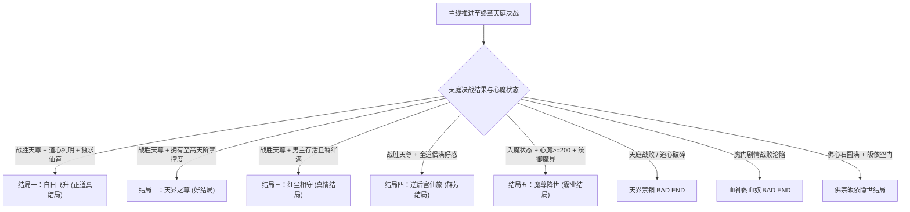

# 🌙《绯月仙行录》（V1.292）全剧情流程·全路线分支·全结局达成终极攻略

> **游戏名称**：绯月仙行录（Feiyue Xianxinglu）  
> **游戏版本**：V1.292 官方简中版  
> **制作团队**：霜之鹤制作组（仙行工作室）  
> **游戏引擎**：RPG Maker MZ  
> **作品类型**：仙侠修真 / 国产同人 RPG / 角色养成 / 门派跑商 / 多重正邪结局  
> **女主角**：上官曦月（前朝落难帝姬，天生纯阴之体，资质冠绝三界）  
> **核心机制**：十大修真境界突破、道心与心魔/堕落双重数值体系、各大仙宗与魔道阵营周旋、灵宠养成、洞府营建、全大地图藏宝与跑商贸易、多路线终局分歧。

---

## 📑 攻略目录导航
1. [核心系统与重要数值机制解析](#一核心系统与重要数值机制解析)
   - [修仙十大境界与突破要诀](#1-修仙十大境界与突破要诀)
   - [道心与心魔/堕落值分水岭](#2-道心与心魔堕落值分水岭)
   - [灵宠养成与收服指南](#3-灵宠养成与收服指南)
   - [时间推进与月度资源运转](#4-时间推进与月度资源运转)
2. [主线剧情全章节通关攻略](#二主线剧情全章节通关攻略)
   - [序章：帝京剧变与拜入凌霄](#序章帝京剧变与拜入凌霄)
   - [第一章：红尘初试·流云城与琉璃岛](#第一章红尘初试流云城与琉璃岛)
   - [第二章：皇都风云·权谋交织与故人再遇](#第二章皇都风云权谋交织与故人再遇)
   - [第三章：仙魔纷争·各大宗门与魔境探秘](#第三章仙魔纷争各大宗门与魔境探秘)
   - [终章：不周天路与天庭决战](#终章不周天路与天庭决战)
3. [全结局达成条件与判定表](#三全结局达成条件与判定表)
   - [正道终局：白日飞升真结局](#结局一白日飞升正道至高真结局)
   - [至尊终局：天庭之尊好结局](#结局二天界好结局天尊归顺)
   - [情缘终局：红尘相守结局](#结局三红尘相守执子之手)
   - [群芳终局：逆后宫仙旅结局](#结局四仙子群芳逆后宫大圆满)
   - [魔道终局：魔尊降世结局](#结局五魔尊降世魔道霸业)
   - [各阵营沦陷与失误结局盘点](#各大阵营失误与沦陷坏结局速查)
4. [全宗门跑商与宝藏图挖掘全盘点](#四全宗门跑商与宝藏图挖掘全盘点)
   - [暴利宗门特产跑商循环路线](#1-暴利宗门特产跑商循环路线)
   - [全大地图藏宝图埋藏点坐标](#2-全大地图藏宝图埋藏点坐标)
5. [毕业战斗流派与技能秘籍搭配](#五毕业战斗流派与技能秘籍搭配)

---

## 一、核心系统与重要数值机制解析

### 1. 修仙十大境界与突破要诀
游戏严格遵循传统修真体系，等级与境界深度挂钩，每次大境界跃迁均需达成**经验满溢 + 突破丹药 + 属性考验**：

| 修真境界 | 等级上限 | 突破所需丹药/材料 | 核心解锁能力与地图权限 |
| :--- | :--- | :--- | :--- |
| **练气期** | Lv 1 ~ 10 | 基础修炼，满经验自然突破 | 开启宗门基础术法 |
| **筑基期** | Lv 11 ~ 20 | 筑基丹 / 破厄丹 | 解锁流云城大地图、御剑飞行、洞府初建 |
| **金丹期** | Lv 21 ~ 30 | 金丹结晶、清心丸 | 开启琉璃塔高层秘境、本命法宝祭炼 |
| **元婴期** | Lv 31 ~ 40 | 元婴结晶 | 开启四大进阶秘境（地下灵脉、离火域、枯寂之地、坤之森） |
| **化神期** | Lv 41 ~ 50 | 化神结晶 | 开启皇城贵族区深入权、高阶炼丹术 |
| **炼虚期** | Lv 51 ~ 60 | 炼虚结晶 | 解锁各大宗门（傲天门、灵兽宗、炎心阁等）核心内门任务 |
| **合体期** | Lv 61 ~ 70 | 合体结晶 | 开启深渊秘境、解锁宗门顶级镇派功法 |
| **大乘期** | Lv 71 ~ 80 | 大乘结晶 | 掌握九天雷系天阶大招（紫霄神雷等） |
| **渡劫期** | Lv 81 ~ 90 | 渡劫结晶、抗雷劫护心丹 | 开启不周山与登天通道 |
| **劫境 / 飞升** | Lv 90+ | 天地道果、心魔圆满 | 迎战终局天庭神将，问鼎仙界 |

> **突破提示**：
> 突破时切记保证生命与法力回满。若心魔值过高，突破时会触发心魔反噬扣除大额属性甚至突破失败；携带「清心丸」或在客栈/洞府香炉处静心后再行突破最为稳妥。

---

### 2. 道心与心魔/堕落值分水岭
这是决定曦月命运走向的核心隐藏数值天平：

* **正道仙修路线（道心清明，心魔值 < 100，堕落值 < 50）**：
  - 能够进入各大名门正派核心圣地，受宗门长老嘉奖与倾囊相授。
  - 正道功法（望月诀、凌霄天雷等）伤害附加额外 20%~50% 神圣破邪加成。
  - **飞升真结局、天界好结局、红尘相守结局的绝对前置要求**。
* **魔道修罗路线（心魔值 ≥ 200，堕落值 ≥ 200）**：
  - 会被名门正派列入防备名单，但可畅行无阻进入**鬼蜮、血神阁、合欢宗**等魔门。
  - 解锁魔修专属残虐术法（初/中/高级血煞术、万魂幡、乱魂术、血食诀）。
  - 角色立绘与对话发生暗堕转变，可直接触发魔门掌门双修与魔尊称霸终局。

---

### 3. 灵宠养成与收服指南
灵宠在战斗中作为强力外援，不仅能独立输出，还提供被动光环增益：

1. **青鸾（风雷系主力）**：
   - **收服地点**：第一章琉璃村后山「青鸾巢穴」。
   - **收服条件**：击败守护妖兽，出示灵兽喜爱的鲜果即可缔结契约。
   - **形态与技能**：拥有幼年与成年形态，成年后掌握群攻暴风与神行提速光环。
2. **九尾狐（念力与控制系）**：
   - **收服地点**：流云城隐藏秘境剧情深处。
   - **特点**：高额单体精神法术伤害，附带概率魅惑瘫痪敌方行动。
3. **青浮游（水愈系辅助）**：
   - **收服地点**：水域湖心与琉璃岛水泽。
   - **特点**：强力群体血量与法力回复，高难持久 Boss 战必备护卫。

---

### 4. 时间推进与月度资源运转
- **月度更替**：客栈睡眠、洞府闭关、大地图远行均会消耗天数。每跨越一个月，系统自动结算宗门贡献与产业收益。
- **任务时效**：城主府与宗门悬赏每月初刷新，逾期未交会自动作废。
- **精气收集**：大地图各野外地块每月随机刷新精气光点，收集后可用于炼制突破大药与喂养灵宠。

---

## 二、主线剧情全章节通关攻略

### 序章：帝京剧变与拜入凌霄
1. **剧情开端**：皇朝发生宫廷惊变，主角上官曦月身受追捕，于千钧一发之际逃出生天。
2. **拜师仙门**：曦月流落至凌霄宫，被掌门师傅云清道长收归门下，正式踏上修真大道。
3. **宗门试炼**：
   - 熟悉凌霄宫各区域（师傅房间、弟子居所、演武场）。
   - 修习基础御气心法，升至 Lv 5，领取新手佩剑与储物袋。
   - 师傅嘱咐曦月下山历练，前往**流云城**增长见识。

---

### 第一章：红尘初试·流云城与琉璃岛
#### 1. 流云城市井探索
- **城主府委托**：前往城主府大厅接取告示任务：
  - **送信委托**：安全稳妥，赚取前期基础灵石。
  - **除妖委托**：前往郊外讨伐恶妖，掉落妖丹与高阶材料。
- **城主府藏书楼**：
  - 藏书楼一楼与二楼包含修仙修真通史与高阶丹方，阅读可增加见识与功法熟练度。
- **市集各店铺**：
  - 药店购买补血补蓝散剂；法器店更新前期武器；裁缝店购置防御法衣。
- **浩瀚居士府邸**：触发吴小山系列求助事件，选择出手相助可积累正道名声与功德值。

#### 2. 琉璃村与后山灵宠
- 经流云城郊外前往**琉璃村**，走访村长家与张丽云家。
- 前往**琉璃村后山**，沿蜿蜒山道深入探索青鸾巢穴，击败拦路妖禽后成功收服**灵宠青鸾**。

#### 3. 琉璃塔秘境突破（1 ~ 5 层）
- **层级推进**：
  - 第 1~2 层：地狼与蜥蜴盘踞，推荐使用远程风刃与剑气逐个击破，切勿莽撞被围殴。
  - 第 3~4 层：包含隐藏密室，搜索墙壁符文解开石门，获取「经验结晶（金丹）」与极品灵石。
  - 第 5 层（塔顶）：迎战塔顶守护巨兽。
- **Boss 战策略**：Boss 蓄力大招前会有红光提示，及时使用护体金光或格挡，利用青鸾的风刃削弱护甲，连招爆发带走。通关后获得开启大地图高阶秘境的关键古符。

#### 4. 望月阁挑战
- 望月阁共 5 层，每层均有珍稀秘籍售卖与试炼：
  - 获取**《一品斩华诀》**与**《月弥曲》**，为中期物理/法术核心主力输出技能。

---

### 第二章：皇都风云·权谋交织与故人再遇
#### 1. 皇都暗流与势力探索
- 境界达到化神期后，主线指引曦月重返**皇城**。
- **平民区暗线**：
  - 调查混混总部地下迷宫与丐帮秘密地下室，搜寻当年皇室覆灭与奸佞勾结的密信。
  - 结识墨轩与阿欢，触发一系列市井暗线事件。
- **贵族区与王太傅府**：
  - 潜入王太傅书房与隐藏密室，探查皇城幕后掌权者的真实阴谋。

#### 2. 宿敌对决与关键抉择点
- 再次与皇室仇敌**宇文卿**产生命运交汇：
  - **【核心分歧 A：守护相助线（男主存活线）】**：在关键暗杀与围攻事件中，选择全力掩护并合力御敌，成功保全其性命，进入「相知相守」情感羁绊，为后续【红尘相守结局】埋下伏笔。
  - **【核心分歧 B：断情复仇线】**：选择斩断过往，专注大道复仇，曦月杀伐果断，心性蜕变，全力指向【飞升】或【天庭称尊】。

#### 3. 军营与凤临阁行动
- **凤临阁一阶段至二阶段**：
  - 凤临阁内部机关重重，需按照五行生克顺序解开楼层阵眼（金->水->木->火->土）。
  - 登上三楼击败皇城供奉长老，回收皇室遗落至宝「九龙玉玺」。

#### 4. 自家专属洞府营建
- 解锁独立洞府系统：
  - **闺房**：静坐修养，快速恢复体力与调和道心。
  - **宠物房**：派遣灵宠外出搜寻高阶草药。
  - **孩子房与仆从房**：管理府邸日常，产出源源不断的灵气丹药。

---

### 第三章：仙魔纷争·各大宗门与魔境探秘
随着修为踏入炼虚与合体期，云霓大陆各大宗门纷争全面爆发，曦月可在正邪两大阵营之间游走抉择：

#### 1. 仙道正宗诸派历练
- **傲天门**：
  - 挑战李爽与掌门李乾坤，在演武场战胜后赢得傲天门尊重。
  - 探索闭关密室，研习天阶神技**《傲天·一品剑气如虹》**与**《天剑》**。
- **灵兽宗**：
  - 巡视宗门前段与后段，进入灵兽宗专属秘境。
  - 解锁宗门特产跑商通道，赚取海量灵石与贡献点。
- **炎心阁**：
  - 拜会炎心阁掌门，浸泡地火灵脉温泉大幅强化火抗与体魄上限。
  - 购入天阶火系攻伐法决**《炎心·举火焚天》**与**《业火焚身》**。
- **佛宗大殿与禅修苦境**：
  - 面见佛宗高僧，接取救助世人功德任务，获取「佛心石」。
  - 挑战七大人生苦境试炼（病之间、求不得、怨憎会、爱别离、死之间等），净化心魔，获得极品心境功法《佛宗·佛经》。

#### 2. 魔道深渊与禁地探索
- **鬼蜮幽冥**：
  - 深入鬼怨阁与蕴魂馆，破除「万魂幡地下室」邪阵。
  - 可选择消灭邪祟匡扶正道，或吸收阴魂炼化为己用，掌握鬼修神技**《鬼蜮·无限诡刺》**与**《鬼手》**。
- **合欢宗与血神阁**：
  - 深入两大魔道宗门，接触《血食诀》、《乱魂术》与双修秘法。
  - **注意**：若在此处沉沦魔道，将大幅增加心魔与堕落值，关闭正道飞升途径，开启专属魔尊争霸线。
- **四大境界大秘境通关要诀**：
  - **离火域**：敌方全火属性免疫，带水系灵宠与寒冰护甲。
  - **枯寂之地**：持续扣除灵气，需携带大量回气丹速战速决。
  - **深海幻影**：水压降低移速，利用雷系法术（雷法在水中伤害翻倍）快速清场。
  - **坤之森**：木系妖兽带高额毒伤与再生，使用火系技能克制。

#### 3. 魔界真相与天元境
- 突破魔界结界，探访魔界成衣店、武器店，直抵**魔尊大殿**。
- 揭开天道衰颓、三界灵脉枯竭的终极阴谋：上古神明并未庇佑人间，而是在天庭布下收割万物生灵的惊天杀局。

---

### 终章：不周天路与天庭决战
#### 1. 不周山天路试炼
- 踏入不周山登天神道，迎战上古镇守者**姜子牙**。
- **打法要点**：
  - 姜子牙掌握封神打神鞭法，攻击附带沉默与破甲。
  - 第一阶段：召唤灵宠拉仇恨，曦月在后排使用《傲天·天剑》超远距离破盾。
  - 第二阶段：姜子牙开启金身无敌状态，需在 3 回合内击碎场上四角的阵旗（雷、火、冰、风），随后合力全力绝杀。

#### 2. 天庭大殿终局之战
- 直面天庭主宰「天尊」，进入三阶段终极 Boss 战：
  - **P1 阶段（神道威压）**：全场天雷轰击，保持自身护盾不断，优先清空蓝量前打出爆发。
  - **P2 阶段（心魔幻境）**：天尊召唤曦月过往心魔（皇城故人、凌霄师门幻象），切记不可慌乱，使用清心功法或佛经破除幻象，直击本体。
  - **P3 阶段（天地崩坏）**：全技能冷却缩短，进入极限 DPS 斩杀阶段，倾泻所有天阶大招与极品丹药！

---

## 三、全结局达成条件与判定表



### 结局一：白日飞升（正道至高真结局）
* **达成判定**：
  1. 境界达到渡劫期/劫境圆满；
  2. 道心清明（心魔值 < 50，堕落值 < 30）；
  3. 天庭决战战胜天尊；
  4. 终局抉择选择「破空飞升，证道混元」。
* **结局叙事**：曦月历经凡尘磨难，洗尽铅华，九天雷劫之下金莲涌动，白日飞升登临无上真仙之位，受万界修士顶礼膜拜。

---

### 结局二：天界好结局（天尊归顺 / 天界之尊）
* **达成判定**：
  1. 战胜天庭天尊；
  2. 声望值达到最高档位（三界威望极高）；
  3. 终局抉择选择「重立天规，我为主宰」。
* **结局叙事**：曦月不肯遁入虚无，而是以无上法力降服天界神众，重定三界秩序，昔日天尊甘为座下护法，成就女帝神话。

---

### 结局三：红尘相守（执子之手）
* **达成判定**：
  1. 第二章皇城篇保全关键男主（宇文卿/故人）存活，未触发牺牲判定；
  2. 完成情缘迷宫与全部双人羁绊交互；
  3. 决战胜利后，面对飞升之门选择「放弃登仙，相守红尘」。
* **结局叙事**：曦月与心上人泛舟江南烟雨之中，相濡以沫，相伴凡尘百年，虽无长生之苦，却享人间至美真情。

---

### 结局四：仙子群芳（逆后宫大圆满）
* **达成判定**：
  1. 仙道与市井全主要道侣好感度拉满（含师门、宗门天骄、故人好友）；
  2. 完成所有专属情缘书信任务；
  3. 最终抉择选择「兼济天下，携美同行」。
* **结局叙事**：众仙相聚，红尘同游，曦月携众道侣隐居洞天福地，逍遥自在，快活无边。

---

### 结局五：魔尊降世（魔道霸业）
* **达成判定**：
  1. 彻底加入魔道阵营（心魔值 ≥ 200，堕落值 ≥ 200）；
  2. 习得全部高阶魔煞功法（万魂幡大成、血神诀大成）；
  3. 诛灭天庭与正道顽固势力，登基为三界魔尊。
* **结局叙事**：曦月弃绝伪善天道，化身无上修罗魔尊，万魔俯首称臣，天地按其意志重新运转。

---

### 各大阵营失误与沦陷坏结局速查
- **血神阁血奴结局**：在血神阁阵营剧情中战斗战败，且魔道抗性不足，被阁内大阵炼化为毫无神智的守阁血奴。
- **佛宗皈依结局**：佛心石满额，七苦试炼中心如止水，看破红尘放下执念，剃度出家常伴青灯古佛。
- **天界禁锢坏结局**：终决战惜败于天尊之手，被封印于天界禁地，沦为天道运转的灵力容器。
- **桃花村/早期秘境战败结局**：在第一章虫穴或野外秘境中战败，触发失踪或重伤救回判定。

---

## 四、全宗门跑商与宝藏图挖掘全盘点

### 1. 暴利宗门特产跑商循环路线
游戏内各大宗门物价遵循地域差价规律，利用传送石可高效倒买倒卖赚取数万灵石：

```text
【灵兽宗】收购低价「灵兽毛皮 / 兽丹」
    ↓ 携带前往
【炎心阁】高价售出兽丹，买入特产「地火晶石 / 火云砂」
    ↓ 携带前往
【傲天门】高价售出地火晶石，买入特产「玄铁飞剑 / 剑穗」
    ↓ 携带前往
【佛宗 / 流云城】高价清空所有货物，买入「清心香 / 灵茶」返回灵兽宗
```
> **循环收益**：单次循环净赚 8,000 ~ 15,000 灵石，前期快速购买极品法宝与突破灵药的最高效途径！

---

### 2. 全大地图藏宝图埋藏点坐标
向酒馆店小二打听或完成悬赏可获得宝藏图，前往对应地图发光处挖掘：
1. **云霓大陆 1~5 号宝藏**：分布在大地图山隘、水滨与古树枯藤下，出产高阶经验包与大额灵石。
2. **琉璃岛野外秘藏**：位于后山隐秘瀑布之后，出产「刑天牙齿」与远古法器残片。
3. **迷失沼泽宝藏**：位于沼泽深处枯树根须旁，出产五毒辟毒宝珠。
4. **鬼蜮超级宝藏 1~2 号**：位于万魂殿废墟回廊角落，出产天阶防具与极品魂包。

---

## 五、毕业战斗流派与技能秘籍搭配

### 1. 极致爆发·正道剑仙流（推荐主线通关与白金飞升）
- **核心功法**：
  - 《傲天·一品剑气如虹》（大范围物理穿透）
  - 《傲天·天剑》（超远距离单体斩杀，对 Boss 造成巨量百分比伤害）
  - 《望月·一品万华凌月诀》（高额神圣法伤与免控光环）
- **辅助保命**：
  - 《凌霄·神雷震天》（高概率眩晕敌方）
  - 《三花聚顶》（全属性暴增 30%，持续 3 回合）
- **战斗思路**：开局起手《三花聚顶》，利用《神雷震天》打出控制打断 Boss 蓄力，随后接《天剑》暴击秒杀。

---

### 2. 控场削弱·冰火阴阳流
- **核心功法**：
  - 《炎心·举火焚天》（大范围灼烧，持续扣血）
  - 《望月·冰天雪地》（群体减速与冻结）
  - 《神·五行华光咒》（全属性抗性削减 40%）
- **战斗思路**：先冰后火触发元素反应爆破，适合应对群怪秘境与多 Boss 同场战斗。

---

### 3. 不死回生·修罗魔煞流（魔道专属）
- **核心功法**：
  - 《高级血煞术》（消耗自身气血对敌造成真实伤害）
  - 《血神·血魔附身》（吸血率提升 60%，濒死复活一次）
  - 《鬼蜮·无限诡刺》（必定暴击的暗属性连击）
- **战斗思路**：化身近战修罗，越残血攻击越高，依靠极高吸血率强行硬抗 Boss 伤害。

---

*本全流程白金指南已收录入 ACG Vault 核心游戏知识库（`apps/acg_vault/data/guides/`），供广大仙侠 JRPG 玩家终极查阅！*