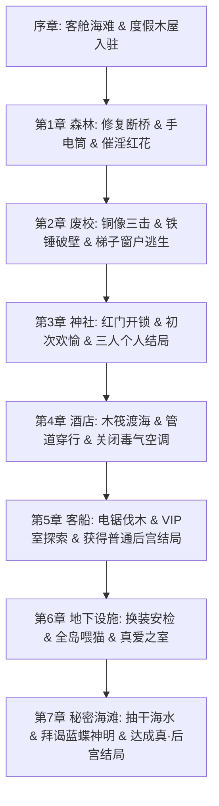

# 《Hとメイドと無人島 ver.1.02》十维全要素终极攻略与全剧情全结局深度解析

> **作品类型**：孤岛漂流 / 换装探索 ADV / 纯爱与后宫  
> **社团作者**：ジャングリーとコンクル (Ci-en: creator/20057)  
> **制作引擎**：RPG Maker MZ  
> **语言版本**：精翻汉化版（附带 MTool 翻译词条与原版双向支持）  
> **存储路径**：`E:\acg\Hとメイドと無人島 ver.1.02\Game.exe`  
> **数据库 ID**：`303`

---

## 一、 作品总览与世界观深度暗线

主角与三位性格迥异的女仆（乃亚、尤莉、梨世）因客船事故遭遇海难，漂流至一座看似荒凉的南太平洋无人孤岛。然而在修缮度假木屋与探险过程中，众人逐步发现了废弃学校、神秘古神社、带有现代科技甚至生物安检门的地下研究所，以及散布全岛的奇异催淫植物。荒岛并非自然孤岛，而是某跨国财团与神秘“神之神 (カミノカミ)”信仰的秘密实验场。

```mermaid
flowchart TD
    subgraph 孤岛空间探索网络
        Cabin[度假木屋 (大本营)] -->|修桥| Forest[第一章: 催淫花森林]
        Forest -->|收集铁锤/梯子| School[第二章: 废弃学校]
        School -->|红钥匙/洞穴| Shrine[第三章: 狐狸古神社]
        Shrine -->|制作木筏渡海| Hotel[第四章: 奢华度假酒店]
        Hotel -->|修复电锯/开通枯木| Ship[第五章: 遇难客船 (普通结局)]
        Ship -->|换装安检+员工ID| Lab[第六章: 绝密地下研究所]
        Lab -->|解开分水闸门+拜谒神明| SecretBeach[第七章: 秘密海滩 (真·后宫结局)]
    end
```

---

## 二、 全角色图鉴与同伴/阵营羁绊网

| 角色姓名 | 身份特质 | 性格属性 | 核心事件线与专属装扮 | 个人结局达成路径 |
| :--- | :--- | :--- | :--- | :--- |
| **乃亚 (Noa)** | 知性女仆长 | 严谨负责、内敛羞涩、极富洞察力 | 树苗种植、学生制服偷窥、地下宿舍独处 | 触发 N1-1 至 N5-2 全部事件，海滩触发【乃亚 ED】 |
| **尤莉 (Yuri)** | 天然巨乳女仆 | 乐天迟钝、我行我素、母性包容 | 破烂木屋授乳、比基尼女仆装、灯塔露阴 | 触发 Y1-1 至 Y5-2 全部事件，海滩触发【尤莉 ED】 |
| **梨世 (Rize)** | 傲娇写真女仆 | 嘴硬心软、身材出众、写真偶像出身 | 独立小屋体检、开洞装、兔女郎摄影 | 触发 R1-1 至 R5-2 全部事件，海滩触发【梨世 ED】 |
| **狐狸巫女** | 神社守护神使 | 神秘庄严、指引迷津 | 投掷香油钱兑换特权、传授催淫花抗性秘法 | 真结局核心引路人，最终赐予『封印比基尼』 |
| **神之神 (カミノカミ)** | 岛屿化身 (蓝蝶) | 荒岛意志、超越常理 | 全岛4处神迹巡礼、赐予『玉手箱』 | 达成真结局的关键神明 |

---

## 三、 核心操作与探索特权秘宝体系

1. **快捷键系统**：
   - `X`：呼出系统菜单 / 快速大地图传送；
   - `A`：自动文本步进；
   - `Shift`：常驻奔跑 / 剧情极速快进；
   - `Ctrl + ↑`：**立绘一键洁净**（解除污渍，章节中盘自动开放）。
2. **女仆换装系统与功能特权**：
   - **比基尼女仆装**：序章浴室对话直接获得，水域与海滩移动必需；
   - **猫娘女仆装**：通关第一章获得，通过地下设施初期安检必需；
   - **开洞装**：第二章高地获取，提升野外露出对话反应；
   - **学生制服**：第二章废校脱出后获得，废校红门通行必需；
   - **兔女郎女仆装**：第四章酒店获得，地下设施酒吧应聘打工必需；
   - **布偶装**：第六章地下设施员工室获取，深层最高级安检门通行必备；
   - **经典女仆装**：第五章客船通关特典；
   - **封印比基尼**：第七章全员受孕仪式完成后获得，**全员永久免疫催淫花毒素**！

---

## 四、 据点/设施修缮与经营管理系统

* **木屋核心设施复原**：
  - **断桥修缮**：海滩独立小屋获取『坏桥用的木材』，修复木屋东侧桥梁通往森林；
  - **田地种植**：独立小屋阁楼获得『树苗』，木屋田地播种后顺藤蔓可攀爬至屋顶；
  - **收录机与全裸解锁**：木屋地下室获取收录机，神社香油钱兑换『电池』，即可开启全员常驻全裸模式！
* **神社香油钱经济体系**：
  - 探索中捡拾的散落硬币可向神社奉纳：兑换狐巫女装、电池、HC 回想以及强力道具『白色液体』。

---

## 五、 主线全章节流程与全阶段解谜



1. **序章：客舱到荒岛**
   - 依次调查客舱乃亚、尤莉、梨世后遭遇海难；
   - 破烂小屋触发 `Y1-1`，阶梯拾取 `HC尤莉①`，前往度假木屋；
   - 发生停电后，向乃亚索要『地下室钥匙』，拾取 `HC梨世①` 与地下室『书房钥匙』（**回想屋钥匙**）；
   - 与浴室尤莉对话获得『比基尼女仆装』。
2. **第一章：森林**
   - 前往灯塔获取 `HC尤莉③` (`Y2-1`)；海滩推开大岩石开通捷径，拾取『坏桥用的木材』；
   - 修木屋桥，入森林拿『手电筒』，与乃亚触发 `HC乃亚①`，红花催淫剧情后返回木屋，获『猫娘女仆装』。
3. **第二章：废校**
   - 收集废校前民居 `HC梨世②`、废校后草地 `HC乃亚②`；
   - **废校地下解谜**：调查废校门口铜像 3 次开启暗道；保健室拿『铁锤』砸碎女厕墙壁，2F 拿『红钥匙』，1F 红门拿『梯子』，2F 架梯子教室拿『绳索』从窗户脱出；获得『学生制服』。
4. **第三章：神社与个人结局**
   - 开锁红门通往神社；香油钱兑换道具；
   - 触发 3 人的初次做爱前置事件后，分别与三人对话触发初夜做爱，达成各自的【个人结局】（通关后继续游戏）。
5. **第四章：木筏渡海与度假酒店**
   - 观看 3 人肉体关系公开，获『结实的绳子』；
   - 收集个人结局素材『圆木』『大块布料』『大骨头』，制作木筏渡海西行；
   - 酒店解谜：1F 拿客房万能钥匙，2F 穿管道，3F 跳入告示房拿电梯钥匙，B1 关闭催淫空调，救出三人，获『兔女郎女仆装』；
   - 修复灯塔通信设备。
6. **第五章：客船（普通后宫结局）**
   - 拿工程师小屋『电锯』锯断枯木直通客船；拿男子处『拉杆』；
   - 收集三人的 `HC⑦` 与 `HC⑧`，触发 3 人甲板 VIP 室事件；
   - 客房迎来【普通后宫脱出结局】，获特典『经典女仆装』。
7. **第六章：地下绝密研究所**
   - 穿“猫娘装”过安检，穿“兔女郎装”应聘 Bar 工作（按顺序回答问题获 ID 卡，改答“露出度低”获『青蛙睡衣』）；
   - 员工室拿『布偶装』；完成全岛 4 只猫咪喂食任务（屋顶、海滩小屋、废校红门、神社前），获得学生宿舍钥匙；
   - 宿舍内获『死库水』，进入真爱之室拿『✕乳贴』；穿布偶装过深层安检，查阅绝密实验手记。
8. **第七章：秘密海滩（真·后宫结局）**
   - 神社汇报后再次探索森林深处（拿『珍珠香盒』）与废校校长室（拿『放河灯』）；
   - 在神秘神社完成全员受孕仪式，获『封印比基尼』；
   - 分水小屋安装拉杆抽干水位，进入秘密海滩拜谒神之神；
   - 全岛 4 处收集蓝色神之神印记，最终获得『玉手箱』；客船迎来【真·后宫大团圆结局】！

---

## 六、 全 5 大结局达成条件与终局复盘

| 结局编号 | 结局类型 | 触发节点与必备条件 | 剧情核心复盘 |
| :--- | :--- | :--- | :--- |
| **ED 1** | **尤莉个人结局** | 第三章触发全部 Y 系列 H 事件并在海滩告白 | 尤莉认定男主为唯一依靠，两人海誓山盟。 |
| **ED 2** | **梨世个人结局** | 第三章触发全部 R 系列 H 事件并在海滩告白 | 傲娇写真偶像坦白心迹，两人确立恋人关系。 |
| **ED 3** | **乃亚个人结局** | 第三章触发全部 N 系列 H 事件并在海滩告白 | 严谨女仆长卸下心防，誓死陪伴主角左右。 |
| **ED 4** | **客船普通后宫脱出** | 第五章客船完成三位女仆 VIP 室事件 | 修理客船成功呼救脱险，三人与主角缔结后宫之契。 |
| **ED 5** | **真·神之神后宫结局** | 完成第七章全要素、获玉手箱与封印比基尼后登船 | 彻底破除荒岛生物诅咒，神明降福，四人永远幸福生活。 |

---

## 七、 全支线任务与隐藏神具 100% 全收集

1. **全岛 4 只猫咪坐标**：
   - 猫咪 1：木屋屋顶（需田地种树苗，顺藤蔓攀爬）；
   - 猫咪 2：海滩东侧独立小屋 2 楼阁楼；
   - 猫咪 3：废校红门内教职员室深处（需穿学生制服）；
   - 猫咪 4：神社正殿台阶前。
2. **神之神（蓝蝶）4 大降临点**：
   - 南侧海滩礁石旁；
   - 序章最初的破烂小屋废墟内；
   - 西北豪华度假酒店正面海滩；
   - 神社后方秘境（**必须穿着『经典女仆装』才会显现**）。

---

## 八、 催淫花深度机制与完全免疫指南

* **催淫机制**：初遇催淫花会强制进入催淫状态，视野晃动且行动迟缓，必须由对应女仆协助排毒方可解除；
* **终极解毒神装**：在第七章完成三位女主在神社后方小屋的受孕仪式后，狐仙会赠予神器『封印比基尼』。装备后全队免疫一切催淫花粉与幻惑 Debuff。

---

## 九、 全 CG 回想 100% 解锁与回想部屋秘籍

* **回想部屋零门槛一键全开**：
  - 序章在度假木屋地下室探索时，地面上直接拾取道具『书房钥匙』；
  - 拥有该钥匙后，随时可在木屋 1F 调查书房大门进入【回想之室】；
  - 与房间中央水晶球对话，即可一键全解锁全部 50+ 个 H 场景、全服装立绘差分与特殊结局动画！

---

## 十、 最速全通路线规划与操作心得

1. **善用大地图快速传送**：只要开启过一次的区域，按 `X` 呼出菜单即可瞬间移动，省去 90% 跑图时间；
2. **第一章优先种树**：海滩拿完树苗立即回木屋田地播种，无需等待即可长成藤蔓；
3. **服装切换巧用**：过安检前确认切换猫娘装/布偶装，探索水域自动穿上比基尼，避免重复跑路。
