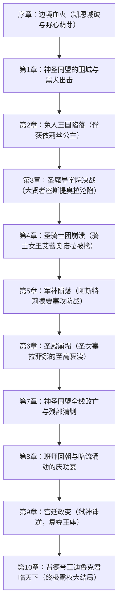

# 🏰《黑兽2·改 ～淫欲所染的背德之都，再临～》（Kuroinu 2 Kai）全剧情解析·全角色档案·全系统要素全指南

> **开发社团**：Liquid（经典暗黑奇幻拔作殿堂级品牌）  
> **日文原名**：『黒獣２･改 ～淫欲に染まる背徳の都、再び～』  
> **英文译名**：*Kuroinu 2: The City of Immorality Stained in Lust, Once Again - Kai*  
> **游戏引擎**：YU-RIS 4.80  
> **作品类型**：暗黑史诗奇幻 / 征服与篡夺 / 圣女恶堕 / 狂气霸王传奇 ADV  
> **全要素规模**：全 10 大主线章节、2000 张全差分事件 CG、300 个回想场景、100 部动态演出动画、50 首豪华背景音乐、专属篡位模式（Sandatu Mode）以及黑兽 1 代全明星女主角联动剧场。

---

## 📑 目录导航
1. [世界观与宏大历史背景](#一世界观与宏大历史背景)
2. [主角与核心女主角全角色档案](#二主角与核心女主角全角色档案)
   - [主角：迪鲁克·朗多（黑犬骑士团长 / 篡位霸王）](#1-主角迪鲁克朗多dyrek-rondo)
   - [女帝：拉德米拉（涅格兰斯提亚绝对支配者）](#2-背德女帝拉德米拉radmila)
   - [圣女：塞拉菲娜（神圣同盟盟主 / 纯洁的光辉）](#3-圣女塞拉菲娜serafina)
   - [军神：阿斯特莉德（同盟军最高总帅 / 不败名将）](#4-军神阿斯特莉德astrid)
   - [骑士女王：艾蕾奥诺拉（近卫圣骑士团领袖）](#5-骑士女王艾蕾奥诺拉eleonora)
   - [大贤者：密斯提奥拉（圣魔导学院长）](#6-大贤者密斯提奥拉mystiora)
   - [兔人公主：依莉丝（同盟国娇嫩公主）](#7-兔人公主依莉丝iris)
   - [近卫侍女：露卡（深宫近侍侍从）](#8-近卫侍女露卡lucca)
   - [斥候与妖精：琥珀 & 梅露梅露](#9-异族斥候与妖精琥珀--梅露梅露)
   - [黑兽1代全明星联动女主角阵容](#10-黑兽1代全明星联动女主角阵容)
3. [主线剧情流程与全章节征服史（Chapter 01 ~ 10）](#三主线剧情流程与全章节征服史)
4. [《改》（Kai）版与 Append 追加核心机制解析](#四改版与-append-追加核心机制解析)
   - [篡夺模式（Sandatu Mode / 篡位霸权开局）](#1-篡夺模式-sandatu-mode)
   - [黑兽1代全明星特典剧场](#2-黑兽1代全明星联动特典剧场)
   - [专属后日谈与深渊恶堕剧场（After Story）](#3-专属后日谈与深渊恶堕剧场)
5. [全要素存档与Extra回放系统说明](#五全要素存档与extra回放系统说明)

---

## 一、世界观与宏大历史背景

### 1. 塞雷纳斯大陆与背德之都「涅格兰斯提亚」
故事发生在广袤而动荡的**塞雷纳斯大陆（Serenus Continent）**。在大陆西方，矗立着一座令整片大陆既畏惧又唾弃的罪恶帝国——**「涅格兰斯提亚」（Negramstia）**，俗称“奉仕之都”或“背德之国”。  
在这片国土上，常理的道德与宗教教义被全盘颠覆，**「欲望即是一切，快感乃最高正义」**。建国百余年间，涅格兰斯提亚凭借无尽的奢靡与残虐，达到了繁荣与堕落的极致。

### 2. 淫魔女帝的“人狩”与神圣同盟的誓师
统治这片罪恶之都的，是拥有绝对魅惑魔力的**女帝拉德米拉（Radmila）**。拉德米拉不仅日夜在寝宫中纵欲无度，更将魔爪伸向了周边的各个文明国度。她以“进贡享乐之品”为由，在邻国境内频繁发起残暴血腥的**「人狩」**（猎捕贵族少女、处女平民与异族公主），激起了大陆诸国的滔天怒火。  
忍无可忍的周边各大王国、骑士团领地、精灵自治领与神圣教廷终于摒弃前嫌，集结全大陆最精锐的正义之师，组成了庞大的**「神圣同盟」（Holy Alliance）**，由象征大陆纯洁与正义的**圣女塞拉菲娜**为名誉盟主、名将**军神阿斯特莉德**为最高统帅，以排山倒海之势向涅格兰斯提亚发起全面包围与合围决战！

### 3. 黑犬骑士团与狂傲野心家——迪鲁克
就在神圣同盟即将彻底粉碎涅格兰斯提亚边境防线的危急关头，一名浑身散发着暴虐与凶煞之气的男人挡在了盟军阵前。  
他正是名震大陆的凶残雇佣兵组织——**「黑犬骑士团」（Black Dog Knights）团长迪鲁克·朗多（Dyrek Rondo）**。坊间传闻他是当年一代传奇开国雇佣兵王沃尔特（Vult）转世再临。  
然而，表面上迪鲁克遵从女帝拉德米拉的御旨迎击神圣同盟，但潜藏在迪鲁克心底深处的，却是无比狂暴而冷彻的野心——**「弑主篡位，称霸天下」**！  
对于迪鲁克而言，不仅神圣同盟军高高在上的圣女、坚贞的女将军、高贵的骑士女王是他的猎物，就连王座上不可一世的女帝拉德米拉，也终将沦为他脚下的玩物！

---

## 二、主角与核心女主角全角色档案

### 1. 主角：迪鲁克·朗多（Dyrek Rondo）
* **身份**：黑犬骑士团团长 / 狂暴雇佣兵之王 / 终极篡位霸主
* **性格与特征**：冷酷、嗜血、霸道无匹、野心滔天。拥有全大陆最顶尖的单兵武勇与残酷手腕，同时具备高超的战略眼光与攻心调教手腕。他精通瓦解敌方高岭之花意志的心理战术，通过残虐折辱与肉体快感的交织，将一切高洁神圣彻底拖入污浊深渊。

### 2. 背德女帝：拉德米拉（Radmila）
* **阵营**：涅格兰斯提亚（支配者）
* **角色定位**：拥有魅惑全大陆权贵与勇士魔力的绝代妖姬。性欲宛如无底黑洞，将男人的精魄与王权视为玩物。
* **剧情轨迹**：起初将迪鲁克视为一条强力而驯服的恶犬，在寝宫肆意享受迪鲁克的粗暴侍奉；然而在决战后期，却反被积蓄已久的迪鲁克彻底发动政变反噬，从高高在上的女王被践踏为日夜承欢受孕的王座母犬。

### 3. 圣女：塞拉菲娜（Serafina）
* **阵营**：神圣同盟（名誉盟主 / 精神支柱）
* **角色定位**：整片大陆信仰的神圣化身，金发碧眼、洁白无瑕，身负拯救苦难黎民与消灭背德之都的宏愿。
* **堕落轨迹**：被迪鲁克以卑鄙计谋与压倒性武力俘获后，遭遇了最为残酷的信仰践踏。从最初誓死不屈、绝食抵抗，到在神圣祭坛前被魔药与暴行持续开发，最终清纯的信仰被彻底改写为对迪鲁克肉棒的永恒崇拜。

### 4. 军神：阿斯特莉德（Astrid）
* **阵营**：神圣同盟军（最高总帅 / 战神）
* **角色定位**：大陆无人不知的冷彻名将，银发铠甲、治军严明，数度击溃背德帝国主力。
* **堕落轨迹**：在要塞陷落一役中，为了掩护残部撤退力竭被擒。面对迪鲁克，阿斯特莉德试图以自裁捍卫军人尊严，却被剥夺武具、在昔日部下面前被公开示众并施以最残酷的雌堕调教，终成狂热渴求战败惩罚的狂乱母兽。

### 5. 骑士女王：艾蕾奥诺拉（Eleonora）
* **阵营**：艾尔多尼亚王国 / 近卫圣骑士团领袖
* **角色定位**：身材丰满高挑、威风凛凛的正义女圣骑士，贯彻至高无上的骑士道信条。
* **堕落轨迹**：在阵地遭遇黑犬佣兵包围突袭，为了保护年轻见习骑士而甘愿沦为战俘。在密牢中经受黑犬士兵与魔物的轮番蹂躏，一身坚不可摧的骑士骄傲彻底碎裂。

### 6. 大贤者：密斯提奥拉（Mystiora）
* **阵营**：古代圣魔导学院（院长）
* **角色定位**：知性优雅、掌握大陆失传高阶禁咒的沉静学者。
* **堕落轨迹**：学院防御结界被破后，研究资料与魔导兵器全部落入黑犬骑士团之手。其理智的大脑在极度反差的精神催眠与肉体开发中失守，沦为终日沉迷肉欲计算的痴态魔女。

### 7. 兔人公主：依莉丝（Iris）
* **阵营**：同盟成员国 / 兽人联合领
* **角色定位**：纯真烂漫、娇小温婉的兔人族公主，拥有象征纯洁的雪白兔耳。
* **堕落轨迹**：城破之日目睹父母被残杀，在极度的绝望与无助中被送上拍卖行与军营。在迪鲁克野蛮狂暴的占有下，娇嫩脆弱的身体被迫烙印上永不磨灭的奴隶支配刻印。

### 8. 近卫侍女：露卡（Lucca）
* **阵营**：涅格兰斯提亚（深宫内廷）
* **角色定位**：忠诚机敏的高挑侍女长，深知宫廷暗流汹涌，暗中倾慕并协助迪鲁克的夺权大计。

### 9. 异族斥候与妖精：琥珀 & 梅露梅露
* **琥珀（Kohaku）**：敏锐矫健的兽耳斥候少女，在森林哨所中被俘，野性与桀骜在粗暴调教中逐渐化为臣服的顺从。
* **梅露梅露（Melmel）**：与世无争的森林妖精萝莉，纯洁的心灵被背德之毒所侵染。

### 10. 黑兽1代全明星联动女主角阵容
在《黒獣２･改》专属联动要素中，一代经典女主角悉数登场，提供专属侵略与调教回想：
* **塞勒斯汀（Celestine）**：一代至高妖精女王，被幽禁深宫的终极象征
* **艾丽西亚（Alicia）**：纯洁骑士团长
* **克劳迪娅（Claudia）**：高贵神圣的高岭名媛
* **克洛伊（Chloe）**：暗黑精灵法皇
* **玛雅（Maia）** & **普莉姆（Prim）** & **辉夜（Kaguya）** & **奥莉加（Olga）**

---

## 三、主线剧情流程与全章节征服史

### 章节战役核心概要：
* **序章（Chapter 00）**：边境重镇凯恩化为火海，黑犬骑士团展现残暴战力。迪鲁克在寝宫向女帝拉德米拉交差，表面谦卑，暗中冷眼打量女帝的肉体与王权。
* **前哨攻坚（Chapter 01 ~ 03）**：同盟军外围据点被逐个击破，俘虏依莉丝与密斯提奥拉，黑犬军声威大震。
* **中盘决战（Chapter 04 ~ 06）**：正面迎战同盟军绝对主力，连破艾蕾奥诺拉圣骑士团与阿斯特莉德军团，直捣神圣同盟大本营，亲手擒获圣女塞拉菲娜，同盟军彻底覆灭！
* **终章政变（Chapter 07 ~ 10）**：带着全大陆最顶尖的俘虏凯旋归都。在为女帝献上“战利品”的盛大宴会上，迪鲁克突然暴起发动雷霆兵变！拉德米拉被死死按在王座上屈辱求饶，迪鲁克登基为背德帝国新皇帝，将全大陆的支配权牢牢握在手中！

---

## 四、《改》（Kai）版与 Append 追加核心机制解析

### 1. 篡夺模式（Sandatu Mode / 篡位霸权开局）
在游戏标题菜单或初始设定中，玩家可直接激活 **【篡夺模式】**（沙陀模式）：
* **跳过前期剧情**：无需经历漫长的主线攻城，直接以“已完成弑君篡位”的帝国新皇帝姿态开始！
* **全权力开放**：自由调用帝国内廷的所有俘虏、奴隶设施，直接进入各女主角的专属深层侵略剧情。

### 2. 黑兽1代全明星联动特典剧场
在 Append 扩展菜单中，收录了一代 9 位核心女主角的特典剧场。迪鲁克踏入封印着一代战败女英雄的秘殿，重新展开跨世代的征服与联动演出。

### 3. 专属后日谈与深渊恶堕剧场
在《黒獣２･改》中，为各女主追加了终局之后的长期后日谈（After Story）：
* **圣女塞拉菲娜**：彻底沦为狂信迪鲁克的母性肉便器
* **女帝拉德米拉**：从支配者彻底转变为渴求受孕的深宫雌奴
* **阿斯特莉德 & 艾蕾奥诺拉**：昔日的军队与骑士统帅成为皇帝行军帐中的双壁玩物

---

## 五、全要素存档与Extra回放系统说明

本指南配套的本地游戏已由 ACG Vault 自动逆向分析并完成全解锁部署：
* **CG 鉴赏模式（CG Mode）**：全 10 大女主/配角分类、共 2000 张差分 CG 全部点亮！
* **回想场景（Scene / Replay Mode）**：全 300 个核心 H 事件、路线结局、后日谈剧情任意即时回放！
* **影片与原声（Movie / BGM Mode）**：100 部动态动画、50 首全部原声背景音乐无限制畅听！
* **全脚本已读与全选择肢标记**：全剧本文本已激活快进支持，全分支选择肢状态已同步激活！

玩家只需在游戏主菜单点击 **【EXTRA】** 或 **【アペンド】**，即可自由享受全部剧情与高阶内容！
