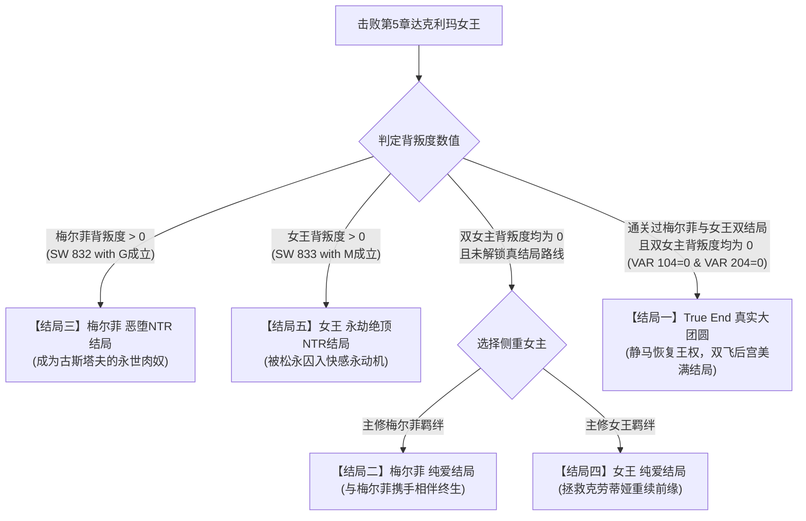

# 🗡️《メルフィアス 蒼紅のヴァージェ》（苍红界域）全剧情流程·全路线分支·全结局达成终极攻略

> **游戏名称**：メルフィアス 蒼紅のヴァージェ（MELFIAS: The Azure and Crimson Verge / 梅尔菲亚斯 苍红界域）  
> **游戏版本**：Ver 1.27 / 汉化完整版  
> **制作社团**：メルフィアス制作组 / 柴犬同盟  
> **游戏引擎**：RPG Maker MV (Nw.js)  
> **作品类型**：科幻暗黑奇幻 / 吸血鬼反乌托邦 / 动作RPG / 纯爱与双重NTR堕落 / 双女主角养成  
> **双女主角**：  
> - **梅尔菲（Melfi）**：平民阶层达克利玛吸血鬼少女，身怀绝技的吸血鬼猎人，擅长使用 PSI 强化光剑与加速器。对搭档静马怀有矢志不渝的炽热爱意。  
> - **达克利玛女王·克劳蒂娅（Queen Claudia）**：统治吸血鬼帝国的冷艳女王，真正身份是静马千年前的人类恋人。为了复活静马而舍弃一切创造了达克利玛世界，灵魂却被野心家松永伯爵封印与觊觎。  
> **核心机制**：瓦尔杰天平体系（爱情/嫉妒/淫欲/背叛/出轨）、月相更替（新月/弦月/满月）、部位拘束与爆衣处刑、PSI武器进阶锻造、双重路线（纯爱拯救 vs 恶堕NTR）、真结局大团圆。

---

## 📑 攻略目录导航
1. [世界观设定与全剧情深度解析](#一世界观设定与全剧情深度解析)
   - [背景世界观：达克利玛与人类存亡](#1-背景世界观达克利玛与人类存亡)
   - [静马、克劳蒂娅与梅尔菲的千年宿命真相](#2-静马克劳蒂娅与梅尔菲的千年宿命真相)
   - [黑幕与敌对派系剖析（古斯塔夫与松永伯爵）](#3-黑幕与敌对派系剖析古斯塔夫与松永伯爵)
2. [核心系统与数值机制全面剖析](#二核心系统与数值机制全面剖析)
   - [瓦尔杰天平（Vaarge System）数值量表](#1-瓦尔杰天平vaarge-system数值量表)
   - [月相系统（Moon Phase）运转与影响](#2-月相系统moon-phase运转与影响)
   - [战斗机制、部位束缚与爆衣解脱](#3-战斗机制部位束缚与爆衣解脱)
   - [PSI 加速器与武器合成升级树](#4-psi-加速器与武器合成升级树)
3. [主线剧情全章节步步通关流程](#三主线剧情全章节步步通关流程)
   - [序章：红尘初劫·列车突围与据点集结](#序章红尘初劫列车突围与据点集结)
   - [第一章：废弃工厂·突入险境与机车救援](#第一章废弃工厂突入险境与机车救援)
   - [第二章：暗影回廊·拜尔神殿塔与地下潜行](#第二章暗影回廊拜尔神殿塔与地下潜行)
   - [第三章：幽灵铁道·D4生化研究所与宿敌贝利斯](#第三章幽灵铁道d4生化研究所与宿敌贝利斯)
   - [第四章：强袭总部·女王骑士团大厦破晓之战](#第四章强袭总部女王骑士团大厦破晓之战)
   - [第五章：终焉神殿·魔动炉深处与苍红决战](#第五章终焉神殿魔动炉深处与苍红决战)
4. [全五大结局达成条件与分歧指南](#四全五大结局达成条件与分歧指南)
   - [结局一：真结局（True End·双飞大团圆）](#1-真结局true-end双飞大团圆)
   - [结局二：梅尔菲 纯爱结局（Melfi Pure Love End）](#2-梅尔菲-纯爱结局melfi-pure-love-end)
   - [结局三：梅尔菲 恶堕NTR结局（Melfi NTR End）](#3-梅尔菲-恶堕ntr结局melfi-ntr-end)
   - [结局四：女王 纯爱结局（Queen Pure Love End）](#4-女王-纯爱结局queen-pure-love-end)
   - [结局五：女王 永劫绝顶NTR结局（Queen NTR End）](#5-女王-永劫绝顶ntr结局queen-ntr-end)
5. [全回忆室（Recollection）CG与事件全解锁表](#五全回忆室recollectioncg与事件全解锁表)
6. [隐藏要素、支线委托与通关特典](#六隐藏要素支线委托与通关特典)

---

## 一、世界观设定与全剧情深度解析

### 1. 背景世界观：达克利玛与人类存亡
在《梅尔菲亚斯 苍红界域》的舞台中，世界被处于食物链顶端的新进化种——**高等吸血鬼「达克利玛（Dacrima）」**所绝对统治。
* 达克利玛拥有远超人类的身体素质、再生机能以及对魔动科技（PSI能量）的掌控力。
* 普通人类沦为被圈养、支配与提供血食的底层生物。部分人类组成了反抗同盟**「克兰（Clan）」**，在废墟旧城镇中苟延残喘，依托地下暗道与达克利玛周旋。
* 达克利玛帝国的统治核心为**女王城（Queen's Castle）**，其核心动力为维持整座城市运转的超大型生化魔动炉。

### 2. 静马、克劳蒂娅与梅尔菲的千年宿命真相
* **男主角·静马（Shizuma）**：
  表面上是反抗军组织中性格温和、身手矫健的人类新兵，但他**真正的身份是拥有纯正王血的达克利玛魔贵族**！
  在千年前的远古战争中，静马为了守护自己所挚爱的人类少女**克劳蒂娅**力竭战死。
* **达克利玛女王·克劳蒂娅（Queen Claudia）**：
  原本只是普通人类公主。在恋人静马战死后，克劳蒂娅陷入了巨大的绝望与执念，为了将静马从死亡深渊中召回，她甘愿舍弃人类之躯，成为了最初的达克利玛始祖——**达克利玛女王**。她用千年岁月建造了整个达克利玛帝国与魔动炉体系，只为重塑静马的身躯与灵魂。但因为魔动炉的庞大反噬，克劳蒂娅在静马苏醒时陷入了人格沉睡，身体与权柄被虚妄的神格所占据。
* **女主角·梅尔菲（Melfi）**：
  平民阶层的达克利玛少女。早在千年前静马战死的那一夜，她就在暗处默默目睹了那位高贵而温柔的魔贵族为爱牺牲的全过程。梅尔菲由此深深爱上了静马。在静马复活并化身失忆人类战士加入反抗军后，梅尔菲毫不犹豫地陪伴在他身边，作为吸血鬼猎人搭档与他同生共死。

### 3. 黑幕与敌对派系剖析（古斯塔夫与松永伯爵）
* **反抗军伪君子·古斯塔夫（Gustav）**：
  人类反抗同盟「克兰」的局长。表面上慷慨激昂领导人类解放事业，实则是一个极度自私丑陋的人渣。他背地里与达克利玛暗中交易，将抵抗军战士和无辜人类以“作战出击”为幌子出卖给达克利玛作为肉食；同时在反抗军的武器上做手脚制造卡壳。他极度垂涎梅尔菲的美色，处心积虑企图击垮梅尔菲的意志并将其变成自己的肉奴隶。
* **吸血鬼野心家·松永伯爵（Count Matsunaga）**：
  达克利玛上层魔贵族。他看穿了女王内心的脆弱，利用秘宝「圣母悼歌（Stabat Mater）」系统，夺取了女王城的控制权限，将沉睡的女王克劳蒂娅禁锢在虚无的容器中，并企图通过无休止的淫虐调教将女王彻底变为自己的禁脔。
* **Ω骑士·贝利斯（Belis）**：
  叛逆的达克利玛大剑豪。拒绝臣服于虚伪的女王命令，信奉绝对的力量与武道，是贯穿中期的强力劲敌。

---

## 二、核心系统与数值机制全面剖析

### 1. 瓦尔杰天平（Vaarge System）数值量表
游戏内有极其精密的人格天平系统（可在状态界面或通过『状态控制器』查看）：

| 角色数值变量 | 变量ID | 属性影响与阈值意义 | 纯爱路线控制要诀 | NTR/恶堕路线触发点 |
| :--- | :--- | :--- | :--- | :--- |
| **梅尔菲·爱情度 (M_Love)** | VAR [101] | 决定梅尔菲与静马的羁绊与纯爱剧情解锁 | 保持 ≥ 100，积极触发夜袭谈心 | 若低于 30，容易心防崩溃 |
| **梅尔菲·嫉妒心 (M_Jeal)** | VAR [102] | 静马与其他女性亲近时飙升，达阈值引爆 | 避免过度撩拨局次长与埃尔内斯塔 | 超过 80 会引发暴走惩罚 |
| **梅尔菲·淫欲 (M_Inyoku)** | VAR [103] | 战败束缚、被脱衣、承受快感攻击时增加 | 战斗中及时使用解脱技能与炸弹 | 达到 100/150/200 触发恶堕进阶 |
| **梅尔菲·背叛度 (M_Uragiri)** | VAR [104] | **核心分歧点**！只要 > 0 则无法达成真结局 | **绝对严禁**答应古斯塔夫的任何非分要求 | 触发 MG02~05 事件后飙升 |
| **女王·爱情度 (Q_Love)** | VAR [201] | 静马与女王（克劳蒂娅）的情感复苏 | 积极触发旧宫幽会剧情（QS01~04） | 若为负数则女王无法唤醒 |
| **女王·背叛度 (Q_Uragiri)** | VAR [204] | **核心分歧点**！松永调教女王的沦陷程度 | 必须在剧情中阻止松永的深度调教 | 触发 QM02~04 事件后彻底沦陷 |

> [!CAUTION]
> **通关警告（真结局红线）**：
> 想要达成 True End（真结局），通关第5章最终魔动炉时，**梅尔菲背叛度（VAR 104）必须严格等于 0**，且**女王背叛度（VAR 204）必须严格等于 0**！一旦有任意一点背叛度，真结局通道将被永久关闭！

---

### 2. 月相系统（Moon Phase）运转与影响
画面顶部显示当前月相，从新月到满月周期更替：
* **新月（New Moon）**：达克利玛活性减弱，潜行事件容易成功，贝利斯处于特定破甲状态。
* **上弦月 / 下弦月**：常规探索与公会委托结算期。
* **满月（Full Moon）**：达克利玛本能暴涨！
  - 只有在满月之夜，特定地图的「月光宝箱（Moon Box）」才能开启。
  - 满月夜且静马不在时，会触发特殊的夜袭/调教分支。
  - 猫咪神秘黑市商人（Neko Shop）仅在特定月相出没。

---

### 3. 战斗机制、部位束缚与爆衣解脱
* **双人协作战斗**：
  静马主打近战牵制与支援解救；梅尔菲主打 PSI 广域输出与属性爆发。
* **敌方束缚（Bind）机制**：
  敌方兵器与魔物会使用拘束皮带、触手或重装拘束技，束缚梅尔菲的胸部、下半身等部位。
  - **束缚状态中**：梅尔菲每回合受到快感刺激，淫欲度持续增加，无法正常行动。
  - **爆衣系统（Strip）**：长时间束缚会导致上衣破损（Cloth Chest）与内裤被夺（Panty Strip）。
  - **解除束缚**：静马必须在行动列表中优先选择技能【拘束を解く（解除束缚）】或消耗道具【反束缚炸弹（Antibind Bomb）】解救梅尔菲。若静马倒下，将直接进入战败处刑 H 流程！

---

### 4. PSI 加速器与武器合成升级树

梅尔菲的专属武装为 **PSI 加速器（PSIアクセラ）**，拥有多阶段攻击与属性附魔机制：

| 武器级别 | 设计图获取途径 | 核心特效 | 战术评价 |
| :--- | :--- | :--- | :--- |
| **PSIアクセラ Lv1** | 初始自带 | 单体 PSI 能量斩击 | 基础平A过渡 |
| **PSIアクセラ Lv2** | 工厂废墟宝箱（设计图Lv2） | 随机攻击 **2 名敌人** | 群怪清杂质变 |
| **PSIアクセラ Lv3** | 拜尔神殿塔隐藏宝箱（设计图Lv3） | 随机攻击 **3 名敌人** | 中期主力推图神兵 |
| **PSIアクセラ Lv4** | D4研究所第11区（设计图Lv4） | 随机攻击 **4 名敌人** | 极高连击覆盖率 |
| **PSIアクセラ LvMAX** | 最终女王城右翼5区（设计图LvMAX） | **2倍攻击力随机连击 4 名敌人** | 毕业究极物理/魔动输出 |

* **元素推进器附魔**：
  - **[炎] 火焰推进器**：攻击附加燃烧 DOT 伤害，对机械与重装骑士有特效。
  - **[冰] 寒霜推进器**：攻击附加冻结与减速效果，对高敏捷刺客有奇效。

---

## 三、主线剧情全章节步步通关流程

### 序章：红尘初劫·列车突围与据点集结
1. **剧情开端**：静马与梅尔菲在列车上遭遇突袭，熟悉基础斩击与技能操作。击退第一波自律兵器。
2. **据点入驻**：抵达旧城镇（Old Town）。前往秘密据点（Ajito）1F 与 B1 汇报。
3. **初遇局次长**：与巨乳副局长**玲子（Reiko）**交谈，触发剧情对话。此时若选择礼貌回应可积累好感，但切记不要过度挑逗，以免拉高梅尔菲的嫉妒值。
4. **旅馆整备**：前往旅馆（Ryokan）2F 房间休息。夜间可触发初次【夜袭谈心】事件（SW 506: yobai01），这是确立梅尔菲纯爱路线的关键起点。

---

### 第一章：废弃工厂·突入险境与机车救援
1. **任务接取**：在据点会议室接取古斯塔夫发布的工厂调查任务。古斯塔夫表面关切，实则包藏祸心。
2. **探索工厂（Factory 1~11）**：
   - 沿传送履带前进，解开起重机开关（Factory Crane）。
   - 在 **Factory 6** 区域拾取关键资源【PSI方块（PSIcube）】。
   - 搜刮宝箱获取【PSI加速器设计图 Lv2】，返回据点装备课即可升级武器。
3. **机车驰援战（Bike Battle）**：
   - 工厂深处突发警报，梅尔菲遭遇女王骑士团主力包围。
   - 静马驾驶改装机车全速突进！在机车追逐战中躲避路障，击溃地狱暴走族（Hellbiker），成功与梅尔菲汇合。
4. **章末分歧警示**：
   - 战斗结束后返回旅馆，古斯塔夫会单独找梅尔菲搭话。**果断拒绝其引诱**，若选择软弱接受，将埋下 NTR 种子。

---

### 第二章：暗影回廊·拜尔神殿塔与地下潜行
1. **潜入旧机场与暗道**：
   - 从第5大道（5th street）进入旧机场（Old airport），穿过秘密通道（Secret passage 1~14）。
   - 密码门锁提示：调查暗道墙壁涂鸦，按顺序扳动电闸即可开启铁门。
2. **登临拜尔神殿塔（Temple Tower 2~13）**：
   - 神殿塔内布满监控警报与暗影魔物。拾取【拜尔塔门禁卡（Security Card）】。
   - 在神殿塔第4层等待月相变更为**满月**，可开启深处的「月光之匣」，获取稀有技能书【全队防御（Allguard）】。
   - 在神殿塔第12层拾取【PSI加速器设计图 Lv3】。
3. **危险的脱衣剧场与酒吧**：
   - 调查第5大道的酒吧（Bar）与脱衣舞剧场。
   - **纯爱避坑**：古斯塔夫与掮客会设局诱导梅尔菲参与地下演出。**切勿触发换装接客选项**！立即带梅尔菲返回据点，并触发【夜袭安慰（yobai02）】，大幅提升梅尔菲爱情度。

---

### 第三章：幽灵铁道·D4生化研究所与宿敌贝利斯
1. **搭乘幽灵列车**：
   - 前往车站闸机口，利用幽灵车票登上幽灵列车（Ghost Train 1~9）。
   - 依次穿越各节车厢，清剿车顶幽灵魔物，搜集3把列车钥匙开启车长室。
2. **探索D4生化研究所**：
   - 抵达地下研究所 D4 区（D4-1 ~ D4-15）。
   - 在 D4-4 区解开生化培养舱谜题，在 D4-11 区拾取第3枚【PSI方块】与【PSI加速器设计图 Lv4】。
   - 在 D4-10 区开启月光宝箱，获取【超级治疗（MegaHeal）】。
3. **决战 Ω骑士·贝利斯（Boss: Belis）**：
   - **Boss 机制**：贝利斯攻击力极高，血量低于 50% 时会释放绝技【九字斩】与【魔界转生】。
   - **打法要领**：静马起手使用【全队防御】，梅尔菲利用附魔冰属性的 PSI 加速器进行减速控制，集火破除贝利斯的重装护甲（BelisArmorBreak）。
   - 击败贝利斯后触发剧情，贝利斯认同了静马的武者气魄，透露了女王城魔动炉的致命弱点。
4. **女王幽会初遇（QS01）**：
   - 本章探索深处时，静马会在梦境/幻境中与女王克劳蒂娅发生共鸣，触发初次幽会。**选择真诚呼唤其名字**，激活女王纯爱线。

---

### 第四章：强袭总部·女王骑士团大厦破晓之战
1. **突击骑士团总部大厦（Order HQ 1~5）**：
   - 反抗军展开全面总攻，静马与梅尔菲作为先锋突入总部大厦。
   - 大厦1~2层为重装骑兵巡逻区，搜集【总部设计图残页】以显现隐藏通道。
   - 在大厦第4层击溃高阶指挥官，解除全楼防御电磁网。
2. **高层阴谋揭露**：
   - 在大厦顶楼通讯室，发现古斯塔夫长期出卖人类给松永伯爵的绝密账本！
   - 古斯塔夫原形毕露，企图反扑，被静马与梅尔菲当场制服。
   - 此时若此前未触发过任何背叛事件，梅尔菲会紧握静马的手，二人互诉衷肠，解锁【高级夜袭与誓言事件（yobai04/05）】。

---

### 第五章：终焉神殿·魔动炉深处与苍红决战
1. **潜入最终女王城（Last Castle Qualial）**：
   - 突破中央枢纽（Central 1~3），分别前往**左翼（Left Wing）**与**右翼（Right Wing）**关闭反应堆过载保险。
   - 在右翼5区（last_castle_r_1_5PSI）拾取【PSI加速器设计图 LvMAX】，回城或就地锻造最强武器！
2. **决战：达克利玛女王（Boss: Dacrima Queen）**：
   - **第一阶段**：女王释放高密度魔动弹幕与精神压迫，优先保持全员血量在 80% 以上。
   - **第二阶段**：女王展开魔界领域，召唤自律兵器协同。梅尔菲使用 LvMAX 加速器配合火焰爆发迅速清场。
   - **终结时刻**：静马以自身魔贵族的真祖之血破除女王周身的封印屏障，成功解放克劳蒂娅的灵魂！
3. **通往结局之门**：
   - 战斗结束后，系统根据双方的天平数值与背叛度，在 Map 352 进行命运判定！

---

## 四、全五大结局达成条件与分歧指南

### 1. 真结局（True End·双飞大团圆）
* **结局称号**：苍红之归宿（Azure & Crimson Harmony）
* **达成条件**：
  1. 系统存档中已记录通关过梅尔菲路线（普通或NTR）与女王路线（普通或NTR），解锁『真结局路线』（SW 582: open true route）。
  2. 当前周目打完魔动炉女王战时，**梅尔菲背叛度必须为 0**（VAR 104 == 0），**女王背叛度必须为 0**（VAR 204 == 0）。
  3. 此时 Map 352 会自动判定 `SW[818: S_end]` 为 ON，自动传送至核心圣殿 Map 371。
* **剧情尾声**：
  克劳蒂娅彻底解开心结，恢复原本娇羞可人的真实性格；静马取回前世魔贵族的无上权柄与记忆；梅尔菲欣喜地迎来了自己深爱千年的英雄。克劳蒂娅与梅尔菲以姐妹相称，两女共侍静马一人，三人共同开创达克利玛与人类和谐共生的全新王国！

---

### 2. 梅尔菲 纯爱结局（Melfi Pure Love End）
* **达成条件**：
  - 专一走梅尔菲路线，完成夜袭谈心系列事件（yobai01~05）。
  - **梅尔菲背叛度为 0**（未被古斯塔夫侵犯，SW 832 为 OFF）。
  - 未激活真结局前提下通关。
* **剧情尾声**：
  达克利玛帝国的阴谋被彻底摧毁，静马与梅尔菲作为生死相依的搭档与恋人，远离了权谋与纷争，隐居生活，甜蜜相守。

---

### 3. 梅尔菲 恶堕NTR结局（Melfi NTR End）
* **达成条件**：
  - 流程中多次妥协于古斯塔夫的威逼利诱，触发 MG02~05 系列剧情。
  - 梅尔菲背叛度飙升，`SW 832: with G` 成立。
* **剧情尾声**：
  静马战死化为干瘪的木乃伊。梅尔菲的肉体被古斯塔夫彻底开发调教，全身心沦为古斯塔夫的泄欲工具。在静马的遗骨面前，梅尔菲一边疯狂承受着古斯塔夫的抽插与内射，一边在高潮绝顶中狂乱地幻想“只要吸收更多精液就能复活静马”，彻底沉沦为毫无尊严的恶堕性奴。

---

### 4. 女王 纯爱结局（Queen Pure Love End）
* **达成条件**：
  - 重点触发旧宫幻境幽会事件（QS01~04），唤醒克劳蒂娅的人性。
  - **女王背叛度为 0**（阻止松永的调教，SW 833 为 OFF）。
  - 未激活真结局前提下通关。
* **剧情尾声**：
  静马成功将克劳蒂娅从沉睡与疯狂中拯救出来，达克利玛的诅咒消散，千年前相爱却被迫分离的人类恋人终于跨越生死长河，紧紧相拥。

---

### 5. 女王 永劫绝顶NTR结局（Queen NTR End）
* **达成条件**：
  - 放任松永伯爵对女王展开深度调教，触发 QM02~04 系列剧情。
  - 女王背叛度极高，`SW 833: with M` 成立。
* **剧情尾声**：
  松永伯爵启动了“圣母悼歌”快感永动装置，将克劳蒂娅的灵魂囚禁在无休止的绝顶高潮之中。克劳蒂娅的纯洁与高傲被彻底粉碎，灵魂彻底沉溺在松永赐予的狂乱快感里，永生永世呼喊着松永的名字，成为松永的快感肉傀儡。

---

## 五、全回忆室（Recollection）CG与事件全解锁表

游戏内置回忆剧场（Theater），对应开关 SW 503 至 SW 600：

| 回忆开关ID | 回忆场景名称 | 涉及主角与对象 | 解锁条件与触发时机 |
| :--- | :--- | :--- | :--- |
| **SW [503]** | recall Reiko kiss | 静马 × 玲子次长 | 第1章后半，据点办公室单独汇报时选择亲吻 |
| **SW [504]** | recall Gustav01 | 梅尔菲 × 古斯塔夫 | 第1章工厂归来，走廊遭遇古斯塔夫骚扰 |
| **SW [506]** | recall yobai01 | 静马 × 梅尔菲 | 序章旅馆 2F，深夜选择潜入梅尔菲房间谈心 |
| **SW [507]** | recall Psychotron | 梅尔菲（束缚） | 工厂深处被生化战甲触手拘束战败 |
| **SW [508]** | recall qntr01 | 女王 × 松永伯爵 | 第2章过场，松永初次对王座上的女王施加调教 |
| **SW [511]** | recall kacho01 | 玲子 × 保安课长 | 第2章据点后勤区，撞见课长对玲子的骚扰 |
| **SW [512-513]** | recall elnesta kiss | 静马 × 埃尔内斯塔 | 第3章研究所，协助女研究员完成药剂研发后的奖励 |
| **SW [514-517]** | recall docterEV 01-04 | 梅尔菲 × 黑市医生 | 在旧街黑市诊所疗伤，接受无理的身体检查 |
| **SW [521-524]** | recall QS 01-04 | 静马 × 女王克劳蒂娅 | 第2至4章各神秘回廊幽会，纯爱路线核心事件 |
| **SW [525-528]** | recall MG 02-05 | 梅尔菲 × 古斯塔夫 | 梅尔菲堕落分支，古斯塔夫逐步突破底线的密室侵犯 |
| **SW [541-544]** | recall yobai 02-05 | 静马 × 梅尔菲 | 第2至4章深夜旅馆纯爱进阶，解锁热吻、夜袭与誓言 |
| **SW [545-547]** | recall QM 02-04 | 女王 × 松永伯爵 | 女王堕落分支，松永利用触手与药物调教女王敏感度 |
| **SW [560-561]** | recall reiko_training | 玲子特训 | 第3章据点训练室，与玲子展开近身格斗特训 |
| **SW [568]** | recall reiko_bath | 玲子露天风吕 | 第3章温泉区，特定月相下撞见玲子沐浴并混浴 |
| **SW [569]** | recall_wc | 洗手间针孔录像 | 搜集圣都女洗手间的微型摄像头胶卷观看 |
| **SW [570-571]** | recall_belis | Ω骑士·贝利斯 | 第3章贝利斯决战，破甲与变身过场 |
| **SW [594]** | recall true_end | **静马 × 克劳蒂娅 × 梅尔菲** | **达成结局一：真结局（双飞大圆满）** |
| **SW [595]** | recall melfy_end_ntr | 梅尔菲 × 古斯塔夫 | **达成结局三：梅尔菲 恶堕NTR结局** |
| **SW [596]** | recall melfy_end | 静马 × 梅尔菲 | **达成结局二：梅尔菲 纯爱结局** |
| **SW [597]** | recall queen_end_ntr | 女王 × 松永伯爵 | **达成结局五：女王 永劫绝顶NTR结局** |
| **SW [598]** | recall queen_end | 静马 × 克劳蒂娅 | **达成结局四：女王 纯爱结局** |

---

## 六、隐藏要素、支线委托与通关特典

### 1. 通关特典道具（一经通关，全存档通用）
通关任意一个结局后，系统会发放一套极其强力的【通关特典道具】，可在任何新老存档的物品栏中直接使用：

1. **シアター・スペシャルパス（剧场特别通行证 / Deluxe Pass）**：
   - 使用后直接**解锁回忆室除结局外的所有CG与剧情回想**！
2. **レベル・コントローラー（等级控制器）**：
   - 使用后可自由将静马与梅尔菲的等级随意变更为 1~99 级。
3. **ヴァージェ・コントローラー（敏感度/状态控制器）**：
   - 自由修改梅尔菲与女王的各项天平数值（爱情度、嫉妒心、淫欲、背叛度归零等），堪称内置作弊神器！
4. **ゴールデンカード（黄金卡片）**：
   - 使用后瞬间获得 **9,999,999 G** 巨额金钱，可在各大武器店与黑市肆意采购。
5. **ラストファストパス（最终快速通行证）**：
   - 无论身处何处，使用后立刻瞬间传送至第5章核心魔动炉门前，省去所有跑图时间。
6. **メルフィ処女選択（梅尔菲处女选择权）**：
   - 开启新周目时，可在开场动画后直接自选梅尔菲是否保留纯洁处女状态。

---

### 2. 支线全收集与实用秘诀
* **黑市洗手间录像赚钱**：
  在圣都各公厕暗角可以搜集到偷拍录像带。携带录像带在静马不在队伍时前往黑市商人处，可换取巨额报酬与稀有防具。
* **满月宝箱全清**：
  每当月相运转至满月时，务必重访神殿塔4层、D4研究所10区与总督大厦2层，开启3个专属的满月魔导宝箱，获取全体终极魔导书。
* **纯爱党防翻车黄金法则**：
  1. 遇到古斯塔夫要求梅尔菲单独执行任务或进入私密房间时，**一律拒绝**！
  2. 遇到松永伯爵企图带走女王时，**果断拔剑迎击**！
  3. 定期在旅馆留宿并进行纯爱夜袭，时刻保证梅尔菲爱情度高于 100 且背叛度牢牢锁定在 0！
