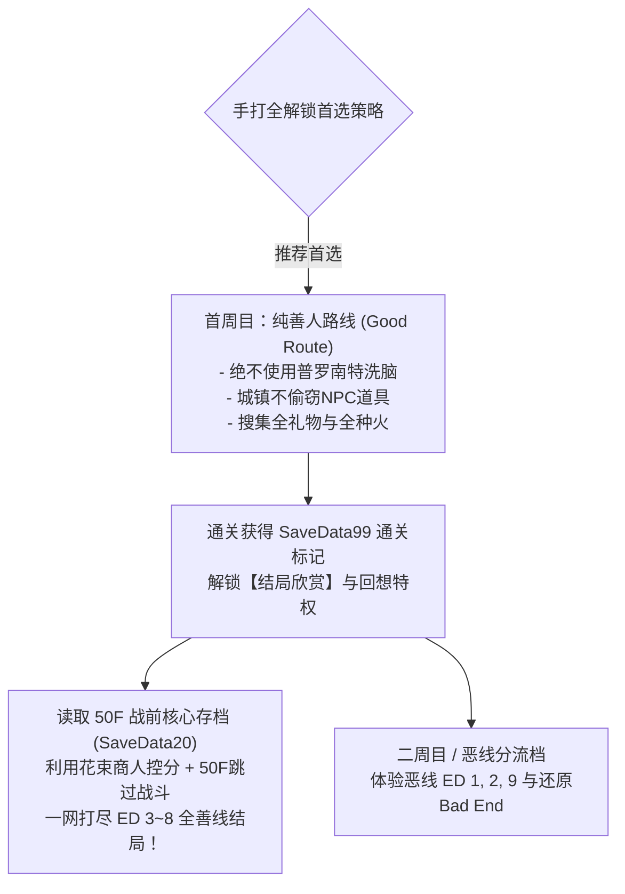
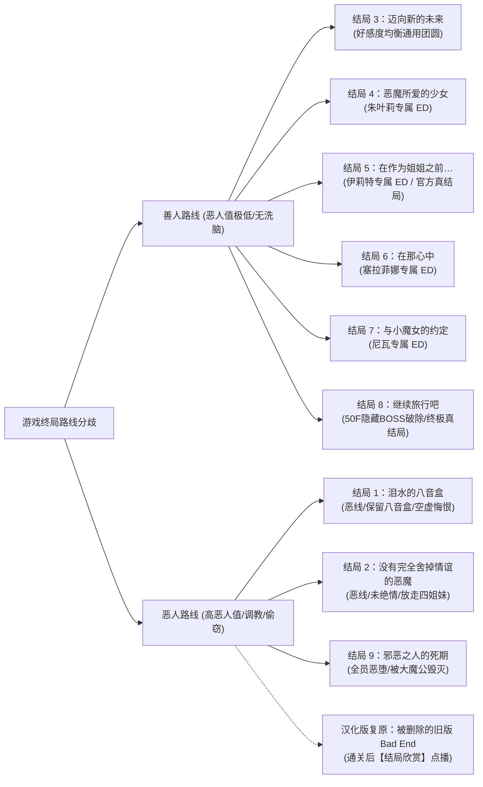

# 🎵《普罗南特交响曲》（Pronant Symphony）全流程手打全解锁全结局终极白金攻略

> **开发社团**：今治EB（汁気のある肉 / 肉汁）—— 日本同人暗黑奇幻与高难JRPG巅峰宗师  
> **日文原名**：『プロナント・シンフォニー』（Pronant Symphony）  
> **前作渊源**：『Pronant Story』（2012年原版） / 宇宙联动前作《监狱岛的尤弥尔》《DEMON'S SWORD SNAKES》  
> **游戏引擎**：WOLF RPG Editor 3.396（汉化增强 Unicode 版，无需转区）  
> **DLsite作品番号**：RJ196613（重制版） / RJ095271（原版）  
> **本地安装路径**：`E:\ACG\Pronant Symphony`  
> **核心特色**：魔界深渊 50 层高难地牢探索、八维场地属性博弈、善恶双主线多结局、官方全 9 大结局 + 汉化版还原被删 Bad End、全 36 幕 H 回想。

---

## 📑 目录导航

1. [作品总览与手打白金核心原则](#一作品总览与手打白金核心原则)
2. [核心战斗系统与破局机制精解](#二核心战斗系统与破局机制精解)
   - [八维场地属性与反转克制表](#1-八维场地属性与反转克制表)
   - [灭团天候「终末」与「整顿阵型」Break破解法](#2-灭团天候终末与整顿阵型break破解法)
   - [队伍构建与神级装备配件推荐](#3-队伍构建与神级装备配件推荐)
   - [魔界集积点数与「大魔公的结晶」获取](#4-魔界集积点数与大魔公的结晶获取)
3. [四姐妹养成、好感度与专属礼物位置大全](#三四姐妹养成好感度与专属礼物位置大全)
   - [角色定位与专属礼物获取层数](#1-角色定位与专属礼物获取层数)
   - [终盘花束商人控分机制（手打全结局核心）](#2-终盘花束商人控分机制手打全结局核心)
4. [全 50 层魔界深渊保姆级手打逐层踏破流程](#四全-50-层魔界深渊保姆级手打逐层踏破流程)
   - [1F ~ 10F：浅层苏醒、姐妹汇合与 6F 密码门](#1-1f--10f浅层苏醒姐妹汇合与-6f-密码门)
   - [11F ~ 25F：恶魔之街、卡塔娜肉块警示与第 1 枚种火](#2-11f--25f恶魔之街卡塔娜肉块警示与第-1-枚种火)
   - [26F ~ 35F：奇迹之泉、时之水复活雕像与心魔试炼](#3-26f--35f奇迹之泉时之水复活雕像与心魔试炼)
   - [36F ~ 40F：5 枚「天上崩落的种火」全收集与 40F 封印门](#4-36f--40f5-枚天上崩落的种火全收集与-40f-封印门)
   - [41F ~ 50F：三大贡品圣物全解密与佛拉斯决战](#5-41f--50f三大贡品圣物全解密与佛拉斯决战)
5. [官方全 9 大结局 + 汉化版还原 Bad End 详细达成条件](#五官方全-9-大结局--汉化版还原-bad-end-详细达成条件)
6. [最高效率手打全结局规划与存档拓扑树](#六最高效率手打全结局规划与存档拓扑树)
   - [核心存档规划步骤图](#1-核心存档规划步骤图)
   - [善线 6 大结局 1 小时极速连收操作法](#2-善线-6-大结局-1-小时极速连收操作法)
   - [恶线 3 大结局手打走法（不伤害四姐妹偷窃法）](#3-恶线-3-大结局手打走法不伤害四姐妹偷窃法)
7. [全 36 幕 H 回想手打与全解锁清单](#七全-36-幕-h-回想手打与全解锁清单)
8. [二周目继承、真魔界难度与极限隐藏挑战](#八二周目继承真魔界难度与极限隐藏挑战)
   - [二周目继承与主角正脸立绘开启](#1-二周目继承与主角正脸立绘开启)
   - [真魔界难度（Lv21+）与 40F 隐藏财宝房](#2-真魔界难度lv21与-40f-隐藏财宝房)
   - [隐藏终极魔神：「动真格的伊斯塔洛特」挑战法](#3-隐藏终极魔神动真格的伊斯塔洛特挑战法)
   - [「地狱模式」（Hell Mode）250 次战斗极限走法](#4-地狱模式hell-mode250-次战斗极限走法)
9. [实用快捷键、旅馆时钟秘籍与自由对话彩蛋词库](#九实用快捷键旅馆时钟秘籍与自由对话彩蛋词库)

---

## 一、作品总览与手打白金核心原则

《普罗南特交响曲》是同人界公认的“披着黄油皮的超硬核殿堂级神作 JRPG”。游戏内部构筑了极其严密的因果法则与善恶天平系统。想要做到**纯手打 100% 全要素、全结局、全CG回想解锁**，必须掌握以下三大底层铁则：



### 1. 为什么必须首周目坚持【纯善人路线】？
1. **剧情文学巅峰**：本作善线剧情极为悲壮感人，尤里乌斯战胜自身身为男娼与半魔阿尔布的自卑心魔，与四姐妹结下真正的生死誓约，是全系列口碑最高的篇章。
2. **通关特权全开**：通关善线后，系统会生成通关标记（Clear Save）。在拥有通关标记的状态下，游戏标题菜单将永久开放**【结局欣赏】**，不仅可以直接调阅全部 9 大结局与汉化版利用数据合成复原的被删 Bad End，还能在 50F 进门确认框中按 **`取消` 键直接跳过战斗结算结局**！
3. **回想安全回收**：善线通关后，回想房间全部开放，无需在手打流程中亲手对四姐妹施加摧残，即可补齐全部 36 幕 H 回想。

### 2. 汉化版专属良心功能
- **全语种原生运行**：基于 WOLF RPG 3.396 引擎，无需 Locale Emulator 转区。
- **不可见数值可视化角色**：汉化版在营地/旅馆特设了专门显示隐藏数值的 NPC，可随时对话查看当前的善恶值、姐妹好感度数值与当前路线判定。
- **旅馆时钟降负荷**：按住 `Shift` 键调查「旅馆的时钟」，可关闭高负荷画面特效，大幅提升战斗帧率。

---

## 二、核心战斗系统与破局机制精解

### 1. 八维场地属性与反转克制表
战斗界面的背景受环境场地属性支配。**随时按 `A` 键可呼出战斗情报面板查看当前场地效果**：

| 正向属性 | 负向属性 | 场地效果与战术应对 |
| :--- | :--- | :--- |
| **火** | **水** | 火强化（火系伤害×1.5） ⇔ 水强化（全员回复量与水系减伤大增） |
| **风** | **地** | 风强化（身手迅捷、暴击率提升） ⇔ 地强化（物理防御力大增） |
| **光** | **暗** | 光强化（圣神祈祷驱散、治愈倍增） ⇔ 暗强化（诅咒/异常命中率暴涨） |
| **死** | **命** | 死强化（即死判定率翻倍） ⇔ 命强化（全员每回合自动恢复高额 HP） |
| **魔暴** | **魔封** | 魔法强化（全法术暴击） ⇔ 魔法弱化（全员魔法咏唱被完全封印） |
| **乱战** | **剑封** | 物理强化（战技伤害爆发） ⇔ 物理弱化（武器战技被强行禁止） |
| **危机** | **良机** | 敌人强化（BOSS攻击力激增） ⇔ 我方强化（全队攻防暴击 Buff） |
| **HP- / MP-** | **HP+ / MP+** | 自动扣除生命/法力 ⇔ 自动持续回复生命/法力 |

### 2. 灭团天候「终末」与「整顿阵型」Break破解法
当战场出现特殊猩红天候**「终末」（End of Era）**时，常规的场地重置技能全部失效！
- **机制警报**：终末倒计时结束时，敌方将释放必定团灭的全屏终焉毁灭击！
- **破解指令**：处于终末状态时，角色行动指令栏的「什么也不做」会自动演化为**「整顿阵型」**！
- **战术核心**：
  1. 辅助角色选择「整顿阵型」，能够大幅延缓终末的发动倒计时。
  2. 输出角色集中火力攻击敌人，打满敌人头顶所需的 **Break 次数**。
  3. **至关重要的小技巧**：即使角色的攻击力为 0，只要普通攻击命中，依然能稳定削减 1 点 Break 值！因此队伍中辅助和奶妈在危急关头也可用普攻补段数，凑齐 Break 即可强行彻底驱散「终末」天候！

### 3. 队伍构建与神级装备配件推荐
- **主角（尤里乌斯 / 阿尔布）**：
  - **核心定位**：队伍最硬的全能辅助/肉盾/解控核心。
  - **神级防具**：**【防御之书】（Book of Protection）**，装备后物理防御、魔法防御与精神力（SPR）大幅飞跃，配合其嘲讽与防御姿态，可稳稳吃下深层 BOSS 的致命单体杀招。
- **长女 伊莉特**：核心物理单体爆发手。必学强化战技「退魔剑术架式」「金刚力」，针对 BOSS 弱点打出核爆输出。
- **次女 塞拉菲娜**：主力群奶与状态净化。常驻「自动治愈」「圣光结界」，针对暗黑/死属性场地进行对冲净化。
- **三女 朱叶莉**：高速破防连段手。拳套多段连击可迅速破掉 BOSS 的 Break 盾牌。
- **幼女 尼瓦**：全属性清场法王。针对复数魔物群攻爆破。
- **必备关键饰品——「御守」系列**：
  - 各类属性「火之御守」「风之御守」「暗之御守」。深层守门人与伊斯塔洛特魔宫守卫以狂暴的火、风、暗属性法术为主，全员针对性佩戴对应御守可直接减免 50% 以上属性伤害！

### 4. 魔界集积点数与「大魔公的结晶」获取
- 迷宫左下角显示“魔界集积点数”。
- **获取极品素材「大魔公的结晶」方法**：当点数累积到 **50 点以上** 时脱离迷宫，即可在据点换取「大魔公的结晶」，用于合成游戏最顶级的神话遗物装备！
- **夜战刷分技巧**：在迷宫夜间时段进行战斗，每场胜利可直接增加 **3 点** 集积度，效率极高。

---

## 三、四姐妹养成、好感度与专属礼物位置大全

### 1. 角色定位与专属礼物获取层数

| 角色 | 战斗职能 | 专属礼物名称 | 获取位置与获取方式 | 专属浪漫约会地点 | 对应专属结局 |
| :--- | :--- | :--- | :--- | :--- | :--- |
| **长女·伊莉特** | 圣骑士 / 极限单爆 / 护盾 | 佩尔纳之物 (传家信物) | **2F 隐藏宝箱** | 2F 营地誓约约会 | **结局 5：在作为姐姐之前…** (官方公认 True End) |
| **次女·塞拉菲娜** | 圣职者 / 全体奶 / 异常驱散 | 圣女的忏悔信物 | **10F 圣堂祭坛隐道** | 10F 圣堂祈祷约会 | **结局 6：在那心中** (圣女圣洁祈愿) |
| **三女·朱叶莉** | 拳斗士 / 高速连击 / 破防 | 强化格斗拳套 | **16F 竞技场深处** | 16F 修炼畅饮约会 | **结局 4：恶魔所爱的少女** (豪爽热泪) |
| **幼女·尼瓦** | 黑魔导 / 全范围歼灭 / 诅咒 | 古代深渊魔导书 | **6F 密码门密室宝箱** | 6F 月下谈心约定 | **结局 7：与小魔女的约定** (萝莉催泪誓约) |

### 2. 终盘花束商人控分机制（手打全结局核心）
游戏判定四姐妹结局的规则为：**该女主角的好感度必须为全队最高，且触发过专属约会事件**。
- 在击败深层主线 BOSS **佛拉斯（Foras）** 之后，**上级恶魔之街** 会正式刷新出一名**「花束商人」**！
- 花束商人处无限量出售四姐妹各自喜爱的专属花束（伊莉特花束、塞拉菲娜花束、朱叶莉花束、尼瓦花束）。
- **控分技巧**：在平时探索中，保持四姐妹好感度均衡；打完佛拉斯后，前往上级恶魔之街买花，买哪位姐妹的花束连续赠送，就能将该姐妹的好感度瞬间拔高为全队绝对第一！

---

## 四、全 50 层魔界深渊保姆级手打逐层踏破流程

```text
魔界深渊 50 层攻略全景地图：
┌─────────────┬───────────────────────────────────────────────────────┐
│ 1F ~ 10F    │ 浅层探索：苏醒拯救朱叶莉 ➔ 2F伊莉特礼物 ➔ 6F密码门 ➔ 10F塞拉菲娜礼物  │
├─────────────┼───────────────────────────────────────────────────────┤
│ 11F ~ 25F   │ 中层魔域：下级恶魔街 ➔ 16F朱叶莉礼物 ➔ 21F种火① ➔ 25F守护者与娜美    │
├─────────────┼───────────────────────────────────────────────────────┤
│ 26F ~ 35F   │ 深渊心魔：瀑壶洞窟种火② ➔ 卡塔娜肉块 ➔ 29F温泉 ➔ 30F奇迹泉 ➔ 时之水复活│
├─────────────┼───────────────────────────────────────────────────────┤
│ 36F ~ 40F   │ 禁忌殿堂：卢基夫古斯种火③ ➔ 魔界之森种火④ ➔ 宫殿8F种火⑤ ➔ 开40F封印门 │
├─────────────┼───────────────────────────────────────────────────────┤
│ 41F ~ 50F   │ 终局之战：三大贡品(星之泪/圣人心脏/魔形之蜜) ➔ 佛拉斯 ➔ 花束商人 ➔ 50F│
└─────────────┴───────────────────────────────────────────────────────┘
```

### 1. 1F ~ 10F：浅层苏醒、姐妹汇合与 6F 密码门
- **1F（苏醒之滩）**：主角尤里乌斯苏醒，体内已被佛拉斯种下半魔阿尔布之印。前行救下被狂暴狼群围攻的三妹朱叶莉，二人结伴。
- **2F（佩尔纳营地）**：
  - 搜索右侧密林木箱，取得**【佩尔纳之物】（长女伊莉特专属礼物）**。
  - 往前推进，会合冷静护佑妹妹的长姐伊莉特与温柔的次女塞拉菲娜。
- **3F（祭坛旧址）**：发现大魔公伊斯塔洛特的古老黑石祭坛（此处为二周目召唤隐藏最强 BOSS 的地点，一周目调查无反应）。
- **4F ~ 5F（深渊密道）**：合力突围魔物潮，在 5F 牢房解救被困的幼女尼瓦。佩尔纳四姐妹全员到齐！
- **6F 密码门（绝对密室解密）**：
  - 门前立有古老石碑，调查紧闭的大门会弹出文字输入框。
  - **解密密码**：本作支持中英文关键字！输入**「撒旦」**、**「路西法」**、**「金银财宝」**或**「lucifer」**均可顺利开门！
  - 门内为古代藏宝库，开启主宝箱可取得**【古代深渊魔导书】（尼瓦专属礼物）**以及大量初期稀有强化宝石。
- **7F ~ 9F（幽暗迷宫）**：魔物等级上升，多利用塞拉菲娜的净化术。
- **10F（浅层圣堂）**：
  - 调查圣堂神龛后方的侧道，拾取**【圣女的忏悔信物】（塞拉菲娜专属礼物）**。
  - 迎战 10F 守关首领，善线击破后开启通往中层恶魔街的传送阵。

### 2. 11F ~ 25F：恶魔之街、卡塔娜肉块警示与第 1 枚种火
- **11F（下级恶魔之街）**：魔界中立据点，设有旅馆、铁匠铺与杂货铺。
  - *善线铁律*：城内恶魔会诱惑主角贩卖奴隶或进行偷盗，**善线玩家坚决不选任何恶魔交互选项，不偷窃**！
- **12F ~ 15F（绅士迷宫区）**：色欲魔公阿斯摩太的势力范围。沿途魔物会附带魅惑与催眠状态，建议全员佩戴清醒戒指。
- **16F（角斗竞技场）**：
  - 深入竞技场角落的荣誉储物柜，拾取**【强化格斗拳套】（朱叶莉专属礼物）**。
- **21F（焦热废墟）**：
  - 走到底部熔岩断桥处，调查发光的隐藏裂缝，挖出**【天上崩落的种火】（第 1 枚 / 埋藏的宝藏）**！
- **25F（中层中枢大厅）**：
  - 迎战中层魔界守护者，BOSS 擅长地属性重压，伊莉特开启「坚壁之阵」，全员集火。
  - 击败后结识魔族少女**娜美（Namy）**，她对人类世界的勇者史诗充满向往。与她交谈可了解魔宫情报。

### 3. 26F ~ 35F：奇迹之泉、时之水复活雕像与心魔试炼
- **瀑壶洞窟 3 至 26F 之间通道**：
  - 从瀑布侧壁的暗道穿过，在岩洞尽头开启宝箱，取得**【天上崩落的种火】（第 2 枚）**！
- **27F ~ 28F（恶堕的警钟——卡塔娜肉块）**：
  - 迷宫通道被一堵巨大的肉壁堵塞，竟是昔日最强阿尔布**卡塔娜**！因沉溺普罗南特洗脑而反噬腐烂，化为哀嚎的人脸肉块。
  - 这一幕是对主角命运的最强警钟，坚定了善线绝不滥用洗脑的决心。
- **29F（天然硫磺温泉）**：
  - 队伍扎营，触发四姐妹温泉沐浴日常事件（善人路线唯一合理福利事件，记录于回想第 29 幕）。
- **30F 奇迹之泉（神装置换圣地）**：
  - **特殊机制**：将背包中所有名字带有**“腐朽”（朽ちた）**前缀的废弃武器与防具直接扔进泉水中！
  - 泉水涌出圣光，腐朽遗物将当场净化转化为**全游戏超顶级的专属神装**！
- **魔界树与龙雕像复活**：
  - 在迷宫深处拾取到关键道具**【时之水】**后，带回此处对枯萎的魔界树与石化的龙雕像使用，两者复活并赋予全队永久属性增幅！
- **31F ~ 35F（心魔试炼）**：
  - 佛拉斯现身布下针对四姐妹心智的试炼，善线尤里乌斯以男儿脊梁替四姐妹抵挡伤害，四姐妹觉醒神圣羁绊，合力退敌。

### 4. 36F ~ 40F：5 枚「天上崩落的种火」全收集与 40F 封印门
要推开 40F 通往魔界最深渊的黑曜石大门，必须集齐全部 **5 枚【天上崩落的种火】**：

| 种火序号 | 藏匿具体坐标与房间 | 探索获取走法 |
| :---: | :--- | :--- |
| **种火 1** | **21F 焦热废墟** | 熔岩断桥尽头的隐藏埋藏点挖掘。 |
| **种火 2** | **瀑壶洞窟 3 至 26F 之间通道** | 瀑布后方暗道尽头开启宝箱。 |
| **种火 3** | **卢基夫古斯之间** | 37F 暗殿偏厅，击破镇守恶魔后开启暗门宝箱。 |
| **种火 4** | **魔界之森 C** | 39F 迷宫森林最右上角隐秘树丛后方小径宝箱。 |
| **种火 5** | **伊斯塔洛特的宫殿 8F** | 40F 传送回溯至宫殿 8F 露台宝箱。 |

- **40F 之门**：将 5 枚种火嵌入 40F 祭坛石门，大门轰然开启！
  - *(注：在二周目开启「真魔界」难度下，40F 会额外浮现一间真魔界专属隐藏财宝密室，可拾取神话武器)*。

### 5. 41F ~ 50F：三大贡品圣物全解密与佛拉斯决战
41F 抵达高耸入云的「上级恶魔之街」。要推开 50F 大魔公伊斯塔洛特的神殿大门，必须凑齐**三大贡品**：

#### (1) 第一贡品：星之泪
- **线索与位置**：藏于 11F 恶魔之街深锁的皇家秘宝库。
- **获取步骤**：在上级恶魔街 43F 击败看守长精英怪，夺得**「魔法钥匙」**；返回恶魔之街用钥匙开锁，取得【星之泪】。

#### (2) 第二贡品：圣人的心脏
- **线索与位置**：安放在上级恶魔之街地底的古代石棺中，被三重魔方阵封印。
- **解密步骤**：在上级恶魔街向幽灵学者打听封印顺序，前往墓穴按照**【光 ➔ 暗 ➔ 地】**的三重顺序依次激活法阵，封印破除，开棺拾取【圣人的心脏】。

#### (3) 第三贡品：魔形之蜜
- **线索与位置**：上级恶魔之街有一位孤僻的禁忌调和师。
- **善人获取法**：调和师原计划抽取四姐妹的鲜血制药，善线主角果断拒绝！选择协助调和师采集中层罕见的深渊圣草与魔晶核心，交付后调和师心悦诚服，赠予【魔形之蜜】。

#### (4) 佛拉斯决战（Foras 讨伐）
- 集齐三大贡品后，在 48F 遭遇佛拉斯真身！
- **BOSS 战术**：佛拉斯擅长暗系即死、诅咒与魔暴天候。
  - 全员佩戴「暗之御守」；塞拉菲娜常驻「自动治愈」与光属性净化；伊莉特开金刚力主攻；
  - 击败佛拉斯，彻底粉碎恶魔对主角肉体的洗脑诱导！
- **决战后关键收益**：
  1. 上级恶魔之街正式出现**【花束商人】**！
  2. 可返回宫殿 7F 与古拉谢波拉斯对话，获取世界观隐藏对话，解答娜美的英雄疑问。
  3. 前往 50F 殿堂大门前。

---

## 五、官方全 9 大结局 + 汉化版还原 Bad End 详细达成条件



### 1. 【善人路线·通用团圆】结局 3：迈向新的未来（新たな未来へ）
- **达成条件**：全程贯彻善人路线（恶人值极低，无普罗南特支配）。击败 50F BOSS，四姐妹好感度相对均衡，未触发任何单独姐妹的最高专属约会。
- **剧情体验**：四姐妹成功采得神药拯救了病危的父亲，五人并肩迈向洒满阳光的大陆，结下永恒挚友羁绊。

### 2. 【善人路线·朱叶莉专属】结局 4：恶魔所爱的少女（悪魔が愛した少女）
- **达成条件**：善人路线，朱叶莉好感度全队最高（在上级恶魔之街向花束商人购买朱叶莉花束赠送拉满），完成 16F 专属事件与约会。
- **剧情体验**：告别酒宴上，热血豪爽的朱叶莉大口痛饮后掩面痛哭，拥抱主角：“无论天涯海角，我的铁拳和我的心永远都在这里！”

### 3. 【善人路线·伊莉特专属·官方真结局】结局 5：在作为姐姐之前…（姉である前に…）
- **达成条件**：善人路线，长女伊莉特好感度全队最高（购买伊莉特花束赠送拉满），完成 2F 专属礼物赠送与誓约约会。
- **剧情体验**：**全游文学价值最高、官方公认正统 True End**。伊莉特卸下圣骑士沉重铠甲与家长重担，作为普通女性与尤里乌斯相拥，两人在人魔交界隐姓埋名相守余生。

### 4. 【善人路线·塞拉菲娜专属】结局 6：在那心中（その心に）
- **达成条件**：善人路线，次女塞拉菲娜好感度全队最高（赠送塞拉菲娜花束拉满），完成 10F 专属信物与圣堂祈祷约会。
- **剧情体验**：串联前作《监狱岛的尤弥尔》。塞拉菲娜洞悉主角心中对长姐的眷恋，选择将爱慕化为最高尚的祝福，终生在圣堂中为主角祈祷。

### 5. 【善人路线·尼瓦专属】结局 7：与小魔女的约定（小さな魔女との約束）
- **达成条件**：善人路线，幼女尼瓦好感度全队最高（赠送尼瓦花束拉满），完成 6F 专属魔导书与月下谈心。
- **剧情体验**：最催泪的情感结局。傲娇的尼瓦拉住主角衣角痛哭：“等我出落成风姿绰约的成熟大魔女，一定会回来找你！不准忘了我！”

### 6. 【善人路线·隐藏真结局】结局 8：继续旅行吧（旅を続けよう）
- **达成条件**：
  1. 善人路线踏破 50 层；
  2. 彻底击溃 50F 的隐藏终极 BOSS；
  3. 在推开伊斯塔洛特黑曜石大门前，触发特殊提示，选择**【寻找新的可能】**；
  4. 结尾关键对话中选择**【不要就此画下句点】**。
- **剧情体验**：主角破解了阿尔布寿命咒缚的古代秘密，四姐妹一致决定与尤里乌斯结成永不散场的传奇冒险团，一同奔赴无尽星海。

### 7. 【恶人路线】结局 1：泪水的八音盒（涙のオルゴール）
- **达成条件**：恶人倾向，对四姐妹多次施展普罗南特洗脑，但未彻底逼至精神坏掉，在最终剧情中保留了最初送给某个姐妹的纪念品“八音盒”。
- **剧情体验**：主角打倒魔公夺取深渊权柄，却发现四姐妹已被自己调教成空洞木偶，主角在空旷宫殿中摇动八音盒悔恨泣不成声。

### 8. 【恶人路线】结局 2：没有完全舍掉情谊的恶魔（情を捨て切れぬ悪魔）
- **达成条件**：恶人路线，但未完全切断与人间的精神纽带，最后关头选择解除洗脑咒缚，抹去姐妹们的痛苦记忆传送回人界，主角独自在崩塌深渊中化为尘埃。

### 9. 【恶人路线·终极破灭】结局 9：邪恶之人的死期（邪悪なる者の死期）
- **达成条件**：极致恶人路线，全员恶堕度拉满，滥用普罗南特洗脑数百次。
- **剧情体验**：大魔公伊斯塔洛特极度鄙夷主角沉沦肉欲的下贱行径，甚至不屑出手，直接引爆主角体内的阿尔布反噬，主角化为脓血惨死，全员被群魔分食。

### 10. 【汉化版特别收录】被删除的旧版 Bad End
- 因原版 2.50 后剧情逻辑冲突被官方移除。汉化者 liyuqi 耗费心血提取残留数据合成还原，玩家在通关后可在【结局欣赏】中随时鉴赏这段珍稀考据暗黑剧情。

---

## 六、最高效率手打全结局规划与存档拓扑树

### 1. 核心存档规划步骤图

```text
【最速全结局手打存档拓扑结构图】

               [正常流程推进至 48F 击败佛拉斯]
                             │
                             ▼
               [到达 50F 大魔公神殿黑曜石门前]
           ★ 保持四姐妹好感度均衡，不使用任何花束 ★
           ─────────────────────────────────────────
           ★ 保存核心枢纽存档：【SaveData20.sav】 ★
           ─────────────────────────────────────────
              /          |          |          \
             /           |          |           \
   [分支A：直接进门] [分支B：买花控分] [分支C：隐藏决战] [分支D：恶线转化]
         │               │              │             │
   击破50F BOSS    去上级恶魔街     选【寻找新的可能】 偷窃NPC累积恶人值
   好感度均衡      买对应花束拉满   击败隐藏BOSS      使用普罗南特洗脑
         │               │          选【不就此画句号】       │
         ▼               ▼              │             ▼
    ★ 结局 3 ★     ★ 结局 4/5/6/7 ★      ▼        ★ 结局 1/2/9 ★
 (迈向新的未来)   (四姐妹各自专属ED)  ★ 结局 8 ★   (八音盒/舍情/死期)
         │                         (继续旅行吧)
         ▼
   生成 SaveData99
   通关标记激活！
```

### 2. 善线 6 大结局 1 小时极速连收操作法

1. **第 1 步：手打完成善线通用结局 3（生成通关标记）**：
   - 推进到 50F 门前，存下 **`SaveData20`**。
   - 不要买花，直接推开大门打倒 50F BOSS，达成**【结局 3：迈向新的未来】**。
   - 通关后系统生成 **`SaveData99.sav`**（通关标记生效）。
2. **第 2 步：利用「取消跳过战斗特权」极速收割四姐妹专属结局**：
   - 读取 **`SaveData20`**：
     - 传送到上级恶魔之街花束商人处，购买**伊莉特花束×5**全部送给伊莉特，存入 **`SaveData11`**；
     - 走向 50F 大门，在进入确认框中按 **`取消`（Cancel）**（有通关标记时取消可直接跳过 BOSS 战演播），直接结算出**【结局 5：在作为姐姐之前…】**！
   - 重新读取 **`SaveData20`**：
     - 购买**塞拉菲娜花束×5**送给塞拉菲娜，存入 **`SaveData12`**；
     - 50F 进门按取消跳过，直接结算出**【结局 6：在那心中】**！
   - 重新读取 **`SaveData20`**：
     - 购买**朱叶莉花束×5**送给朱叶莉，存入 **`SaveData13`**；
     - 50F 进门按取消跳过，直接结算出**【结局 4：恶魔所爱的少女】**！
   - 重新读取 **`SaveData20`**：
     - 购买**尼瓦花束×5**送给尼瓦，存入 **`SaveData14`**；
     - 50F 进门按取消跳过，直接结算出**【结局 7：与小魔女的约定】**！
3. **第 3 步：触发终极真结局 8**：
   - 重新读取 **`SaveData20`**；
   - 50F 门前提示选择【寻找新的可能】 ➔ 迎战并击溃 50F 隐藏终极 BOSS ➔ 结尾对话选择【不要就此画下句点】，达成**【结局 8：继续旅行吧】**！

### 3. 恶线 3 大结局手打走法（不伤害四姐妹偷窃法）
官方在访谈中曾指出，70% 玩家不舍得走恶人路线是因为不想亲手伤害四姐妹。作者特设了“良心恶人手打方案”：
- **无伤姐妹累积恶人值**：在恶魔之街和各大城镇，对路人 NPC 进行反复偷窃！偷窃会迅速增加恶人点数，将善恶天平拉向恶人路线，且完全不会对四姐妹产生任何调教摧残。
- **收割恶线结局**：
  - 中度恶人 + 保留八音盒 ➔ 达成**【结局 1：泪水的八音盒】**；
  - 恶人路线 + 最终战选择放走姐妹 ➔ 达成**【结局 2：没有完全舍掉情谊的恶魔】**；
  - 滥用普罗南特命令将四姐妹恶堕度拉满 ➔ 达成**【结局 9：邪恶之人的死期】**。

---

## 七、全 36 幕 H 回想手打与全解锁清单

全剧共有 36 幕独立事件演出与差分 CG，分类一览：

```
全 36 幕回想矩阵清单：
├── 1. 伊莉特（Ilit）专属：第 01 ~ 08 幕
│   ├── 01. 虚弱状态下的初次精神侵入（轻度催眠暗示）
│   ├── 02. 圣骑士佩剑的亵渎与认知篡改
│   ├── 03. 迷宫扎营夜袭与绝对服从印记
│   ├── 04. 铠甲之下的白刃交接（夺去处女）
│   ├── 05. 战阵中央的肉体慰劳（战意转化）
│   ├── 06. 亲历妹妹恶堕时的无力屈服
│   ├── 07. 深夜寝室的母狗调教（尊严荡然无存）
│   └── 08. 彻底痴狂的战鬼肉便器（恶线终局）
├── 2. 朱叶莉（Juely）专属：第 09 ~ 14 幕
│   ├── 09. 格斗修炼后的脱力调教
│   ├── 10. 肌肉敏感度强化（催淫暗示）
│   ├── 11. 直率元气少女的雌性觉醒
│   ├── 12. 粗暴强行交尾与本能沦陷
│   ├── 13. 大庭广众之下的发情失控
│   └── 14. 沦为只知渴求公兽的雌兽奴隶
├── 3. 塞拉菲娜（Seraphina）专属：第 15 ~ 21 幕
│   ├── 15. 忏悔室神圣祷告的亵渎
│   ├── 16. 白魔法阵逆转与圣水玷污
│   ├── 17. 圣洁修女服下的淫靡侵蚀
│   ├── 18. 救济信徒为名的献身调教
│   ├── 19. 唤醒监狱岛暗黑记忆的深渊轮暴
│   ├── 20. 圣女自甘堕落的堕天仪式
│   └── 21. 彻底沦陷为魔界的专属肉便器圣母
├── 4. 尼瓦（Niva）专属：第 22 ~ 28 幕
│   ├── 22. 禁忌魔导书阅读时的精神恍惚
│   ├── 23. 幼弱身躯的魔导回路改造
│   ├── 24. 毒舌傲娇在快感冲击下的哭泣求饶
│   ├── 25. 魔力枯竭时的体液补充契约
│   ├── 26. 姐妹在侧时的暗中亵渎
│   ├── 27. 理性崩溃后的病态依恋与痴态
│   └── 28. 心智彻底幼体退化的玩具化
└── 5. 其他与特殊事件：第 29 ~ 36 幕
    ├── 29. 迷宫天然温泉窥视与全员沐浴（善人路线唯一合理福利事件）
    ├── 30. 温泉深夜突袭与四姐妹水下轮流把玩
    ├── 31. 恶魔之街绅士会所的公开性奴拍卖
    ├── 32. 阿斯摩太的魅魔侍寝狂宴
    ├── 33. 魔界集积暴走引发的噩梦侵蚀
    ├── 34. 「全员后宫乱交命令」大解禁
    ├── 35. 败北给特定魔物头目后的凌辱产卵
    └── 36. 结局专属全员恶堕狂欢殿堂
```

> **纯爱善线玩家全解锁特权**：手打通关善线后，读取拥有通关标记的 **`SaveData99`**，直接进入标题菜单的**【回想房间】**，即可以上帝视角直接点播补全全部 36 幕回想，无需在游玩流程中折磨四姐妹！

---

## 八、二周目继承、真魔界难度与极限隐藏挑战

### 1. 二周目继承与主角正脸立绘开启
- **主角脸部立绘开关**：
  - 一周目中尤里乌斯在各类剧情和 CG 中不显示正脸；
  - 继承 SaveData99 开启二周目后，游戏设置菜单将解锁**【主角 CG/立绘显示】**开关，玩家可自由开启主角的高清英俊立绘！

### 2. 真魔界难度（Lv21+）与 40F 隐藏财宝房
- **开启门槛**：继承通关存档开始新周目时可选，要求队伍等级达到 21 级以上。
- **难度特色**：魔物 AI 极具攻击性，场地天候频繁变异，但掉落专属的「真魔界神话武器与隐藏秘术」。
- **40F 隐藏财宝房**：在 40F 破开封印门后，只有真魔界难度下才会显现这间隐藏密室，内有顶级遗物装备。

### 3. 隐藏终极魔神：「动真格的伊斯塔洛特」挑战法
- **触发条件**：真魔界难度下，击倒 50F BOSS 之后；
- **挑战步骤**：
  1. 返回 **3F（伊斯塔洛特的祭坛）**；
  2. 在祭坛前献上背包中的至宝**「魔王之血」**；
  3. 虚空中将凝聚出血红迷雾，召唤出全游戏最强隐藏 Boss——**「动真格的伊斯塔洛特」**！
- **战术要领**：Boss 兼具全属性天候毁灭技，必须全员备齐高阶御守，主角全回合维持圣壁嘲讽，塞拉菲娜全力奶满，是检验硬核 JRPG 战术构建的终极试金石。

### 4. 「地狱模式」（Hell Mode）250 次战斗极限走法
- **模式特色**：真实模拟阿鲁布寿命限制，初始战斗次数仅 50 次，全通关战斗次数上限严格锁死在 **250 次以内**！超过 250 次立即因寿命耗尽 Game Over。
- **走法核心**：
  - 绝不打多余小怪，全程熟练规避明雷；
  - 战术目标直奔宝箱与 BOSS；
  - 通关后将获得四姐妹地狱模式专属嘉奖台词与超稀有通关纪念勋章。

---

## 九、实用快捷键、旅馆时钟秘籍与自由对话彩蛋词库

### 1. 快捷键与实用操作大全

| 按键 | 功能说明 | 战斗中作用 |
| :--- | :--- | :--- |
| **`Shift`** | 高速战斗 / 快速移动 | 按住可将战斗动画与行动速度提升 3 倍 |
| **`Ctrl`** | 自动战斗模式 | 自动普攻清场，刷小怪必备 |
| **`A`** | 情报面板呼出 | 实时查看当前八维场地属性与敌我增益 |
| **`Ctrl + Z`** | 快速 Skip 剧情 | 极速跳过已读对话 |
| **`F4`** | 窗口全屏切换 | 自由缩放游戏视窗 |
| **`F12`** | 快速软重启游戏 | 重启游戏进程，方便 SL |
| **`在记录栏按住 Shift + 确定`** | **快速读取存档** | 直接从存档菜单瞬移读档 |

### 2. 旅馆时钟神秘秘籍
- 在旅馆房间中，**按住 `Shift` 键调查「旅馆的时钟」**：
  1. 可关闭高负荷画面演出，显著减轻 CPU 占用，彻底消除画面卡顿；
  2. 在「普通」难度下，可在此处选择降级为「简单」难度（注意降级后无法返回普通）。

### 3. 自由对话（全对话）实用彩蛋词库一览
在营地与四姐妹进行自由对话时，输入特定单词会触发大量专属剧情互动与趣味彩蛋：

| 分类 | 推荐输入关键词（支持中文） | 角色趣味反应 |
| :--- | :--- | :--- |
| **专有名词** | `万魔殿`、`佛拉斯`、`伊斯塔洛特`、`卢基夫古斯`、`普罗南特` | 深入探讨魔界历史、佛拉斯的阴谋与古代恶魔传说 |
| **姐妹名字** | `伊莉特`、`塞拉菲娜`、`朱叶莉`、`尼瓦` | 互相评价彼此的性格、长处与害羞秘密 |
| **情感互动** | `喜欢`、`爱`、`漂亮`、`可爱`、`谢谢` | 四姐妹各自脸红、害羞自白或傲娇反驳 |
| **趣味粗口** | `水桶腰`、`笨蛋`、`变态`、`萝莉控` | 朱叶莉扬言要用铁拳揍人，尼瓦毒舌疯狂输出，伊莉特严肃警告 |
| **日常问候** | `你好`、`早上好`、`晚上好`、`辛苦了` | 温馨温馨的扎营日常问候与好感度反馈 |

---

*本全流程白金指南已收录入 ACG Vault 核心游戏知识库（`apps/acg_vault/data/guides/`），供广大手打 JRPG 玩家终极查阅！*
