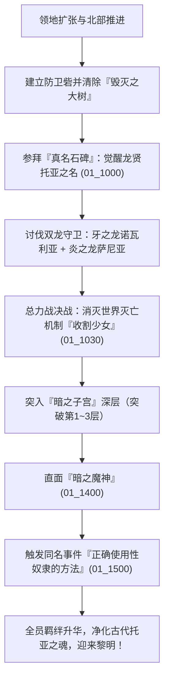

# ⚔️《正しい性奴隷の使い方 -暗黒大陸開拓記-》全剧情深度解析与全结局通关完全攻略

---

## 📌 基础档案与作品信息

| 项目 | 详细内容 |
| :--- | :--- |
| **游戏原名** | 正しい性奴隷の使い方 -暗黒大陸開拓記- |
| **官方作品号** | RJ166249 |
| **制作社团** | Irisfield (アイリスフィールド) |
| **系列定位** | Irisfield 宏大世界观三部曲之第三部（与《素晴らしき国家の築き方》、《浮遊都市の築き方》处于同一世界观谱系） |
| **游戏引擎** | Native PC (自研SLG战斗引擎 + 战棋/军团战略 + 模拟经营) |
| **汉化制作** | 艾莉亚朵妮（翻译）、Olthius / Cyber P（程序与封装） |
| **核心题材** | 暗黑奇幻、领地开荒经营、战棋与军团战、纯爱与调教双线、全角色专属结局 |
| **结局规模** | 全 28 种结局（包含 27 个各具深度的人物专属独立结局 + 1 个宏大综合通关结局） |

---

## 📖 故事背景与宏大世界观深度解析

### 1. 创世神话与三部曲历史脉络
* **创世的原点**：在世界的起源，“世界”（造物主）从泥海中掬起一握白泥，塑造了最初的生灵。世界通过赋予事物“语言”与“真名”来定义法则，世界的演进伴随着“色彩”的逐步诞生。
* **约400年前（美好国家时代）**：英雄皇女艾莉亚、初代王与古代伟大术者“龙贤托亚”（Toya）共同开创了和平时代，艾莉亚朵妮的祝福恩泽延绵后世（对应《素晴らしき国家の築き方》）。
* **浮游都市时代**：文明在空中翱翔，学者与求知者建立起超脱地面的浮游都市迪司莱鲁（对应《浮遊都市の築き方》）。
* **黑暗时代的暗黑大陆**：暗黑大陆终年被无边无际的常暗笼罩，环境恶劣、魔兽横行，毁灭性的世界清理机制“收割少女”（Harvest Maiden，即毁灭的“现象”）周期性降临，意图将所有文明化为虚无。

### 2. 剧情主线展开（四大阶段）

#### 阶段一：苏醒与暗黑开荒（草创期）
主角在一片空无的黑暗大陆中苏醒，失去了过往的记忆与人格，但本能地掌握着神秘的**“支配术”**与**“高速分娩术”**。
主角与拥有圣骑士/勇者资质的女主角**菲莉亚（Philia）**相遇。为了在黑暗大陆建立生存据点，主角运用古代术式：
1. 以男性的“精液”作为制作**“圣光源”**的核心介质，在黑暗中驱散迷雾、守护领地安全；
2. 建立**高速生产技术**，由自愿者产下成长极快、不知疲倦的**“劳动奴隶”**，组建开荒工兵团与防卫队。

#### 阶段二：势力碰撞与光之教团（扩张期）
随着领地逐步向外扩展，主角救助了周边沦陷的聚落，并遭遇了其他势力。以表面圣洁高冷、内心却厌恶政治应酬的圣女**拉比瑟娜（Rabisena）**为首的“光之教团”与主角势力产生交涉与冲突。
在此期间，主角解放了**战衣职业系统**（剑圣、魔女、女仆、盗贼），并组建由劳动奴隶构成的军团，解锁集团战与总力战，扫平盗贼团与魔兽巢穴。

#### 阶段三：北伐绝境与龙之试炼（攻坚期）
大陆北部被危险的环境障碍**『毁灭之大树』**封锁，任何踏入该领域的角色都会持续损耗体力。主角调遣工兵大队协同修筑防卫砦，逐步伐除毁灭之大树。
随后，主角率军攻入北方龙巢，先后讨伐了镇守封印的两大远古化身：**牙之龙诺瓦利亚**与**炎之龙萨尼亚**，为突入大陆核心铺平了道路。

#### 阶段四：终极真相——《正确使用性奴隶的方法》（破晓期）
* **真名觉醒**：主角在北方“真名石碑”前觉醒，确认自己正是继承了古代**龙贤托亚**资质与浩瀚玛娜的化身。
* **决战收割少女**：主角集结领内全体同伴发起总力战，成功击溃毁灭的具现“收割少女”，打破了灭世轮回。
* **暗之魔神的真面目**：主角深入大陆最底层的“暗之子宫”，直面盘踞此地400年的“暗之魔神”。令人震撼的真相揭晓——暗之魔神竟是400年前的龙贤托亚本体！当年托亚为了拯救被造物主判定为毁灭的世界，毅然以自身灵魂为容器，吞噬了世间全部庞大之暗，在永恒痛苦中苦熬了400余年。
* **同名事件落题《正确使用性奴隶的方法》**：
  所谓的“性奴隶使役术”，其实原本根本不是什么肮脏残酷的调教术，而是龙贤托亚为了让人们超越种族、信仰隔阂心意相通而创设的**“灵魂羁绊连接术”**！
  **“性奴隶”真正正确的使用方法，从来不是将其当成发泄欲望的肉便器或压榨资源的牲畜，而是打破拘束奴役的“隶石”，以对等、尊重与真爱相待，缔结坚不可摧的心灵羁绊！**
  全员女主角的真挚心意与主角融为一体，引发了超越奇迹的羁绊共鸣，最终击败并净化了苦苦支撑400年的托亚之魂。暗黑大陆迎来了400年未曾见过的破晓晨曦，第二种色彩在这个世界中孕育诞生。

---

## 🎮 核心系统与模拟经营开荒全指南

### 1. 领地三大资源循环

```
┌────────────────────────────────────────────────────────┐
│                      领地资源铁三角                     │
├─────────────────┬──────────────────┬───────────────────┤
│    圣 光 源      │    劳动奴隶      │    资 金 / 建 材  │
│ (迷雾驱散/领地范围)│ (工兵/建造/军团战)│ (设施强化/防卫建设)│
└─────────────────┴──────────────────┴───────────────────┘
```

1. **圣光源（Holy Light Source）**：
   * **作用**：驱散黑暗大陆常暗迷雾。只有在光源照耀范围内，才能进行迷宫探索、设施修筑与安全生产。
   * **充能原料**：男性的精液（生命玛娜的结晶）。
   * **生产策略**：
     * **纯爱流做法**：依靠男主角自身精力生产，或建造领地公共供精设施；绝不将心仪女主角指定为“榨精娼妇”。
     * **鬼畜流做法**：将女性俘虏或女角色分配至娼馆接待士兵，快速汲取海量精液，但会使女角色恶堕并破除处女。
2. **劳动奴隶与高速分娩**：
   * **作用**：领地建设、清除障碍、集团军作战的基础人口单位。
   * **获取方式**：通过高速生产技术受孕繁育。推荐使用聚落收留的志愿者女性进行生育，不要强迫核心女主角参与。
3. **毁灭之大树清除技巧**：
   * 探索大陆北部时，沿途的大树无法被英雄角色直接砍伐，必须在设施建造菜单中选择“撤去命令”，调集足额劳动奴隶工兵进行伐除。
   * 必须在周边建立“防卫队之砦”，迎击游荡魔兽，保障工兵生命安全。

---

### 2. 战斗体系与战衣职业树

本作采用指令开关式的自律战斗模式，核心深度在于战前阵型布署与战衣（职业装备）搭配：

| 战衣名称 | 职业定位 | 核心优势与战术价值 |
| :--- | :--- | :--- |
| **剑圣 (Sword Master)** | 前排单体物攻 | 极高爆发、破甲突刺，适合攻坚高血量精英魔兽与单体Boss。 |
| **玛吉柯魔女 (Magica Witch)** | 后排群体法系打击 | 大范围属性法术轰炸，迷宫清杂与集团战核心法系支柱。 |
| **守护女仆 (Protes Maid)** | 坦克 / 防御辅助 | 高护甲、群体护盾、伤害承伤与战线维持，防止脆皮被秒杀。 |
| **盗贼 (Sex Thief)** | 敏捷 / 干扰 / 掠夺 | 异常状态施加、宝箱开锁、额外资源偷取与机动扰敌。 |

#### 战斗三大模式：
1. **迷宫探索战**：由主角与女主角小队组成，考验战衣互补与技能树点法。
2. **集团战（军团对阵）**：调动奴隶兵团进行阵地突击（如收复盗贼据点），胜负取决于指挥官手腕与兵力基数。
3. **总力战（决战系统）**：决战收割少女与暗之魔神时开启。全员女主角连同后备大军参战，未出战的角色可在后备席持续恢复 LP 与玛娜，必须合理运用车轮轮换战术。

---

## 💖 纯爱路线 vs 奴隶/娼馆恶堕路线全判定指南

### 1. 纯爱路线达成铁律（避雷须知）
若要达成各女主角的**纯爱结婚结局（嫁ED）**，必须严格遵循以下原则：

1. **死守“经验人数 = 1”**：
   * 游戏中每位女角色的属性面板都有详细的“经验人数”统计。
   * 纯爱状态下，该数值**必须且只能为 1**（即只与男主角发生过关系）。
2. **严禁指派为榨精娼妇**：
   * 绝对不要在领地娼馆中将女主角指派为工作人员或榨精肉便器。
3. **回避战斗战败凌辱事件**：
   * 部分关键剧情战（如光之势力入侵第1层、第2层败北）战败会触发敌军凌辱事件，导致女角色破处并增加经验人数。高难度下务必勤加存档。
4. **解放“隶石”并恢复真名**：
   * 伴随好感提升，带角色前往北方的“真名石碑”完成“隶石解放”（34系列专属事件），解开主从烙印。
5. **缔结婚姻之契（嫁系统）**：
   * 羁绊等级达到 LV5 后，触发专属结婚事件（10_XX05），正式结为夫妻。游戏支持多重结婚（后宫纯爱）。

---

## 🏆 全 28 种结局达成条件与结局走向完全图鉴

### 👰 女主角个别专属结局（ED 00 ～ ED 26）

| 结局编号 | 对应角色 | 结局名称 / 场景 | 核心达成条件与结局剧情走向 |
| :---: | :---: | :---: | :--- |
| **ED 00** | **菲莉亚 (Philia)** | 伴侣的晨曦牧场 | **条件**：菲莉亚羁绊LV5、纯爱完成结婚。<br>**剧情**：两人卸下英雄与使役者的重担，在阳光下经营牧场，菲莉亚清晨催促丈夫起床照料奶牛，过上温馨甜蜜的日常生活。 |
| **ED 01** | **拉比瑟娜 (Rabisena)** | 圣女的真实心声 | **条件**：与光之教团和解、拉比瑟娜羁绊LV5、结婚。<br>**剧情**：在外人面前依旧维持高洁圣女形象，但独处时对繁琐的外交会谈大吐苦水，紧紧依靠着丈夫共度余生。 |
| **ED 02** | **阿尔内特 (Arnette)** | 儿女绕膝的热闹家庭 | **条件**：阿尔内特羁绊LV5、结婚。<br>**剧情**：与男主生育了众多孩子，家里每天都在上演争抢玩具的喧闹，两人在幸福与忙碌中守护着家庭。 |
| **ED 03** | **莉卡 / 艾莎 (Rika / Aisa)** | 不净之地的救赎旅途 | **条件**：完成莉卡营救支线、羁绊满、结婚。<br>**剧情**：两人重返莉卡诞生与长大的不净之地，男主将力量借给她，一同为了拯救更多迷茫之人而战。 |
| **ED 04** | **卡露娜 (Karuna)** | 周游世界的爱管闲事夫妇 | **条件**：卡露娜羁绊LV5、结婚。<br>**剧情**：离开开拓后的大陆周游世界，尽管总是忍不住插手各地的纷争与麻烦，但卡露娜乐在其中，相伴相随。 |
| **ED 05** | **莉莉娅布鲁姆 (Liliabloom)** | 惩治暴政的漫长旅者 | **条件**：精灵使者莉莉娅布鲁姆羁绊LV5、结婚。<br>**剧情**：面对异大陆施行暴政的独裁国家，男主与她以二人之力向整个国家宣战，在漫长岁月里践行正义。 |
| **ED 06** | **安黛莉比雅 (Andelibia)** | 千年龙言的永恒相伴 | **条件**：龙族伴侣安黛莉比雅羁绊LV5、结婚。<br>**剧情**：男主使用龙言语的力量突破寿命界限，与身为长生种的她在千年岁月中不离不弃，相濡以沫。 |
| **ED 07** | **诺拉 (Nora)** | 废除奴隶制的立宪新王 | **条件**：诺拉羁绊LV5、结婚。<br>**剧情**：两人登基为新国家之王与王后，主动立法永久废除性奴隶使役术与劳动奴隶制造，完全依靠人类智慧开创文明盛世。 |
| **ED 08** | **笑之枪** | 并肩迎战再生之暗 | **条件**：笑之枪羁绊LV5、结婚。<br>**剧情**：残存的黑暗再度蠢动，笑之枪与男主再次并肩冲向战场，并在激战中向男主吐露了自己尘封已久的真正名字。 |
| **ED 09** | **沃尔夫 (Wolf)** | 战场之狼的生死相托 | **条件**：沃尔夫契约达成、同生共死。<br>**剧情**：男主将统治权托付给他人，在异国他乡残酷的战场上与沃尔夫重逢，两人作为无可替代的战友将背后托付给对方。 |
| **ED 10** | **莉亚＆露亚 (Lia & Lua)** | 双子医师的静谧诊所 | **条件**：双子姐妹隶石解放、完成结婚。<br>**剧情**：男主主动辞去大陆最高统治者地位成为平民，与双子姐妹一同在领地一隅经营小型医疗所，沐浴在阳光下度过余生。 |
| **ED 11** | **诺瓦尔 (Noir)** | 异乡大陆的归家之灯 | **条件**：暗之眷属诺瓦尔隶石解放、结婚。<br>**剧情**：将领地建设交托同伴，两人隐姓埋名迁居至遥远异大陆，每日工作归家都有深爱的诺瓦尔温柔迎接。 |
| **ED 12** | **卡琳 (Karin)** | 跨越寿命界限的深情 | **条件**：卡琳羁绊满、结婚。<br>**剧情**：卡琳拥有半吊子的长生寿命，面对生老病死的怅惘，两人在深情告白中珍惜相伴的每一寸光阴。 |
| **ED 13** | **南娜 (Nanna)** | 加倍奉献的新娘誓约 | **条件**：女仆南娜羁绊满、结婚。<br>**剧情**：在庄重的大典上南娜身披婚纱，发誓要以胜过普通妻子数倍的忠诚与爱意永远侍奉照顾主人。 |
| **ED 14** | **贝鲁娜 (Belna)** | 跨越七百年的血脉守望 | **条件**：鬼族贝鲁娜羁绊满、结婚。<br>**剧情**：拥有极长寿限的贝鲁娜来到男主的墓前扫墓，虽然调侃男主“只活了700多岁”，但她承诺会永久守护两人留下的血脉子嗣。 |
| **ED 15** | **莉莉 (Lily)** | 机械与真心的盛大婚礼 | **条件**：莉莉羁绊满、协助自动打蛋机。<br>**剧情**：领带端正，伴随着同伴们的衷心祝福，一场盛大而充满欢笑的婚礼为这段羁绊画上圆满句号。 |
| **ED 16** | **露伊娜 (Luina)** | 永不打烊的热闹酒馆 | **条件**：露伊娜羁绊满、结婚。<br>**剧情**：曾经的奴隶与盗贼如今都成了常客，露伊娜在充满欢声笑语的酒馆里担任看板娘直到白发苍苍。 |
| **ED 17** | **艾塔娜 (Aitana)** | 守望七色诞生的永恒之眼 | **条件**：艾塔娜羁绊满、结婚。<br>**剧情**：在目送此生唯一的伴侣离去后，艾塔娜重返世界起点，获得了永恒之色，继续静待世界绽放七彩的那一天。 |
| **ED 18** | **克罗娜 (Chrona)** | 迈向顶峰的世界第一偶像 | **条件**：克罗娜羁绊满、结婚。<br>**剧情**：男主作为专属制作人“D大人”，陪伴克服紧张的克罗娜登上了世界第一偶像选拔的璀璨舞台。 |
| **ED 19** | **艾莉丝 (Iris)** | 守护家园的英武母亲 | **条件**：艾莉丝羁绊满、结婚。<br>**剧情**：魔兽侵袭边境，艾莉丝挺身而出击退强敌，随后笑着赶回家中为深爱的丈夫与孩子准备丰盛晚饭。 |
| **ED 20** | **萝拉 (Lora)** | 秩序之种与“法政大陆” | **条件**：萝拉羁绊满、确立法政体系。<br>**剧情**：萝拉辅佐男主为后世奠定完善的法治根基，暗黑大陆在后世被称为“法政大陆”，成为保障所有人尊严的理想国度。 |
| **ED 21** | **琪秋 (Kichu)** | 终焉命运战场上的求生者 | **条件**：琪秋羁绊满、并肩作战。<br>**剧情**：数不清的岁月后，面对决定世界终极命运的浩大战场，两人怀揣着活下去的坚决信念并肩伫立。 |
| **ED 22** | **塞拉 (Sera)** | 浮游都市迪司莱鲁的真理探寻 | **条件**：学者塞拉羁绊满、结婚。<br>**剧情**：两人来到空中奇迹“浮游都市迪司莱鲁”，抛开世俗权力，毕生沉浸在探索世界起源与历史真理的浪漫旅途之中。 |
| **ED 23** | **莉莉娜 (Lilina)** | 阳光下的孤儿乐园 | **条件**：莉莉娜＆斯卡雷特羁绊满、结婚。<br>**剧情**：夫妻俩一同经营起充满欢声笑语的育幼院，斯卡雷特调侃他们是一对不可救药的“大善人夫妻”。 |
| **ED 24** | **妮丝 (Nis)** | “治圣”之名与无才能者的希望 | **条件**：妮丝羁绊满、结婚。<br>**剧情**：妮丝凭借惊人的医术被载入史册，尊称为“治圣妮丝”，成为所有天生无才能的孩子们追寻梦想的灯塔。 |
| **ED 25** | **希瓦 (Shiva)** | 百年后的挚友吊唁 | **条件**：希瓦羁绊满、结婚。<br>**剧情**：百年后，长寿的精灵莉莉娅布鲁姆来到希瓦与男主的合葬墓前，微笑着回忆两人如神仙眷侣般白头偕老的安详一生。 |
| **ED 26** | **阿尔基内斯 (Arkines)** | 自由之翼重返蔚蓝苍穹 | **条件**：阿尔基内斯赎罪完成、真名解放。<br>**剧情**：阿尔基内斯在赎清所有过往罪孽后迎来生命的圆满终结，自由之翼终于被天空赦免，在同伴的注视下飞向永恒。 |

---

### 🌅 综合通关结局（ED 100）

* **结局脚本**：`40_0100.txt`
* **触发条件**：未满足特定女主角单独结局时，或通关真结局后的宏大史诗闭幕。
* **剧情概述**：
  暗黑大陆的永夜彻底终结，温暖的阳光重新洒满大地。人类摆脱了蒙昧与恐惧，开始建立新的聚落与城邦。
  作为引导驱散黑暗、令世界诞生出“第二种色彩”的性奴隶使，你在本大陆上的壮丽史诗暂告一段落，静静守望着文明与第三种色彩时代的破晓到来。

---

## 🧭 真结局（True End）最终决战步骤完全指引

想要达成完美破晓真结局并解锁所有真相，请严格按照以下步骤推进：



1. **第一步：觉醒龙贤资质（01_1000）**
   * 大陆北部探索时访问“真名石碑”，系统会提示取回真名。
   * 选择“以龙贤托亚之名自称”或“恢复此前名字”（不影响后续剧情，但会正式开启真结局主线）。
2. **第二步：荡平北方守护双龙**
   * 分别挑战“牙之龙诺瓦利亚”（牙の筵）与“炎之龙萨尼亚”（灼热之乐土）。
   * 双龙均有极高抗性与大招，前排需配备守护女仆吸收烈焰与撕咬伤害，后排使用魔女进行弱点属性法术轰杀。
3. **第三步：总力战消灭『收割少女』（01_1030）**
   * 从领内事件调出与“收割少女”的总力决战。
   * 注意配置前后卫替补轮换。收割少女拥有全屏必杀技，当看到蓄力提示时，及时换上满血高防角色抗伤，待其虚弱期全力倾泻输出。
4. **第四步：突破暗之子宫三层**
   * 破除结界后全军突入暗之子宫。沿途敌人伤害极高，务必带足高级恢复药水。
5. **第五步：终焉圣战《正确使用性奴隶的方法》（01_1500 ～ 01_1510）**
   * 直面400年被黑暗侵蚀的托亚本体。常规攻击虽有伤害但无法撼动其“存在力”。
   * 触发剧情，主角与全员女主角的灵魂羁绊彻底共鸣，将“奴隶支配”升华为“真爱奇迹”，施展出究极羁绊术式，成功超度托亚，迎来晨曦破晓！
