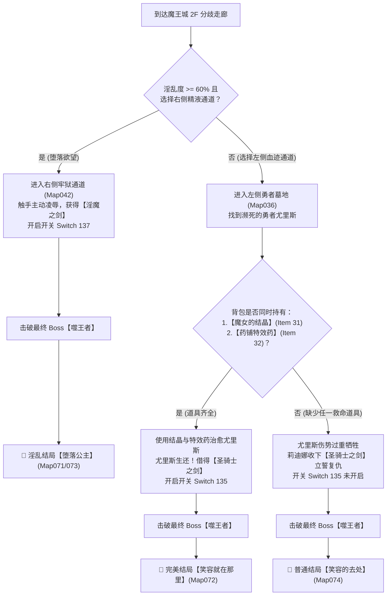

# ⚔️《姫騎士リディナと淫欲のダンジョン》全剧情解析与全结局全要素终极攻略

---

## 📌 基础档案与作品信息

| 项目 | 内容 |
| :--- | :--- |
| **游戏原名** | 姫騎士リディナと淫欲のダンジョン（姬骑士莉迪娜与淫欲的地下城） |
| **官方作品号** | RJ398912 |
| **制作社团** | タイフーンコム (Typhoon Com) |
| **游戏引擎** | RPG Maker MV（即时动作 ARPG 战斗 + 潜行避敌 + 拘束挣脱 + 身体部位敏感度开发系统） |
| **本地路径** | `E:\ACG\Lydina` |
| **ACG Vault 归档** | 游戏 ID: 63 |

---

## 📖 故事背景与全剧情主线深度剖析

### 1. 序章：英雄遇害与舍弃王冠的公主
曾经给大陆带来深重灾难的魔王再次于魔王城复活。为了拯救世界，受到国民敬仰的英雄勇者**尤里斯（Yuris）**孤身踏上征程前往魔王城决战，却在深入险境后音信全无。
王国的公主**莉迪娜（Lydina）**与尤里斯有着深厚的情愫与约定。当得知勇者败北、魔物大军开始向四周蔓延后，莉迪娜毅然舍弃了金丝雀般的公主头衔与王室尊荣，披挂铠甲、握紧圣剑，作为一名救世的“姬骑士”挺身而出，发誓要查明尤里斯的下落并彻底讨伐魔王。

### 2. 第一章：污秽丛生之森与哥布林巢穴
莉迪娜首先来到连接魔王领域的「魔女之森」。这里已被好色卑劣的哥布林族群（小哥布林、普通哥布林、哥布林头目）占领。
- 莉迪娜在森林深处意外发现了曾经协助过勇者的「魔女秘密居所」，魔女早已离开，但留下了强大的魔法道具——**「魔女的结晶」**。
- 挡在关卡前进道路上的是神秘的「奉献之门」，开门条件竟是献上「哥布林的精液」。
- 莉迪娜在深入哥布林废墟时可能遭遇宝箱陷阱被俘入牢房，经历凌辱后从体内提取精液作为钥匙。
- 最终莉迪娜突破层层阻碍，击败哥布林头目，成功激活并解放了第一座封印结晶，打通了通往下一区域的通道。

### 3. 第二章：被兽人统治的小镇与禁断春药沼泽
莉迪娜传送至第二区域「被统治的小镇」。原本繁荣的小镇如今已被残暴好色的兽人（Orc）彻底支配：
- 城镇北面前往下一区域的关卡被兽人重兵把守，要求出示**「通行许可证」**。
- 莉迪娜得知镇内酒馆老板手中有通行证，为了获得许可证，莉迪娜只得穿上轻便衣装在充斥着好色魔物的酒馆中打工端盘子，并在送餐途中忍受酒客哥布林与兽人的动手动脚与性骚扰。在顺利端送4次料理后，老板兑现承诺交付了通行证。
- 穿过北门后进入危险的「沼泽」。沼泽中的泥潭带有强效春药特性，不仅行动迟缓，还会持续刺激身体提升快感值，四处还潜伏着封锁口腔与触碰私处的巨型史莱姆。
- 在沼泽深处隐秘的「药铺洞窟与牢房」中，莉迪娜找到了药铺之女留下的日记以及专门为了拯救重伤勇者所研制的至宝——**「药铺特效药」**。
- 突破沼泽后，莉迪娜击败了关底暴虐的兽人首领，解开了第二枚封印结晶，魔王城的大门终于完全敞开。

### 4. 第三章：魔王城最高层决战与惊天幕后真相
莉迪娜杀入最终迷宫「魔王城」（1F ➡ 2F ➡ 3F）：
- 在魔王城 2F 的走廊深处，莉迪娜发现地面上赫然分流着两道痕迹：左侧是斑驳的**红色血迹**，右侧是散发恶臭的**白色精液**。
- **勇者尤里斯的真相**：沿着左侧血迹走入圣地墓地，莉迪娜见到了伤痕累累、气息奄奄的尤里斯。尤里斯拼尽全力告知了莉迪娜一个足以颠覆认知的残酷事实：
  > **“魔王根本就没有真正复活！……魔王的躯体只是被外来的某种存在当成傀儡利用了！幕后另有真正的黑手！”**
- 登上魔王城 3F 迎战所谓的魔王。魔王被击败倒地后，隐藏在幕后的真正元凶现出真身——自称**「噬王者」（King Eater / 王喰らい触手）**的异界掠食者！
- **噬王者的目的**：噬王者来自于资源耗尽的异界，为了将这个世界的人类与魔物作为长久榨取精气与生命的食粮，特意寄生并利用魔王之躯制造战乱，借此大肆进食。
- 莉迪娜以骑士之名迎战噬王者本体，誓死保卫大陆的和平与所爱之人！

---

## 🏆 全结局分支条件与触发完全指南

游戏共有 **3 个正式结局**，其分支判定点全部位于 **魔王城 2F 的走廊分歧** 与 **背包道具持有状态**：

---

### 💖 1. 完美结局 / 真结局：「笑容就在那里」（True / Happy Ending）
- **对应地图**：`Map072`
- **达成条件**：
  1. 在第一章地下城1的魔女之森隐秘通道，探索「魔女的房间」拾取 **【魔女的结晶】（Item 31）**；
  2. 在第二章地下城2的沼泽深处隐秘洞窟，探索「药铺牢房」拾取 **【药铺特效药】（Item 32）**；
  3. 前往魔王城 2F 时，**选择左侧红色血迹路线**（圣骑士路线）；
  4. 遇到重伤倒地的尤里斯时，莉迪娜会想起魔女与药铺之女的嘱托，当场使用结晶与特效药成功将尤里斯从鬼门关救回！尤里斯亲手将「圣骑士之剑」借予莉迪娜（开启开关 `Switch 135: 生存ルート`）；
  5. 登上 3F 击破最终 Boss 噬王者。
- **结局剧情**：
  噬王者被打倒，世界重归长久和平。尤里斯伤愈康复，与莉迪娜一同回到墓园圣地。阳光明媚下，尤里斯鼓起勇气正式向莉迪娜告白求婚（*“请和我结婚吧！”*）。向来神情严肃刚强的莉迪娜脸上绽放出了温柔幸福的微笑，迎来了圆满浪漫的婚礼结局。
- **通关奖励**：通关后自动进入全回想房间，并解锁通关彩蛋。

---

### 🥀 2. 普通结局：「笑容的去处」（Normal Ending）
- **对应地图**：`Map074`
- **达成条件**：
  1. 未收集齐「魔女的结晶」或「药铺特效药」（缺少任意一个）；
  2. 前往魔王城 2F 时选择左侧血迹路线；
  3. 尤里斯因缺少灵药救治，在莉迪娜怀中重伤不治身亡。莉迪娜悲痛欲绝，从尤里斯遗体上拿起「圣骑士之剑」，发誓继承尤里斯的守护意志；
  4. 登上 3F 击破最终 Boss 噬王者。
- **结局剧情**：
  噬王者被消灭，世界迎来了和平，然而救世的勇者却已长眠地下。莉迪娜独自一身戎装来到尤里斯的墓碑前凭吊献花。她强忍悲伤告诉长眠的尤里斯：国家现在很和平，下一次来探望时，自己一定会努力展现出真正的笑容。带着遗憾与孤独继续守护着王国。

---

### 👑 3. 淫乱结局：「堕落公主」（Lewd / Bad Ending）
- **对应地图**：`Map071` & `Map073`
- **达成条件**：
  1. 主角处于淫乱状态（**淫乱度 >= 60%**）；
  2. 在魔王城 2F 走廊处**选择右侧散发白色精液痕迹的路线**（牢狱通道）；
  3. 莉迪娜进入牢狱深处，看到蠕动的触手魔物后，无法抗拒下半身的骚痒与快感渴望，主动投身触手被其疯狂缠绕凌辱，并从中获得「淫魔之剑」（开启开关 `Switch 137: 淫乱ルート`）；
  4. 登上 3F 击破最终 Boss 噬王者。
- **结局剧情**：
  噬王者虽然被消灭，但莉迪娜的身心已彻底沦为淫欲的俘虏。王城的女仆们议论纷纷，传闻莉迪娜公主在与魔王决战后便失去了踪迹；然而真实情况是——莉迪娜每天夜晚都在各个城镇的小巷中游荡，主动寻找陌生男性，甚至无需任何金钱报酬便宽衣解带、露出淫靡的表情，任凭街头各色男人随意玩弄抽插她那高贵的身体，彻底堕落为沉迷肉欲的公用肉便器。

---

## 🗝️ 关键救人道具获取完全指引

要打出【完美结局】，必须在进入魔王城 2F 之前收集齐以下两件关键物品：

### 💎 道具一：【魔女的结晶】（Item 31）
- **所在区域**：地下城1「森林」➡「魔女秘密居所」➡「魔女的房间」（`Map023`，坐标 `X: 8, Y: 4`）
- **获取步骤**：
  1. 在森林地图（Map008）探索过程中，寻找隐秘的树丛小径（注意观察地图边缘不自然的林间通路）；
  2. 进入「魔女秘密居所」（Map021），继续深入推门进入「魔女的房间」（Map023）；
  3. 调查房间内部的书架与魔法阵装置，阅读魔女留下关于勇者与魔王力量异变的日记；
  4. 在房间宝箱中拾取**【魔女的结晶】**（自动开启开关 `Switch 147: 魔女の結晶`）。

### 🧪 道具二：【药铺特效药】（Item 32）
- **所在区域**：地下城2「沼泽」➡「药铺洞窟」➡「药铺牢房」（`Map034`，坐标 `X: 8, Y: 4`）
- **获取步骤**：
  1. 在小镇酒馆打工取得「通行许可证」后，从小镇北门进入「沼泽」（Map013）；
  2. 避开沼泽中的粉色春药水洼与巡逻史莱姆，探索沼泽东北方的隐藏岩洞入口（Map013 坐标 `X: 22, Y: 3`）；
  3. 进入「药铺洞窟」（Map033），穿过狭长曲折的坑道进入最深处的「药铺牢房」（Map034）；
  4. 调查地上的残卷与医药台，阅读药铺之女为勇者准备备用药物的留言；
  5. 拾取**【药铺特效药】**（自动开启开关 `Switch 148: 薬屋の特薬`）。

---

## 🗺️ 章节主线全关卡详尽攻略流程

### 【第一章：森林与哥布林巢穴】
1. **初始整备**：在传送房间（Map010）与守卫对话，选择进入「魔女之森」。
2. **穿越丛林**：
   - 沿途有草丛潜伏的小哥布林与巡逻的大哥布林，可以挥剑攻击消灭，也可以利用走位绕开。
   - 若被哥布林从背后扑倒会进入拘束状态，需要连续敲击确定键挣脱，否则快感值会迅速飙升导致高潮。
3. **魔女房间解密**：穿过森林中段时往隐蔽岔路走，拿到【魔女的结晶】。
4. **奉献之门与哥布林精液**：
   - 前往奉献之门前（Map008），提示需要「哥布林的精液」才能融化封印。
   - 进入废墟宝箱陷阱处（Map040），故意开启宝箱中陷阱被捕，或者深入哥布林住处（Map045），触发事件获取【哥布林的精液】。
   - 返回奉献之门将精液献祭，大门轰然开启。
5. **Boss 战：哥布林头目（Goblin Boss）**：
   - Boss 具有大范围重击与冲撞技能，注意拉开距离，在硬直时上前使用重斩或火柱输出。
   - 战胜后解放第 1 枚封印结晶，传送回神殿。

---

### 【第二章：被统治的小镇、酒馆与春药沼泽】
1. **探索小镇**：
   - 街道上到处游荡着兽人士兵，接触会被强行索取快感。
   - 镇内有「强奸旅馆」（投宿触发夜袭事件）与「按摩店」（可体验特殊精油开发）。
2. **酒馆打工任务（核心主线）**：
   - 前往酒馆（Map032），与柜台老板对话承接端盘子打工任务。
   - 莉迪娜需要将 4 盘菜逐一端送到指定的酒桌客人面前。
   - **注意技巧**：在送餐过程中，身旁的小哥布林与醉酒兽人会伸出手性骚扰，不要慌乱，平稳移动避开障碍，将全部 4 盘料理准确送达。完成后与老板对话，获得关键道具**【通行许可证】**！
3. **穿越春药沼泽**：
   - 出示通行证穿过北门守卫，进入粉色沼泽（Map013）。
   - 尽量走泥泞中的干燥碎石小道。若踏入粉色春药泥浆，快感值会持续跳动上升。
   - 沼泽中的史莱姆具有口塞拘束技能，优先用远程火炎或快速挥剑击破。
4. **获取药铺特效药**：在沼泽右上角进入药铺洞窟，探寻药铺牢房取得【药铺特效药】。
5. **Boss 战：兽人军团长（Orc Boss）**：
   - 兽人血厚攻高，蓄力攻击带有击飞硬直，建议游走输出。
   - 战胜后解放第 2 枚封印结晶，魔王城传送点开启。

---

### 【第三章：魔王城与噬王者决战】
1. **魔王城 1F & 2F 攀登**：
   - 击败沿途的精英魔物，开启各层捷径传送阵。
2. **走廊终极大分歧（2F 尽头）**：
   - **想走真结局 / 普通结局**：走左侧血迹通道 ➡ 勇者墓地（若有两件神器则救活尤里斯走真结局；若无则尤里斯死亡走普通结局）。
   - **想走淫乱结局**：确保淫乱度 >= 60% ➡ 走右侧精液通道 ➡ 主动投身触手被凌辱并获得淫魔之剑。
3. **最终决战：噬王者（Eater of Kings）**：
   - **第一阶段（假魔王）**：招式较为常规，利用圣骑士之剑的高额伤害快速破盾斩杀。
   - **第二阶段（噬王者本体）**：全屏多段触手横扫与精神侵蚀波动。注意躲避紫色地面预警，当其释放触手牢笼时立刻向外翻滚脱离，找准核心全力输出。
   - 击败噬王者后，根据此前的路线选择，自动进入对应的结局演播与致谢名单。

---

## 🎁 官方隐藏作弊与回想秘籍（极其重要！）

游戏内置了极其强力的官方作弊后门与完备的全回想房间：

### ⚡ 秘籍一：全满神装通关报酬（无限道具 + 999万金币）
- **触发地点**：传送房间（`Map010`，神殿大厅）
- **触发坐标**：**屏幕左侧墙壁角落地砖 `(X: 4, Y: 12)`**
- **操作方法**：走到该坐标面前，**对着墙壁连续按下确定键（Z 键 或 Enter 键）整整 21 次**！
- **获得的逆天奖励**：
  - 💰 **金币 9,999,999**（上限金钱）
  - 🍶 **无限万能药水**（无消耗道具，使用后立即全回复 HP + 精神力+1）
  - 🌿 **无限抑制药草**（无消耗道具，使用后立即让快感值 -50）
  - 💊 **无限纯洁之药**（无消耗道具，使用后立即让淫乱度 -100）
  - 💧 **无限干净的水**（无消耗道具，随时洗净浑身黏液与精液污渍）
  - 💖 **无限淫欲的春药**（无消耗道具，快速拉满淫乱度）
  - 💎 **无限结晶**（可在商店无限换取金钱）
  - 🩸 **淫欲的结晶 x 999**
  - 💊 **延命苦药（HP上限+100）x 999**
  - ⚔️ **强击苦药（攻击力上限+1）x 999**
  - 👙 **全身各部位开发春药（口内/胸部/乳头/私处/阴蒂/穴内）各 x 999**
  - 🛡️ **最强隐藏极品防具与饰品**

### 🕊️ 秘籍二：先代公主的轻松模式恩赐
- **触发地点**：传送房间（`Map010`）右侧坐标 `(X: 16, Y: 12)`
- **操作方法**：与站在那里的先代救世公主对话，在选项中选择**「想要轻松玩游戏」**。
- **奖励内容**：立刻无偿赠送一套【无限万能药水】、【无限抑制药草】与【无限纯洁之药】。

### 🎬 秘籍三：全回想房间（Map024）完全要素自选
通关任意结局后，玩家会自动进入回想房间。回想房间内包含：
1. **淫乱度自由调节柱**（坐标 `X: 5, Y: 13`）：可自由将莉迪娜的淫乱度设定为 `0%`、`20%`、`40%`、`60%`、`80%` 或 `100%`。
2. **全魔物双差分 CG 回放**：
   - 矮小哥布林（X: 4, Y: 5）：提供【一般状态】与【淫乱状态】双差分
   - 普通哥布林（X: 7, Y: 5）：提供【一般状态】与【淫乱状态】双差分
   - 哥布林头目（X: 6, Y: 7）：提供【一般状态】与【淫乱状态】双差分
   - 矮小兽人（X: 11, Y: 5）：提供【一般状态】与【淫乱状态】双差分
   - 兽人（X: 14, Y: 5）：提供【一般状态】与【淫乱状态】双差分
   - 史莱姆（X: 9, Y: 7）：提供【一般状态】与【淫乱状态】双差分
   - 触手（X: 12, Y: 7）：提供【一般状态】与【淫乱状态】双差分
3. **特殊情境回放区**：包括酒馆裸体打工、强奸旅馆夜袭、精油按摩店调教、春药沼泽高潮、战败拘束 CG 等。

---

## ⚙️ 战斗与快感判定核心机制

1. **双状态系统（纯洁 vs 淫乱）**：
   - 当淫乱度较低时（< 60%），莉迪娜保持高傲刚烈的姬骑士形态，受击与被拘束时语气充满屈辱与抵抗，立绘端庄；
   - 当淫乱度较高时（>= 60%），莉迪娜转变为淫乱状态，喘息粗重、面色绯红，被拘束或性骚扰时语音转变为渴望沉沦的娇喘，立绘与对话发生彻底改变，并能解锁专属淫乱路线。
2. **快感槽与高潮绝顶惩罚**：
   - 快感值（0~100）：受到怪物爱抚、踏入春药水洼或饮用春药均会增加快感值。
   - 当快感值达到 100 时触发高潮绝顶，全身麻痹无法行动。若**连续绝顶达到 3 次**，精神力将崩溃导致战斗不能，直接触发战败拘束 H 场景。
   - 使用「抑制药草」可以迅速降低快感值维持神志清醒。
3. **部位开发度机制**：
   - 胸部、乳头、口内、私处、阴蒂、穴内六大部位各自拥有独立敏感开发百分比（可在菜单中查看）。开发度越高，对应部位受到攻击时快感增长倍率越高。

---
*本攻略已完整同步归档至 ACG Vault 数据库与本地知识库中，可直接在 ACG Vault 控制台随时查阅。*
