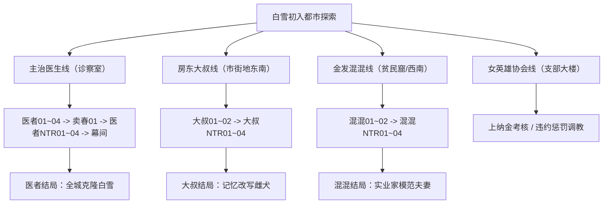

# ❄️《寝取られたヒロイン白雪》（被NTR的女英雄白雪）全剧情深度解析与全结局终极攻略

> **开发社团**：ワンちゃんマン（Wan-chan Man）  
> **作品原名**：『寝取られたヒロイン白雪』（被NTR的女主人公白雪 / 堕落的女英雄白雪）  
> **DLsite编号**：RJ01279319  
> **游戏类型**：变身魔法少女 / 卡牌战斗 RPG（DBG 牌组构筑） / NTR恶堕·纯爱大反转·多结局  
> **游戏引擎**：RPG Maker MV（nw.js）  
> **核心主角**：白雪（女英雄）、良太（男友/经纪人）、阿尔塞拉（前辈女英雄）  
> **攻略归档**：ACG Vault 本地游戏资产知识库  

---

## 📑 目录导航
1. [世界观设定与核心角色深度解析](#一世界观设定与核心角色深度解析)
2. [核心系统与隐藏数值机制详解](#二核心系统与隐藏数值机制详解)
   - [幸福能量（Happy Energy）机制](#1-幸福能量happy-energy机制)
   - [三大堕落核心数值（性经验、淫乱度、顺从度）](#2-三大堕落核心数值性经验淫乱度顺从度)
   - [上纳金考核与周期期限（Deadline）](#3-上纳金考核与周期期限deadline)
   - [战斗卡牌构建与迷宫探索（DBG 战斗系统）](#4-战斗卡牌构建与迷宫探索dbg-战斗系统)
3. [核心分歧关键道具：【真男人卡牌】三件套全收集指引](#三核心分歧关键道具真男人卡牌三件套全收集指引)
4. [全结局（ALL ENDINGS）详细触发条件与剧情全解](#四全结局all-endings详细触发条件与剧情全解)
   - [【TRUE END 1A】：此后永远幸福（良太纯爱真结局）](#1-true-end-1aその後末永く幸せに此后永远幸福--良太纯爱真结局)
   - [【TRUE END 1B】：要来我家吗？（阿尔塞拉百合真结局）](#2-true-end-1bアタシの家来る要来我家吗--阿尔塞拉百合真结局)
   - [【NORMAL END 2A】：此后依然要好·纯洁守护版（普通结局A）](#3-normal-end-2aそれからも仲良し此后依然要好纯洁守护版)
   - [【NORMAL END 2B】：此后依然要好·恶堕三人行版（普通结局B）](#4-normal-end-2bそれからも仲良し此后依然要好恶堕三人行版)
   - [【DOCTOR NTR END】：白雪去哪了？（医生全城克隆量产结局）](#5-doctor-ntr-end白雪はどこに白雪去哪了--医生全城量产克隆结局)
   - [【PUNK NTR END】：被夺走的女英雄·白雪（金发混混实业家结局）](#6-punk-ntr-end奪われたヒロイン白雪被夺走的女英雄白雪--金发混混实业家结局)
   - [【UNCLE NTR END】：主人的雌犬（房东大叔洗脑恶堕结局）](#7-uncle-ntr-endご主人様の雌犬主人的雌犬--房东大叔洗脑恶堕结局)
   - [【PENALTY END】：上纳金不足·病房隔帘受辱惩罚](#8-penalty-end上納金不足懲罰上纳金不足病房隔帘受辱惩罚)
   - [【MERCENARY END】：迷宫02佣兵肉便器结局](#9-mercenary-end傭兵の肉便器迷宫02佣兵肉便器结局)
   - [【DEAD ENDS 01~06】：迷宫战败囚禁 Bad End 汇总](#10-dead-ends-0106迷宫战败囚禁-bad-end-汇总)
5. [四大专属 NTR 男主路线事件全流程推进表](#五四大专属-ntr-男主路线事件全流程推进表)
   - [主治医生（医者）事件线（01~04、幕间、NTR终局）](#1-主治医生医者事件线)
   - [房东大叔（おじさん）事件线（01~04、洗脑终局）](#2-房东大叔おじさん事件线)
   - [金发混混（チンピラ）事件线（01~04、婚后终局）](#3-金发混混チンピラ事件线)
   - [变身女英雄协会（変身ヒロイン協会）阴谋线](#4-变身女英雄协会変身ヒロイン協会阴谋线)
6. [全城镇打工、支线委托与特殊场景一览](#六全城镇打工支线委托与特殊场景一览)
7. [全要素 100% 白金通关推荐攻关路线](#七全要素-100-白金通关推荐攻关路线)
8. [全回想房间（Recall Room）与一键全解锁说明](#八全回想房间recall-room与一键全解锁说明)

---

## 一、世界观设定与核心角色深度解析

### 1. 背景设定
故事发生在被称为“怪人与恶徒盘踞”的近未来现代都市 **H市**。在这座城市中，存在着名为**“变身女英雄协会”（変身ヒロイン協会）**的官方管理组织，专门统筹和派遣拥有超常战力的变身少女讨伐恶徒。

然而光鲜亮丽的表象之下，协会本质上是一个将变身少女视作**“易耗品与敛财/泄欲工具”**的腐朽黑幕。变身少女必须定期向协会缴纳高昂的“管理上纳金”，一旦无法按时缴纳，就会被协会以“代偿”为由强制调教。

### 2. 核心角色解析

* **白雪（Yuki / 纯白女英雄）**
  * 游戏主角。性格温柔、纯洁善良但极度有责任感的美少女。
  * 与男友良太是青梅竹马兼战斗搭档。变身与施展强力绝招需要依赖**“幸福能量”**。
  * 在序幕中目睹良太为救自己中弹重伤，为了赚取高昂的重症监护医疗费和上缴协会的保护金，不得不四处冒险打工，逐渐步入欲望与堕落的陷阱。

* **良太（Ryota / 男友兼经纪人）**
  * 白雪的男友兼战术指挥官。
  * 序章中替白雪挡下怪人子弹，卧床不起住院。前期体质虚弱，深感自己拖累白雪，因无法亲自保护女友而极度内疚自责。
  * 根据玩家的选择，他既有可能在白雪一步步被他人寝取时觉醒“软弱绿帽癖”，也有可能在真结局中借助传说卡牌觉醒惊人体魄，正面痛击恶徒，完成纯爱的大逆转救赎。

* **阿尔塞拉（Arcera / 先辈变身女英雄）**
  * 实力强劲的前辈变身女英雄。
  * 早在白雪之前就已经被恶徒和协会深入开发，堕落成为沉迷肉欲与双人快感的痴女先辈。
  * 表面上扮演白雪的战友与引路人，暗中却热衷于诱惑白雪跨越禁忌防线；两人在战斗与互慰中培养出了深厚的百合羁绊。

* **主治医生（医者）**
  * 良太的主治医师。表面举止得体、医术高超，实则为变身女英雄协会的核心研究人员。
  * 以“为白雪检查身体”、“补充变身幸福能量”为借口，一步步诱导白雪接受催眠和性侵，其终极目的是克隆白雪的肉体，建立量产型女英雄宠物体系。

* **房东大叔（おじさん）**
  * 狡猾贪婪的市井高利贷/房东。
  * 利用白雪急需用钱与温顺单纯的弱点，以减免房租为由诱骗白雪，并联手被调教的阿尔塞拉使用催眠技能卡，妄图将白雪彻底改造成专属肉犬。

* **金发混混（チンピラ / 不良头目）**
  * 街头混混首领。真身为当初在序章中开枪打伤良太的底层杂兵。
  * 当初见识到白雪绝美的变身英姿后陷入痴狂，之后接受了肉体强化改造手术在黑道组织中上位，一切行动皆为了将白雪据为己有。

---

## 二、核心系统与隐藏数值机制详解

### 1. 幸福能量（Happy Energy）机制
* **作用**：变身女英雄的核心动力源。进入迷宫探索、变身战斗均需消耗幸福能量。
* **补充途径**：
  * 前往医院探望良太进行温存互动（初期每次补充少量）；
  * 前往诊察室接受医生“诊疗”补充（会逐步累积医生事件堕落度）；
  * 街头特殊打工与剧情事件。
* **危险阈值**：序章中若幸福能量低于 20，切勿强行选择“侦察敌方基地”，否则会因力竭直接陷入 **Dead End 01**！

### 2. 三大堕落核心数值（性经验、淫乱度、顺从度）
游戏内部通过变量精准追踪白雪的肉体与心理状态：
* **性经验值（Sex Exp / VAR[4]）**：
  * `0`：处女状态。
  * `15+`：解锁混混02、协会01、医生02等基础事件。
  * `30+`：解锁大叔02、医生03等进阶事件。
  * `50+`：解锁大叔NTR01、混混NTR01、医生04。
  * `100+`：彻底堕落分水岭！解锁全套街头卖春02~07、病房公开接吻、以及 **普通结局恶堕三人行差分**。
* **淫乱度（Lust / VAR[5]）**：
  * 影响白雪的主动迎合程度。达到 50 与 100 时分别解锁郊外南部的“贵族大小姐凌辱事件”。
* **顺从度（Obey / VAR[6]）**：
  * 影响对施虐者的屈服程度。达到 10 与 50 时解锁市街地占卜馆的催眠调教事件。

### 3. 上纳金考核与周期期限（Deadline）
* 游戏按天推进（每日早晨良太会打电话汇报剩余天数 `VAR[2]`）。
* **第1周期**：需在决战之日缴纳 **200 枚金币** 上纳金。
* **第2周期**：需在决战之日缴纳 **400 枚金币** 上纳金。
* **违约惩罚**：若到期身上金币不足（`VAR[3] < 目标额`），良太会无奈联系协会寻求免除，结果白雪会被安排去“照顾少爷”（实质为肉体代偿），触发 **Map 156 上纳金不足调教惩罚**，且第3章地牢难度强行上升！

### 4. 战斗卡牌构建与迷宫探索（DBG 战斗系统）
* 采用回合制卡牌对决。白雪拥有 HP、MP 与牌组 Cost 上限。
* **卡牌来源**：迷宫宝箱拾取、击破敌人随机三选一抽卡、道具店购买。
* **战斗流派推荐**：
  * **高伤爆发流**：优先堆叠魔法攻击力（Magic Atk），利用核心输出卡配合重掷次数（Reroll）一回合秒杀单体精英。
  * **护盾反击流**：搭配高防盾牌卡与回血技能，应对第3章高难BOSS。
  * **温泉 Buff**：出征前可去都市郊外温泉沐浴（消耗10枚），获得强力全属性强化增益。

---

## 三、核心分歧关键道具：【真男人卡牌】三件套全收集指引

能否达成 **TRUE END（真结局）**，完全取决于白雪是否在决战前收集齐传说中的 **3 张「真男人卡牌」（真の男のカード）**！这是唤醒良太男子气概、改写软弱宿命的唯一圣物。

| 卡牌名称 | 对应物品ID | 获取地点与详细前置触发条件 | 剧情作用 |
| :--- | :---: | :--- | :--- |
| **真の男の腕カード** （真男人之手臂卡） | `Item[64]` | **市街地（Map 61 EV058）**：探索市街地特定角落交互剧情获得。 | 赋予良太如钢铁般的双臂与出拳力量。 |
| **真の男の脚カード** （真男人之腿部卡） | `Item[65]` | **道具店（Map 77 EV001）**：在西侧道具店购买全部核心陈列道具（或累计消费满足店主要求）后，店主作为特别礼物赠送。 | 赋予良太稳如磐石的下盘与迅猛步伐。 |
| **真の男の股間カード** （真男人之裆部卡） | `Item[66]` | **第3章迷宫06（Map 157 EV011）**：击破第3章地牢守护者，救出被困的阿尔塞拉后，在大叔逃窜掉落物中拾取。 | 赋予良太硕大雄壮的男根与源源不断的雄性荷尔蒙。 |

> [!IMPORTANT]
> **使用时机**：在进入第3章最终迷宫（Map 161 决战）之前的整备室（Map 159），白雪身上必须拥有这 3 张卡。此时与良太对话会触发特别剧情选项：**“使用真男人卡牌吗？”**。选择【是】后，将触发良太肌肉觉醒与纯爱首绞高潮H事件，成功激活 **Switch 92（True End 标志位）**！

---

## 四、全结局（ALL ENDINGS）详细触发条件与剧情全解

游戏共有 **10 大类正式结局分支**，涵盖纯爱大团圆、百合归宿、恶堕狂欢、各路 NTR 惨败及全战败结局：

### 1. 【TRUE END 1A】：『その後、末永く幸せに』（此后永远幸福 - 良太纯爱真结局）
* **达成条件**：
  1. 在决战前收集齐全部 3 张「真男人卡牌」；
  2. 在 Map 159 整备室对良太使用卡牌，使良太彻底觉醒；
  3. 通关第3章击破幕后黑手主治医生；
  4. 金发混混登场偷袭时，觉醒筋肉神力的良太挺身而出与混混正面对决，将其彻底击飞；
  5. 战后迎来终局抉择，选择 **【良太】**。
* **结局剧情**：
  良太找回了作为男人的绝对自信与强健体格，白雪终于卸下重担与良太正式确立伴侣关系，两人携手相伴，迎来幸福安宁的生活。
  *(彩蛋：若通关时白雪的性经验 `VAR[4] >= 100`，结尾独白中白雪会泛起红晕，心中暗自闪过：“不过……偶尔出轨一下，也没关系的吧？♥”)*

### 2. 【TRUE END 1B】：『アタシの家、来る？』（要来我家吗？ - 阿尔塞拉百合真结局）
* **达成条件**：
  1. 达成真结局决战前置（集齐 3 张真男人卡片并击败黑幕）；
  2. 平时与阿尔塞拉积极互动，使阿尔塞拉好感度达到 **`love01 >= 10`**（变量61达到10以上）；
  3. 战后迎来终局抉择，选择 **【阿尔塞拉】**。
* **结局剧情**：
  白雪深情地向阿尔塞拉倾诉爱意，表示自己最喜欢的人其实是一直扶持自己度过难关的前辈。良太在旁不但没有愤怒，反而心领神会地大力祝福（并悄悄尾随期待观摩）。阿尔塞拉微笑着牵起白雪的手，邀请白雪搬入自己的家中，两人从此开启放纵欢愉的百合同居生活。

### 3. 【NORMAL END 2A】：『それからも仲良し…』（此后依然要好·纯洁守护版）
* **达成条件**：
  1. 未集齐真男人卡牌（拥有少于 2 张）打通第3章最终迷宫；
  2. 白雪的性经验值严格保持在 **`性经验 < 100`**；
  3. 决战面对金发混混时，良太因身体羸弱无法参战，白雪拼死压榨最后的变身魔力与混混同归于尽式换伤将其击溃。
* **结局剧情**：
  白雪变身能力大半衰退。战后出院的三人走在街头，面对轻浮市民的猥琐搭讪，白雪严词拒绝，阿尔塞拉将其赶走。良太长舒一口气，三人虽然经历了波折，但守住了底线，以纯洁的战友关系继续守护城市的和平。

### 4. 【NORMAL END 2B】：『それからも仲良し…』（此后依然要好·恶堕三人行版）
* **达成条件**：
  1. 未集齐真男人卡牌打通第3章最终迷宫；
  2. 白雪的性经验值达到 **`性经验 >= 100`**（深度堕落）。
* **结局剧情**：
  战斗结束后，面对街头路人想要“和变身女英雄玩玩”的搭讪，早已沉迷肉欲的白雪欣然接受，并调侃良太：“反正良太先生本来就是看到我被寝取就会兴奋的变态，对吧？♥”。白雪当众切换成**“大肚孕妇形态”（ボテ腹）**，与阿尔塞拉一同在良太眼前接受市民们的多人肉体开发。良太看着心爱的白雪高潮迭起，下半身硬得发痛，三人达成了扭曲却融洽的“寝取守护者”生活。

### 5. 【DOCTOR NTR END】：『白雪はどこに？』（白雪去哪了？ - 医生全城量产克隆结局）
* **达成条件**：
  1. 依次触发医生事件01~04及医生幕间；
  2. 在诊察室（Map 69）触发提示：“再前进将进入医生NTR结局”，选择【是】。
* **结局剧情**：
  良太服下医生开具的所谓“特效药”，陷入深度昏睡整整一年。一年后醒来，发现医生因为“利用白雪克隆体彻底消除全城犯罪”而荣获诺贝尔和平奖。全城推行“每家每户分配一只白雪”的政策，量产型白雪沦为所有市民和怪物的泄欲宠物与家政奴仆，连阿尔塞拉也被克隆量产。一只眼神空洞的克隆白雪微笑着向良太下跪称呼其为“主人”，良太精神彻底崩溃。

### 6. 【PUNK NTR END】：『奪われたヒロイン・白雪』（被夺走的女英雄·白雪 - 金发混混实业家结局）
* **达成条件**：
  1. 依次触发金发混混事件01~04；
  2. 在市街地西南（Map 61 EV047）选择推进混混专属终局。
* **结局剧情**：
  白雪的身心彻底被金发混混攻陷。在白雪的温柔调教与悉心指导下，不学无术的混混竟然脱胎换骨，晋升为全市知名的大实业家。白雪替混混生下了一大群可爱的孩子，两人作为模范夫妻登上电视黄金档接受专访。而良太沦为一无所有的无能旁观者，甚至被邀请参与3P时也只能在床边看着白雪被混混粗暴抽插而无能狂怒。

### 7. 【UNCLE NTR END】：『ご主人様の雌犬』（主人的雌犬 - 房东大叔洗脑恶堕结局）
* **达成条件**：
  1. 依次触发房东大叔事件01~04；
  2. 在市街地东南（Map 61 EV050）选择推进大叔专属终局。
* **结局剧情**：
  大叔联合已经沦陷的阿尔塞拉，利用精神改写卡牌对白雪展开深度催眠洗脑，将白雪记忆中所有关于青梅竹马良太的温馨画面全部偷换篡改成大叔。数周后，出院的良太在街头遇到挺着大肚子的大叔随从白雪。白雪冷酷地视良太为“前任无能经纪人”，并骄傲自满地声明：“我已经成为大叔主人专属的听话雌犬了♥”。

### 8. 【PENALTY END】：『上納金不足懲罰』（上纳金不足·病房隔帘受辱惩罚）
* **达成条件**：
  在第2章结算日，白雪身上金币不足 400 枚，触发上纳金不足事件。
* **结局剧情**：
  良太因无法缴纳上纳金而向协会求情，协会提出以“看照少爷”代偿。白雪在良太病房仅隔一道帘子之后，被权贵恶少极尽侮辱地掌掴臀部、深度口交吞精，并强行破处内射。良太只隔着帘子听到白雪痛苦又娇喘的声音，却无能为力。

### 9. 【MERCENARY END】：『傭兵の肉便器』（迷宫02佣兵肉便器结局）
* **达成条件**：
  在第2迷宫（Map 24）遇到佣兵要求支付 200 金币时，金钱不足并选择 **【献出身体】（体を捧げる）**。
* **结局剧情**：
  佣兵虽然替白雪扫清了迷宫中的所有魔物，但随后将白雪带回住所施加严酷调教。良太出院前往探视白雪时，只见白雪满身痕迹、眼神涣散，完全沦为了佣兵的专属玩物。

### 10. 【DEAD ENDS 01~06】：迷宫战败囚禁 Bad End 汇总
* **Dead End 01（序章草率侦察）**：序幕中幸福能量不足 20 时若执意侦察敌营，会被怪人当场俘虏沦为苗床。
* **Dead End 02（迷宫1战败）**：被恶徒当场擒获，破处强灌子宫。
* **Dead End 03（迷宫2战败）**：被恶徒带回秘密基地公开展示，沦为全组织公用泄欲工具。
* **Dead End 04（迷宫3战败）**：被恶徒用触手连续监禁调教2个月，强制膨腹受孕。
* **Dead End 05（迷宫4战败）**：被植入特大号肛塞（Anus Plug）开发后穴，沦为排泄与性调教标本。
* **Dead End 06（迷宫5/6战败）**：良太与白雪双双被抓入协会监牢，在隔壁牢房由监控镜头公开直播白雪遭受腹击与轮暴。

---

## 五、四大专属 NTR 男主路线事件全流程推进表

游戏中的四大 NTR 男主角拥有清晰严密的阶梯式事件链条，每个阶段均有明确的前置条件：

### 1. 主治医生（医者）事件线
* **医者事件01**：无条件，直接前往医院诊察室。
* **医者事件02**：观看医者01 ＋ **性经验 >= 15**。
* **医者事件03**：观看医者02 ＋ **性经验 >= 30**。
* **医者事件04**：观看医者03 ＋ **第1章通关 ＋ 性经验 >= 50**。
* **地下卖春01**：观看医者04后触发，开启高报酬地下肉体诊疗。
* **医者寝取01**：观看卖春01后在诊察室触发。
* **医者寝取02**：观看医者寝取01后触发。
* **医者寝取03**：观看医者寝取02 ＋ **第2章通关**。
* **医者幕间与寝取04**：观看寝取03后触发幕间，随后进入寝取04。
* **医者终局**：在诊察室与医生对话选择确认，直通 **Ending 05（白雪はどこに？）**。

### 2. 房东大叔（おじさん）事件线
* **大叔事件01**：无条件，市街地东南街道交谈。
* **大叔事件02**：观看大叔01 ＋ **性经验 >= 30**，在医院门口交互。
* **大叔寝取01**：观看大叔02 ＋ **第1章通关 ＋ 性经验 >= 50**，市街地东南。
* **大叔事件03**：观看大叔寝取01后，在市街地南部交互。
* **大叔寝取02**：观看大叔03后，在市街地东南交互。
* **大叔寝取03**：观看大叔寝取02 ＋ **第2章通关**，市街地东南。
* **大叔寝取04**：观看大叔寝取03后，医院门前交互。
* **大叔终局**：观看大叔寝取04后，在市街地东南确认进入，直通 **Ending 07（ご主人様の雌犬）**。

### 3. 金发混混（チンピラ）事件线
* **混混事件01**：无条件，贫民窟（スラム）中央区域触发。
* **混混事件02**：观看混混01 ＋ **性经验 >= 15**，贫民窟北部。
* **混混寝取01**：观看混混02 ＋ **第1章通关 ＋ 性经验 >= 50**，市街地西南。
* **混混事件03**：观看混混寝取01后，市街地西南触发。
* **混混寝取02**：观看混混03后，市街地东部触发。
* **混混寝取03**：观看混混寝取02 ＋ **第2章通关**，市街地西南。
* **混混寝取04**：观看混混寝取03后，市街地西南触发。
* **混混终局**：观看混混寝取04后，在市街地西南确认进入，直通 **Ending 06（奪われたヒロイン・白雪）**。

### 4. 变身女英雄协会（変身ヒロイン協会）阴谋线
* **协会事件01**：性经验 >= 15，市街地东部协会支部。
* **协会事件02**：性经验 >= 25，协会支部前台。
* **协会事件03**：第1章通关后触发。
* **协会事件04**：观看协会03后触发。
* **协会事件05**：第2章通关后触发。
* **协会事件06**：观看协会05后触发，揭露协会与怪人勾结贩卖少女的黑幕真相。

---

## 六、全城镇打工、支线委托与特殊场景一览

| 场景分类 | 地点位置 | 触发条件与内容亮点 |
| :--- | :--- | :--- |
| **地下卖春（01~07）** | 都市各区域暗巷 | 需观看医者卖春01或 **性经验 >= 100**。报酬极其丰厚（50~200枚），但会大幅提高性经验与淫乱度。 |
| **都市郊外温泉（01~03）** | 都市郊外温泉馆 | 入场费10枚。可消除异常并赋予战斗全能力 Buff。事件03需第2章通关且高性经验，触发混浴调教。 |
| **都市郊外训练场** | 郊外训练馆 | 包含露出训练、呼吸耐性、屈从调教与受孕膨腹训练，可解锁各类差分立绘。 |
| **神社巫女打工** | 郊外西北神社 | 无门槛兼职赚钱，高性经验后追加香客猥亵骚扰与奉纳差分。 |
| **贫民窟俱乐部（01~03）** | 贫民窟东北夜店 | 需地牢03通关及第2章通关，触发变身女英雄舞台脱衣舞与贵宾室侍奉。 |
| **市街地占卜馆** | 市街地西南角 | 顺从度（Obey）达到 10 与 50 时解锁，占卜师利用催眠香深度心理调教。 |
| **道具店店主羁绊（01~05）** | 郊外咖啡馆 & 道具店 | 购买道具提高店主好感度。好感Lv5时与邻座哥布林对话，根据是否透露避孕药情报产生支线差分；并赠送真男人关键腿卡！ |

---

## 七、全要素 100% 白金通关推荐攻关路线

为了以最高效率回收全部 10 个结局和全回想 CG，建议按照以下规划分步进行：

### 阶段一：纯爱真男人白金首通（解锁全回想权限）
1. **初期策略**：
   - 保持白雪纯洁（性经验尽可能压低为 0），不触碰任何街头非必要色情事件与卖春；
   - 幸福能量不足时，仅通过探望良太或购买正规药剂补充；
   - 积极刷迷宫与打工凑齐金币，准时缴纳第1章（200枚）与第2章（400枚）上纳金。
2. **收集 3 张真男人卡片**：
   - 市街地角落交互获取【腕卡】；
   - 道具店光顾并购买核心道具，获取店主赠送的【腿卡】；
   - 打通第3章地牢06，击破Boss解救阿尔塞拉，拾取掉落的【裆部卡】。
3. **整备室与决战**：
   - 在 Map 159 整备室对良太使用卡片，触发良太肌肉觉醒纯爱H；
   - 决战痛击医生与金发混混；
   - 存档点 A（决战选择前）：
     - 选择【良太】 -> 达成 **TRUE END 1A（此后永远幸福）**！
     - 读档 A，若平时咖啡馆多找阿尔塞拉聊天刷好感至10 -> 选择【阿尔塞拉】 -> 达成 **TRUE END 1B（百合真结局）**！

### 阶段二：普通结局与恶堕差分回收
1. 不使用真男人卡片直接进入决战；
2. 性经验 < 100 -> 达成 **NORMAL END 2A（纯洁守护版）**；
3. 将性经验刷至 100 以上 -> 达成 **NORMAL END 2B（恶堕大肚三人行版）**。

### 阶段三：各男主专属 NTR 结局存档收割
1. 单独开档或读取第2章存档：
   - 专精诊察室医生路线 -> 触发 **DOCTOR NTR END**；
   - 专精市街地大叔路线 -> 触发 **UNCLE NTR END**；
   - 专精贫民窟混混路线 -> 触发 **PUNK NTR END**；
   - 故意在第2章结算日缺钱 -> 触发 **上纳金不足调教惩罚**；
   - 地牢2佣兵选献身 -> 触发 **佣兵肉便器结局**；
   - 各地牢故意战败 -> 触发 **Dead End 01~06**。

---

## 八、全回想房间（Recall Room）与一键全解锁说明

如果你希望立即鉴赏所有剧情、动画与全差分 CG，游戏内置了官方完整回想空间：

* **回想房间位置**：游戏主地图 `Map 162（回想部屋）`。
* **正常开启条件**：成功通关任意一次 **TRUE END（真结局）** 后，游戏标题画面即可直接进入回想房间。
* **一键全回想解锁开关**：
  * 进入回想房间后，走到正上方的核心水晶 NPC（EV019）处交互；
  * NPC 会提示：*“全エピソードの解放は、トゥルーエンディングをクリアした後に行うことができます。全ての回想を解放しますか？”（是否一键解锁全部回想？）*；
  * 选择 **【はい】（是）**，游戏内部会将全部 CG 标志位与事件开关置为开启，一键点亮全 70 套原创 CG、34 段 H 事件及全部结局回放！

---
*(本攻略基于《寝取られたヒロイン白雪》v1.0 官方完整工程数据精确逆向整理，已妥善归档至 ACG Vault 资料库。)*
