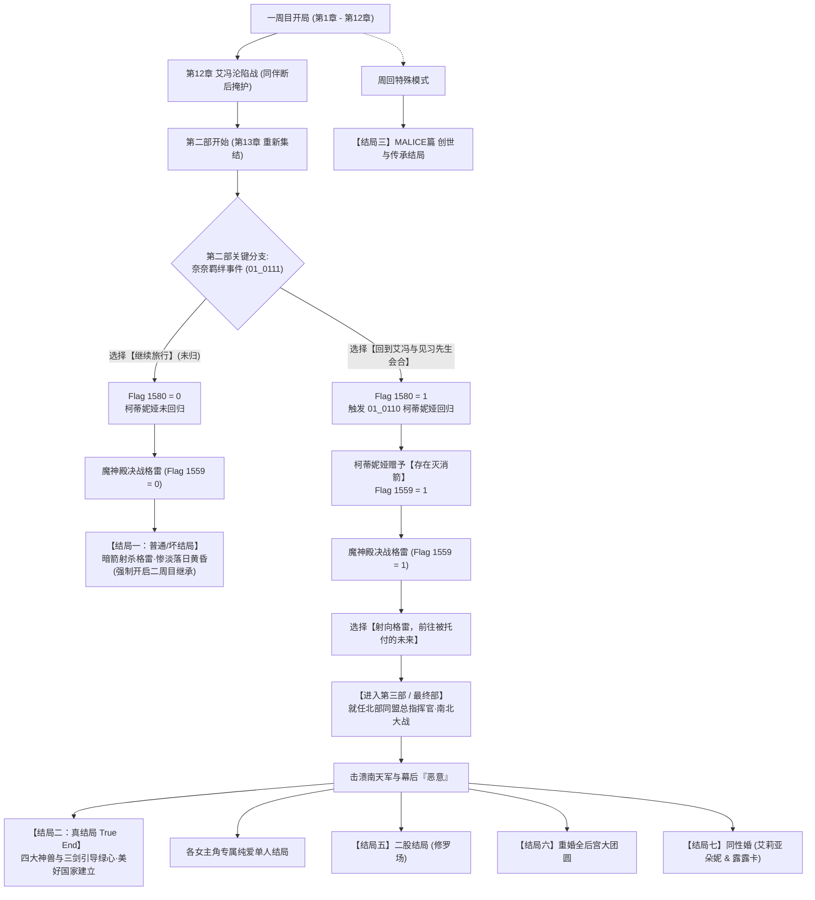

# 👑《素晴らしき国家の築き方》（建立美好国家的方法 / How to Build a Magnificent Kingdom）全剧情深度解析与全结局通关终极攻略

> **开发社团**：アイリスフィールド（Iris Field）  
> **日文原名**：『素晴らしき国家の築き方』  
> **英文译名**：*How to Build a Magnificent Kingdom*  
> **中文译名**：《建立美好国家的方法》/《美好国度的建设方略》  
> **作品类型**：国家建设经营模拟（SLG）+ 实时动作战斗（ARPG/RTS）+ 奇幻史诗多结局大作  
> **作品编号**：RJ219681（Steam / DLsite）  
> **游戏引擎**：Subako Engine（DirectX / C++ 原生同人商业级引擎）  
> **核心特色**：宏大的南北大陆对立与千年魔神救赎史诗、深层伏笔反转、多周目继承体系、完全自由的纯爱/风俗/TNS防绿模式选择、全结局全角色誓约。

---

## 📑 目录导航
1. [世界观设定与核心登场角色详解](#一世界观设定与核心登场角色详解)
2. [主线剧情全脉络梳理（序章至最终部）](#二主线剧情全脉络梳理序章至最终部)
3. [全结局分歧树与精确达成攻略](#三全结局分歧树与精确达成攻略)
   - [结局一：一周目普通/坏结局【惨淡落日的昏黄未来】](#1-结局一一周目普通坏结局惨淡落日的昏黄未来)
   - [结局二：二周目真结局【开拓崭新未来的美好国家】（True Ending）](#2-结局二二周目真结局开拓崭新未来的美好国家true-ending)
   - [结局三：隐藏篇章【MALICE篇·创世与传承结局】](#3-结局三隐藏篇章malice篇创世与传承结局)
   - [结局四：各女主角个人纯爱恋人结局](#4-结局四各女主角个人纯爱恋人结局)
   - [结局五：修罗场二股结局（脚踏两只船）](#5-结局五修罗场二股结局脚踏两只船)
   - [结局六：重婚全后宫大团圆结局](#6-结局六重婚全后宫大团圆结局)
   - [结局七：百合同性婚结局（艾莉亚朵妮 & 露露卡）](#7-结局七百合同性婚结局艾莉亚朵妮--露露卡)
4. [国家经营建设与资源模拟核心方略](#四国家经营建设与资源模拟核心方略)
5. [战斗系统技巧与TNS防绿过滤器机制](#五战斗系统技巧与tns防绿过滤器机制)
6. [官方秘籍系统（IrisCode）与白金全收集指南](#六官方秘籍系统iriscode与白金全收集指南)

---

## 一、世界观设定与核心登场角色详解

### 1. 世界观与核心地理冲突
故事发生在被天险山脉与古代结界分割的广袤大陆：
- **北部同盟地区**：气候严酷、资源贫瘠。原由多个散落的小国家和城邦组成，其中核心为古都**艾冯（エヴォン / Avon）**，以及加尔特农（Galtnon）、威尔福斯（Velforth）等领邦。艾冯在故事开篇已陷入破败与毁灭边缘。
- **南部大陆（南天国）**：气候宜人、物资丰饶、军力强盛，但野心勃勃，长期对北部大陆虎视眈眈。
- **“供民”与“魔神”的千年契约**：北部大陆的大地生机极度匮乏，千百年来依靠被称为“供民”的部族代代自愿将生命力献祭给“夺命魔神”格雷（格莱亚苏尔），魔神将生命力转化为“绿心”维系着大陆的微弱生机，抵御着世界暗面的侵蚀。
- **灾厄王事变与“恶意”（Malice）**：多年前席卷大陆的神秘动乱，导致艾莉亚朵妮的生母艾蕾诺拉王妃死亡，幕后其实潜藏着神秘古老邪恶组织“恶意”的操盘。

---

### 2. 核心登场角色图鉴

| 角色名称 | 身份定位与声优/代码 | 性格特征与角色功能 |
| :--- | :--- | :--- |
| **见习（见习骑士）** | 主人公 / 玩家扮演角色 | 艾冯原见习骑士，被艾莉亚朵妮委以重任任命为**复兴全权代理兼骑士团长**，最终成为**北部同盟军总指挥官**。魔神格雷唯一的关门真传弟子。 |
| **艾莉亚朵妮（アリアドネ / Ariadne）** | 艾冯第一王女 / 核心第一女主（Aria） | 性格坚毅乐观、富有远见，哪怕面对最艰难的绝境也绝不放弃，立志打破千年悲剧宿命，建设一个让所有人都能幸福生活的“美好国度”。 |
| **格雷（グレイ / Gray / 格莱亚苏尔）** | 前艾冯骑士团长 / 夺命魔神（Gray） | 千年来背负世人恐惧与诅咒的“魔神”，收纳供民生命维系世界。表面上扮演冷酷伪恶者，实则深爱着人类并以长辈身份守护主角与艾莉亚朵妮。 |
| **露露卡（ルルカ / Ruruka）** | 北方山岳雪国女王（Ruru） | 艾莉亚朵妮的挚友兼同盟领袖，沉稳英气，与艾莉亚朵妮有着极深羁绊（可触发百合结婚事件）。 |
| **芙罗莉娜（フロリナ / Florina）** | 威尔福斯女王（Fror） | 尚武英勇的领袖，性格耿直果敢，在同盟中给予主角坚定的军事信任。 |
| **梅露迪娅（メルディア / Meldia）** | 加尔特农女王（Merd） | 智谋过人的女王，擅长政务与经济布局，推举主角担任同盟总指挥官的关键支柱。 |
| **柯蒂妮娅（コーディリア / Cordelia）** | 神秘游侠刺客（Cody） | **通往真结局的命运核心钥匙！** 掌握着唯一能斩断魔神因果宿命的神器**“存在灭消之矢”**。第二部是否归队决定了世界走向光明还是黄昏。 |
| **奈奈（ナナ / Nana）** | 天才歌姬 / 游历少女（Nana） | 纯真善良的少女，原敬仰神秘“老师”，在老师走入歧途后选择留在艾冯赎罪，在第二部中其心理抉择直接关联柯蒂妮娅的回归。在MALICE篇中成长为传奇都市建立者。 |
| **五郎（ゴロー / Goro）** | 豪爽冒险者 / 主角挚友（Goro） | 优夏的搭档，第三部中身负重伤垂死，被格雷赋予力量变异为强悍的蓝色魔兽战士参战。 |
| **优夏（ユーシャ / Yusha）** | 女勇者（Yusy） | 五郎的冒险搭档，正义感极强，战斗力出众。 |
| **安莉（アンリ / Anri）** | 天才圣剑士（Anri） | 手持开拓未来之剑的天才少女，真结局终战中引导神兽力量的核心三大剑士之一。 |
| **希璐德（シィルド / Hilde）** | 守护之剑圣骑士（Shie） | 曾破除封印结界的强大骑士，真结局中与安莉、主角共同引导三大圣剑。 |
| **莉奈（リーネ / Lina）** | 供民少女（Rine） | 供民血脉继承者。点醒格雷“供民献身是出于自身意志而非被单方面剥夺”，给予格雷真正的灵魂救赎。 |
| **贝尔娜（ベルナ / Berna / Vell）** | 神秘神性少女（Vell） | 第二部初期唤醒主角的奇妙少女，具有随意变化身形与**复制所有角色与职业技能**的逆天战力，性格极其豪放开放。 |
| **罗洛娜（ロロナ / 罗洛丽亚娜）** | 古代大树妖精 / 神灵存在 | 陪伴与守护魔神格雷千年的存在，真结局中陪伴格雷安然退休离去。 |
| **四大神兽** | 风之卡吕希安 / 水之优米露娜娜 / 土之缪珀克莱特 / 火之露贝尔薇特 | 分别与莱欧斯、娜蒂、艾丝忒尔、奈奈结缔祝福契约的远古自然力量。 |

---

## 二、主线剧情全脉络梳理（序章至最终部）

### 1. 第一部（序章 ～ 第12章）：破壁而立与艾冯沦陷战
- **第0章～第2章【绝境受任】**：艾冯在灾难后成为废墟，百姓流离失所。艾莉亚朵妮王女任命年轻的见习骑士为艾冯骑士团长与复兴全权代理人。二人从一块麦田、一座工坊开始，开荒拓土、召集各路人才（猎人妮亚美、治疗师卡丝柯、巫女艾丝忒尔等）。
- **第3章～第8章【诸王同盟】**：随着艾冯城池逐渐繁荣，加尔特农的女王梅露迪娅与威尔福斯的女王芙罗莉娜被艾莉亚朵妮的执政理念所打动，三国正式结成坚不可摧的“北部同盟”，共同面对北方日益加剧的魔兽动乱与饥荒危机。
- **第9章～第11章【阴谋隐现】**：国庆节与武斗会期间，“恶意”操纵的武装黑衣人突袭会场，艾莉亚朵妮险些中毒，主角与格雷联手压制叛乱，揭开了当年艾蕾诺拉王妃遇害案与潜伏结社的冰山一角。
- **第12章【艾冯沦陷·悲壮断后】**：格雷突然以“灾厄王”姿态发难，魔兽与强敌重重包围艾冯要塞。为了掩护主角与艾莉亚朵妮撤退以保全同盟火种，同伴们（莱欧斯、伊欧、莉奈、艾丝忒尔、妮亚美、奈奈、娜蒂等）毅然选择留守断后，浴血奋战阻挡追兵。要塞陷落，主角重伤昏迷，艾莉亚朵妮带着主角流亡。

### 2. 第二部（第13章 ～ 魔神殿决战）：流亡再起与宿命分水岭
- **三年流亡与再起**：神秘少女贝尔娜唤醒主角，艾莉亚朵妮与主角在极其艰苦的环境下重新聚拢残余军民，逐步寻回当年失散的伙伴们，揭露格雷之所以扮演“恶王”是为了吸取恶业与生命封印更大的灾祸。
- **第14章【魔神殿进军】**：北部同盟重新集结，杀入魔神殿最深处直面“夺命魔神”格莱亚苏尔（格雷）。
- **决战终局的生死抉择**：
  - 若**柯蒂妮娅未回归**：打败格雷后，其诅咒无法化解，柯蒂妮娅在暗中放箭杀死格雷，格雷力量暴走消逝，北部同盟失去了唯一的生机来源，大陆陷入无望的暮光黄昏（**进入一周目普通/坏结局**）。
  - 若**柯蒂妮娅回归并交付“存在灭消之矢”**：主角在最后一刻对格雷使用灭消之矢，抹去强加在他身上的魔神神格因果律，格雷重获凡人之躯生还，世界因果发生根本逆转，**直接解锁第三部（最终部）**！

### 3. 第三部（最终部 / 第15章）：南北全面大战与大陆创生
- **三年后的总指挥官**：三年过去，艾冯与北部同盟进入空前繁荣期。然而南方强权“南天国”突然对北部同盟发布宣战布告。在诸王会议上，艾莉亚朵妮、芙罗莉娜、梅露迪娅全票一致推举主角为**北部同盟军最高总指挥官**！
- **全明星阵容进军**：格雷重返战阵与主角并肩作战；五郎以魔兽姿态守护前线；希秧与野兽大军助阵；歌姬奈奈鼓舞全军；神性贝尔娜复制顶级神技。同盟军一路势如破竹击退南天军队，彻底斩断隐藏在暗处的“恶意”化身。
- **终局奇迹【神兽与三剑】**：格雷与妖精罗洛丽亚娜完成了千年的赎罪与工作，格雷将大树中积蓄千年的纯净“绿心”释放于天地。安莉、希璐德与主角手握三大圣剑，借由风、水、土、火四大神兽的最高神威，将庞大无比的绿心注入整个大陆。分隔南北千年的结界消散，天降祥瑞，干涸的荒原化作绿洲，供民永远解除了献祭宿命，一个前所未有的“美好国家”宣告诞生！

---

## 三、全结局分歧树与精确达成攻略

---

### 1. 结局一：一周目普通/坏结局【惨淡落日的昏黄未来】
- **结局名称**：Normal End / Bad Ending（落日之末）
- **触发条件**：
  1. 一周目游玩时（通常因无法提前获知伏笔或缺少周回引导）；
  2. 在第二部推进过程中，奈奈的专属羁绊事件（`01_0111.txt`）中选择了【继续旅行】；
  3. 导致柯蒂妮娅未能回归艾冯（Flag 1580 = 0, Flag 1559 = 0），队伍未获得神器“存在灭消之矢”。
- **战后剧情**：
  决战格雷后，由于缺少灭消因果的神器，格雷无法被解救。柯蒂妮娅自暗中射出普通暗箭将格雷击杀。格雷体内的庞大魔力由于缺乏正确引导而暴走消散。北部同盟虽勉强获胜，但失去魔神生命源泉的大地彻底失去了复兴的希望。艾莉亚朵妮虽强颜欢笑宣称“哪怕用风俗和盗贼产业也要从头复兴”，但面对缓缓下沉的落日与无尽暮光，大陆走向不可挽回的荒凉与凋敝。
- **解锁要素**：通关后开启**周回系统（02_9120）**，全员能力、等级、金钱与大部分非经验数值可继承至二周目！

---

### 2. 结局二：二周目真结局【开拓崭新未来的美好国家】（True Ending）
- **结局名称**：True Ending（素晴らしき国家の築き方）
- **达成严苛前置条件**：
  1. **必须在二周目（或继承存档）下游玩**；
  2. 进入第二部后，当推进到各地同伴寻回阶段时，前往触发**奈奈（歌姬）的个别绊事件（`01_0111.txt`）**；
  3. 面临人生抉择选项时，**必须选择第一项：【回到艾冯与见习先生会合】**（切勿选择“继续旅行”！），系统判定 `FLAGSET, 1580, 1`；
  4. 随后在艾冯据点触发**柯蒂妮娅回归特别绊事件（`01_0110.txt`）**。柯蒂妮娅现身向主角道歉，并将能湮灭世界因果法则的唯一神器**【存在灭消之矢】（存在消滅の矢）**交付给主角（系统判定 `FLAGSET, 1559, 1`）；
  5. 推进至魔神殿决战格雷（`01_9010.txt`），击败格雷后，背包中的存在灭消箭发出耀眼光芒，系统弹出专属救赎选项：
     - **【射向格雷，前往被托付的未来】**（射出存在灭消箭）；
  6. 箭矢命中格雷，抹除其背负千年的魔神神格诅咒，格雷从沉重宿命中解脱并生还，全员成功迈入**第三部（最终部 / Chapter 15）**！
  7. 在第三部中，担任北部同盟总指挥官，调配全军击溃南天国侵略军，斩杀幕后元凶“恶意”；
  8. 最终格雷与罗洛丽亚娜放下重担安详隐退；四大神兽（风水土火）与三圣剑将千年积攒的纯净绿心注入全大陆，结界消散，南北归一，全员达成史诗级大团圆真结局！

---

### 3. 结局三：隐藏篇章【MALICE篇·创世与传承结局】
- **结局代号**：`03_0012.txt` / Ending 1
- **触发机制**：通关主线或二周目后，在特定系统菜单中选择进入“MALICE篇”（CSceneMalice）。
- **剧情揭秘**：
  视角跨越至太古之初，展现“眼中没有任何色彩的少女”以白泥捏造生灵的创世源起，解开了世界上所有“恶意”与异变的根本成因。篇章末尾以歌姬奈奈的晚年回忆视角收尾：奈奈在历经残酷冒险后，在昔日同伴的协助下亲手建立起了一座收纳庇护了 **16,487 名孤儿** 的宏伟新都市，用一生的慈爱书写了大陆的全新文明史诗。

---

### 4. 结局四：各女主角个人纯爱恋人结局
- **涉及角色**：艾莉亚朵妮（Ariadne）、露露卡（Ruruka）、芙罗莉娜（Florina）、梅露迪娅（Meldia）、莉奈（Lina）、奈奈（Nana）、艾丝忒尔（Estelle）、妮亚美（Nyami）等。
- **达成方法**：
  在艾冯据点日常交流中，持续提升指定女主角的好感度与羁绊值。
  当羁绊达到上限时，触发该角色的专属【恋人H】事件（脚本号 `30_xxxx`、`31_xxxx` 系列）。在打通最终决战后，主角将与该指定女主角确认终身伴侣关系，迎来专属于两人的甜美后日谈。

---

### 5. 结局五：修罗场二股结局（脚踏两只船）
- **触发脚本**：`00_5000.txt`
- **触发条件**：在主线游玩过程中，未走单一纯爱路线，而是**同时攻略了两名及以上女主角**并均确认了恋人关系。
- **精彩剧情**：主角清晨在食堂喝咖啡沉思时，意识到自己脚踏两只船的尴尬处境，随后被卷入两位女友之间的吃醋修罗场与双人特殊互动事件。

---

### 6. 结局六：重婚全后宫大团圆结局
- **触发脚本**：`00_5001.txt`
- **触发条件**：在周回或高精力运营下，**将全主要女主角全部攻略为恋人**。
- **精彩剧情**：在艾冯城走廊上，主角扶着酸痛的腰部苦笑感叹。战后作为北部同盟最高统帅的主角与艾莉亚朵妮、诸位女王及所有女伴达成合法重婚协议，建立起其乐融融、百花齐放的超级后宫大家庭。

---

### 7. 结局七：百合同性婚结局（艾莉亚朵妮 & 露露卡）
- **触发脚本**：`00_5002.txt`
- **触发条件**：在游戏过程中重点培养艾莉亚朵妮与露露卡之间的双人羁绊任务，且主角在对应情愫选项中选择促成二人。
- **精彩剧情**：两位北方领袖少女跨越国境与立场，在艾冯教堂中正式向全体国民宣布成婚，成为北部同盟传唱的百合佳话。

---

## 四、国家经营建设与资源模拟核心方略

本作的核心框架是经营模拟SLG，国家的硬实力直接决定了守城战、剧情推进速度与同伴满意度。

### 1. 核心五大资源循环机制
1. **劳动力（Labor）**：国家发展的根本动力。优先分配给农业开荒，中后期转向商业与军事工房。
2. **资金（Gold）**：用于建筑升级、士兵招募与装备采购。主要依靠税收、商业街、风俗店（可选）以及外征讨伐战利品。
3. **粮食（Food）**：决定人口承载上限与国民满意度。若粮食不足会爆发饥荒，大幅削减防御力。
4. **矿石/资材（Material）**：建造高级城防工事与锻造神装的关键耗材。
5. **绿心/魔力（Green Heart）**：大地的生命本源，用于解锁古代高级科技与大范围结界。

### 2. 文明等级（Civilization Level）晋升优先级
- **前期（第1～4章）**：全力开垦农田与水利灌溉，将文明等级拉升至基础线，保障人口不流失；
- **中期（第5～9章）**：搭建集市与工坊，提升资金流入速度，尽快建造训练所提高同伴出击属性；
- **后期（第10～12章）**：在要塞沦陷战前，务必加固艾冯要塞的城墙防卫工事与箭塔，降低断后战斗难度。

---

## 五、战斗系统技巧与TNS防绿过滤器机制

### 1. 战斗克制与队伍战力成型
- **兵种属性相克**：步兵克弓兵、弓兵克骑兵/魔兽、骑兵克步兵。面对大规模魔兽群时，利用妮亚美的陷阱技能可大幅削减敌前锋。
- **装备耐久度保护**：每次出击后注意在工坊修复防具与武器，耐久归零会导致战斗力骤降。
- **第三部黄金战力组合**：
  - **格雷**：物理与暗黑魔力天花板，单体爆发秒杀敌将；
  - **五郎（魔兽态）**：超强肉盾与大范围AOE控场；
  - **贝尔娜**：全能型万金油，复制顶级输出技能后兼具输出与回复；
  - **安莉 & 希璐德**：神兽圣剑突击手，负责收割高抗性精英怪。

### 2. TNS过滤器机制（NTR / 纯爱开关）
本作在同人SLG中具备非常人性化的安全机制：
- 游戏脚本专门内置了 **`00_6000` 系列的 TNS 过滤器（TNS Filter）**。
- **纯爱党玩家福音**：在游戏设置或开局选项中开启过滤器后，**所有非自愿、恶堕、NTR以及带有凌辱性质的被动事件将被彻底屏蔽或替换**，玩家可以 100% 放心游玩纯正的王道救国与甜美纯爱故事！
- **全内容探索玩家**：关闭过滤器则可体验完整的风俗馆经营、特殊俘获事件以及全差分CG收集。

---

## 六、官方秘籍系统（IrisCode）与白金全收集指南

在游戏主界面的 **【IrisCode】（アイリスコード）** 入口中，可输入官方特典代码，直接激活特殊购入特典（脚本 `00_7002` ～ `00_7010`）：
- 特典包括：开局赠送限定强力装备（单手剑、大剑、拳装具、弓、投掷短剑、魔法杖、防具等7大类神装自选）、海量启动资金与经验道具。
- 二周目启动时，利用周回系统继承上周目强力神装与全员属性，开启二周目专属战斗跳过功能，可极速通关并直奔第二部与第三部的真结局！

---

> **本攻略由 ACG Vault 知识库深度整理**  
> 关联作品：`E:\ACG\[アイリスフィールド][RJ219681] 素晴らしき国家の築き方`  
> 数据库档案 ID：`132`  
> 状态：全剧情、全结局分歧条件、真结局钥匙已完整收录于 ACG Vault！
