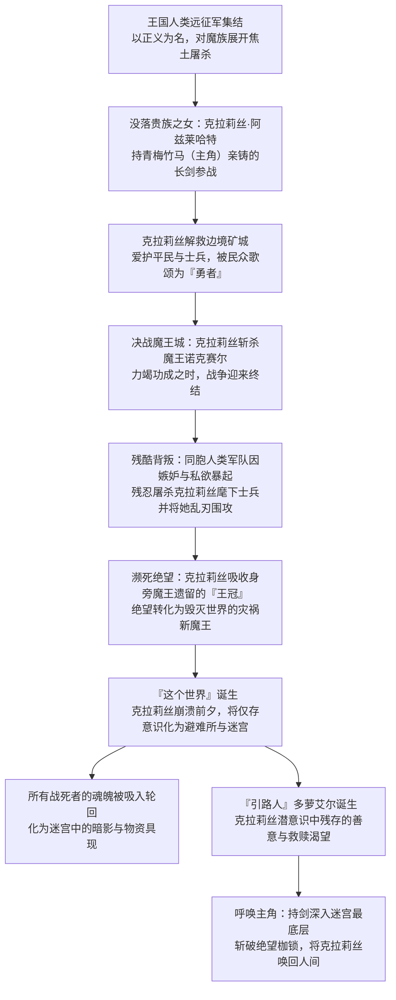
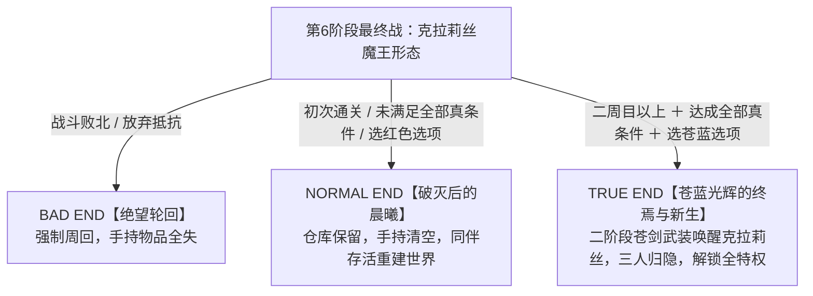
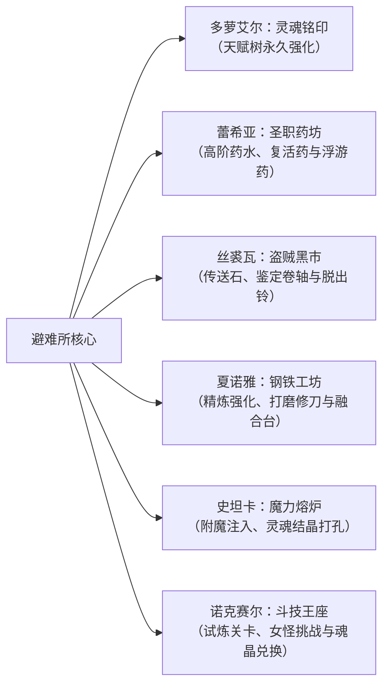

# ⚔️《苍色之光与魔剑锻造师》（蒼キ光と魔剣の鍛冶師 / The Shimmering Horizon and Cursed Blacksmith）全剧情全脉络·三大结局·全迷宫机制100%终极攻略

> **开发团队**：Ason（台湾同人社团）｜ **发行平台**：Steam（AppID: 1414910） / DLsite（RJ309598）  
> **游戏类型**：Roguelike 走格子回合制迷宫探索 × 锻造经营 × 魂系资源管理 × 暗黑奇幻群像剧  
> **核心机制**：侵蚀度（Erosion）资源管控 ＋ 锻造/强化/附魔/融合四合一工坊 ＋ 苍剑/魔剑双形态 ＋ 三大结局分歧  
> **全要素覆盖**：✅ 世界观与终极黑幕深度解密、全角色宿命羁绊梳理、全结局（Bad/Normal/True End）达成硬性条件、全主线六阶段与最终BOSS机制、五把神殿祭品武器精准配方、灵魂铭印全技能树、最强词条构筑与无尽模式。

---

## 📑 目录导航

1. [世界观设定与核心剧情深层暗线解密](#一世界观设定与核心剧情深层暗线解密)
   - 表面框架与终极黑幕（勇者堕为魔王之真相）
   - 克拉莉丝·阿兹莱哈特的命运悲歌
   - 避难所与迷宫的真正本质
   - 「引路人」多萝艾尔的真面目
   - 苍色之光与魔剑阿兹莱哈特的象征意义
   - 克拉莉丝隐藏日记全篇心路复盘
2. [全同伴角色背景与羁绊关系网络](#二全同伴角色背景与羁绊关系网络)
3. [三大分支结局达成条件与周回继承全解](#三三大分支结局达成条件与周回继承全解)
   - 结局分支决策树
   - 坏结局（Bad End）：绝望的无尽轮回
   - 普通结局（Normal End）：破灭后的残破晨曦
   - 真结局（True End / Another End）：苍蓝光辉的终极救赎
   - 周回系统（New Game+）继承机制与特权速查表
4. [核心系统与战斗资源管理体系](#四核心系统与战斗资源管理体系)
   - 侵蚀度（Erosion）系统与避险策略
   - 武器格挡率（Block Rate）计算机制与80%上限突破
   - 武器耐久度判定与「无损不毁」顶级机制
5. [锻造工坊与最强武器/词条 BD 构筑](#五锻造工坊与最强武器词条-bd-构筑)
   - 锻造三大属性法则（质量 / 强度 / 魔力）
   - 强化、附魔、融合与神级追加词条清单
   - 毕业级武器与饰品构筑推荐
6. [避难所设施升级与灵魂铭印经营全解](#六避难所设施升级与灵魂铭印经营全解)
   - 六大功能设施解锁与实用建议
   - 灵魂铭印（Soul Imprint）26项天赋树与最优先加点
   - 跨周回赛钱箱理财策略
7. [主线六阶段全迷宫图文级流程与 BOSS 机制攻略](#七主线六阶段全迷宫流程与-boss-机制攻略)
   - 第一阶段：静寂洞窟 ＋ 哀愁回廊（救出蕾希亚）
   - 第二阶段：暗淡城迹 ＋ 混乱之森（救出丝裘瓦）
   - 第三阶段：荒芜荒野 ＋ 纷乱要塞（救出夏诺雅）
   - 第四阶段：微风山道 ＋ 褪色矿坑（救出史坦卡）
   - 第五阶段：魔都城寨（救出诺克赛尔）
   - 第六阶段：侵蚀之炼狱 ~ 终末之门（终极决战迷宫）
     - 五大祭品武器配方与解封地点
     - 三大支线炼狱固定迷宫与强敌机制
     - 4块「遥远纯粹的记忆」隐藏获取点
   - 最终 BOSS（克拉莉丝化身 / 绝望魔王）两阶段击破秘诀
8. [无尽迷宫、全成就与斗技场挑战](#八无尽迷宫全成就与斗技场挑战)

---

## 一、世界观设定与核心剧情深层暗线解密

### 1.1 表面框架 vs 隐藏真相

* **表面故事**：  
  主角是一名失忆的青年锻造师（铁匠），手握一柄会侵蚀神志的漆黑魔剑，从充满迷雾与亡灵的异界废墟中苏醒。在持有微光提灯的无口少女「多萝艾尔」引导下，主角在浮空孤岛建立「避难所」，深入不断随机变动的六大迷宫，陆续救出被困的人类与魔族同伴，合力打造神兵，最终击败深渊魔王以逃离囚笼。

* **核心黑幕（随着记忆收集与前魔王诺克赛尔叙述完全揭晓）**：  
  这绝不是简单的穿越或讨伐恶魔，而是**一场关于「英雄被同胞背叛残害、绝望反转为魔王，在灵魂破灭边缘渴求拯救」的凄美悲剧**。

---

### 1.2 关键核心真相细则

| 维度 | 游戏深层事实揭秘 |
| :--- | :--- |
| **世界本质** | 整个迷宫世界并非真实物理空间，而是**克拉莉丝在受到绝望侵蚀彻底化为新魔王的一刹那，为了保护重要之人并困住毁灭力量，用潜意识构筑出的心灵回廊与绝望牢狱**。 |
| **多萝艾尔的真身** | 多萝艾尔（Doroelle）**是克拉莉丝潜意识分裂出的化身**。她承载了克拉莉丝未被污染的纯净人格与记忆碎片，其外表与克拉莉丝极为神似。她的使命只有一个：**指引她最深爱、最信任的锻造师（主角）来到心灵最底层杀死/拯救自己**。任务完成后她将融合归一。 |
| **避难所同伴的死活** | 蕾希亚、丝裘瓦、夏诺雅、史坦卡在现实的惨烈战争中皆已濒临死亡或意识涣散。克拉莉丝在化为魔王剥夺她们记忆的同时，实际上是在**保护她们免遭现实背叛与侵蚀的精神崩溃**。在避难所被主角拯救后，她们的灵魂得以重聚成长。 |
| **魔剑与苍剑的来历** | 主角开局手握的漆黑「魔剑」，是主角少年时亲手为克拉莉丝打造的誓约之剑。在克拉莉丝身死化为魔王前夕，她拼尽全力将剑托付回主角身边。当主角收集齐全部同伴羁绊与记忆，魔剑吸收纯洁灵魂后将蜕变为真正的神兵——**「苍剑·阿兹莱哈特」**。 |
| **前魔王诺克赛尔** | 原魔王诺克赛尔被克拉莉丝刺穿心脏前，将自身神魂融入魔王王冠。因此在克拉莉丝吸收王冠后，诺克赛尔以魔力结晶体的形态存活于心灵世界，并以避难所商人的身份从旁见证局势。 |

---

### 1.3 苍色之光（蒼き光）的核心意象

在本作中，「苍色」（蓝青色光芒）代表着**纯粹灵魂与羁绊的本真色彩**：
* 迷宫中散落的苍光，是被困死者未曾熄灭的善意与思念；
* 最终战阶段二，主角摆脱侵蚀状态，转化为神圣辉煌的「苍剑武装」，剑刃绽放出破晓般的苍蓝曙光，象征着用爱与执着斩裂憎恨血海。

---

### 1.4 克拉莉丝日记（勇者的记忆）全篇心路轨迹

游戏内散落的隐藏日志还原了克拉莉丝从懵懂少女到被逼成魔王的完整悲剧：
1. **平淡无奇的记忆（1~6）**：
   - 记录克拉莉丝离开家乡出征，主角婉拒从军选择留在铁匠铺。主角熬夜为她量身打造了一柄不沉且顺手的手工剑，这柄剑成为她最重要的精神支柱。
   - 在巡逻中结识死脑筋圣骑士少女蕾希亚，初次带领小队剿匪，救下了半魔族与人类混编的盗贼团（其中有猫娘丝裘瓦的影子），开始对人类与魔族的绝对善恶产生动摇。
2. **竭力奋斗的记忆（1~5）**：
   - 上级命令她将平民矿城作为炮灰诱饵据点以拖延魔族大军。克拉莉丝不愿草菅人命，毅然违抗军令，暗中疏散平民并率队用炸药炸塌山谷击退魔族，救下全城百姓。
   - 矿城居民感激涕零，尊称她为「勇者」。克拉莉丝只找夏诺雅保养爱剑，心中默默希望能将这份荣誉带回家乡向主角炫耀。
3. **勇猛辉煌的记忆（1~4）**：
   - 国王因其声望赦免了违抗军令之罪并封她为帝国勇者。在王宫宴会上，魔族猛将史坦卡夜袭高台，对她发出了灵魂拷问：「**勇者大人啊，在大家的眼中，你还算是一个人类吗？**」
4. **迷惘困惑的记忆（1~6）**：
   - 远征军深入魔界，战争演变为单方面的残酷侵略与烧杀抢掠。克拉莉丝亲眼目睹同胞士兵滥杀无辜魔族平民，更目睹伪装成魔族的人类盗贼被自己人残忍虐杀。
   - 猫娘魔族为死去的人类痛哭，让克拉莉丝信念几乎崩塌：「到底谁才是侵略者？勇者到底算什么？」
5. **决一死战的记忆（1~3）**：
   - 魔王城总攻。蕾希亚拼死拖住守门的史坦卡，克拉莉丝孤身杀入王座，与压倒性实力的魔王诺克赛尔决战，险胜并刺穿魔王心脏。
6. **终局前夕的记忆（1~2）**：
   - 刚杀魔王，背后的友军士兵却拔刀刺杀克拉莉丝的亲卫队并围杀克拉莉丝。贵族与教会不愿看到平民敬仰的没落贵族凯旋夺权，决定让「勇者光荣牺牲在魔王殿」。
   - 在同胞无休止的围砍与嘲讽中，克拉莉丝心死狂笑：「**原来一直以来让我坚持下去的唯一理由，就只是想回到那家伙的身边而已……**」随后王冠暴走，绝望将天地吞没。
7. **遥远纯粹的记忆（1~4）**：
   - 揭晓主角幼年不知自己生日、在铁匠铺挥汗打铁。克拉莉丝溜去玩耍，为主角亲手编织项链作为生日约定的温馨回忆。

---

## 二、全同伴角色背景与羁绊关系网络

| 角色名称 | 种族 / 原身份 | 避难所职能 | 救出地点 | 宿命羁绊与剧情暗线 |
| :--- | :--- | :--- | :--- | :--- |
| **主角（玩家）** | 人类 / 铁匠青年 | 锻造、探索、持剑者 | 初始苏醒 | 克拉莉丝青梅竹马。一生最重要的羁绊，也是唯一能击破心之壁垒唤醒克拉莉丝的人。 |
| **多萝艾尔** | 意识聚合体 / 引路人 | 灵魂铭印、升级加点 | 避难所初始 | 克拉莉丝未崩塌潜意识的化身。提灯指引方向，性格无口冷淡却全心全意为主角铺路。 |
| **蕾希亚** | 人类 / 圣骑士见习 | 药水调配、蔬菜种植 | 阶段 1 终点 | 曾经对克拉莉丝无比憧憬的圣骑士，认出主角是克拉莉丝口中挂念的重要之人。在避难所重塑对真光的信仰。 |
| **丝裘瓦** | 魔族 / 盗贼猫娘 | 道具杂货贩售 | 阶段 2 终点 | 原人魔共生盗贼团一员。嘴硬贪吃（极度喜欢烤蜥蜴肉串），视主角为大客户与同甘共苦的挚友。 |
| **夏诺雅** | 人类 / 武器锻造师 | 武器保养、特制附魔 | 阶段 3 终点 | 随军铁匠，皮肤黝黑开朗豪爽。曾多次为克拉莉丝保养爱剑，深知那把剑对克拉莉丝的无可替代性。 |
| **史坦卡** | 魔族 / 魔王军先锋将领 | 魔力注入、防具强化 | 阶段 4 终点 | 身材娇小却拥有骇人魔力巨腕。曾受人类罗伊恩惠而取名，性格傲娇好战，对背叛克拉莉丝的人类深恶痛绝。 |
| **诺克赛尔** | 高等魔族 / 前魔王 | 斗技场主管、魂石交换 | 阶段 5 终点 | 拥有强大威压的高贵魔王。神魂寄宿于王冠，静观主角打破命运轮回，并作为考官给予试炼。 |
| **克拉莉丝** | 人类（魔王化） / 最终BOSS | 心之深渊真BOSS | 阶段 6 尽头 | 悲剧的核心。渴望被理解、被救赎，最终战后与主角回归现世平静生活。 |

---

## 三、三大分支结局达成条件与周回继承全解

### 3.1 结局分支决策树

---

### 3.2 坏结局（Bad End）：绝望的无尽轮回

* **触发判定**：在第6迷宫最终BOSS「克拉莉丝」战中彻底战败，或在倒计时「所有的结局」中耐久耗尽放弃。
* **剧情表现**：主角无力斩断憎恨之锁，肉体在暗红色的泥沼中消解，克拉莉丝陷入永恒的疯狂与悲痛。主角的意识再次被多萝艾尔的提灯唤醒，重置回初始迷宫。
* **周回惩罚**：**强制开启新游戏**。手持道具全部消失；仓库内道具被清空；无法跳过序章，无法修改难度；仅保留图鉴与仓库扩展格数。

---

### 3.3 普通结局（Normal End）：破灭后的残破晨曦

* **触发判定**：
  1. 初次击破最终BOSS（系统锁死：**一周目初次通关必定锁定 Normal End**）；
  2. 或在二周目及以后，未收集齐核心记忆、未触发避难所全部羁绊对话，或最终战斗结束对话时选择**红色选项**。
* **剧情表现**：主角成功将狂暴的魔王击溃，克拉莉丝的魔力外壳消散，但其残魂化为微光融入虚空。避难所世界解体，醒来的人类与魔族士兵失去暴戾杀意，在废墟大地上开始互助合作、重建家园。蕾希亚、丝裘瓦、夏诺雅、史坦卡各奔前程，将克拉莉丝作为心中的光辉继续生活。
* **周回特权**：读取通关存档可选择返回避难所或重开新周回。**仓库内的装备与道具全数继承**，手持物品清空，图鉴继承。

---

### 3.4 真结局（True End / Another End）：苍蓝光辉的终焉与新生

> [!IMPORTANT]
> 官方说明中「Another End」即为「True End」。想要达成此结局，必须达成以下严苛条件链！

* **达成硬性条件清单**：
  1. **周回限制**：必须是**至少通关过一次 Normal End 的存档（二周目或以上）**；
  2. **关键记忆收集**：在迷宫各处收集齐全部关键的「勇者的记忆」（在记忆列表中呈现为**蓝色字体**的高光记忆，详见第七节）；
  3. **羁绊全开**：在避难所与所有6位同伴（多萝艾尔、蕾希亚、丝裘瓦、夏诺雅、史坦卡、诺克赛尔）触发全部特殊对话，聆听她们对克拉莉丝与战争的感悟，解锁全员牵绊；
  4. **四处隐蔽记忆收集**：在第6迷宫4个休息点拾取全部 4 块「遥远纯粹的记忆」；
  5. **决战第二阶段（苍剑武装）**：
     - 在第一阶段打空 BOSS 血槽后，剧情触发克拉莉丝灵魂暴走，主角手持「苍剑·阿兹莱哈特」自动进入神圣「**苍剑武装**」状态；
     - 在场上不断收集散落的苍色之光强化苍剑，依次触发**蕾希亚 → 丝裘瓦 → 夏诺雅 → 史坦卡 → 诺克赛尔 → 克拉莉丝**的全员灵魂呼唤演出；
     - 终结最后一击，彻底击碎克拉莉丝心中的绝望核心！

* **真结局后日谈剧情**：  
  迷宫世界在温柔的苍色光雨中和平解构。克拉莉丝摆脱了王冠与魔王的诅咒，而多萝艾尔因主角与克拉莉丝的强烈愿望获得了真实的肉身，化作如克拉莉丝双胞胎妹妹般的同伴。  
  主角带着克拉莉丝与多萝艾尔归隐到未受战火侵扰的宁静边境村落：
  - 主角重开铁匠铺，除了打造农具也为村民排忧解难；
  - 克拉莉丝戴着兜帽教村中小孩子们剑术，脸上重新绽放出久违的灿烂笑容；
  - 多萝艾尔习惯了新身体，每天帮主角搬运采集的矿石；
  - 三人在温暖的木屋里一起做饭、喝热汤，晨曦洒在窗台，恶梦终于永远消散。

---

### 3.5 周回系统（New Game+）继承机制速查表

通关真结局后，主角获得「破碎的王冠」，将其交付给诺克赛尔即可随时开启新周回：

| 继承项目 | True End 继承规则 | Normal End 继承规则 | Bad End 继承规则 |
| :--- | :---: | :---: | :---: |
| **轮回之印（永久属性加成）** | ✅ 保留并叠加 | ✅ 保留并叠加 | ✅ 保留并叠加 |
| **仓库中的物品与武器** | ✅ **完全保留** | ✅ **完全保留** | ❌ 清空 |
| **手持身上的道具/武器** | ❌ 清空（需存入仓库） | ❌ 清空 | ❌ 清空 |
| **仓库最大容量上限** | ✅ 累加（每轮+80） | ✅ 累加（每轮+80） | ✅ 累加（每轮+80） |
| **赛钱箱（存款灵魂）** | ✅ 保留（第1关后取出）| ✅ 保留 | ❓ 视存档点 |
| **无尽迷宫强化 / 混沌之环** | ✅ **完全保留** | ❓ 重置 | ❌ 重置 |
| **图鉴收集度** | ✅ 完全保留 | ✅ 完全保留 | ✅ 完全保留 |
| **可跳过序章** | ✅ **允许跳过** | ❌ 不可跳过 | ❌ 不可跳过 |
| **自由调整游戏难度** | ✅ **任意选择（含炼狱）** | ❌ 仅可降低 | ❌ 锁定初始 |

#### 轮回之印属性成长表（每通关一轮累加）
* **1 周目**：HP +15 ｜ 侵蚀抗性 +5 ｜ 负重上限 +5
* **2 周目**：HP +30 ｜ 侵蚀抗性 +10 ｜ 负重上限 +10
* **5 周目**：HP +75 ｜ 侵蚀抗性 +25 ｜ 负重上限 +25
* **10 周目（满印）**：HP +150 ｜ 侵蚀抗性 +50 ｜ 负重上限 +50
* **仓库上限**：初始 100 格 → 1周目 180 格 → 2周目 260 格 → … → 10周目 900 格！

---

## 四、核心系统与战斗资源管理体系

### 4.1 侵蚀度（Erosion）系统与避险指南

1. **侵蚀增长机制**：在迷宫内每移动一定步数，或每次主动施展「魔剑系强力专属特技」，侵蚀度便会增加。
2. **侵蚀阈值惩罚**：
   - 超过 50%：视野变窄，偶发幻听与减益状态；
   - 达到 100%（侵蚀爆发）：迷宫怪物狂暴化，精英敌人出现率剧增，每回合扣除生命，极其容易暴毙。
3. **控制技巧**：
   - 灵魂铭印优先点满「侵蚀速率减缓」与「魔剑抑制」；
   - 在第6阶段献祭5把指定武器可大幅净化全区域侵蚀；
   - 携带防侵蚀药剂与特定饰品（如「远方纯粹护符」）。

---

### 4.2 格挡率（Block Rate）计算机制

> [!WARNING]
> 本作格挡率存在特殊上限机制，盲目堆词条极易踩坑！

* **默认机制**：角色基础格挡率**物理上限为 80%**。即使武器面板格挡率超过 80%（例如 90% 或 100%），只要角色行动（移动/普通攻击），格挡率会自动跌回 80%。
* **突破 80% 上限达成 100% 绝对格挡的方案**：
  - 必须施加**「研磨感觉（集中）」**增益状态；
  - 此时格挡上限由 80% 提升至 100%；
  - **避坑提示**：**千万不要在武器上附魔「格挡不减少 XX%」**！由于底层判定逻辑冲突，该词条会强制将格挡值卡死在基础的 80%，导致原本可以靠回弹达到 100% 格挡的极品武器失效！

---

### 4.3 武器耐久度机制与「不碎不灭」神技

* 武器攻击与格挡时均会消耗耐久值（Durability）。一旦耐久降为 0，武器会**彻底碎裂消失**。
* **终极保刀策略**：
  1. 通过素材（如高阶黄玉托帕石 ★★★ Topaz+）刷出「**不消耗武器耐久度 8%~15%**」词条，经过武器融合累加至 **100%**；
  2. 配合夏诺雅保养台，主武器即可实现**无限使用永不磨损**，彻底免除高难迷宫毁刀后手无寸铁的绝望境地！

---

## 五、锻造工坊与最强武器/词条 BD 构筑

### 5.1 锻造三大属性配比法则

锻造武器由投入的 4 种基础材料（矿石、晶核、金属、素）决定。成品的类型与品质完全取决于以下三维数值：

$$\text{质量 (Mass)} \quad \text{强度 (Strength)} \quad \text{魔力 (Magic)}$$

| 武器类型 | 质量 (Mass) 区间 | 核心特征与适用战斗流派 |
| :--- | :---: | :--- |
| **大剑 / 巨锤 (Greatsword / Hammer)** | 9 ~ 10 | 极致单发破坏力、破甲击晕、大范围横扫，负重占用高 |
| **单手剑 / 战斧 (Sword / Axe)** | 7 ~ 8 | 攻防兼备，格挡率高，技能平衡，开荒与决战万金油 |
| **长枪 / 细剑 (Spear / Rapier)** | 5 ~ 6 | 贯穿多格、攻击距离远、水/冰属性特化、闪避反击 |
| **匕首 / 拳刃 (Dagger / Claws)** | 3 ~ 4 | 超轻重量、多次连击、高暴击流、风属性高敏捷特化 |
| **法杖 / 灵珠 (Staff / Wand)** | 4 ~ 8（魔力特化） | 超高元素射程、全图范围轰炸、光/暗强力法术附魔 |

---

### 5.2 毕业级神器推荐与极品词条组合

#### 1. 终极推图战神——「百炼断罪大剑」
* **锻造配方**：奥利哈钢 ×2 ＋ 绯绯色金 ＋ 魔晶核 ＋ 暗热之素
* **核心附魔词条**：
  - 词条 1：`武器耐久度不消耗 100%`（神级永固）
  - 词条 2：`物理吸血 15%~20%`（续航核心，省去带药负担）
  - 词条 3：`攻击判定增加 1 格（穿透/范围斩）`
  - 词条 4：`暴击率 +30% ＋ 暴击伤害 +50%`

#### 2. 攻防一体不坏壁垒——「森达圣剑·改」
* **核心附魔词条**：
  - 词条 1：`格挡成功时反弹 100% 伤害`
  - 词条 2：`起始格挡率 +35%`
  - 词条 3：`异常状态免疫（毒/麻痹/沉默全防）`
  - 词条 4：`杀敌回复 SP`

---

## 六、避难所设施升级与灵魂铭印经营全解

### 6.1 六大设施职能与解锁时机

---

### 6.2 灵魂铭印（Soul Imprint）26项加点优先级

通过迷宫收集纯白灵魂后，与多萝艾尔对话升级以下核心能力：

| 优先级 | 技能名称 | 核心效果 | 升级建议 |
| :---: | :--- | :--- | :--- |
| **T0 (必满)** | **起始等级 (Starting Level)** | 每次踏入迷宫初始等级大幅提升 | 极速拉满，开局属性碾压 |
| **T0 (必满)** | **负重上限增加 (Weight Limit+)** | 允许携带更多高阶武器与重甲道具 | 极速拉满，解决移动惩罚 |
| **T0 (必满)** | **灵魂保留率 (Soul Retain)** | 探索失败或返回时带回更多灵魂 | 极速拉满，减少死亡惩罚 |
| **T1 (核心)** | **侵蚀速率减缓 (Erosion Slow)** | 步数累积侵蚀大幅降低 | 优先点满，防止后期暴毙 |
| **T1 (核心)** | **高阶锻造 (High-rank Smithing)** | 解锁金色传说武器锻造可能 | 中期优先点出 |
| **T1 (核心)** | **专用技「魔剑凝时」 (Time Stop)** | 消耗侵蚀换取 3 回合时停领域 | 神技，救命与爆发必备 |
| **T2 (功能)** | **物品保留数 (Item Keep)** | 死亡返回时允许锁定重要武器带回 | 点到 3~5 个即可 |
| **T2 (功能)** | **低阶/简约/精确锻造** | 降低素材消耗，预览锻造结果 | 顺带点满 |
| **T3 (后期)** | **专用技「魔剑灭刃破」** | 超大范围 3 连毁灭斩击 | 大后期点满用于清屏 |

---

## 七、主线六阶段全迷宫流程与 BOSS 机制攻略

### 7.1 第一阶段：静寂洞窟 ＋ 哀愁回廊（救出蕾希亚）
* **迷宫特性**：新手教学期，基础敌人为史莱姆、骷髅士兵与小鬼。
* **BOSS**：**魔盔甲（Living Armor）**
  - **机制**：高防御、重剑前砸范围攻击；每 4 回合进行蓄力劈砍。
  - **打法**：保持 1~2 格距离诱导攻击后侧移，利用单手剑破盾或雷属性魔法削韧；击败后铠甲碎裂，从中救出昏迷虚弱的蕾希亚。

---

### 7.2 第二阶段：暗淡城迹 ＋ 混乱之森（救出丝裘瓦）
* **迷宫特性**：引入毒雾地块、陷阱地刺与高机动魔兽。
* **BOSS**：**影狼领主（Shadowfang Lord）**
  - **机制**：突进撕咬、暗夜嚎叫召唤两只影狼眷属、遁入暗影。
  - **打法**：优先使用横扫技能清理两只小狼，BOSS 扑击时使用格挡招架，反手重击破防。战后救下被吊在树梢上骂骂咧咧的猫娘丝裘瓦。

---

### 7.3 第三阶段：荒芜荒野 ＋ 纷乱要塞（救出夏诺雅）
* **迷宫特性**：地面布满炽热熔岩，岩石傀儡与炎翼恶魔横行，引入浮空（Levitation）药水需求。
* **BOSS**：**要塞巨神像（Fortress Golem）**
  - **机制**：护体炎甲（受到近战反伤）、全场地脉震荡。
  - **打法**：使用水/冰属性细剑或长枪打出融化弱点，震地回合跳上石柱躲避。击溃后救出在要塞打铁炉旁死守的夏诺雅。

---

### 7.4 第四阶段：微风山道 ＋ 褪色矿坑（救出史坦卡）
* **迷宫特性**：悬崖地形多，击退摔落秒杀机制，引入落石陷阱。
* **BOSS**：**狂暴巨腕·史坦卡（Rampaging Arm Stanka）**
  - **机制**：紫色魔力巨拳超远距离轰击、蓄力蓄势破防。
  - **打法**：史坦卡出拳后会有 1 回合的硬直间隙，立即近身打出僵直，切忌贪刀硬吃蓄力拳。将其打至半血后触发剧情，主角的剑意与温和言辞使其巨手魔力平息，成功收编。

---

### 7.5 第五阶段：魔都城寨（救出诺克赛尔）
* **迷宫特性**：高阶恶魔精锐集结，出现瞬移暗杀怪与大恶魔主教。
* **BOSS**：**魔王近卫·双子梦魇**
  - **打法**：集火先杀法系梦魇断其复活术，再依靠高格挡平推近战梦魇。在深处王座见到优雅端坐的前魔王诺克赛尔，魔王坦言一切真相，正式入驻避难所。

---

### 7.6 第六阶段：侵蚀之炼狱 ~ 终末之门（终极决战迷宫）

#### 1. 五把神殿祭品武器精准配方与献祭地

第6迷宫受极度强大的原初诅咒笼罩，侵蚀增长极快。必须在以下5处魔法阵献祭特定的指定武器，方可大幅削弱全图侵蚀与压制屏障：

| 献祭魔法阵所在位置 | 需献祭武器名称 | 最低属性要求 (质/强/魔) | 属性类别 | 最低成本推荐锻造配方 |
| :--- | :--- | :---: | :---: | :--- |
| **侵蚀之炼狱 入口** | **森达战锤** (Zender Hammer) | 9 / 45 / 19 | 🌟 光属性 | 秘银 ×2 ＋ 金刚石 ＋ 光明之素 |
| **呜咽回荡之地** | **森达匕首** (Zender Dagger) | 3 / 17 / 13 | 🍃 风属性 | 优质钢 ＋ 秘银 ＋ 疾风之素 |
| **叹息隐匿之地** | **森达巨剑** (Zender Claymore) | 8 / 24 / 6 | 🔮 暗属性 | 优质钢 ×2 ＋ 侵蚀之金属 ＋ 暗黑之素 |
| **罪孽深染之地** | **森达细剑** (Zender Rapier) | 5 / 7 / 7 | 💧 水属性 | 铁矿石 ×2 ＋ 秘银 ＋ 洪水之素 |
| **混沌之彼岸** | **森达长剑** (Zender Sword) | 8 / 66 / 30 | 🔥 火属性 | 刚玉 ＋ 奥利哈钢 ×2 ＋ 侵蚀魔法石 ＋ 炎热之素 |

> [!TIP]
> **极速轻量化技巧**：献祭武器在提交后会永久消耗。在避难所做好这5把武器后，每把武器喂一瓶「浮游药水」强化，将其重量压至 **1 点**，即可轻松随身打包带进迷宫而不占负重！

---

#### 2. 四大休息处隐藏「遥远纯粹的记忆」获取位置
* **记忆 1**：位于休息处「侵蚀交杂之境界」右上废墟瓦砾后；
* **记忆 2**：位于休息处「翠绿之残光」瀑布水幕深处（需浮游术）；
* **记忆 3**：位于休息处「朱红之残光」左下角岩浆暗道尽头；
* **记忆 4**：位于休息处「朦胧之残光」中央浮空石台顶端。  
* **特效**：集齐 4 块后，可找多萝艾尔兑换顶级饰品**「誓约之护符」**（侵蚀抗性 +50%，全属性减伤 15%）。

---

### 7.7 终极决战：克拉莉丝（魔王形态）全阶段打法

#### 第一阶段：绝望之神核（暗黑魔剑形态）
* **Boss 技能**：
  - `轻盈步伐`：瞬间拉开 3~4 格距离；
  - `侵蚀傀儡`：召唤 2~3 只高阶暗影精英怪；
  - `元素射击`：同时释放火/冰/雷三连远距离贯穿光束；
  - `铁碎斩`：直击命中时直接扣除玩家武器 **90 点耐久值**！
  - `魔剑旋转斩 / 魔剑强袭 / 魔剑灭刃破`：蓄力 1 回合进入霸体状态，下一回合全图斩击；
  - **绝命大招【所有的结局】**：Boss 扣除至最后阶段必定发动！开启 **35 回合死亡倒计时**，场地每回合持续腐蚀装备耐久，近身会被弹开！
* **攻坚打法策略**：
  1. 必须常驻「时停（魔剑凝时）」打爆发输出。Boss 虽在 3 回合后会强制解除时停，但该解除动作会占用 Boss 自身行动点，利用此机制可形成良性循环压制；
  2. Boss 进入蓄力霸体时，不要硬抗，利用位移药水或掩体拉开距离；
  3. 当 Boss 开启「所有的结局」35 回合倒计时并推开玩家时，**果断开启投掷攻击**，将包内闲置备用武器与投掷道具连续掷出造成巨额爆发伤害；
  4. 压至最后 10 回合倒计时，使用魔剑突进打出终结一击！

---

#### 第二阶段（仅限 True End 触发）：苍蓝光辉的终焉赎魂战
* **战斗机制**：
  - 玩家生命归零后不灭，魔剑碎裂并重铸觉醒为**「苍剑·阿兹莱哈特」**！
  - 角色进入永久**「苍剑武装」**状态（免疫所有异常状态，格挡率保底 40% 且每回合自增，全属性抗性 +20%）；
  - 战场四周不断涌出耀眼的苍色光芒，捡起光芒即可瞬间为苍剑充能；
  - 随着玩家挥剑反击，依次爆发同伴们的灵魂共鸣应援：
    1. **蕾希亚的光辉祈祷**：为玩家驱散全部阴霾，攻击附带圣光震慑；
    2. **丝裘瓦的破空匕首**：切断魔王黑雾护盾，Boss 陷入脆弱易伤；
    3. **夏诺雅的百炼火花**：爆燃重击破灭 Boss 肢体装甲；
    4. **史坦卡的崩天巨臂**：正面砸碎魔王身前防御结界；
    5. **诺克赛尔的前魔王王威**：剥离魔王王冠的侵蚀神格；
    6. **克拉莉丝的真挚泪水**：唤回神智，剑锋没入绝望光环，将少女轻拥入怀！

---

## 八、无尽迷宫、全成就与斗技场挑战

### 8.1 无尽迷宫（Endless Labyrinth）高层速通心得
* **解锁条件**：主线通关后，在避难所与诺克赛尔对话解锁入口。
* **机制特色**：层数无上限，深层敌人全员精英化（附带吸血、自爆、反伤等词缀），掉落珍稀货币**「混沌之环」**。
* **核心构筑推荐**：
  - 「100% 不耗耐久大剑」＋「吸血 20% 词条」＋「杀敌重置时停」；
  - 善用混沌之环在诺克赛尔处升级基础攻击倍率与初始药水槽。

### 8.2 斗技场全女怪挑战与白金成就建议
* **斗技场**：通关后可在诺克赛尔处自由选择曾遭遇过的特殊女怪进行 1v1 切磋，所有战斗战败不扣除任何道具，是测试武器输出极限的最佳靶场。
* **白金成就关键避坑点**：
  - `【全记忆收集】`：务必在一周目探索第6迷宫时走齐全部三条炼狱分支（幽绿、猩红、死灰），切莫漏掉固定地图角落的特殊强敌；
  - `【神匠的荣耀】`：锻造出 5 种不同属性且质量评价达到 S 级的特殊武器；
  - `【苍蓝晨曦】`：达成 True End 即可解锁最高规格全成就徽章。
