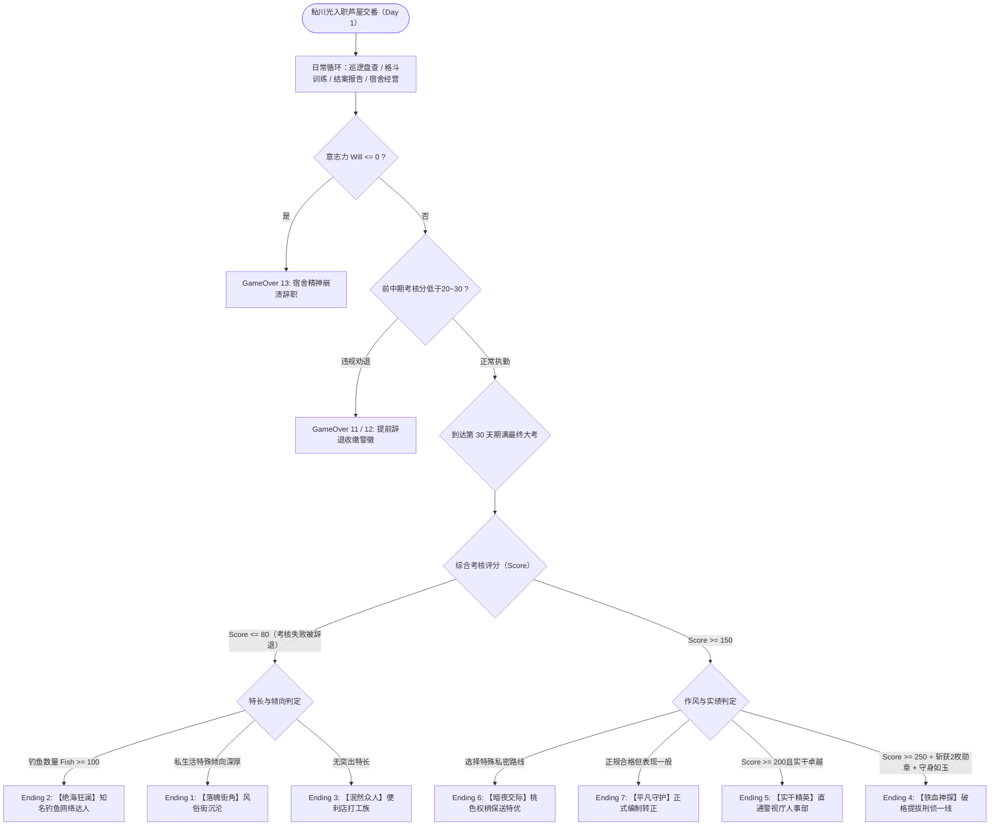
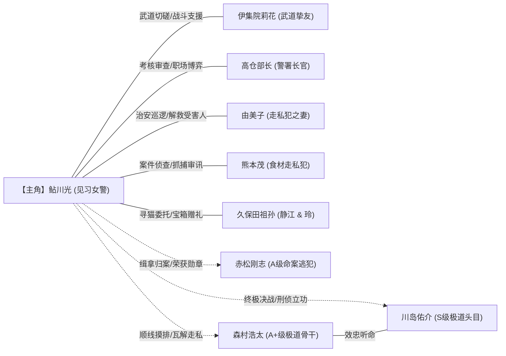
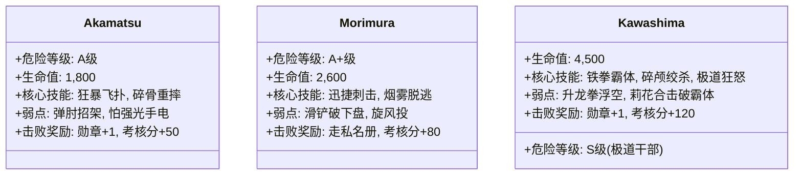
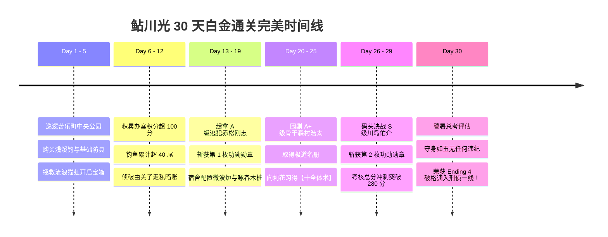

# 🎮《极道恶徒EX：女警鲇川光》（Yakuza Rogue EX: Officer Ayukawa Hikaru）全剧情脉络·多分支结局·全要素100%终极攻略

> **制作社团/厂商**：WAKUWAKU  
> **作品编号**：Steam AppID: 4706950  
> **作品类型**：现代都市警务模拟 / 极道犯罪战斗RPG / QTE动作养成 / 多分支生活探索  
> **核心机制**：30天实习期考核倒计时 / 辖区治安度与结案报告系统 / 意志力精神管理 / 垂钓与黑市走私暗线 / 战斗破防与格斗术修炼  
> **全要素状态**：✅ **包含宏观剧情与极道暗线全解析、30天日程管理与考核达标指南、全7大终局+3大提前失败条件、全角色图鉴与羁绊事件、格斗技能与宿舍家具配置、全通缉犯（川岛/森村/赤松）机制与全回想解锁指引**

---

## 📑 目录导航
1. [世界观设定与核心剧情深层暗线](#一世界观设定与核心剧情深层暗线)
   - [表面警务日常 vs 关西极道“鲤龙会”走私暗流](#1-表面警务日常-vs-关西极道鲤龙会走私暗流)
   - [三大考核核心数值：考核分、意志力与治安度](#2-三大考核核心数值考核分意志力与治安度)
   - [多分支命运走向决策架构图](#3-多分支命运走向决策架构图)
2. [全角色图鉴与阵营羁绊网](#二全角色图鉴与阵营羁绊网)
   - [主角：鲇川光（Ayukawa Hikaru）](#1-主角鲇川光ayukawa-hikaru)
   - [同伴与警署高层（伊集院莉花、高仓部长）](#2-同伴与警署高层)
   - [辖区居民与关键涉案人物（由美子、熊本茂、濑户美香、小坂千奈等）](#3-辖区居民与关键涉案人物)
   - [关西极道“鲤龙会”通缉头目（川岛佑介、森村浩太、赤松刚志）](#4-关西极道鲤龙会通缉头目)
   - [角色关系拓扑图](#5-角色关系拓扑图)
3. [核心操作与探索系统指南](#三核心操作与探索系统指南)
   - [操作按键绑定表](#1-操作按键绑定表)
   - [探索地图分布与治安巡逻点](#2-探索地图分布与治安巡逻点)
   - [专业垂钓体系与名贵鱼种分布](#3-专业垂钓体系与名贵鱼种分布)
4. [宿舍经营与据点强化体系](#四宿舍经营与据点强化体系)
   - [苦乐町交番宿舍（202室）功能设施清单](#1-苦乐町交番宿舍202室功能设施清单)
   - [健身强化设备与属性加成](#2-健身强化设备与属性加成)
   - [意志力恢复与防崩溃管理](#3-意志力恢复与防崩溃管理)
5. [主线30天流程推进与极道通缉犯讨伐指南](#五主线30天流程推进与极道通缉犯讨伐指南)
   - [前期阶段（第1~10天）：基础巡逻与新手适应](#1-前期阶段第110天基础巡逻与新手适应)
   - [中期阶段（第11~20天）：大案侦破与通缉线索](#2-中期阶段第1120天大案侦破与通缉线索)
   - [后期阶段（第21~30天）：决战极道与终考冲刺](#3-后期阶段第2130天决战极道与终考冲刺)
   - [三大通缉犯首领战斗机制深度分解](#4-三大通缉犯首领战斗机制深度分解)
6. [全分支结局达成条件与终局复盘](#六全分支结局达成条件与终局复盘)
   - [Ending 4：【铁血神探·破格提拔】（刑侦一线正义结局）](#ending-4铁血神探破格提拔刑侦一线正义结局)
   - [Ending 5：【实干精英·直通警视厅】（优秀转正实干结局）](#ending-5实干精英直通警视厅优秀转正实干结局)
   - [Ending 6：【暗夜交际·桃色权柄】（潜规则保送特别优结局）](#ending-6暗夜交际桃色权柄潜规则保送特别优结局)
   - [Ending 7：【平凡守护·正式编制】（基准合格转正结局）](#ending-7平凡守护正式编制基准合格转正结局)
   - [Ending 1：【落魄街角·风俗沉沦】（辞退堕落结局）](#ending-1落魄街角风俗沉沦辞退堕落结局)
   - [Ending 2：【绝海狂澜·辞职钓鱼女警】（神级渔翁隐藏结局）](#ending-2绝海狂澜辞职钓鱼女警神级渔翁隐藏结局)
   - [Ending 3：【泯然众人·便利店打工族】（平淡退圈结局）](#ending-3泯然众人便利店打工族平淡退圈结局)
   - [GameOver 11 / 12 / 13：提前解雇与意志崩溃辞职](#gameover-11--12--13提前解雇与意志崩溃辞职)
7. [全居民支线任务与隐藏情报收集](#七全居民支线任务与隐藏情报收集)
8. [全战斗技能与最强格斗BD构筑](#八全战斗技能与最强格斗bd构筑)
   - [警用格斗与中华武术技能树](#1-警用格斗与中华武术技能树)
   - [防具装备与特殊护符属性表](#2-防具装备与特殊护符属性表)
   - [最强攻防爆发BD配置推荐](#3-最强攻防爆发bd配置推荐)
9. [全CG回忆与特殊场景100%全收集指引](#九全cg回忆与特殊场景100全收集指引)
10. [极速刷钱与30天白金通关运营策略](#十极速刷钱与30天白金通关运营策略)

---

## 一、世界观设定与核心剧情深层暗线

### 1. 表面警务日常 vs 关西极道“鲤龙会”走私暗流
* **表面警务**：主角**鲇川光**是刚从警察学校毕业的纯真热血警员。她怀着“惩恶扬善、守护市民”的崇高理想，被派遣到兵库县芦屋市的苦乐町交番进行为期 **30 天的见习实习考核**。在此期间，她需处理街头纠纷、盘查可疑人员、维护中央公园治安，并接受警署**高仓部长**的严苛审核。
* **深层暗流**：看似宁静祥和的芦屋富人区与繁华商业街背后，盘踞着横跨关东横滨与关西神户的大型暴力极道组织——**“鲤龙会”**。
  - 干部级头目**川岛佑介（S级危险人物）**正在打通贯穿中部与北陆地区的国际走私渠道；
  - 心腹手下**森村浩太（A+级通缉犯）**负责接洽物资与中转网络；
  - 更有情绪失控致人死亡的逃犯**赤松刚志（A级危险分子）**流窜在辖区边缘。
* **职场暗流**：芦屋警署并非铁板一块。高仓部长表面威严公允，私下却掌握着决定实习警员命运的生杀大权。若考核分数未达预警线（低于20~30分），部长会施加巨大劝退压力，甚至暗示特殊“协助”手段，给主角的道德底线带来巨大考验。

### 2. 三大考核核心数值：考核分、意志力与治安度
* **考核评分（Score）**：核心通关评定基准。完成案件登记、成功制止犯罪、逮捕通缉犯并撰写结案报告均可增加积分。若积分持续低于30点，将触发提前解雇预警；积分达到150/200/250以上则是锁定高级结局的关键门槛。
* **意志力（Will）**：代表主角的精神耐受极限。在遭遇暴力袭击、心理挫折或异常事件时会大幅损耗。**一旦意志力降为 0，主角将精神崩溃，在宿舍含泪写下辞职信导致 GameOver 13**。恢复意志力必须通过专属训练或特定休憩。
* **辖区治安度（Security）**：中央公园及街区的安全指数。治安度过低不仅会增加高危罪犯出现概率，还会导致市民投诉，进而扣除每日考核得分。

### 3. 多分支命运走向决策架构图

---

## 二、全角色图鉴与阵营羁绊网

### 1. 主角：鲇川光（Ayukawa Hikaru）
* **背景**：警校格斗科综合优等生，性格坚毅有正义感，身手矫健却缺乏社会老练经验。
* **核心数值**：
  - 生命（HP）：承受伤害总量，可在宿舍或武道馆升级；
  - 体力（Stamina）：巡逻奔跑、连续出拳与闪避的消耗源；
  - 意志（Will）：精神防火墙，防止心理防线失守；
  - 腕力/足力/核心：决定正拳、飞踢与投摔技能伤害倍率。

### 2. 同伴与警署高层
* **伊集院莉花（Ijuin Rika / 角色编号401）**：
  - **身份**：豪迈健美的武道馆女师范兼挚友，格斗技巧纯熟。“仙人之下我无敌，仙人之上一换一”。
  - **作用**：提供高级中华武术传承（代师范状）、传授高阶格斗绝技，后期可作为支援同伴并肩作战。
* **高仓部长（Takakura）**：
  - **身份**：芦屋警署负责人，掌握主角转正评分的最终拍板人。
  - **剧情暗线**：在主角考核分极低时会展开谈话，给出常规惩戒或灰色保底路径。

### 3. 辖区居民与关键涉案人物
* **由美子（Yumiko / 801）**：
  - **身份**：大分县出身的少妇，外貌出众惹火，常在辖区公园遭遇性骚扰。
  - **暗线**：其丈夫熊本茂常年从事走私，夫妻关系极为畸形。主角协助其脱离骚扰可获重要辖区线索。
* **熊本茂（Kumamoto Shigeru / 802）**：
  - **身份**：前高级餐厅厨师，暗中经营珍稀野生食材走私网络，性格扭曲。
* **濑户美香（Seto Mika / 803）**：
  - **身份**：前银座顶流女公关，现隐居芦屋豪宅。因金主极少露面而内心空虚。
  - **互动**：主角巡逻或家访可触发展开系列交流，获取高额情报或特殊赠礼。
* **小坂千奈（Kosaka China / 804）**：
  - **身份**：芦屋大学教育系在读大学生，因消费挥霍陷入经济困境，卷入地下不良兼职。
* **久保田静江（Kubota Shizue / 805）**：
  - **身份**：深藏不露的隐形富豪老妇人，为孙女疗养定居芦屋。寻回失踪猫咪“虹”后可解锁丰厚支援。
* **玲（Rei / 806）**：
  - **身份**：久保田静江的孙女，清冷病弱少女。随身携带每日刷出神秘珍稀物资的神奇宝箱。
* **虹（Niji / 809）**：
  - **身份**：芦屋街区的流浪三花猫，支线剧情寻宠目标。

### 4. 关西极道“鲤龙会”通缉头目
* **川岛佑介（Kawashima Yusuke / 807）**：
  - **危险评级**：S 级
  - **背景**：关西极道“鲤龙会”核心干部，精通近身肉搏与凶残械斗，策划关西-北陆走私航线。击败并逮捕他可荣获一级功勋勋章。
* **森村浩太（Morimura Kota / 808）**：
  - **危险评级**：A+ 级
  - **背景**：鲤龙会行动骨干兼川岛左膀右臂，负责前线运输与接应。抓获后可顺藤摸瓜引出川岛。
* **赤松刚志（Akamatsu Takeshi / 810）**：
  - **危险评级**：A 级
  - **背景**：神户暴力致死逃犯，性格极度狂躁，伏击在偏僻小巷，拥有强力压制摔技。

### 5. 角色关系拓扑图

---

## 三、核心操作与探索系统指南

### 1. 操作按键绑定表

| 按键 / 组合键 | 功能指令 | 实战应用说明 |
| :--- | :--- | :--- |
| **W / A / S / D** | 角色移动 | 控制鲇川光在辖区四向行走 / 奔跑 |
| **Shift** | 冲刺加速 | 消耗微量体力加快移动，追逐逃犯必备 |
| **Space / Enter** | 确认 / 对话 / 交互 | 盘查嫌疑人、触发场景事件、检视道具 |
| **ESC / X** | 取消 / 打开主菜单 | 查看个人属性、案件记录、装备与背包 |
| **Tab** | 地图缩放 / 标记切换 | 切换苦乐町大地图，查看犯罪频发热点区 |
| **F** | 手电筒开关 | 深夜在偏僻小巷、地下车库与树林巡逻照明 |
| **Q / E** | 战斗招式切换 | 快速在正拳、飞踢与防御架势间切换 |
| **1 / 2 / 3** | 游戏运行倍速 | 调节时间流速（1x 标准 / 2x 快进 / 3x 极速） |
| **P** | 游戏即时暂停 | 规划行动路线与战斗决策 |

### 2. 探索地图分布与治安巡逻点
* **苦乐町交番（派出所）**：日常签到、领取警署公告、提交办案报告并获取考核评分（Score）的核心枢纽。
* **中央公园（Central Park）**：犯罪多发地带。白天多为流浪汉争执与小偷小摸；黄昏与入夜后常出没痴汉、不良团伙骚扰事件。
* **商业步行街与便利店**：可购买快餐、饮料补给品，了解街坊传闻；也是小坂千奈兼职出没地。
* **高级住宅区**：久保田静江宅邸与濑户美香别墅所在地，环境幽静，偶有可疑极道车辆徘徊。
* **雷鸣溪流 / 湖畔渔场**：钓鱼系统专属场地，白天与深夜出没鱼群不同，可获得名贵渔获。
* **废弃物流仓库 / 后巷**：极道“鲤龙会”走私据点与通缉犯隐藏巢穴，战斗烈度极高。

### 3. 专业垂钓体系与名贵鱼种分布

在雷鸣溪流与近郊水域，装备不同鱼竿可展开钓鱼迷你小游戏。成功起钩不仅能烹饪恢复体力，高阶珍品还能在黑市卖出巨额日元，**累计垂钓达100条更是解锁 Ending 2 的唯一前置**！

| 鱼竿等级 | 鱼竿名称 | 钓鱼范围 | 售价/获取途径 |
| :--- | :--- | :--- | :--- |
| **Lv 1** | **浅溪钓** | 范围 3 | 初始杂货店 3,000 日元购买 |
| **Lv 2** | **河伯钓** | 范围 4 | 钓鱼熟练度提升后商店解锁，15,000 日元 |
| **Lv 3** | **龙王钓** | 范围 5 | 高级钓具，50,000 日元 |
| **Lv 4** | **海神钓** | 范围 6 | 极品神竿，完成久保田奶奶隐藏委托后赠予 |

#### 珍稀鱼种图鉴
* **香菇溪鱼**：基础小型淡水鱼，出现概率高，售价 800 日元；
* **野生黑鲷**：琵琶湖水系特产，挣扎力度中等，售价 3,500 日元；
* **鸭川巨型鲤鱼**：需使用河伯钓以上，力量极大，售价 8,000 日元；
* **濑户内海石斑鱼**：罕见海味，需精准QTE控标，售价 18,000 日元；
* **传说“黄金鳟”**：极稀有金色鱼影，售价 50,000 日元，烹饪可永久提升生命上限。

---

## 四、宿舍经营与据点强化体系

苦乐町交番为见习警员提供的宿舍为 **202 室**。在宿舍中布置家具不仅能提升生活品质，更能为日常巡逻与高难度格斗提供永久被动增益！

### 1. 苦乐町交番宿舍（202室）功能设施清单

| 家具设备 | 获取途径 / 价格 | 核心增益效果 |
| :--- | :--- | :--- |
| **高级冰箱** | 电器商城 45,000 日元 | 珍稀鱼类与食材保质期增加 **48 小时** |
| **高级微波炉** | 电器商城 20,000 日元 | 加热食物后进食恢复效果提升 **50%** |
| **办公笔记本电脑** | 警务特供 35,000 日元 | 可在宿舍直接撰写报告，**案件报告收益增加 50%** |
| **哑铃组合** | 体育用品 15,000 日元 | 体力上限永久提高 **30 点** |
| **格斗木桩（咏春）** | 武馆订购 60,000 日元 | 生命上限增加 **80 点**，腕力+5，战斗经验效率提升 **50%** |
| **有氧跑步机** | 体育用品 50,000 日元 | 体力上限增加 **80 点**，足力+5，奔跑速度小幅增加 |
| **斗神头巾（挂画）** | 击败道场挑战 获得 | 生命上限增加 **80 点**，核心+5，战斗经验效率提升 **50%** |
| **进口古典地毯** | 家居百货 25,000 日元 | 房间舒适度提升，生命上限提高 **50 点** |
| **元气海报** | 杂货店 3,000 日元 | 每日清晨醒来体力额外恢复 20 点 |

### 2. 健身强化设备与属性加成
* **腕力（Arm Power）**：影响拳击、冲拳与擒拿伤害。可通过宿舍木桩、哑铃及警务道场力量训练提升（Lv 1 ~ Lv 5）；
* **足力（Foot Power）**：影响飞踢、回旋踢与滑铲破防值。通过跑步机训练提升；
* **核心（Core Power）**：影响投摔技与抵御敌人扑倒压制的能力。

### 3. 意志力恢复与防崩溃管理
* **日常损耗防范**：巡逻遭遇战败或受到屈辱惩戒事件会导致意志力大幅骤降；
* **恢复手段**：
  - 前往莉花武道馆进行【吐纳心法冥想】；
  - 宿舍深睡并配合微波炉热饮；
  - 成功缉拿通缉犯荣立大功（精神士气大振）。

---

## 五、主线30天流程推进与极道通缉犯讨伐指南

### 1. 前期阶段（第1~10天）：基础巡逻与新手适应
* **核心目标**：尽快熟悉苦乐町地形，积累考核分至 60 分以上，避免跌入 30 分解雇预警区。
* **每日日程模板**：
  - **上午**：前往交番报到，查阅当日治安公告板，接取巡查任务；
  - **下午**：中央公园巡逻，处理不良少年（901）、乞丐纠纷（905）或醉汉骚扰（906）；
  - **傍晚**：前往雷鸣溪流垂钓或道场跟随莉花训练力量；
  - **夜间**：返回交番电脑或宿舍笔记本录入结案报告，准时就寝。
* **关键事件**：
  - 触发久保田奶奶寻猫委托，在中央公园草丛找到流浪猫“虹”，开启久保田祖孙羁绊；
  - 购置初级盾牌与防刺背心，大幅提高防猝死能力。

### 2. 中期阶段（第11~20天）：大案侦破与通缉线索
* **核心目标**：考核分冲刺至 150 分，锁定合格转正基准线；启动鲤龙会外围调查。
* **关键事件**：
  - **神户杀人逃犯赤松刚志（810）缉捕战**：
    - 在深夜后巷触发赤松目击报告。该犯擅长凶暴冲撞与抓取压制；
    - 战前装备【聚碳酸酯盾】与【正拳突进】，在其突进瞬间按 QTE 弹肘破防，将其拘捕，**斩获第 1 枚立功勋章**；
  - 深入调查由美子与熊本茂的家庭走私案，查获珍稀黑市食材暗账，破获走私渠道。

### 3. 后期阶段（第21~30天）：决战极道与终考冲刺
* **核心目标**：考核分冲破 250 分，围剿森村浩太（808）与川岛佑介（807），冲击满分白金。
* **关键战役推进**：
  - **第24~26天·废弃车库围堵森村浩太**：
    - 森村行动敏捷、擅长短刀刺击。需运用【旋风投】破坏其重心，击败后搜出【鲤龙会内部名册】；
  - **第27~29天·码头仓库决战川岛佑介**：
    - S级极道头目战，拥有霸体与狂暴三连击；
    - 召唤莉花协助出战，配合【升龙拳】打出硬直破防，终结鲤龙会关西走私网，**斩获第 2 枚立功勋章**；
  - **第30天·警署终考评估**：
    - 接受高仓部长的最终面谈，依据30天积累的数据触发专属结局。

### 4. 三大通缉犯首领战斗机制深度分解

#### BOSS 1：赤松刚志（Akamatsu Takeshi / A级）
* **Phase 1（HP 100%~50%）**：开场极易发动蓄力冲撞。必须保持防守架势，待其冲撞命中盾牌产生硬直时，立即使用【正拳突进】接【迅踢】打出两段连击。
* **Phase 2（HP 50%~0%）**：进入暴怒状态，抓取判定范围增大。若被其扑倒需快速连打交互键脱离压制，使用【怒天镇】重扣击晕完成逮捕。

#### BOSS 2：森村浩太（Morimura Kota / A+级）
* **战斗机制**：移速极快，会频繁后跳拉开距离投掷暗器。
* **克制策略**：配备防刺背心，切忌盲目挥拳。利用冲刺滑铲贴近下盘破坏其平衡，随后无缝衔接【旋风投】将其摔在水泥地面，彻底瓦解其反抗能力。

#### BOSS 3：川岛佑介（Kawashima Yusuke / S级最终头目）
* **Phase 1（常规博弈）**：攻击附带破盾重击，硬刚极易破防。必须通过左右滑步闪避其直拳，抓侧身破绽进行【弹肘】反击。
* **Phase 2（极道霸体）**：周身泛起红光，免疫常规轻击击退。此时必须呼叫伊集院莉花登场拉扯仇恨，主角绕后使用【龙膝】直击脊柱打破霸体。
* **Phase 3（困兽犹斗）**：触发超高难度多段 QTE 判定，全数命中后释放必杀技【升龙拳】将川岛击飞倒地，戴上手铐！

---

## 六、全分支结局达成条件与终局复盘

在第 30 天结束时，系统将精准检测以下底层判定变量：
* `Score`（考核评分，参数代号 `p1=3`）；
* `Medal`（大案勋章数，参数代号 `p1=12`）；
* `Fish`（总垂钓鱼获数，参数代号 `p1=11`）；
* `Will`（意志力耐受，参数代号 `p1=10`）；
* `PureRoute`（纯洁职业操守标志，判定代号 `type=9`）。

### 全结局触发条件速查表

| 结局编号 | 结局全称 | 核心触发阈值要求 | 结局后日谈演播走向 |
| :---: | :--- | :--- | :--- |
| **Ending 4** | **【铁血神探·破格提拔】** | **Score >= 250** 且 **勋章 >= 2** 且 **坚守操守 (PureRoute)** | 办案神速震惊全警局，高仓部长亲笔特优推荐，直接调入警视厅刑侦一线 |
| **Ending 5** | **【实干精英·直通警视厅】** | **Score >= 200**（未达满勋章或有轻微瑕疵） | 办事雷厉风行、群众基础极佳，作为罕见实干人才调往警视厅人事部重点培养 |
| **Ending 6** | **【暗夜交际·桃色权柄】** | **Score >= 150** 且 **深入特殊私密路线** | 表面圆满完成警务，私下以非凡交际手腕周旋于高层之间，获部长保送特优晋升 |
| **Ending 7** | **【平凡守护·正式编制】** | **Score >= 150** 且 未走特殊路线 | 踏实巡逻记录，无功无过合格转正，正式成为苦乐町交番编制巡警 |
| **Ending 1** | **【落魄街角·风俗沉沦】** | **Score <= 80（考核失败）** 且 偏向堕落 | 正义信念崩塌，辗转夜总会陪酒、泡泡浴店，最终沉沦街角站街，警徽锁入抽屉 |
| **Ending 2** | **【绝海狂澜·辞职钓鱼女警】** | **Score <= 80（考核失败）** 且 **钓鱼数 >= 100** | 虽被辞退却点满垂钓神技，钓获黄金鳟名扬全网，成为年入千万的顶流钓鱼女主播 |
| **Ending 3** | **【泯然众人·便利店打工族】** | **Score <= 80（考核失败）** 且 无特殊特长 | 正义热情在日复一日的超市打工与顾客冷眼中磨灭，路过交番只能驻足发呆 |
| **GameOver 11** | **【见习劝退·收缴警服】** | 前期考核评分长期低于警戒线（< 20） | 部长勒令停职，收回警服办公用品，黯然离去 |
| **GameOver 12** | **【考核失格·中途解聘】** | 中期累计扣分过多，治安崩溃 | 正式撤销见习资格，遣送回原籍 |
| **GameOver 13** | **【意志崩塌·宿舍辞职】** | **意志力 Will <= 0** | 精神防御彻底崩溃，在宿舍202室深夜落泪写下辞职信，告别警察梦想 |

---

## 七、全居民支线任务与隐藏情报收集

### 支线 1：【久保田祖孙的心愿——寻回三花猫虹】
* **接取地点**：高级住宅区久保田别墅；
* **流程**：在商业街杂货铺购买【小鱼干】，黄昏时分在中央公园东北角喷泉旁的灌木丛中探索，按 Space 诱捕流浪猫“虹”并送回；
* **战利品**：久保田静江的信任、解锁玲的每日【神秘宝箱】（每日随机开出高级消耗品或数万日元）。

### 支线 2：【由美子夫人的求助——击退跟踪恶汉】
* **接取地点**：中央公园林荫道；
* **流程**：傍晚巡逻发现尾随由美子的痴汉（904）。上前出示警官证后对方拒捕，切入战斗；将其制伏后护送由美子安全归家；
* **战利品**：考核分 +20、获得【熊本走私暗账碎页】。

### 支线 3：【女大学生的迷途——解救千奈】
* **接取地点**：商业街KTV后巷；
* **流程**：撞破不良团伙逼迫小坂千奈签署高利贷兼职协议。以【警用威慑】介入，击溃两名不良混混（901），夺回借条；
* **战利品**：千奈好感度满值、考核分 +35、获得强力护符饰品。

### 支线 4：【道场真传——莉花的同门考核】
* **接取地点**：伊集院武道馆；
* **流程**：腕力、足力达到 Lv 3 以上时向莉花发起切磋。需在3分钟内打掉莉花 3,000 点血量；
* **战利品**：获得【代师范状】，解锁最终奥义技能【十全体术】与【明镜止水】。

---

## 八、全战斗技能与最强格斗BD构筑

### 1. 警用格斗与中华武术技能树

| 技能名称 | 招式类型 | 冷却/消耗 | 技能效果说明 |
| :--- | :--- | :--- | :--- |
| **正拳突进** | 基础拳法 | 耗体 15 | 快速向前突刺重拳，对敌方头部造成物理打击，可衔接连招 |
| **迅踢** | 腿法连击 | 耗体 20 | 快速二连踢，破除敌人下盘防守，削减其平衡槽 |
| **弹肘** | 防守反击 | 耗体 25 | 完美格挡瞬间发动的肘击，100% 打断敌人蓄力并造成硬直 |
| **旋风投** | 擒拿柔术 | 耗体 40 | 抓住敌人双肩施展回旋过肩摔，无视护甲造成巨额摔伤 |
| **吐纳法** | 气功内劲 | 冷却 20s | 调整呼吸，瞬间恢复 40% 损失体力，并提高防御力 10 秒 |
| **龙膝** | 强力破防 | 耗体 35 | 飞身跃起以膝盖猛击敌人胸骨，对霸体敌人造成双倍破盾值 |
| **怒天镇** | 重型重扣 | 耗体 50 | 双拳抱锤自上而下砸击，使普通敌人直接倒地昏迷 |
| **升龙拳** | 终极奥义 | 耗体 60 | 汇聚全身爆发力的向上勾拳，造成致命浮空，高额斩杀伤害 |
| **明镜止水** | 被动心法 | 被动生效 | 处于危险血量时闪避判定帧翻倍，暴击率提升 30% |
| **十全体术** | 宗师传承 | 被动生效 | 全技能伤害提升 40%，且所有技能冷却时间缩短 25% |

### 2. 防具装备与特殊护符属性表

| 防具/武器名称 | 类型 | 属性加成与特效 |
| :--- | :--- | :--- |
| **警用短棍** | 警械 | 攻击动作额外造成 **20 点** 伤害 |
| **聚碳酸酯盾** | 防暴装备 | 攻击动作额外造成 **20 点** 伤害，抵消来自敌人的 **10 点** 伤害 |
| **凯夫拉复合盾** | 专业重盾 | 攻击动作额外造成 **30 点** 伤害，抵消来自敌人的 **20 点** 伤害 |
| **防刺背心** | 贴身护甲 | 减免所受肉体与刀刃伤害 **10 点** |
| **警用防暴全装** | 重装防具 | 移速微降，但减免所受伤害 **20 点** |
| **古神祝福（传说）** | 极品神衣 | 减免所受伤害 **50 点**，人物外观解锁特殊华丽装束 |
| **斗神长棍** | 隐藏武器 | 攻击动作额外爆发 **80 点** 恐怖伤害 |

### 3. 最强攻防爆发BD配置推荐
* **武器配置**：【凯夫拉复合盾】 + 【斗神长棍】（兼顾 20 点减伤与 110 点常驻额外伤）；
* **防具配置**：【古神祝福】 + 【防暴装】（减伤高达 70 点，杂兵攻击完全破不了防）；
* **技能轮盘搭配**：
  - 1号位：**正拳突进**（起手试探与快速攒气）；
  - 2号位：**龙膝**（专打极道头目的黄色霸体护盾）；
  - 3号位：**旋风投**（近身抓取无视防御输出）；
  - 4号位：**升龙拳**（破盾后的最高倍率核弹斩杀）；
  - 核心辅助：**吐纳法** + 被动 **十全体术**。

---

## 九、全CG回忆与特殊场景100%全收集指引

游戏内内置全景 CG 画廊（回想部屋）。以下为各大事件触发与收集节点：

| 画廊编号 | 回想事件名称 | 触发地点 / 涉及人物 | 正确触发判定条件 |
| :---: | :--- | :--- | :--- |
| **CG_01** | **由美子小树林遭遇事件** | 中央公园西北角 / 由美子 (801) | 第 5~8 天黄昏前往树林小道触发 |
| **CG_02** | **千奈卫生间受难危机** | 商业街KTV / 小坂千奈 (804) | 推进千奈借贷调查，未及时击败混混时触发差分 |
| **CG_03** | **熊本宅邸潜入调查** | 熊本茂宅 (802) / 鲇川光 | 搜查食材走私暗账，被熊本茂撞破的系列剧情 |
| **CG_04** | **美香豪宅奢靡派对** | 豪华别墅区 / 濑户美香 (803) | 美香好感度达标后接受夜间做客邀请触发 |
| **CG_05** | **高仓部长的深宵谈话** | 警署署长办公室 / 高仓部长 | 实习中途考核分低于警戒线时的特殊保底剧情 |
| **CG_06** | **森村浩太交锋战败差分** | 货运仓库 / 森村浩太 (808) | 逮捕森村时故意被其击败触发捕获场景 |
| **CG_07** | **川岛佑介极道囚牢差分** | 码头集装箱区 / 川岛佑介 (807) | 决战川岛时战败触发系列拘束回忆 |
| **CG_08** | **赤松刚志小巷伏击差分** | 暗街死胡同 / 赤松刚志 (810) | 单独追击赤松刚志发生格斗战败时触发 |
| **CG_09** | **全7大结局通关鉴赏** | 终考结算室 / 全体角色 | 通关 Ending 1~7 依次解锁对应回忆位 |

> [!TIP]
> **回想部屋（全CG一键解锁技巧）**：  
> 若玩家在二周目开启继承模式，或在标题界面输入制作组通用开发者指令，可在主菜单【回想部屋】内直接点击“全要素点亮”，即可免去多周目重复刷战败差分的繁琐操作。

---

## 十、极速刷钱与30天白金通关运营策略

### 1. 早期极速滚雪球理财
* **第一桶金**：第 1~3 天每日必找小女孩【玲】开启宝箱，平均可白嫖 10,000~30,000 日元起步资金；
* **垂钓暴利**：将资金优先投入【河伯钓】。黄昏时分在雷鸣溪流专攻大鱼影，一条野生黑鲷或鸭川巨鲤即可变现数千至上万日元，迅速攒足购买宿舍【办公电脑】与【格斗木桩】的资金。

### 2. 考核评分极速刷分路线
* 撰写报告务必在宿舍电脑前进行（享受 50% 额外积分加成）；
* 每日夜间务必巡视中央公园深处，制止 2~3 起现行犯罪，每日净赚 20~30 分；
* 配合 2 名高危通缉犯（赤松、川岛）的破案立功大奖赏（单次 +50~120 分），第 25 天即可稳破 250 分大关。

### 3. 白金无伤通关终极法则
* **绝不贪刀**：面对持械极道成员，永远以【凯夫拉盾牌】架势起手，看准对方出招硬直再释放【弹肘】或【旋风投】；
* **意志力常驻监控**：决不让意志力跌破 30 点安全线，遇到恶性扣意志事件后立即前往道场冥想恢复；
* **存档关键节点**：在 **第 29 天晚上** 务必在宿舍存档，即可在第 30 天面谈时自由测试并达成全部 Ending 1~7 终局！
