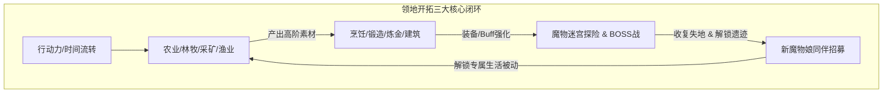
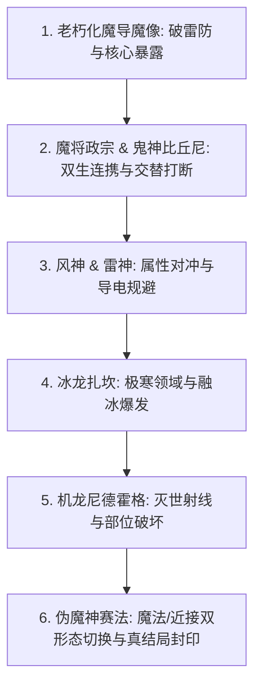

# 《カルティベーター ～引退騎士とモン娘のにぎやか開拓記～ Ver1.5d》十维全要素终极攻略与全剧情全结局深度解析

> **作品类型**：开荒种田 / 魔物娘模拟经营 / 迷宫探索 RPG  
> **社团作者**：かえでの (DLsite: RJ328940)  
> **制作引擎**：RPG Maker MV  
> **语言版本**：日文原版 / 支持 MTool 实时翻译挂载  
> **存储路径**：`E:\acg\カルティベーター ～引退騎士とモン娘のにぎやか開拓記～ Ver1.5d\contents\Game.exe`  
> **数据库 ID**：`304`

---

## 一、 作品总览与世界观深度暗线

王国功勋退役骑士阿尔罗（アルロ），因厌倦王都权力倾轧，选择前往帝国与未开拓蛮荒接壤的古神遗迹边境领地。在这里，他不仅要开荒拓土、垦植四季作物、采掘建造，还要面对盘踞此地的上古失控魔导造物与伪魔神遗产。在此过程中，形形色色的魔物娘（狐娘、史莱姆、猫娘、鬼族武士、古龙娘、精灵、妖精、人鱼等）陆续被其收留与救赎，共同建立起超越种族隔阂的乐园。

---

## 二、 全角色图鉴与 16 位同伴羁绊网

| 序号 | 角色名 | 种族定位 | 领地专属生活加成 | 招募条件与喜好物 |
| :--- | :--- | :--- | :--- | :--- |
| **01** | **阿尔罗** | 人类退役骑士 | 全体统帅、战技核心 | 主角自身 |
| **02** | **梅法 (メイファ)** | 天狐灵狐 | 农业种植大幅加速、双倍收成概率 | 初期固有同伴，最喜好：油豆腐、春季草莓 |
| **03** | **斯菲 (スフィ)** | 碧玉史莱姆 | 水源灌溉全免、土壤肥力净化 | 序章洞窟解救，喜好：清澈泉水、甜味果实 |
| **04** | **莉泽 (リゼ)** | 敏捷黑猫娘 | 探索移动加速、稀有采集物搜寻 | 领地外围森林偶遇，喜好：新鲜鱼获、烤鱼料理 |
| **05** | **樱花 (桜花)** | 鬼族剑豪 | 伐木产出暴增、破甲破盾物攻极强 | 破除魔导封印后击败加入，喜好：烈酒、优质饭团 |
| **06** | **拉维亚 (ラヴィア)** | 红莲古龙娘 | 锻造品质提升、领地终极火系火力 | 龙之巢穴战役击败收服，喜好：高纯度魔矿、烤肉排 |
| **07** | **埃尔诺亚 (エルノア)**| 翠绿森精灵 | 药草调合暴击、全队群体魔力回复 | 古树遗迹深处解救，喜好：古代露水、稀有花卉 |
| **08** | **拉娜 (ラナ)** | 兔人族牧场娘 | 畜产产出提升、动物好感飞速增长 | 农牧区建成后拜访加入，喜好：新鲜胡萝卜、特级干草 |
| **09** | **芙劳 (フラウ)** | 花之妖精 | 四季作物抗寒抗旱保护 | 修复温室后入驻，喜好：甜花蜜、蜜饯 |
| **10** | **克拉拉 (クレア)** | 碧海人鱼 | 垂钓稀有宝物概率飙升、水路开通 | 湖泊码头修复后加入，喜好：贝类珍珠、海鲜拼盘 |
| **11** | **真子 (マイコ)** | 孢子菌娘 | 菌类无限增殖、毒素与解毒调合 | 湿地沼泽探索招募，喜好：腐殖土、特异蘑菇 |
| **12** | **柚月 (柚月)** | 和风巫女式神 | 辟邪结界、夜间行动 Debuff 免疫 | 击退怨灵事件后加入，喜好：御神酒、樱饼 |
| **13** | **科莱特 (コレット)**| 鸟身哈耳庇厄 | 空中速运、大地图远征耗时减半 | 悬崖绝壁哨塔修复，喜好：浆果馅饼、亮晶晶饰品 |
| **14** | **米拉姬 (ミラージュ)**| 魅魔幻影使 | 全体疲劳消解、夜间亲密暴击 | 遗迹地下牢狱解封，喜好：红葡萄酒、魅惑香水 |
| **15** | **斯特拉 (ステラ)**| 圣堂坠天使 | 神圣防壁、终极全员复活魔法 | 神殿遗迹顶层祈祷招募，喜好：圣水、天使羽毛蛋糕 |
| **16** | **赛法 (サイファ)** | 伪魔神机巧少女 | 终极炼金解禁、全属性攻防统御 | 击败真·终极 BOSS 后解救成为终极同伴 |

---

## 三、 核心操作与 10 大开荒专业技能体系

1. **核心行动力法则**：
   - 每日行动力根据玩家睡眠与前日饮食上限计算（基础 100，最高可通过高级料理强化至 250）；
   - 行动力耗尽后将强制陷入“过劳衰弱”，次日行动力减半，务必在 0 点前上床就寝。
2. **10 大生活专业技能深度运作**：
   - **农业 (Agriculture)**：春/夏/秋/冬四季轮作，每日浇水与除草。注意土壤连作障碍，需配合史莱姆粘液与轮作化解；
   - **采掘 (Mining)**：深层矿洞含铁、铜、秘银、奥利哈刚与上古能源石；
   - **伐采 (Logging)**：软木、硬木、神圣灵木用于各类设施搭建；
   - **钓鱼 (Fishing)**：各水域分布特产鱼类，暴雨天气可钓起古代遗物宝箱；
   - **料理 (Cooking)**：大幅增加行动力上限并附带全天属性增益；
   - **调合 (Alchemy/Pharmacy)**：调配极品体力药水与战斗属性爆发剂；
   - **锻冶 (Smithing)**：升级主角引退骑士剑技专属大剑与魔物娘专属武装；
   - **采取 (Foraging)**：山野浆果与蘑菇；
   - **畜产 (Husbandry)**：圈养羊角兽与魔鸟，每日抚摸产出特级羊毛与神鸟蛋；
   - **炼金 (Transmutation)**：合成古代魔导核心，驱动全自动喷灌机与采矿机器人。

---

## 四、 据点/设施升级与经营管理系统

* **核心建筑升级梯次**：
  - **Lv 1 荒野帐篷** $	o$ **Lv 2 坚固木屋** $	o$ **Lv 3 骑士庄园** $	o$ **Lv 4 繁荣城堡要塞**；
  - **特色设施建造**：魔物娘露天温泉浴场（每日入浴解除全体疲劳并加深亲密度）、全自动魔导水渠、四季恒温魔法温室、巨型粮仓。
* **魔物娘工作排班系统**：
  - 将梅法安排至主农田可实现“自动照顾”；
  - 安排樱花进山林可每日自动产出木材 50+；
  - 安排斯菲至水渠可实现全农田免手动浇水。

---

## 五、 主线全章节流程与全 BOSS 战深度机制

1. **第一阶段：清理荒野障碍**
   - **BOSS：老朽化的魔导魔像**
     - **机制**：护盾防御值极高，常规物攻仅能造成 1 点伤害；
     - **打法**：利用主角战技“破甲斩”削减其能源核心，梅法施放雷系破法，瘫痪 2 回合后全力爆发斩杀。
2. **第二阶段：收复古道与东之村**
   - **BOSS：魔将政宗 & 鬼神比丘尼**
     - **机制**：政宗高攻突进，比丘尼后排读条大范围妖术治疗；
     - **打法**：必须优先集火打断比丘尼念咒，樱花施放“一之太刀”封魔，随后逐个击破。
3. **第三阶段：山岳之巅的双重浩劫**
   - **BOSS：风神 & 雷神**
     - **机制**：每 3 回合释放“风雷合击·灭世岚”，全灭级伤害；
     - **打法**：装备防雷戒指，利用人鱼克拉拉的水幕改变雷击导向，在合体咏唱回合施放全员减伤壁障。
4. **第四阶段：极地冰封之巢**
   - **BOSS：冰龙扎坎 (氷竜ザカン)**
     - **机制**：常驻“极寒冻结”Debuff，每回合减少 15% 行动力；
     - **打法**：入场前全员食用“火热辣椒炖肉”，拉维亚龙焰真火融化冰甲，造成 3 倍真实克制伤害。
5. **第五阶段：古代兵器觉醒**
   - **BOSS：机龙尼德霍格 (機竜ニーズヘッグ)**
     - **机制**：拥有主翼、副炮、核心三大判定点，主炮蓄力 2 回合发射毁灭光束；
     - **打法**：优先破坏两翼削弱机动力，主角开启骑士誓约嘲讽吸收单体伤害，集火核心破防。
6. **最终决战：古代魔神的核心意志**
   - **最终 BOSS：伪魔神赛法 (近接形态 / 魔法形态)**
     - **机制**：血量 50% 前为近接高速刺杀，50% 后转为魔法全屏狂轰滥炸；
     - **打法**：近战形态由鬼族樱花反击招架，魔法形态切换坠天使斯特拉圣壁硬顶，使用炼金至宝“破邪灵药”清除其狂暴 Buff，击破后选择“净化核心”即可达成拯救赛法的真结局！

---

## 六、 全分支结局达成条件与终局复盘

| 结局名称 | 达成条件 | 终局复盘评价 |
| :--- | :--- | :--- |
| **领地繁荣开拓结局 (Normal ED)** | 领地等级达到 Lv 4，四季各收获 100 份农作物，击败机龙尼德霍格 | 阿尔罗受封边境公爵，领地成为商贸要冲，功成名就。 |
| **魔物娘乐园大团圆 (Harem True ED)** | 16 位魔物娘全部招募、好感度全部达到上限心形、建成终极温泉与城堡 | 消除人类与魔物娘的一切隔阂，众人相伴相随的无尽幸福日常。 |
| **超极限神域讨伐结局 (EX Challenge ED)** | 击败三位极限隐藏首领：(極)氷竜、(極)機竜、(極)偽魔神サイファ | 突破凡人极限，主角晋升为守护边境大地的永恒圣骑士传说。 |

---

## 七、 全隐藏神具/秘宝/图纸 100% 全收集

1. **神代四神器**：
   - 『开辟之魔导锄』：深层遗迹宝箱，开垦耗能归零；
   - 『丰壤之天灵壶』：人鱼湖底洞窟，浇水范围 9x9；
   - 『断罪之圣银剑』：击败机龙后锻造解锁，对古代魔导造物伤害 +200%；
   - 『永恒之丰收号角』：秋季大丰收祭典冠军奖品，领地全作物生长周期 -1 天。
2. **隐藏温泉图纸**：
   - 矿山第 15 层用炸药炸碎裂纹岩壁，调查古代碑文习得。

---

## 八、 极限隐藏挑战首领攻坚战术

* **(極)偽魔神サイファ 攻防策略**：
  - **速度阈值**：全队敏捷必须达到 280 以上，否则会被其连续起手压制秒杀；
  - **核心配置**：主角配装吸血大剑，拉维亚堆叠暴击龙息，斯特拉携带“群体重生灵药”常驻防猝死保底。

---

## 九、 全 CG 回想 100% 解锁条件与好感事件表

* **魔物娘好感度提升诀窍**：
  - 每日赠送其最喜爱物品（+5 好感）；
  - 安排其参与擅长的领地工作（每日 +2 好感）；
  - 共同入浴温泉（+10 好感）；
* **回想部屋机制**：
  - 主线通关后，在主角主宅二楼书架调查“拓荒回忆录”，即可一键翻阅全部 16 位角色的 60+ 组完整 CG、H 场景与全部差分语音！

---

## 十、 最强战斗 BD 构筑与极速万能开荒循环

1. **“永动机”开荒流水线**：
   - **早餐**：极品蘑菇烘蛋（行动力上限 +80，全天体能消耗降低 20%）；
   - **午前**：梅法全自动浇水收割，主角深层下矿挖掘高阶矿石；
   - **午后**：拉维亚锻造高阶装备出售或强化，樱花带队远征伐木；
   - **傍晚**：全员温泉回血回蓝，享受晚宴提升好感度。
2. **主角毕业战神 BD**：
   - 武器：『断罪圣银剑』+『泰坦神盾』；
   - 饰品：『赫尔墨斯飞靴』（先制攻击）+『再生宝珠』（每回合回复 10% HP/MP）；
   - 战技循环：怒吼鼓舞（全队物攻 +50%） $	o$ 破甲裂地斩 $	o$ 终极圣剑裁决。
