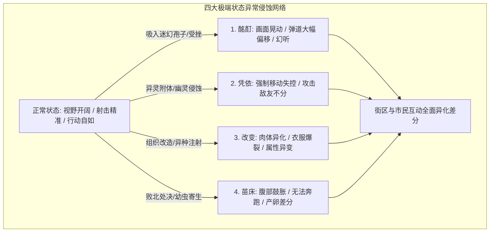

# 《状態異常Ⅲ =Abnormal Condition= ～酩酊/憑依/改変/苗床編～》十维全要素终极攻略与全剧情全结局深度解析

> **作品类型**：俯视角射击战 / 状态异常异变 / 动作探索 RPG  
> **社团作者**：オクトピグ (DLsite: RJ01617096)  
> **制作引擎**：RPG Maker MZ (定制射击与准星系统插件)  
> **语言版本**：妖狐工房完整汉化版  
> **存储路径**：`E:\acg\状態異常Ⅲ\Game.exe`  
> **数据库 ID**：`306`

---

## 一、 作品总览与世界观深度暗线

社团オクトピグ享誉同人界的硬核状态异常三部曲最终章《状態異常Ⅲ》。女主角一之濑雫（一之瀬雫）作为特殊事件调查员，潜入被怪异与寄生生物严重侵蚀的封锁隔离城市。与前两作侧重“淫纹/禁书”或“毒瘾/魅了”不同，本作将恐怖氛围与肉体异化推向巅峰，围绕四大极端状态——**酩酊（神经毒素与致幻）**、**凭依（异体寄宿与精神夺舍）**、**改变（骨骼与身体构造成熟异化）**、**苗床（活体培育器与幼体寄生）**展开。一之濑雫必须在枪林弹雨与危机四伏的腐化街区中杀出一条血路，调查灾厄真相，或是在层层异化中彻底成为怪异繁衍的苗床。



---

## 二、 全角色与寄生异形图鉴

| 实体名称 | 属性定位 | 攻击模式与威胁度 | 战败捕获状态倾向 |
| :--- | :--- | :--- | :--- |
| **一之濑雫 (主角)** | 特殊调查官 | 擅长手枪点射、散弹面伤与翻滚闪避 | 本作唯一可操控女主角，四维抗性随侵蚀动态下降。 |
| **幽灵相谈所所长** | 中立情报商 | 传授异灵退散技巧、售卖特种驱魔弹药 | 推进主线与解除“凭依”状态的核心 NPC。 |
| **高利贷老板** | 贫民窟黑幕 | 借贷资金购买重型军火，逾期将引发讨债拘束 | 金钱紧缺时的应急通道，带有特殊惩罚支线。 |
| **哥布林掠夺者** | 基层步兵 | 近战挥刀、飞扑压制，数量庞大 | 战败触发【野蛮凌辱】与【粗糙改造】。 |
| **寄生树人 / 孢子母株** | 区域控制者 | 喷洒全屏黄色孢子雾气、地下根须穿刺 | 战败触发【酩酊深度致幻】与【神经毒素浸染】。 |
| **异界宿体虫族** | 终极寄生体 | 极速爬行、幼体自爆、产卵针刺突 | 战败直接触发【苗床Ⅰ~Ⅲ 活体孵化】。 |

---

## 三、 核心操作与俯视角即时射击系统

1. **射击与操控体系**：
   - **移动**：`W / A / S / D` 控制一之濑雫走位；
   - **瞄准与射击**：**鼠标指针瞄准**，左键开火，右键开启战术后撤/翻滚；
   - **换弹机制**：按 `R` 键换弹。弹药见底时强制进入换弹等待时间（可利用掩体规避伤害）；
   - **视野角与盲区**：角色拥有 120 度前方视野，背后属于漆黑战争迷雾，必须频繁转动鼠标探查盲区。
2. **战术参数控制**：
   - **弹道散布 (ブレ幅)**：连续射击散布会急剧增大，建议 2~3 发短点射；
   - **眩晕量表 (スタンゲージ)**：连续命中敌人弱点可打满眩晕槽，触发敌人跪地 3 秒虚弱爆发期。

---

## 四、 街区侵蚀度与四大状态机制全解析

* **四大状态深度阶梯**：
  1. **酩酊 1 ~ 3**：
     - 1 阶：画面微醺边缘暗角；2 阶：镜头剧烈晃动，移速降低 20%；3 阶：准星反向漂移，无法精准瞄准；
  2. **凭依 1 ~ 3**：
     - 幽灵附身，角色会概率不听使唤自发向怪物靠近，需去神社驱魔泉水洗涤；
  3. **改变 1 ~ 3**：
     - 皮肤浮现异种符文与淫纹，衣服破损度 Max，街区市民对话全部变为侮辱与性骚扰；
  4. **苗床 Ⅰ ~ Ⅲ**：
     - 腹部受寄生幼体撑大，奔跑功能锁死，体力上限折半，街区特定场所会触发突发产卵瘫软。
* **街区变色系统 (状態異常で街の色変更)**：
  - 当一之濑雫陷入严重异常状态后，整个城市街道的光影和 BGM 会转化为深沉窒息的紫红色肉质异界调，所有商店与 NPC 反应产生颠覆性差分！

---

## 五、 主线关卡与三大阶段 BOSS 深度机制

```mermaid
flowchart TD
    Boss1[1Boss: 腐化变异体巨兽 (弱点头部 / 散弹轰击)] --> Boss2[2Boss: 幽冥凭依死灵使 (四角机关灯点燃 / 破防爆发)]
    Boss2 --> Boss3[3Boss: 母体异种核心 (幼体清理 / 核心暴露终极集火)]
    Boss3 --> Endings{结局收束: 驱除灾厄脱出 vs 全状态沉沦}
```

1. **第一阶段：废弃街区突破**
   - **1号 BOSS：腐化变异体巨兽**
     - **机制**：正面重甲免伤 80%，直线冲撞并在地面留下酸液；
     - **打法**：引诱其撞击水泥电线杆使其进入眩晕硬直，绕至背后弱点核心用散弹枪贴脸连射，2 轮循环击破。
2. **第二阶段：风之洞穴与废弃医院**
   - **2号 BOSS：幽冥凭依死灵使**
     - **机制**：常驻隐形并持续释放跟踪灵体，一旦被触碰即叠加【凭依】层数；
     - **打法**：场景四角有 4 盏紫外线投光灯，顺时针将其逐一开启照射全场，死灵使显形并受到 300% 破防增伤，立刻使用冲锋枪全弹爆发。
3. **第三阶段：地下城深层母巢决战**
   - **3号 BOSS：母体异种核心 (Queen Mother)**
     - **机制**：拥有【机制1：全场剧毒迷雾】、【机制2：大量卵囊孵化自爆虫】、【机制3：全屏触手穿刺】；
     - **打法**：第一优先级用手雷清理四周卵囊，防止被围剿；当 BOSS 张开吸气蓄力时，向其口部投掷燃烧瓶打断蓄力，随后对暴露的心脏施展最大输出火力！

---

## 六、 全分支结局与终局复盘

| 结局名称 | 达成要求 | 结局深度复盘 |
| :--- | :--- | :--- |
| **调查成功脱出 (True Survival ED)** | 通关所有关卡、击败 3Boss、身上无任何 3 阶异常状态、完成委托 1~6 | 一之濑雫成功取得异种样本并引爆地下巢穴，乘直升机撤离，保留人类尊严。 |
| **酩酊沉沦结局 (Intoxication ED)** | 在酩酊 3 状态下击败或战败于植物母株 | 神经被彻底麻痹，沉醉在永恒的快感幻觉中，成为花房中永不苏醒的花奴。 |
| **幽冥凭依夺舍 (Possession ED)** | 凭依 3 状态下完成决战 | 一之濑雫的自我意识被彻底吞噬，肉身化为异界恶灵在现世游荡的新载体。 |
| **异种终极苗床 (Mother Nest ED)** | 苗床 Ⅲ 状态下战败于母体异种核心 | 彻底沦为地下巢穴最高阶繁殖母体，源源不断为虫族孕育下一代怪异幼体。 |

---

## 七、 全委托任务与隐藏补给 100% 收集

1. **委托 1 ~ 6 攻略指南**：
   - 任务 1：公园女厕所搜寻遗落弹药箱；
   - 任务 2：萧条住宅区驱逐 10 只变异乌鸦；
   - 任务 3：旧垃圾场收集 3 份废旧电池修复雷达；
   - 任务 4：风之洞穴内部消灭精英地精领队；
   - 任务 5：医院地下室回收解毒血清；
   - 任务 6：高利贷暗室查阅非法实验契约。
2. **隐藏强力武器获取**：
   - 在旧垃圾场最深处集装箱后方，可拾得隐藏重火力武器『定制战术连发霰弹枪』，推图容错率大幅提升。

---

## 八、 迷宫禁区挑战与旧垃圾场/风之洞穴突破

* **风之洞穴强风规避**：洞穴内每隔 15 秒吹起逆风，子弹射程衰减 50%。必须贴紧左侧岩石暗角前进，在风停间隙迅速清剿守卫。

---

## 九、 全 CG 回想 100% 解锁与战败差分全览

* **H 房间记录（画廊部屋）系统**：
  - 地图包含专门的 `H房间_记录` 与 `H房间`；
  - 拥有包括：
    - 哥布林战败凌辱 CG；
    - 树人孢子触手拘束 CG；
    - 幽灵凭依操纵自慰 CG；
    - 苗床活体产卵连续阶段 CG（包含立绘腹部多级渐变与断面剖视差分）；
  - 通关或与 H 房间记录水晶交互，即可直接检阅全部 40+ 组极度详尽的异常状态专属回想！

---

## 十、 枪械最高输出 BD 构筑与无伤速杀技巧

1. **毕业枪械组合**：
   - **主武器**：战术冲锋枪（高射速打出 BOSS 眩晕硬直）；
   - **副武器**：高威力破甲左轮手枪（单发暴击伤害突破 500 点）；
   - **投掷物**：高爆破片手雷 x 5。
2. **走位与拉扯核心精髓**：
   - 永远保持“后退射击”态势，切勿贴脸肉搏；
   - 遇到带控制怪优先翻滚规避，利用拐角卡视角逐个击破！
