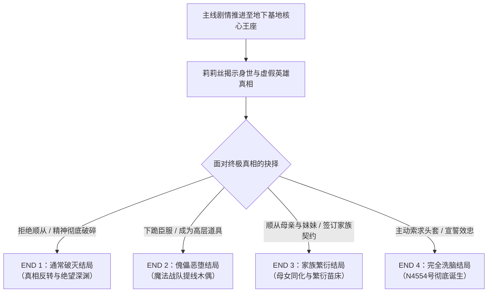

# ⚔️《圣剑战队～战斗员潜入的洗脑陷阱～》全剧情与全结局全攻略

> **游戏原名**：『聖剣戦隊-戦闘員が潜入する洗脳の罠-』（Sacred Sword Rangers / Combatant Factory）  
> **游戏类型**：日式战队特摄 / 潜入调查 / 恶之组织洗脑 / 恶堕多结局 RPG  
> **制作引擎**：RPG Maker MV（NW.js）  
> **本地目录**：`E:\ACG\聖剣戦隊-戦闘員が潜入する洗脳の罠`  
> **启动程序**：`Game.exe`  
> **全要素规模**：全 4 大结局分支、21 处完整 CG 与回想事件、全战队队员陷落事件、内置回想大厅一键全解锁机制。

---

## 📑 目录导航
1. [作品背景与核心角色设定](#一作品背景与核心角色设定)
2. [主线剧情核心脉络深度全解析](#二主线剧情核心脉络深度全解析)
   - [序幕：市中心迎击与秘密潜入](#1-序幕市中心迎击与秘密潜入)
   - [潜伏：伪装战斗员与组织日常](#2-潜伏伪装战斗员与组织日常)
   - [瓦解：战队同伴相继陷落](#3-瓦解战队同伴相继陷落)
   - [崩塌：残酷的身世与虚假正义](#4-崩塌残酷的身世与虚假正义)
3. [四大主线结局（END 1 ~ END 4）达成条件与结局详析](#三四大主线结局end-1--end-4达成条件与结局详析)
   - [END 1：通常破灭结局（真相反转与绝望深渊）](#end-1通常破灭结局真相反转与绝望深渊)
   - [END 2：傀儡恶堕结局（「魔法战队」提线木偶）](#end-2傀儡恶堕结局魔法战队提线木偶)
   - [END 3：家族繁衍结局（母女同化与繁衍苗床）](#end-3家族繁衍结局母女同化与繁衍苗床)
   - [END 4：完全洗脑结局（头套加冕与n4554号诞生）](#end-4完全洗脑结局头套加冕与n4554号诞生)
4. [全流程逐日任务与地图推进攻略](#四全流程逐日任务与地图推进攻略)
   - [Day 1：开场迎击 -> 潜入基地 -> 发电厂作战](#day-1开场迎击---潜入基地---发电厂作战)
   - [Day 2：工厂巡视与地下设施调查](#day-2工厂巡视与地下设施调查)
   - [Day 3：资金筹备与赞助商涉猎](#day-3资金筹备与赞助商涉猎)
   - [Day 4：外部联络断绝与决战莉莉丝](#day-4外部联络断绝与决战莉莉丝)
5. [全CG回想大厅（Map041）一键解锁与全节点对照表](#五全cg回想大厅map041一键解锁与全节点对照表)
   - [21处回想事件精确对照表](#1-21处回想事件精确对照表)
   - [内置回想大厅进入方式与一键解锁操作](#2-内置回想大厅进入方式与一键解锁操作)
   - [F12控制台调试秒通秘籍](#3-f12控制台调试秒通秘籍)

---

## 一、作品背景与核心角色设定

### 1. 核心角色设定
* **天羽绫音（Amaha Ayane / 主角）**：
  * **身份**：正义英雄组织「圣剑战队」的粉色战士兼王牌核心，擅长敏捷刺杀与鞭剑战斗。
  * **潜伏代号**：恶之组织女战斗员 **N4554号**。
  * **宿命秘密**：自幼便流淌着恶之组织的战斗员基因，所谓的英雄成长其实是恶之组织高层一手布下的长线棋局。
* **战队盟友**：
  * **红战士（队长）**：拥有极高的正义感与冲劲，但在突击行动中遭到干部黑虎伏击俘获。
  * **黄战士**：身材火辣的热情队友，在遗迹探索行动中被陷阱捕获并改造成木乃伊傀儡。
  * **蓝战士**：战队的技术与火力支援。
  * **白战士**：性格清冷、意志坚定的前线队员，在深入调查中被恶之组织捕获并进行残酷的深度洗脑改造。
  * **侦探酱（Detective）**：负责战队后勤情报收集与联络的外部侦探，在秘密基地外围调查时被反追踪俘虏。
* **恶之组织「黑夜幽灵」（Night Phantoms）**：
  * **干部首领·莉莉丝（Lilith）**：掌控基地运作、人造人流水线与精神洗脑装置的总支配者，手腕残忍且极具心理压迫感。
  * **大干部·黑虎（Generator Tiger / 发电机老虎）**：掌控电力与重工业改造设施的暴虐干部。
  * **女战斗员 N2417号**：绫音失踪已久的亲妹妹，已被彻底洗脑成为忠诚的组织基层战斗员。
  * **资深女战斗员 O1713号**：绫音与妹妹的亲生母亲，真实身份是潜伏人类社会二十余年的恶之组织老牌特工。

---

## 二、主线剧情核心脉络深度全解析

### 1. 序幕：市中心迎击与秘密潜入
故事开篇，繁华的市中心遭受恶之组织「黑夜幽灵」的大规模袭击。圣剑战队队长红战士因疏散不及陷入被动，天羽绫音作为粉色战士抢先突入战场，凭借利落的身手与鞭剑斩杀了怪人与杂兵。  
然而，战队始终无法彻底查清敌方主力基地位置。为了从根本上摧毁恶之组织的阴谋，绫音决定实施单兵潜伏渗透计划。她在公园的女厕内暗中制伏了一名落单的女战斗员，剥夺其紧身衣与遮面头套进行换装伪装，成功混入了隐藏于地底深处的「黑夜幽灵」秘密地下基地。

### 2. 潜伏：伪装战斗员与组织日常
进入地下基地后，绫音以女战斗员的标准口号与肢体语言掩饰身份，被编入基层宿舍区。她在大厅参加集结令，接受干部黑虎针对市中心电力枢纽的破坏任务指示。  
为了不暴露破绽并收集情报，绫音被迫承担起基层的各类苦差：包括在管理严苛的非法改造工厂巡视工人、前往受控区域收取保护费、甚至参与高层赞助商的接待服务。在基地内部，她亲眼目睹了庞大的人造人生产线、心智消除室与各种精神重塑装置，感受到恶之组织深不可测的控制力。

### 3. 瓦解：战队同伴相继陷落
随着潜伏深入，绫音逐渐与外界失联。在此期间，圣剑战队的其他成员在试图搜救她或打击恶之组织的过程中接连遭遇算计：
* **黄战士**在外部探查中被困，遭遇生物陷阱导致精神失控；
* **白战士**深入敌后遭遇重重围剿，被送入高强度精神改造装置彻底洗脑；
* **红战士**率队强袭基地发电厂，最终不敌大干部黑虎的压倒性力量而告负被擒；
* 负责场外情报支援的**侦探酱**亦被恶之组织的追踪网络锁定，断绝了战队与外界的最后联络。

### 4. 崩塌：残酷的身世与虚假正义
当绫音终于突破封锁来到基地核心禁区时，迎来的并非正义终结邪恶的决战，而是彻底击碎其人生信念的残酷真相：
1. **妹妹的同化**：在基地表现优异的战斗员N2417号，摘下面罩后赫然是她寻找已久的亲妹妹，且妹妹已对组织完全顺从；
2. **母亲的真面目**：资深战斗员O1713号竟然是抚养两姐妹长大的母亲。母亲平静地吐露，自己早在二十年前便是组织派遣到人类社会的潜伏间谍，当年的婚姻只是掩护，甚至父亲也是在察觉端倪后被母亲灭口；
3. **傀儡的正义**：莉莉丝冷笑着告诉绫音，所谓的「圣剑战队」英雄戏码，根本就是组织为了测试战斗员实战数据、消磨人类反抗意识而默许的产物。绫音自始至终流淌着恶之组织的血脉，她所坚持的正义英雄梦想不过是一场荒诞的滑稽剧。

---

## 三、四大主线结局（END 1 ~ END 4）达成条件与结局详析



### END 1：通常破灭结局（真相反转与绝望深渊）
* **剧情概况**：  
  在莉莉丝揭晓一切、母亲与妹妹现身劝降时，绫音的世界观彻底坍塌。她无法接受过去的崇高理想只是敌人的提线游戏，亦无法对杀害父亲的母亲释怀。在理智断裂与无限的绝望中，她瘫坐在地放弃了抵抗，作为败者被永远囚禁于基地深渊之中。
* **结局定性**：原版主线常规 BAD END，英雄信念与家族温情双重粉碎。

---

### END 2：傀儡恶堕结局（「魔法战队」提线木偶）
* **达成条件**：  
  在最终面谈中选择彻底向总司令莉莉丝俯首称臣，放弃作为天羽绫音的人格与独立意志。
* **剧情概况**：  
  圣剑战队被正式宣告废除。莉莉丝决定开启新一轮欺瞒人类社会的娱乐特摄企划——「魔法战队」。绫音被彻底剥离过去的记忆与自主情感，作为被高层操纵的空壳傀儡，穿上全新设计的戏服再度出现在人类城市中，以“假面英雄”的身份与恶之组织干部演出一场场虚伪的交战戏码，成为恶之组织玩弄人类社会的永恒木偶。
* **结局定性**：操纵恶堕结局，正义英雄彻底沦为恶势力的舞台戏子。

---

### END 3：家族繁衍结局（母女同化与繁衍苗床）
* **达成条件**：  
  选择顺应母亲（O1713）与妹妹（N2417）的规劝，达成组织家族契约，承担作为组织女性血脉的“特殊职责”。
* **剧情概况**：  
  莉莉丝认可了绫音在战斗员血统上的潜力。为了培育具有卓越潜能的新一代战斗员，绫音与母亲、妹妹一同被送入组织的后勤培育设施，成为专属的繁衍母体。在组织安排的高强度配种与环境同化下，三人的心智彻底融入了生物繁衍的本能之中，家族三人以怪诞的形式“永远生活在一起”。
* **结局定性**：家族同化结局，彻底退化为组织后代生产的人形苗床。

---

### END 4：完全洗脑结局（头套加冕与N4554号诞生）
* **达成条件**：  
  在受尽组织的精神洗脑与身心屈辱后，主动向莉莉丝乞求放下所有尊严与人性，请求戴上无名战斗员的头套。
* **剧情概况**：  
  绫音跪伏在地，莉莉丝亲手递上了象征抹杀自我的黑色战斗员头套。戴上头套的刹那，洗脑核心指令「为伟大的黑夜幽灵奉献一切」如潮水般涌入脑海，将绫音最后一丝人类理智彻底焚毁。曾经耀眼的圣剑战队王牌彻底消亡，取而代之的是只会发出怪声口号、盲目顺从任何命令的底层女战斗员——**N4554号**。
* **结局定性**：终极精神洗脑恶堕结局，自我意识完全湮灭。

---

## 四、全流程逐日任务与地图推进攻略

### Day 1：开场迎击 -> 潜入基地 -> 发电厂作战
1. **市中心战场（Map002）**：剧情战斗迎击怪人，熟悉基础操作，战斗难度极低，平A配合技能即可快速获胜。
2. **战队基地（Map003 / 004）**：与红战士、队长对话，触发潜入侦察构想。
3. **公园（Map005）与女厕（Map006）**：
   - 前往公园公共厕所区域，触发落单女战斗员事件。
   - 互动执行偷袭绞杀判定，夺取其战斗员紧身衣并换装。
4. **基地入口（Map007）与主大厅（Map008）**：
   - 换装后经由秘密通道进入组织基地，与门卫交互确认伪装成功。
   - 前往大厅集结，聆听大干部黑虎的「发电厂夜袭计划」。
5. **发电厂事件（Map012 / 019）**：
   - 借由耳内微型通讯器向战队发送电报。
   - 夜间潜入发电厂内部，目睹红战士强行突入并与黑虎决战，红战士战败被擒。

### Day 2：工厂巡视与地下设施调查
1. **战斗员宿舍（Map015 / 010）**：
   - 可以在个人宿舍休息推进时间，利用洗手间镜子随时进入回想大厅。
2. **任务布告栏（Map008 - EV029）**：
   - 接受「管理工厂被俘工人」任务。
3. **工厂（Map016 / 018）**：
   - 进入工厂内部视察，目睹黑帮与组织流水线作业。
   - 遭遇不良分子挑衅，经历首次服从度与隐忍考验。

### Day 3：资金筹备与赞助商涉猎
1. **布告栏新任务（Map008）**：
   - 接受「贫民窟收保护费」或「高级住宅区议员接待」任务。
2. **贫民窟（Map014）与富人区（Map033）**：
   - 前往目标区域与黑道、赞助商议员交涉，期间发生多起羞辱与顺从事件，潜伏心理防线逐渐被蚕食。
3. **实验室数据清理（Map045）**：
   - 接受清理电脑数据的任务，从中搜集到人造人研究日志与失踪少女档案。

### Day 4：外部联络断绝与决战莉莉丝
1. **侦探通讯事件（Map015 - EV013）**：
   - 宿舍通讯器再度响起，侦探酱表示追踪到了基地坐标但遭遇敌人包围，通讯在一阵杂音中中断。
2. **大厅警报（Map039）**：
   - 基地发生骚乱，全员前往大厅集合，得知战队外部据点已被连根拔起。
3. **地牢探监与首脑之室（Map030 -> Map040）**：
   - 前往地下监狱探视被囚禁洗脑的战队同僚，确信战队全军覆灭。
   - 步入莉莉丝宝座之间，触发核心真相反转剧情，依玩家对话选择分歧走向 **END 1 ~ END 4**。

---

## 五、全CG回想大厅（Map041）一键解锁与全节点对照表

游戏内置了极其实用的「回想大厅（Memory Room）」，位于地图 **Map041**。

### 1. 21处回想事件精确对照表

| 序号 | 触发事件/开关 | 对应CG资源标识 | 核心剧情节点与内容概述 |
| :---: | :---: | :---: | :--- |
| **01** | EV002 / Switch 47 | `StealthCG` | **潜入绞杀**：公园女厕偷袭女战斗员，夺取紧身服与头套 |
| **02** | EV004 / Switch 48 | `tentacleCG` | **地下触手**：基地地下深层遭遇生物触手怪陷阱 |
| **03** | EV005 / Switch 49 | `tigerCG` | **发电厂黑虎**：发电厂决战黑虎干部被捕获凌辱 |
| **04** | EV006 / Switch 50 | `purplestartCG` | **木马刑具**：主角绫音初次违纪遭受基地惩戒调教 |
| **05** | EV007 / Switch 52 | `factory2CG` | **人体流水线**：女战斗员批量改造与流水线生产实录 |
| **06** | EV008 / Switch 51 | `factoryCG` | **工厂黑帮**：工厂监督巡视期间遭受暴力欺凌 |
| **07** | EV009 / Switch 53 | `oral sex2CG` | **赞助商招待**：富人区政要与赞助商秘密招待事件 |
| **08** | EV010 / Switch 54 | `footjobCG` | **干部足奉仕**：莉莉丝总司令的高傲践踏与服侍 |
| **09** | EV011 / Switch 55 | `oralsexCG` | **母亲O1713事件**：与生母一同接受干部的苛刻惩戒 |
| **10** | EV012 / Switch 56 | `TSCG` | **TS时间停止催眠**：星野未来遭遇装置洗脑调教 |
| **11** | EV013 / Switch 57 | `yellowCG` | **黄战士堕落**：黄战士遭遇木乃伊陷阱彻底失控沦陷 |
| **12** | EV014 / Switch 58 | `danceCG` | **俱乐部洗脑舞蹈**：基地暴露性洗脑舞蹈心理重塑 |
| **13** | EV015 / Switch 60 | `witheCG` | **白战士陷落①**：白战士潜入失败遭受严酷拷问 |
| **14** | EV016 / Switch 59 | `detectiveCG` | **侦探受难**：场外支援侦探酱被捕获调教事件 |
| **15** | EV017 / Switch 61 | `withe2CG` | **白战士陷落②**：白战士心智消除彻底改造成战斗员 |
| **16** | EV018 / Switch 62 | `masturbationCG` | **自我瓦解**：绫音在药物与欲望催化下的身心沉沦 |
| **17** | EV019 / Switch 63 | `redCG` | **红战士终局**：正义队长红战士彻底战败与精神崩溃 |
| **18** | EV020 / Switch 64 | `endCG` | **结局 1（END 1）**：莉莉丝揭开身世真相，英雄梦碎 |
| **19** | EV021 / Switch 65 | `END2CG` | **结局 2（END 2）**：傀儡英雄「魔法战队」企划启动 |
| **20** | EV022 / Switch 66 | `END3CG` | **结局 3（END 3）**：绫音、母亲与妹妹母女三代配种同化 |
| **21** | EV023 / Switch 67 | `END4CG` | **结局 4（END 4）**：戴上头套放弃思考，N4554号诞生 |

---

### 2. 内置回想大厅进入方式与一键解锁操作
1. **正常进入路径**：在游戏任意进度下，回到自己的宿舍（Map015），调查右上方的**穿衣镜/传送水晶（EV012）**，系统会提示“是否进入回忆大厅”，选择确认即可传送到 **Map041**。
2. **官方一键全解锁水晶**：
   - 传送进入回想大厅（Map041）后，径直走向坐标 `(12, 9)` 的水晶装置（**EV003**）。
   - 调查该水晶，系统会执行内部指令：打开 **Switch 45（全CG解锁）** 并将 **Switch 46 ~ 67** 全部置为有效。
   - 大厅内所有原本灰暗的 21 处回想水晶将全部点亮，无需通关即可随时重温全部剧情与CG！

---

### 3. F12控制台调试秒通秘籍
若在游戏任意场景中想要随时调出全要素，可按下键盘 **`F12`**（或修改启动参数开启开发者工具），在 Console 控制台内输入以下 JavaScript 代码并回车：

```javascript
// 一键激活全CG与回想开关 (Switch 45 ~ 67)
for (let i = 45; i <= 67; i++) {
    $gameSwitches.setValue(i, true);
}
// 瞬间传送至回想大厅 (Map 041)
$gamePlayer.reserveTransfer(41, 10, 8, 2, 0);
console.log(">> 全CG与回想已全部解锁，并已传送到回想大厅！");
```
输入后主角将直接被传送到回想大厅，所有事件立即可看。
